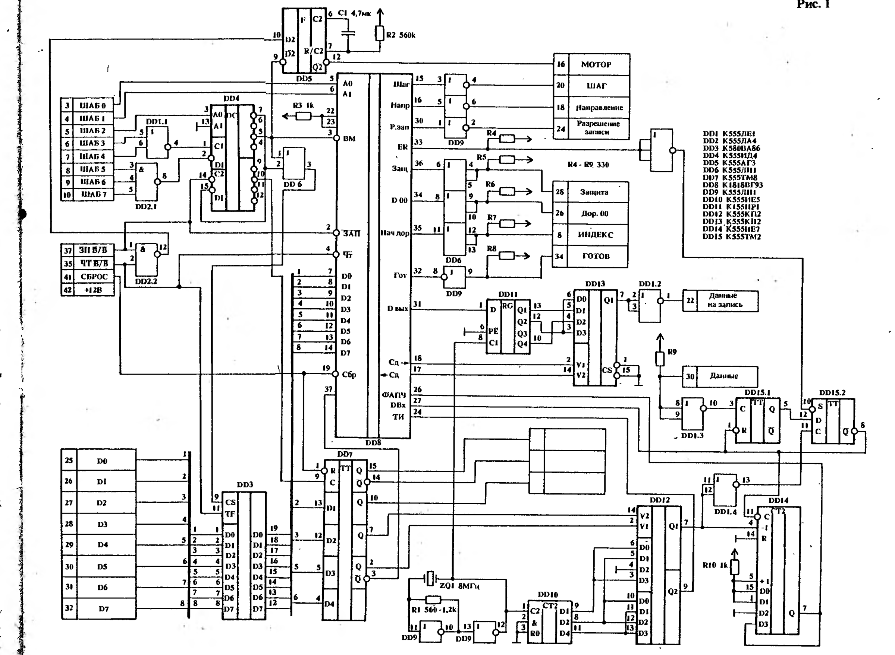
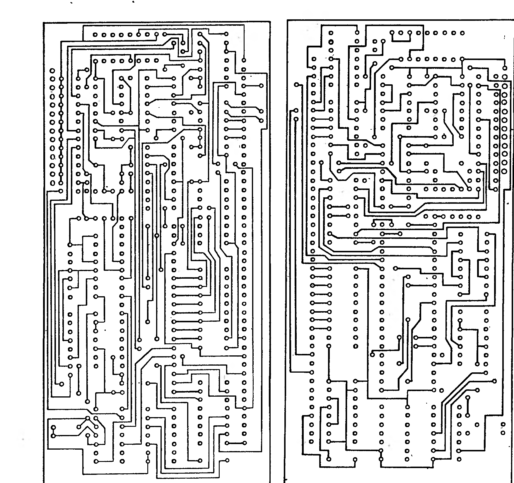
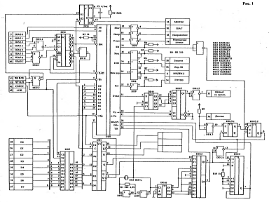

# Контроллер дисковода «Беларусь»: доработанная схема для ПК «Вектор»

Доработанный контроллер дисковода для ПК «Вектор» из журнала «Радиолюбитель». В каталоге — скан журнальной публикации М. Чеботарева («Усовершенствованная схема контроллера дисковода для ПК „Вектор“», «РЛ» №11, 1992, с. 9, 10) и библиографическая ссылка на заметку В. Кузьмина «Возвращаясь к напечатанному» («РЛ» №2, 1996, с. 7), в которой исправлены ошибки повторения.

## Источники

| Файл                 | Содержание                                                                                                                                                   |
| -------------------- | ------------------------------------------------------------------------------------------------------------------------------------------------------------ |
| [fdd.djvu](fdd.djvu) | Скан «Радиолюбитель» №11, 1992: две страницы (с. 9 и с. 10), 300 dpi, 2456×3283, без текстового слоя. Тот же скан, что в каталоге «Радиолюбителя» (см. ниже) |
| [fdd.png](fdd.png)   | Растровое изображение — предпросмотр из исходного материала, 384×288                                                                                         |

Текст обеих публикаций расшифрован в каталоге журнала:

- [М. Чеботарев, «Усовершенствованная схема контроллера дисковода для ПК „Вектор“», «РЛ» №11/1992, с. 9, 10](../../radiolubitel/rl/1992_11_p09/README.md);
- [В. Кузьмин, «Возвращаясь к напечатанному», «РЛ» №2/1996, с. 7](../../radiolubitel/rl/1996_02_p07/README.md).

Страницы скана `fdd.djvu` сверены с файлами `rl_1992-11-p09.djvu` и `rl_1992-11-p10.djvu` того же каталога: это те же растры страниц 9 и 10.

Схема в каталоге журнала вырезана из полосы крупным фрагментом:

## Что доработано

Распространённая среди радиолюбителей стандартная схема контроллера, по утверждению автора, имеет немало недостатков; в предлагаемом варианте (рис. 1) они устранены. В схему введены:

- **предкомпенсация записи** — предварительная фазовая коррекция сигнала записи;
- **синхронизация приёма данных** — по образцу схемы контроллера «Балтик» («РЛ» №5/1991).

Печатная плата разработана Балабановичем В.В. (рис. 2). При форматировании дискет на контроллере, изготовленном по стандартной схеме, наибольшее число ошибок выявилось на дискетах «ИЗОТ» — на них и отрабатывалась схема.

## Предкомпенсация записи

Количество ошибок резко возрастает, начиная с 50-й дорожки. Причина — фазовые искажения при воспроизведении: из-за перекрытия соседних импульсов тока воспроизведения их вершины сдвигаются в сторону большего временного интервала между импульсами. Компенсация при записи заключается в уменьшении более короткого интервала между импульсами при переходе к интервалу большой длительности.

Схема предкомпенсации выполнена на двух микросхемах — К555ИР1 и К555КП2 (в подписи к рис. 1 — регистр сдвига DD11 K155ИР1 и мультиплексор DD13 K555КП2). Контроллер 1818ВГ93 на выходах 17 и 18 выдаёт сигналы, показывающие направление корректировки выходных импульсов при записи; они и управляют схемой предкомпенсации.

- Данные с выхода 31 К1818ВГ93 поступают на вход регистра DD11; на тактовый вход регистра заведена частота 8 МГц, поэтому задержка импульсов на каждом следующем выходе регистра — 125 нс.
- В нормальном положении используется 2-й выход регистра. В зависимости от сигналов с контроллера импульс на КП2 проходит с первого или с четвёртого выхода, и задержка уменьшается на 125 нс или увеличивается на 250 нс.
- По опыту эксплуатации дисководов японского производства «ТЕАС» при таких сдвигах импульсов во времени получается минимум ошибок. При применении дисководов других фирм задержки могут быть другими — их подбирают изменением тактовой частоты и выбираемых выходов регистра.

Прочие элементы рис. 1 по подписи к нему: дешифратор адреса DD4 K555ИД4, элементы DD1 K555ЛЕ1 и DD2 K555ЛА4, формирователь адреса DD3 K580ВА86, одновибратор предкомпенсации DD5 K555АГ3 (C1 4,7 мк, R2 560k), элементы DD6/DD9 K555ЛИ1 на выходах МОТОР/ШАГ/Направление/Разрешение записи/Защита/Дор.00/ИНДЕКС/ГОТОВ (резисторы R4–R9 330 Ом), кварцевый генератор ZQ1 8 МГц с DD10 K555ИЕ5 и DD14 K555ИЕ7 (R1 560–1,2к, R10 1к), триггеры DD7/DD12 K555ТМ8 и DD15 K555ТМ2. Шины контроллера — ШАБ0–7 и D0–D7.

## Синхронизация приёма данных

Синхронизация выполнена на DD15 (К555ТМ2). Раньше сигнал с дисковода поступал на одновибратор, формировавший импульс заданной длительности, и эти импульсы не были синхронизированы с процессами в контроллере.

В доработанной схеме:

1. импульс, приходящий от дисковода, предварительно запоминается в первом триггере и по срезу тактового импульса выдаётся на вход 27 контроллера;
2. по фронту тактового импульса переключается счётчик DD14 (К555ИЕ7);
3. с выхода счётчика синхронизирующие импульсы поступают на контроллер — таким образом в контроллере разделяются импульсы данных и строб-импульсы.

## Влияние на количество ошибок

| Вариант                                    | Ошибок при форматировании |
| ------------------------------------------ | ------------------------- |
| Исходная схема                             | 120                       |
| Введены временные задержки                 | 30                        |
| Введена только синхронизация приёма данных | 60                        |
| Обе доработки вместе                       | 5                         |

На дискетах других фирм ошибок не было. После размагничивания головок дисковода ошибки исчезли и на дискетах «ИЗОТ».

## Адресация портов

При изменении схемы адресация портов оставлена прежней.

**1. Адрес порта = 000111хх (1C, 1D, 1E, 1F)** — запись/чтение управляющего слова в триггер ТМ8; данные — управляющее слово.

| D7  | D6  | D5  | D4  | D3  | D2   | D1  | D0  |
| --- | --- | --- | --- | --- | ---- | --- | --- |
| XX  | XX  | DD  | DD  | XX  | Side | AB  | XX  |

- D7, D6, D3, D0 (XX) — свободны;
- D5, D4 (DD) — плотность записи;
- D2 (Side) — выбор стороны дисковода;
- D1 (AB) — выбор дисковода.

**2. Адреса обращения к 1818ВГ93:**

| Порт | Код      | Чтение       | Запись     |
| ---- | -------- | ------------ | ---------- |
| 1B   | 00011011 | Pr состояния | Pr команд  |
| 1A   | 00011010 | Pr дорожки   | Pr дорожки |
| 19   | 00011001 | Pr сектора   | Pr сектора |
| 18   | 00011000 | ДАННЫЕ       | ДАННЫЕ     |

Сокращение «Pr» приведено как в оттиске и в расшифровке публикации.

## Печатная плата

Плата разработана Балабановичем В.В. — рис. 2 публикации; в каталоге журнала приведён вырезанный фрагмент полосы:

## Уточнения В. Кузьмина (1996)

При повторении контроллера были обнаружены ошибки («РЛ» №2, 1996, с. 7):

- 10-й контакт разъёма дисковода должен быть соединён с 15-й ножкой микросхемы DD7, 12-й — с 14-й, 32-й — с 10-й;
- 1-я и 15-я ножки микросхемы DD12 соединяются с общим проводом;
- выход логического элемента DD2.1 имеет не 8-й, а 6-й номер;
- номинал резистора R4 — 10 кОм, резисторов R5…R8 — 1 кОм;
- сигналы выбора дисковода DS0, DS1 приходят на разъём непосредственно с регистра управления DD7, из-за чего светодиод дисковода не гаснет и тогда, когда обращения к дисководу нет. Недостаток устраняется доработкой по рисунку в заметке.

Рисунок к заметке 1996 года в этом каталоге отсутствует — он есть в каталоге журнала: [фрагмент схемы с доработкой](../../radiolubitel/rl/1996_02_p07/README.md).

