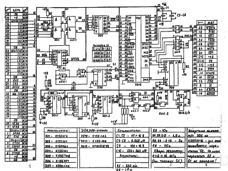

# Контроллер дисковода (Омск): схема

Принципиальная схема контроллера дисковода для ПЭВМ [«Вектор-06Ц»](../../README.md) и [«Криста-2»](../../../krista2/README.md). В каталоге только изображение схемы: текстового описания, перечня элементов, методики сборки и настройки, а также файлов ПЗУ или образа дискеты здесь нет.

## Файл

| Файл                         | Что это                                                                                                                                                     |
| ---------------------------- | ----------------------------------------------------------------------------------------------------------------------------------------------------------- |
| [FDD_OMSK.png](FDD_OMSK.png) | Растровое изображение 384 × 288 пикселей, PNG, 8 бит на канал RGB, 192 оттенка серого (признак пересэмплирования), 111,8 КБ; штриховое линейное изображение |

В метаданных PNG записано разрешение 72 dpi — это копия для просмотра на экране, а не скан для печати. Время изменения файла — 5 октября 2013 года; дата 1995 в карточке каталога относится к документу, а не к файлу.

## Ограничения

- Разрешение 384 × 288 пикселей. При таком масштабе обозначения микросхем, номера выводов, номиналы и подписи практически не читаются, поэтому в README они не приводятся и не пересказываются: единственный достоверный источник — само изображение. Для изготовления платы нужен оригинал чертежа крупнее.
- Изображение растровое, без текстового слоя: подписи нельзя выделить или найти поиском. Линии сглажены, мелкие элементы при уменьшении могли пострадать; исходного разрешения в файле нет.
- В каталоге нет ни описания работы контроллера, ни перечня элементов, ни рекомендаций по подключению — поэтому этих сведений нет и в README: любые пересказы подписей с такого растра были бы догадкой.
- Номер `567`, дата `1995` и автор `gepard` взяты из карточки каталога. Выходные данные на самом изображении в этом масштабе не читаются, поэтому проверить их по чертежу нельзя.

Другие контроллеры дисковода — в разделе [«Контроллеры дисковода»](../README.md).
