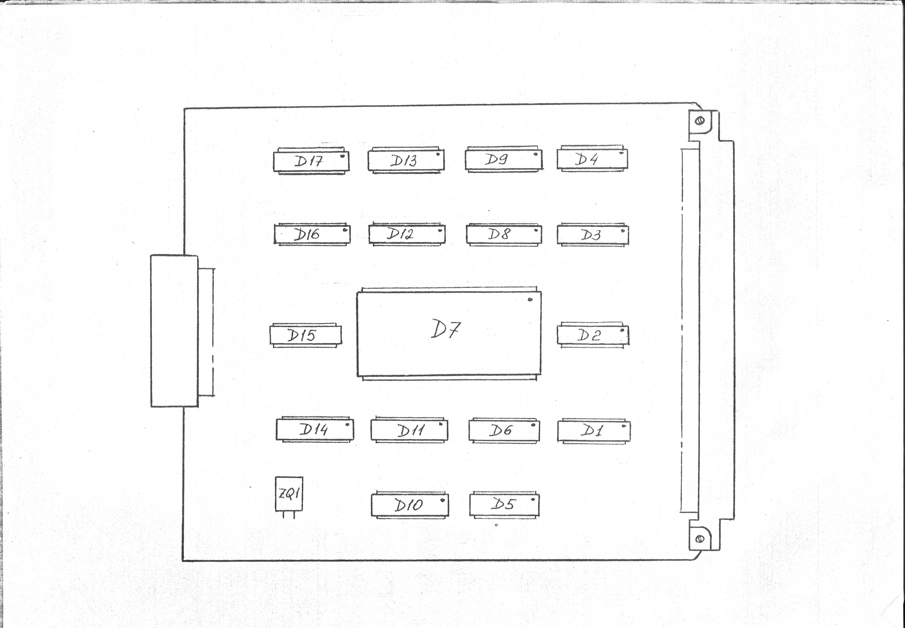
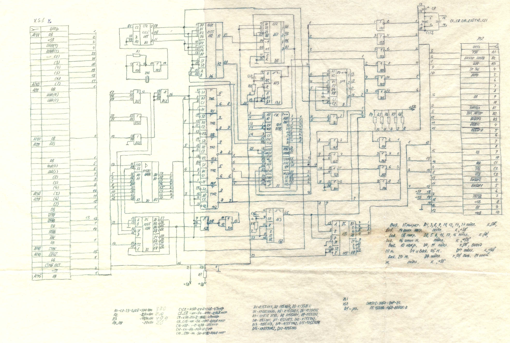
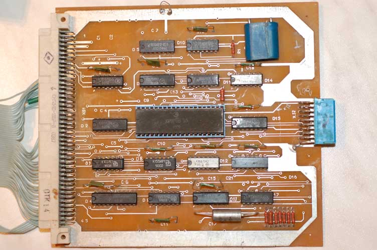

# Контроллер дисковода «РС-Инвосервис»: руководство по настройке

Руководство фирмы «РС-Инвосервис» (Волгоград, 1991 г.) к контроллеру дисковода для БПЭВМ «Вектор-06Ц»: общее описание работы контроллера, порядок сборки и настройки, статическая проверка платы и порядок подключения. Объём — 8 страниц: обложка и 7 страниц текста. На обложке: «БПЭВМ „ВЕКТОР-06Ц“», «Фирма „РС-Инвосервис“», «КОНТРОЛЛЕР ДИСКОВОДА. Руководство по настройке», «ВОЛГОГРАД — 1991»; в колонтитулах страниц — «РС-ИНВОСЕРВИС КОНТРОЛЛЕР» и «ВОЛГОГРАД 1991».

В каталоге лежит скан руководства, а также отдельные листы: схема контроллера, схема, вычерченная от руки, рисунок платы и фотография. Сама схема в скан не входит: текст ссылается на неё, но приводит только словесные указания.

## Источники

| Файл                                                 | Что это                                                                                                                                             |
| ---------------------------------------------------- | --------------------------------------------------------------------------------------------------------------------------------------------------- |
| [fdc_kish.djvu](fdc_kish.djvu)                       | Скан руководства: 8 страниц по 2432 × 3428 точек (в файле заявлено 600 dpi), чёрно-белый (JB2), без текстового слоя, без аннотаций и без метаданных |
| [fdc_kish_sch.jpg](fdc_kish_sch.jpg)                 | Схема контроллера, 5889 × 4481 точек: рисунок с обозначениями микросхем D1…D15 и выводами системного разъёма                                        |
| [fdc_kish_sch_by_hand.jpg](fdc_kish_sch_by_hand.jpg) | Схема, вычерченная от руки, 3941 × 2658 точек; рукописные подписи при распознавании не читаются                                                     |
| [fdc_kish_mon.jpg](fdc_kish_mon.jpg)                 | Рисунок с позиционными обозначениями микросхем, 3507 × 2436 точек                                                                                   |
| [fdc_kish_foto.jpg](fdc_kish_foto.jpg)               | Фотография, 752 × 500 точек                                                                                                                         |

Весь текст ниже набран по скану `fdc_kish.djvu`: текстового слоя в нём нет, поэтому текст распознан заново. Места, которые читаются неуверенно, перечислены в разделе «Замечания к источникам».

## Иллюстрации

## Общее описание (стр. 1–2)

Контроллер дисковода — электронная схема для обмена информацией между компьютером и накопителем на гибких магнитных дисках, а также для программирования режимов работы дисковода. Собирается на печатной плате размером 140 × 150 мм и подключается к системному разъёму «ВУ» ПЭВМ «Вектор-06Ц». К одному контроллеру может быть подключено до четырёх дисководов, но существующая операционная система «МикроДОС» поддерживает работу только с двумя.

Работу «Вектора-06Ц» с гибкими дисками обеспечивают две операционные системы — «МикроДОС» и «CP/M-39». Для работы с «МикроДОС» помимо контроллера дисковода необходимо, чтобы в конфигурации ПЭВМ присутствовал электронный диск; «CP/M-39» электронный диск не поддерживает и работает только с одним или двумя дисководами.

Компьютер работает с контроллером как с внешним устройством: используются шина данных, младшие разряды шины адреса, сигналы чтения устройства ввода-вывода (ЧТВВ) и записи в устройство ввода-вывода (ЗПВВ), а также сигнал «системный сброс», который переводит все микросхемы контроллера в исходное состояние.

## Узлы контроллера (стр. 2–4)

| Узел (по источнику)             | Микросхемы             | Назначение                                                                                                                                             |
| ------------------------------- | ---------------------- | ------------------------------------------------------------------------------------------------------------------------------------------------------ |
| Дешифратор адреса контроллера   | D1.4, D2, D3.2         | сравнивает код на шине адреса с адресом контроллера при наличии ЧТВВ или ЗПВВ                                                                          |
| Узел выбора БИС контроллера     | D2, КР1818ВГ93         | низкий уровень с вывода 5 D2 идёт на вывод 3 БИС (выбор кристалла) и включает её в работу                                                              |
| Включение шинного формирователя | D1.3, D3.4, D4         | тот же сигнал с вывода 5 D2 поступает на вывод 11 D1.3; на выводе 13 D3.4 появляется низкий уровень, который идёт на вывод 9 D4 и включает D4 в работу |
| Шинный формирователь            | D4                     | в зависимости от уровня на выводе 11 настраивается на передачу от компьютера к контроллеру или обратно                                                 |
| Тактовый генератор              | D10.5, D10.6           | выдаёт прямоугольные импульсы частотой 8 МГц                                                                                                           |
| Счётчик тактовых частот         | D11                    | на выводах 9, 8, 11 — сигналы с частотами 4, 2 и 1 МГц соответственно                                                                                  |
| Мультиплексор тактовой частоты  | D6                     | переключает тактовую частоту при различных режимах работы контроллера                                                                                  |
| Формирователь импульсов данных  | D13.1                  | из импульсов, приходящих с магнитной головки дисковода, формирует импульсы данных для входа данных БИС контроллера и для счётчика D5                   |
| Формирователь «строба данных»   | D5 (счётчик)           | по импульсам с вывода 11 D5 формируются импульсы «строб данных», которые поступают на D7                                                               |
| Запуск двигателя дисковода      | D13.2                  | ждущий мультивибратор, запускаемый при любом обращении компьютера к контроллеру                                                                        |
| Дешифратор выбора накопителя    | D15                    | на входы 5 и 13 поступает двоичный код; низкий уровень появляется на одном из выходов 4, 5, 6, 7 и определяет выбранный дисковод                       |
| Регистр сдвига данных записи    | D8                     | формирует сигнал данных для записи на диск                                                                                                             |
| Регистр слова состояния         | D9, D12, D14 (К155ТМ2) | хранит номер выбранного накопителя, переключение тактовой частоты и выбор головки дисковода                                                            |

Пояснения источника к отдельным узлам:

- Длительность импульса, формируемого D13.1, зависит от цепочки R2, C17. Для устойчивого считывания данных часто возникает необходимость подобрать конденсатор C17 под конкретную БИС контроллера КР1818ВГ93.
- Импульс запуска двигателя, формируемый D13.2, можно продлевать повторными запускающими импульсами: двигатель дисковода будет вращаться столько времени, сколько необходимо для полного выполнения требуемых от контроллера операций. Длительность запуска после одного обращения определяется цепочкой R3, C16.
- Работа дешифратора D15 разрешается только после появления высокого уровня на его выводе 6, то есть только после запуска двигателя дисковода.
- В триггеры D9, D12, D14 записываются сигналы, определяющие номер выбранного накопителя (D9, выводы 6 и 8), переключение тактовой частоты контроллера (D12.2 и D14.1, выводы 8 и 6 соответственно) и выбор головки дисковода (D14.2, вывод 8). По сигналу «сброс» системной шины эти триггеры обнуляются; запись информации в них происходит в первую очередь при любом обращении к контроллеру.

## Порядок сборки (стр. 5–6)

Сборка предполагается на стандартной печатной плате, которую можно заказать по адресу: 460074, г. Волгоград-74, а/я 40, «РС-Инвосервис».

1. Перед началом сборки прозвонить на печатной плате цепь питания +5 В на предмет отсутствия короткого замыкания на землю.
2. При сборке особое внимание уделить правильности впаивания микросхем, разъёма системной шины и конденсаторов по питанию 0,1 (0,068) мкФ. На плате подписаны места установки конденсаторов, но из-за большого количества отверстий для перехода с одной стороны платы на другую не всегда ясно, какие именно ставить; поэтому перед впаиванием конденсатора нужно проверить, что действительно один его вывод пойдёт на землю, а другой — на +5 В.
3. Микросхему КР1818ВГ93 лучше установить на панельку.
4. После сборки на плате необходимо сделать следующие изменения и дополнения:

| №   | Изменение                                                                                           |
| --- | --------------------------------------------------------------------------------------------------- |
| 1   | вывод 13 микросхемы D3 соединить с выводом 9 микросхемы D4                                          |
| 2   | вывод 14 D3 соединить с выводом 8 D1                                                                |
| 3   | вывод 5 D3 соединить с выводом 7 системного разъёма                                                 |
| 4   | вывод 6 D3 соединить с выводом 6 системного разъёма                                                 |
| 5   | вывод 9 D2 соединить с выводами 9 и 10 D1                                                           |
| 6   | вывод 13 D2 соединить с выводом 5 системного разъёма                                                |
| 7   | вывод 6 D2 соединить с выводом 11 D1                                                                |
| 8   | вывод 1 D15 соединить с выводом 5 D15                                                               |
| 9   | вывод 1 D15 соединить с выводами 5 и 15 этой же микросхемы и через резистор 2 кОм подключить к +5 В |
| 10  | вывод 7 D5 соединить с выводом 9 D5                                                                 |
| 11  | вывод 8 D5 соединить с выводом 10 D5                                                                |
| 12  | вывод 7 D11 замкнуть на землю                                                                       |
| 13  | вывод 14 D14 замкнуть на +5 В                                                                       |
| 14  | выводы 2, 3, 10, 14 микросхемы D13 замкнуть между собой и подключить через резистор 2 кОм на +5 В   |
| 15  | вывод 9 D13 соединить с выводом 3 D12                                                               |
| 16  | вывод 21 D7 подключить к +5 В                                                                       |
| 17  | вывод 22 D7 подключить через резистор 2 кОм на +5 В                                                 |

После того как все изменения сделаны, нужно опять прозвонить цепь +5 В на землю.

## Проверка в статическом режиме (стр. 6–7)

Проверка работоспособности контроллера в «статическом» режиме позволяет выявить возможные замыкания между дорожками или бракованные элементы микросхем.

1. Вынуть из панельки микросхему КР1818ВГ93.
2. Не подключая контроллер к «Вектору», подать на него напряжение питания +5 В.
3. Замерить потребляемый ток — он не должен превышать 0,5 А.
4. Проверить работу тактового генератора: на выводе 10 микросхемы D10 должны присутствовать прямоугольные импульсы частотой 8 МГц.
5. Проверить работу счётчика D11: на выходах 9, 8, 11 должны присутствовать импульсы с частотой 4, 2, 1 МГц соответственно.
6. Проверить наличие прямоугольных импульсов на выводах 7 и 9 мультиплексора D6.
7. Проверить наличие прямоугольных импульсов на выводе 7 счётчика D5.
8. На выводе 4 элемента D13.1 должен быть высокий уровень.
9. На выводе 5 элемента D15.2 должен быть низкий уровень.
10. Подать кратковременно низкий уровень на 44-й вывод системного разъёма (замкнуть его проводком на землю) и проверить, установились ли в исходное состояние триггеры D9, D12, D14 (высокий уровень на выводах 6 и 8 каждого триггера).
11. На выводе 9 микросхемы D4 — высокий уровень, на выводе 11 — средний (2,5 В), так как этот вывод идёт только на системный разъём и в данный момент никуда не подключён.
12. На выводах 4, 5, 6, 7, 9, 10, 11, 12 микросхемы D2, а также на выводах 4, 5, 6, 7 микросхемы D15 должны быть высокие уровни.
13. Проверить уровни логических сигналов непосредственно на выводах системного разъёма: на всех выводах, которые куда-либо подключены, должен быть средний уровень, на неподключённых — низкий.
14. Проверить каждый вывод системного разъёма на отсутствие замыканий с соседними выводами, а также на землю и на +5 В — кроме тех выводов, которые по схеме идут на землю или на питание.
15. Проверить, не замыкают ли на землю выводы 36 и 39 системного разъёма; если замкнуты, необходимо разорвать эти связи.

Если на какой-то микросхеме сигнал не соответствует указанному в руководстве, нужно проверить эту цепь на отсутствие замыканий с другими сигналами и в крайнем случае заменить микросхему. Проверка сигналов на системном разъёме позволяет избежать нарушения нормальной работы «Вектора» при подключении к нему платы контроллера.

## Подключение и запуск (стр. 7–8)

- При подключении к «Вектору» одновременно электронного диска и контроллера дисковода электронный диск должен запитываться от блока питания «Вектора», а для питания контроллера необходимо использовать отдельный блок питания, от которого будет запитываться и сам дисковод. При этом на плате контроллера необходимо перерезать дорожки, идущие к 2-му и 44-му выводам системного разъёма (+5 В).
- Блок питания, от которого запитывается контроллер и дисковод, должен иметь два канала с напряжением +5 В и +12 В и током не менее 1,2 А в каждом канале.
- После выполнения предыдущих пунктов необходимо распаять кабель, соединяющий плату контроллера и дисковод. Создаваемый контроллером интерфейс и системное программное обеспечение «Вектора» обеспечивают его работу совместно с двухсторонними 80-дорожечными дисководами типа ЕС5Е23.01 (Болгария) или TEAC (Япония).
- Затем подключить контроллер к «Вектору» (с электронным диском или без него, в зависимости от того, какой операционной системой вы располагаете — «МикроДОС» или «CP/M-39») и включить питание. Если появилась нормальная карта загрузки, значит контроллер, по крайней мере, не мешает работать самому «Вектору».
- Загрузка системы. Наиболее удобный вариант — когда в «Векторе» предварительно произведена замена микросхемы со старым начальным загрузчиком (К556РЕ5) на микросхему с новым начальным загрузчиком (К556РТ7 или К573РФ2). В этом случае достаточно вставить в дисковод дискету с записанной на ней операционной системой «МикроДОС-2», нажать кнопки «ВВОД»+«БЛК» — контроллер должен загрузить операционную систему, — а затем «СБР»+«БЛК» для её запуска.
- В случае со старым начальным загрузчиком операционная система «МикроДОС» загружается с магнитофона и после этого запускается, при этом необходимо, чтобы в дисководе всё-таки была вставлена дискета, так как после запуска система обращается к диску для чтения каталога.
- Если система загрузилась нормально, первым делом нужно попробовать отформатировать чистые диски и поставить на них систему (как это делается — см. описание «МикроДОС»).
- Если при форматировании появляется большое количество ошибок (на новых дискетах), необходимо подобрать конденсатор C17 в пределах 180–460 пФ (начальное значение — 30 пФ).
- Контроллер, собранный согласно схеме и из исправных деталей, начинает работать сразу.

## Замечания к источникам

- Год на обложке пропечатан с дефектом (читается как «19 9…»); 1991 г. указан в нижних колонтитулах всех страниц.
- Маркировка микросхемы со старым начальным загрузчиком в скане читается неуверенно — «К556РЕ5»; наименования нового загрузчика («К556РТ7» или «К573РФ2») читаются увереннее.
- Скан `fdc_kish.djvu` (8 страниц) не имеет текстового слоя, аннотаций и метаданных: весь текст распознан заново. Разбивка на разделы соответствует заголовкам источника — «Общее описание работы контроллера дисковода БПЭВМ „ВЕКТОР-06Ц“» и «Порядок сборки и настройки контроллера»; номера страниц источника в заголовках README указаны в скобках.
- В тексте источника позиционные обозначения микросхем набраны латинской `D` с номером элемента через точку: `D1.4`, `D3.2`, `D3.4`, `D10.5`, `D13.1`, `D15.2` и т. д. Скан низкого качества, и при распознавании `D` путается с `0`, а `В` — с `8` («+58» вместо «+5 В»). В README обозначения и напряжения приведены в исправленном виде; остальные неоднозначные места перечислены ниже.
- Номера выводов и элементов микросхем приведены как в скане. Пункты 8 и 9 списка изменений в скане оба начинаются с «вывод 1 D15» (второй раз — вместе с выводами 5 и 15); оба пункта оставлены как прочитаны, отличить опечатку источника от двух последовательных доработок по скану нельзя.
- Адрес для заказа платы в скане читается как «460074 г. Волгоград-74, а/я 40, „РС-Инвосервис“»; вторая цифра индекса различается неуверенно (460074 / 400074). Начертание марки фирмы в колонтитулах — «РС-ИНВОСЕРВИС».
- Тип болгарского дисковода в скане читается неуверенно: «ЕС5Е23.01» (в другом прочтении — «ЕС5Э325.01»); японский указан как «TEAC».
- Начальное значение ёмкости C17 в скане набрано неразборчиво (читается как «30 пФ» или «33 пФ»), при этом рекомендуемый диапазон подбора — 180–460 пФ.
- Номер вывода системного разъёма для сигнала «системный сброс» (п. 10 статической проверки) и для +5 В (раздел о подключении) в скане читается одинаково — «44». Возможно, один из них — «14»: цифры 1 и 4 в наборе различаются плохо. Нумерация остальных выводов разъёма (36, 39, 7, 6, 5) читается уверенно.
- Микросхема контроллера в разных местах скана набрана по-разному: «КР1818ВГ93» и с дополнительным знаком в конце маркировки; в README везде оставлено «КР1818ВГ93».
- Входы дешифратора D15 в скане читаются как «5 и 13» (во втором прочтении — «5 и 15»); вывод разрешения — «6».
- Схема, на которую ссылается текст, в скан не входит. Отдельные листы в каталоге (`fdc_kish_sch.jpg`, `fdc_kish_sch_by_hand.jpg`, `fdc_kish_mon.jpg`, `fdc_kish_foto.jpg`) — самостоятельные изображения без заголовков и подписей; их назначение указано по именам файлов. Рисунок `fdc_kish_sch.jpg` содержит обозначения микросхем D1…D15 и подписи выводов системного разъёма, но перечень элементов и подписи к нему в изображениях не читаются.
- В общем указателе раздела этот вариант подписан как «Кишинёв», однако на обложке и в колонтитулах скана стоит фирма «РС-Инвосервис» (Волгоград, 1991). README описывает только то, что напечатано в самом руководстве.

## Другие варианты

- [Контроллеры дисковода](../README.md) — общий указатель раздела.
