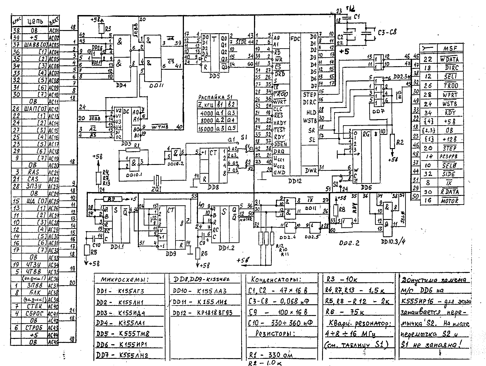

# Контроллер дисковода «Спейс-Гепард» (Омск)

Контроллер НГМД для ПЭВМ [«Вектор-06Ц»](../../README.md) и [«Криста-2»](../../../krista2/README.md). В комплект входят плата контроллера, схема замены Начального Загрузчика (микросхема D9; германиевые диоды типа Д9 идут в комплекте) и дискета с МикроДОС и утилитами. Документация омская: на титуле описания ОС стоит «ОМСК — 93, 94, 95», даты текстовых файлов — 7 сентября 1995 года.

Каталог содержит три текстовых документа и изображение схемы. Перечня элементов, файлов ПЗУ и образа дискеты в нём нет.

| Файл                         | Содержание                                                                                                                                        |
| ---------------------------- | ------------------------------------------------------------------------------------------------------------------------------------------------- |
| [samodel.txt](samodel.txt)   | «Методика сборки и настройки контроллера дисковода „Spase-Gepard“»: принцип работы, порядок сборки, проверка, статистика запуска                  |
| [recomcon.txt](recomcon.txt) | «Рекомендации по подключению контроллера дисковода к ПЭВМ „Вектор-06Ц“, „Криста-2“»: порядок подключения, работа с дискетой, поиск неисправностей |
| [control.txt](control.txt)   | «Описание МикроДОС и программ, входящих в комплект»: состав дискеты, команды и утилиты ОС, обмен с магнитной лентой                               |
| [fdd_omsk.gif](fdd_omsk.gif) | Принципиальная схема: чёрно-белый штриховой рисунок, растровый GIF 2164 × 1631                                                                    |

Тексты — CP866 с переводами строк CRLF. В `control.txt` есть Escape-последовательности разметки (подчёркивание и усиление фрагментов); при переложении они сняты. Документы набраны под 80-колоночный вывод, поэтому часть заголовков и строк обрезана по правому краю — обрезанные слова в тексте ниже восстановлены по смыслу, а обозначения микросхем, номера выводов, контактов и адреса оставлены как в оригинале.



## Устройство контроллера

По «Методике сборки и настройки». ПЭВМ работает с контроллером как с внешним устройством: используются шина данных, младшие разряды шины адреса, сигналы чтения устройства ввода-вывода (ЧТВВ) и записи в устройство ввода-вывода (ЗПВВ), а также сигнал «системный сброс», переводящий все микросхемы в исходное состояние.

При обращении к контроллеру ПЭВМ выставляет на шину адреса код контроллера и один из сигналов — ЗПВВ или ЧТВВ, в зависимости от направления передачи. Код дешифрируется микросхемами DD3 и DD4; при совпадении адреса и наличии стробирующего сигнала появляется низкий уровень на выводе 6 микросхемы DD11 — он включает КР1818ВГ93 в работу (сигнал `CS`).

- **Тактовый генератор** собран на элементах DD10.1 и DD10.2. Его выходные импульсы частотой 4 (8, 16) МГц поступают на счётчик DD8, на выводах которого формируются сигналы 4 и 1 МГц.
- **DD1** — два одновибратора. Первый (DD1.1) формирует из импульсов, приходящих с магнитной головки дисковода, импульсы данных, которые идут непосредственно на вход `DRD` (чтение данных) микросхемы ВГ93 и на вывод 11 счётчика DD9; DD9 формирует импульсы «строб данных», также поступающие на ВГ93. Длительность импульса `DRD` определяется цепочкой R5C10; для устойчивого считывания иногда (очень редко) требуется подобрать конденсатор C10 под конкретную БИС ВГ93.
- Второй одновибратор (DD1.2) запускает двигатель дисковода при обращении компьютера к контроллеру. Длительность запуска после одного обращения задаёт цепочка R6C9.
- **DD10.3 и DD10.4** — дешифратор выбора накопителя. На его входы 9 и 13 приходят сигналы с DD5, определяющие выбор дисковода; они всегда противоположны. Поэтому низкий уровень появляется только на одном из выходов DD10 (8 или 13) и только при высоком уровне на выводах 10 и 12, то есть одновременно с запуском двигателя НГМД.
- **DD6** — регистр сдвига, формирующий сигнал данных для записи на диск.
- **DD5** — регистр слова состояния. В него записываются номер выбранного накопителя (выводы 13, 14, 15), выбор головки (выводы 5, 7) и признак того, будет ли в записи участвовать сигнал ЗПЗУ (выводы 4, 2; важно только для ПЭВМ «Криста-2»).

Схема в каталоге присутствует только как растровое изображение, обозначения с неё в текст не переносились.

## Сборка и настройка платы

Требуется заземлённый паяльник на 12 или 24 В. Флюс — спиртоканифоль: 1 куб. см канифоли на 30 г спирта, размешивать раз в 15 минут; растворяется за 4–5 часов. Перед началом сборки плату проверяют на отсутствие закороток и разрывов дорожек.

1. Запаять «мелочь» — резисторы, конденсаторы, кварц. Установить перемычки S1 (их положение для разных кварцев указано на схеме). Конденсаторы C3–C8 — блокировочные, ёмкостью 0,047–0,1 мкФ; C10 не нужен.
2. Запаять системный разъём «Вектора». У него есть «ключи», поэтому нужна внимательность. Лучше ставить разъём перпендикулярно плате: проще (не надо гнуть выводы) и удобнее — контроллер будет стоять вертикально, не занимая места позади компьютера.
3. Запаять все микросхемы, кроме ВГ93.
4. Соединить проводком 5-вольтовую шину контроллера со 2-м или 44-м контактом разъёма. Питание пока берётся от ПЭВМ; это нужно только для предварительной проверки микросхем и отсутствия «залипух» на плате после пайки. Перед установкой ВГ93 перемычку убрать. Плату промыть спиртом или ацетоном.
5. Подключить полусобранный контроллер к ПЭВМ и включить её. Если он не даёт ПЭВМ работать — либо есть замыкания на шине адреса или данных (от контактов 3–10, 25–32 разъёма и далее по плате), либо неисправны DD2, DD3, DD4 или DD5. При неуверенности в исправности микросхем их можно запаивать по одной, каждый раз проверяя включением ПЭВМ.

   При наличии осциллографа проверяют тактовый генератор: кварц должен возбуждаться, на выводе 6 DD10 должна быть частота кварца. Проверяют DD8: в точках b1 и b2 (перемычка S1) должны быть импульсы 4 и 1 МГц. Полезно также проверить, нормально ли инвертируют сигналы DD2 и DD7.

6. Изготовить дисковый шлейф. Сначала обрабатывают конец, который соединяется с контроллером: каждую жилку прорезают на 15 мм, конец зачищают на 1–2 мм, лучше не лудить. Жилы аккуратно запаивают в двойной ряд отверстий вверху платы — 16 отверстий сверху и 14 снизу. Верхний ряд — общие провода (14 шт.) и два отверстия питания (5 и 12 В); нижний ряд — сигнальные (кроме четырёх крайних, под конденсаторы). Они идут парами: сигнальный — общий, сигнальный — общий и так далее. Всего 30 жил: 14 общих, 14 сигнальных, одна 5 В и одна 12 В.
7. Второй конец шлейфа — на интерфейсном разъёме НГМД общие контакты нечётные, сигнальные чётные. Контакты с 1-го по 7-й не используются; работа идёт с 8-го по 34-й (27 контактов). На плате контроллера жила, идущая на 34-й контакт разъёма НГМД, находится рядом с плюсовой ногой конденсатора C2; за ней ещё три жилы — общий, +5 В и +12 В (самая крайняя). Эти три жилы со стороны разъёма НГМД отделяют от остальных на 10–15 см: они пойдут на разъём питания НГМД. Оставшиеся 27 жил зажимают в разъём НГМД (проще с помощью тисков: «наживулить» на разъём, затем обжать).
8. Питающие провода соединить с разъёмом питания НГМД. Сразу предусматривают отвод к разъёму блока питания дисководов (БПД): к каждому контакту разъёма НГМД припаивают пару проводов — один от шлейфа, другой к БПД. На разъёме питания НГМД два средних контакта — общий, внешний — 12 В, внутренний (ближний к интерфейсному разъёму) — 5 В. Если разъём пронумерован: 1 — 12 В; 2, 3 — общий; 4 — 5 В.
9. Обязательно проверить тестером («цешка», мультиметр) места соединения шлейфа с платой контроллера, а также отсутствие замыканий по питанию.
10. Убрать соединение 5-вольтовой шины с контактами 2 (44) системного разъёма (п. 4): теперь контроллер питается от БПД. Подключить весь комплекс — контроллер, дисковод, БПД — и включить ПЭВМ. При включении БПД на дисководе должен кратковременно загореться светодиод и закрутиться мотор; иногда (зависит от марки НГМД) нужно вставить дискету и закрыть карман. Для проверки не берут системную дискету из комплекта — годится любая другая (чистая, неформатированная, негодная).

    Если мотор не работает (дискета не вращается) — либо не работает DD1, либо «дохлый» конденсатор C9. Проверить можно так: коснуться пинцетом 9-й ноги DD1 — должен загореться светодиод на НГМД, а при вставленной дискете с закрытым карманом должен завертеться мотор. Если этого нет, сначала меняют C9. Если мотор крутится, а светодиод НГМД не горит — виновата DD10 (тогда наверняка не работает и тактовый генератор) либо DD5.

    Обязательно проверяют питание на выводах ВГ93: 21-й вывод — 5 В, 40-й — 12 В.

11. Если всё в порядке — запаять ВГ93 и отмыть плату: неисправности гораздо лучше искать на чистой плате.

    Подключить всё и включить, но системную дискету пока не вставлять. Нажать ВВОД-БЛК: должна опознаться ВГ93 и пойти обращение к дисководу (см. п. 10). Если при этом выходит на магнитофонный загрузчик — проверить питание на всех микросхемах. Если питание в норме, но ничего не работает, контроллер проверяют программой `ТEST` на магнитофонной кассете (если она есть). Программа работает под Монитором-Отладчиком, а ещё лучше — под заменённым ПЗУ РФ4: там есть монитор, и `ТEST` будет работать под ним. Загружать надо не первые копии программы (формат записи Монитора-Отладчика), а вторые (формат BIOS 3.00). Если и это не помогло — взять контроллер и очень внимательно, миллиметр за миллиметром, с лупой осмотреть его весь.

Соединять и отсоединять контроллер от ПЭВМ разрешается только при отключённом питании ПЭВМ и НГМД.

Статистика сборки на исправных микросхемах, по данным автора, для 30 контроллеров: 20 запускаются сразу, 8 — не сразу из-за неаккуратности при пайке, 2 — по разным причинам (непорядок в шлейфе, пережиг микросхемы, «дохлый» резистор, конденсатор, кварц и прочее).

Микросхемы могут быть серий 155, 555 или 1533. Резистор R6 и конденсатор C9 рассчитаны на 155АГ3; если стоит 555АГ3, придётся подбирать R6 в районе 30–40 кОм.

## Подключение к ПЭВМ

По «Рекомендациям по подключению». Девиз документа — «Festina lente» (торопись медленно).

1. Внимательно осмотреть изделие: всё ли припаяно, ничего не оторвалось и не сломалось.
2. Проверить «цешкой» или мультиметром отсутствие замыкания между цепями питания (общий и +5 В, общий и +12 В).
3. Заменить Начальный Загрузчик (микросхема D9; у «Кристы» — D23) по схеме, входящей в комплект. С германиевыми диодами типа Д9 (идут в комплекте) при аккуратной работе проблем не возникает. Если ставятся кремниевые диоды типа Д522, возможно, придётся убрать резистор (он в схеме один) или чуть увеличить его — до 1,2–1,3 кОм.
4. Проверить работу ПЭВМ после замены ПЗУ — запустить одну-две игры.
5. Подключить контроллер к ПЭВМ, но питание на него пока не подавать. Включить ПЭВМ и убедиться, что контроллер не мешает её работе. Выключить ПЭВМ.
6. Пункт для тех, у кого блок питания дисковода ещё не работал. Включить БП «вхолостую» и замерить напряжения: по цепи 5 В допускаются отклонения 10 %, не больше; по цепи 12 В — 5 %. Распайка БП такая же, как на «Векторе»: 1 — общий, 3 — 5 В, 5 — 12 В.
7. Стыковать всё вместе — ПЭВМ, контроллер, БП, дисковод. Включать советуют сначала всё, кроме ПЭВМ, её — в последнюю очередь.
8. При нажатии ВВОД-БЛК должна начаться загрузка с дисковода. Это возможно только когда: (а) дисковод соединён с контроллером и БП; (б) дискета вставлена правильно и карман дисковода закрыт; (в) дисковод исправен; (г) дисковод 80-дорожечный, двусторонний.
9. Если на экране уже виден каталог дискеты — можно работать. Игру запускают командой `A>R POLYGAME` (ввод `A>POLYGAME` позволит запустить её, но играть вряд ли получится). Подготовка новой дискеты:

   ```text
   A>FORMAT
   ```

   На вопросы отвечать: `1`, `2`, `A:`, `Y`. После форматирования обязательно перезапуститься: `FORMAT` настолько «эгоистична», что после неё система зависает (причина известна, но программу не переделывали).

   Затем на отформатированную дискету генерируют систему:

   ```text
   A>SYSGEN MDOS28.COM A:100
   ```

   На все вопросы программы отвечать `Y`, но перед ответом не забыть сменить дискету. Новая дискета будет совсем пустой; лучше всего сделать из неё копию дискеты, идущей в комплекте: вставить её в дисковод и скопировать все файлы командой `A>DIP A:=*.*`.

## Если система не загружается

Раздел «В чём дело, мсье контроллер?» из «Рекомендаций».

Если после нажатия ВВОД-БЛК система не загрузилась, смотрят, что именно загрузилось. Выход в загрузчик «Криста», «Вектор» или в BIOS (если установлена РФ4) означает одно из двух: на контроллер не подано питание (проверить +5 В и +12 В на самом контроллере) или что-то случилось с контроллером. Следует осмотреть все соединения системного разъёма и проверить, все ли сигналы идут с ПЭВМ на контроллер. Если ничего не обнаружено — нужен осмотр контроллера с осциллографом: либо разбираться со схемой самому, либо возвращать контроллер на проверку изготовителю.

Если контроллер опознаётся, но система не грузится, подсказку дают сообщения нового Начального Загрузчика (см. его описание):

| Сообщение           | Причина                                                    |
| ------------------- | ---------------------------------------------------------- |
| `Нет диска`         | нет дискеты в дисководе или не закрыт карман               |
| `Не системный диск` | на системных дорожках диска нет системы (не сгенерирована) |
| `Плохой формат`     | дискета неправильно отформатирована                        |
| `Сбой чтения`       | неисправны дискета, дисковод или контроллер (см. ниже)     |

`Сбой чтения` подразумевает многое:

1. **Испорчена дискета** — механически (поцарапана, помята), физически (побывала в магнитном поле — например, лежала на динамике) или ошибочными действиями оператора либо дисковода. Последнее чаще всего случается, если с дискеты снята защитная наклейка; неисправный дисковод может испортить и защищённую дискету. Проверяется только другой, заведомо рабочей дискетой.
2. **Плохой дисковод.** Чаще всего он просто не отъюстирован (юстировку, как в магнитофоне, должен делать мастер соответствующими инструментами и приборами). Кроме юстировки возможна масса других неисправностей. Проверяется подключением другого, заведомо исправного дисковода.
3. **Неисправен контроллер.** Спектр широкий, но чаще всего (и с этого можно начинать) виновато питание. Питание контроллера не очень критично (допустимо от 4,5 до 5,5 В), более критично питание ПЭВМ; при этом заранее неизвестно, что поможет — увеличить или уменьшить его. Пробовать от 4,5 до 5,8 В; чаще помогает уменьшить до 4,8–4,6 В. Если регулировка не помогает, надо вплотную заниматься контроллером — но только полностью убедившись, что дискета и дисковод ни при чём.

Если ДОС грузится, но сразу после загрузки или через некоторое время портится — это почти на 90 % питание ПЭВМ, и его, скорее всего, нужно уменьшить. Изредка требуется подрегулировать питание контроллера. Лучше всего делать питания контроллера и ПЭВМ раздельными: дисководы и контроллер от одного БП, ПЭВМ — от другого.

Одно «узкое» место в работе контроллера с ПЭВМ — интерфейс. Если контроллер воткнут напрямую в системный разъём ПЭВМ, всё нормально. Если он упрятан в коробку к дисководам и соединён шлейфом-переходником, длина шлейфа не должна превышать 40 см, и чем меньше, тем лучше. Встречаются процессоры, которые не заставить работать с более отклоняющимися из-за шлейфа параметрами сигналов, а некоторые микросхемы КР1818ВГ93 работают на шлейфе не очень хорошо. В обоих случаях выходов два: убрать шлейф либо менять процессор или ВГ93 (смотря кто виноват).

## Если неисправен дисковод

Раздел «В чём дело, мсье дисковод?». Фатальные неисправности дисковода, вообще отказывающегося работать, здесь не разбираются — это дело специалистов. Рассматриваются три недостатка:

1. **При обращении к дисководу он начинает работать, но тут же зависает система** — ярко проявляется в программах `TYPE`, `MAR` и т. п. Чаще всего это дисковод МС5313. Обычно помогает переставить перемычку на плате дисковода рядом с микросхемой К155РЕ3 (она может принимать лишь два положения). Если не помогло — юстировать НГМД в мастерской.
2. **Дисковод читает, но часто выдаёт ошибки чтения** — в 9 случаях из 10 помогает юстировка НГМД.
3. **Дисковод не хочет форматировать дискету или плохо её форматирует.**
   - Если при форматировании дисковод сразу «затыкается» — впаять конденсатор 150–300 пФ параллельно оптопаре, которая «заглядывает» в индексное отверстие дискеты (стоит рядом с микросхемой ЛА11 на плате НГМД).
   - Если дисковод сразу начинает ошибаться при форматировании — увеличить напряжение 5 В, подаваемое на контроллер.
   - Если ошибки при форматировании начинаются примерно с дорожки 60–70-й — снова впаять конденсатор параллельно оптопаре.

Дисковод, как всякое устройство, требует периодического ухода. Он начинает лучше и тише работать, если смазать машинным маслом направляющие, по которым ходят головки, и ось двигателя, который их двигает; делать это очень аккуратно, чтобы масло не попало на поверхности головок. Раз в 3–4 месяца нужно чистить головки НГМД, но не ваткой с одеколоном: для этого есть очистные дискеты и специальный состав жидкости (в комплекте с очистной дискетой). Свой состав выдумывать не стоит; в крайнем случае берут чистый медицинский спирт и разводят дистиллированной водой 50 × 50, ещё лучше добавить изопропиловый спирт (40 × 40 × 20).

## МикроДОС и программы комплекта

Раздел по «Описанию МикроДОС и программ, входящих в комплект» (титул: «ВЕКТОР-06Ц», «КОНТРОЛЛЕР ДИСКОВОДА», «КРИСТА-2», «ОМСК — 93, 94, 95»).

### Состав дискеты

| Файл         | Размер | Файл          | Размер | Файл           | Размер | Файл           | Размер |
| ------------ | ------ | ------------- | ------ | -------------- | ------ | -------------- | ------ |
| `CRC.COM`    | 2 К    | `INITIAL.SUB` | 2 К    | `MDOS28.COM`   | 18 К   | `SAVEASM.COM`  | 2 К    |
| `CRC.CRC`    | 2 К    | `LOADASM.COM` | 2 К    | `PIP.COM`      | 8 К    | `SAVEBAS.COM`  | 2 К    |
| `DIP.COM`    | 4 К    | `LOADBAS.COM` | 2 К    | `POLYGAME.COM` | 20 К   | `SAVEC.COM`    | 4 К    |
| `DIR.COM`    | 2 К    | `LOADC.COM`   | 2 К    | `POWER.COM`    | 16 К   | `SAVEMON.COM`  | 2 К    |
| `DOS201.COM` | 18 К   | `LOADMON.COM` | 2 К    | `POWER.DOC`    | 10 К   | `SAVEROM.COM`  | 2 К    |
| `DOS201.HLP` | 6 К    | `LOADROM.COM` | 2 К    | `R.COM`        | 2 К    | `SYSGEN.COM`   | 2 К    |
| `DUMP.COM`   | 2 К    | `MAR.COM`     | 14 К   | `RUN.COM`      | 22 К   | `TESTBEST.COM` | 2 К    |
| `FORMAT.COM` | 6 К    | `MAR.HLP`     | 4 К    | `SAVE.TXT`     | 6 К    | `TYPE.COM`     | 4 К    |

`CRC.CRC` — файл, который создаёт `CRC.COM` с контрольными суммами; в списке он присутствует наравне с программами.

Размеры приведены в килобайтах, как в источнике. Подробно описаны `TYPE.COM`, `INITIAL.SUB`, `R.COM`, `RUN.COM`, `CRC.COM`, `DIP.COM` и `TESTBEST.COM`; остальные программы либо имеют встроенную подсказку, либо описаны в файлах с расширением `DOC`, `TXT` на самой дискете или в соответствующих руководствах.

### Программы комплекта

`RUN.COM` — стандартный BASIC V2.5 плюс загрузчик программы, написанной на BASIC'е и имеющей расширение `.BAS`. Загружает с дискеты сам BASIC и программу, имя которой указано за командой `RUN`:

```text
[V:]RUN [V:]FILE
```

`FILE` — имя программы на диске, обязательно с расширением `BAS`. Здесь и далее квадратные скобки означают необязательность параметра. Пример: `A>RUN B:RALLI`.

`TYPE.COM` — одна из внешних (транзитных) команд, как `RUN`, `DIR`, `SYSGEN`, `PIP` и т. п. Позволяет вывести на экран и просмотреть любой файл, но желательно применять её только к текстовым файлам. Вывод можно приостановить директивой УС-S, возобновить по УС-Q или завершить работу по УС-C. Пример: `A>TYPE POWER.DOC`.

`INITIAL.SUB` — стартовый файл, автоматически запускаемый МикроДОС после загрузки с диска (на больших машинах он называется `AUTOEXEC.BAT`). Содержит команды, выполняющиеся друг за другом до исчерпания файла; команд может быть сколько угодно. Обычно туда записывают установку подходящего цвета отображения и фона экрана, очистку экрана, вывод каталога и т. п. Файл можно модифицировать любым редактором и смотреть командой `TYPE`.

`CRC.COM` — подсчитывает контрольную сумму файла (файлов) и может сохранять результаты в файле `CRC.CRC`. Если распечатать его командой `TYPE CRC.CRC`, виден список контрольных сумм всех файлов на дискете. Затем дают команду `CRC *.*` — программа считает контрольные суммы всех файлов; они обязательно должны совпасть с соответствующими суммами в списке `CRC.CRC`. Если какой-либо файл не хочет работать, первым делом проверяют его контрольную сумму.

`R.COM` — нужен для запуска больших по объёму программ (больше 30 Кбайт), а кроме того устанавливает стандартную палитру перед запуском программы. Формат: `R [V:]GAME`, например `A>R A:POLYGAME`.

`DIP.COM` — копирование файлов на одном дисководе. Формат такой же, как у `PIP`, но есть ещё ключи, позволяющие копировать наиболее оптимально. Достаточная подсказка выводится при запуске `DIP` без параметров; однако перед этим желательно дать команду `0 5C A`, поскольку подсказка написана в коде КОИ-7.

`TESTBEST.COM` — тест квазидиска; работа с ним рассматривается в описании подключения квазидиска.

### Назначение ОС

МикроДОС предназначена для более эффективного решения различных задач на ПЭВМ «Вектор» и «Криста-2». Совместно с прикладным программным обеспечением (компиляторы языков высокого уровня, средства организации баз данных, экранные редакторы и т. п.) она позволяет сократить затраты на создание программного обеспечения на базе этих ПЭВМ. Применение резидентных команд позволяет легко управлять вычислительным процессом.

Резидентные команды МикроДОС:

| Команда | Назначение                                                  |
| ------- | ----------------------------------------------------------- |
| `А`     | устанавливает 7-битовый код для обмена с консолью           |
| `D`     | выводит на консоль список имён файлов, находящихся на диске |
| `Е`     | удаляет имена указанных файлов из оглавления диска          |
| `К`     | устанавливает 8-битовый код для обмена с консолью           |
| `О`     | изменяет количество системных дорожек на указанном диске    |
| `S`     | назначает системное дисковое устройство                     |
| `U`     | изменяет текущий код пользователя                           |
| `0`     | устанавливает параметры ввода-вывода                        |
| `1`     | осуществляет запись файла на диск из ОЗУ                    |
| `2`     | копирует файлы с магнитной ленты на диск                    |
| `3`     | копирует файлы с диска на магнитную ленту                   |
| `5`     | переименовывает файлы                                       |
| `8`     | производит проверку («форматирование») электронного диска   |

В состав МикроДОС включены также транзитные утилиты `FORMAT` (форматирование ГМД) и `SYSGEN` (копирование ОС на системные дорожки ГМД).

### Загрузка МикроДОС

Загрузка с ГМД производится одновременным нажатием ВВОД и БЛК. Диск с МикроДОС должен находиться на дисководе с именем `A:`.

> Если перед запуском (стартом) МикроДОС удерживать клавишу УС, произойдёт форматирование квазидиска. Квазидиск перед работой с ним ДОЛЖЕН БЫТЬ отформатирован.

Возможна загрузка МикроДОС и с магнитной ленты.

### Командные строки

Пользователь общается с МикроДОС с помощью командных строк, вводимых с клавиатуры в ответ на приглашение. После выполнения команды на экран выводится промпт — приглашение вводить следующую строку, и диалог продолжается.

Директивы редактирования командных строк:

| Директива   | Действие                                    |
| ----------- | ------------------------------------------- |
| УС-Е        | перейти в начало новой строки экрана        |
| УС-Н, ЗБ, ← | удалить последний введённый символ с экрана |
| УС-I        | выполнение горизонтальной табуляции         |
| УС-R        | показать отредактированную командную строку |
| УС-Х, →     | удалить командную строку с экрана           |
| УС-^        | удалить последнее введённое слово с экрана  |

В момент выдачи промпта содержимое буфера консоли остаётся неизменным до ввода первого печатного символа, который меняет прежнее содержимое и начинает формировать новое. В ответ на промпт можно продолжить работу с прежним содержимым буфера, введя УС-W: на экран выводится текущее содержимое буфера, курсор располагается после него.

Основной элемент командной строки — команда, состоящая из имени и необязательных параметров. Имя может быть:

- резидентной командой ДОС;
- названием дискового файла типа `COM` или `SPR`, содержащего программу, исполняемую в Области Транзитных Программ (ОТП).

Например, `D` — резидентная команда вывода каталога диска; `FILE` — выполнение транзитной программы `FILE.COM` с текущего диска. Программы, зарезервированные в МикроДОС именами, реализуют основные функции ДОС; их коды находятся в оперативной памяти, занимаемой ДОС, поэтому их называют резидентными утилитами — они позволяют управлять работой внешних устройств ПЭВМ. Программы в виде файлов с расширением `COM` или `SPR` по мере необходимости загружаются в ОТП и выполняют действия в соответствии с параметрами командной строки. Поставляемые на дискете с МикроДОС программы называются транзитными утилитами.

Если первый символ командной строки — `;`, строка считается комментарием. Если первый символ — `:`, интерпретатор решает, выполнять ли команду, в зависимости от успешного выполнения предыдущей команды (кода возврата).

### Код пользователя

Каждому пользователю присваивается числовой десятичный код от 0 до 15. Программам этого пользователя на всех дисках доступна только подобласть данных с номером, соответствующим коду. Подобласти данных защищены от модификации: изменять или удалять данные каждый пользователь может только в своей подобласти. Подобласть с номером 0 имеет особенности и называется системной подобластью данных. Файловая система открывает файлы только для чтения в системной подобласти (если файл имеет установленный системный атрибут) в том случае, если в текущей подобласти пользователя указанный файл отсутствует. Это позволяет использовать программы с системным атрибутом, находящиеся в подобласти пользователя 0 на системном диске, из любой подобласти, поэтому нет необходимости хранить их в каждой подобласти. Изменять свой код пользователь может резидентной командой `U`, указав новый код в качестве параметра вызова.

### Идентификация файлов

Файл идентифицируется именем. В общем виде:

- `V:` — имя дискового устройства, на котором расположен файл;
- `ИМЯ` — имя файла, максимум 8 символов;
- `ТИП` — расширение (тип файла), не более 3 символов.

Имя устройства можно не указывать — тогда МикроДОС автоматически приписывает имя текущего дисковода. Для имени используется латинский алфавит, возможны цифры и некоторые специальные символы; пробелы и символы табуляции внутри имени недопустимы. В имени и типе не разрешаются символы `>`, `<`, `.`, `,`, `:`, `;`, `?`, `*`. Имя и тип разделяются точкой и вместе образуют полное имя файла.

Когда нужно выполнить одну операцию над группой файлов, используется неявное имя со специальными символами `*` и `?`:

- `*` — любое значение, начиная с этой позиции символа;
- `?` — любое значение в данной позиции символа.

МикроДОС проверяет на совпадение только явно указанные в определённых позициях символы. Примеры:

```text
А>D *.СОМ     список файлов типа СОМ
А>D BAS.*     список файлов всех типов с именем BAS
A>D A.*       список файлов, имена которых начинаются с А
А>D A?B.COM   список файлов типа СОМ с трёхсимвольными именами,
              начинающимися с А и кончающимися В
```

### Атрибуты файлов

С каждым файлом могут быть связаны характеристики — атрибуты, указывающие множество разрешённых или запрещённых операций. Атрибут задаётся одной из букв:

| Атрибут | Значение                                                                                                                     |
| ------- | ---------------------------------------------------------------------------------------------------------------------------- |
| `D`     | несистемный файл, доступный только пользователю с соответствующим кодом; ему разрешено читать, модифицировать и удалять файл |
| `R`     | файл только для чтения                                                                                                       |
| `S`     | системный файл; модифицировать его нельзя, читать может любой пользователь с любым кодом                                     |
| `W`     | файл для чтения и записи; его можно модифицировать и удалять                                                                 |

### Резидентные команды

**Управление работой дисковой системы:**

| Команда            | Действие                                                                                                                                                                                                                                                                   |
| ------------------ | -------------------------------------------------------------------------------------------------------------------------------------------------------------------------------------------------------------------------------------------------------------------------- |
| `УС-С`             | выполнить горячий старт МикроДОС. Выполнение текущей программы прекращается, файл консоли вывода закрывается, выполняется процедура горячего старта из БСВВ. Обращений к дискам и сброса дисковой системы не происходит: текущий диск и код пользователя остаются прежними |
| `D [V:] [ИМЯ.ТИП]` | вывести на экран каталог диска для текущей области пользователя; имя файла может быть задано в неявном виде                                                                                                                                                                |
| `Е [V:] ИМЯ.ТИП`   | удалить дисковый файл из текущей области пользователя                                                                                                                                                                                                                      |
| `O [V] [число]`    | показать или установить число системных дорожек на дисках; без числа выводится текущее значение, с числом — устанавливается заданное                                                                                                                                       |
| `S V:`             | назначить системное дисковое устройство с указанным именем                                                                                                                                                                                                                 |
| `U <число>`        | установить код новой текущей области пользователя на дисках                                                                                                                                                                                                                |

**Управление вводом-выводом на консоль:**

| Команда         | Действие                                                                                                                                                                                                                                                                                                                                                                |
| --------------- | ----------------------------------------------------------------------------------------------------------------------------------------------------------------------------------------------------------------------------------------------------------------------------------------------------------------------------------------------------------------------- |
| `УС-F`          | закрыть файл, предназначенный для консоли; отменяет выполненные ранее переназначения консоли                                                                                                                                                                                                                                                                            |
| `УС-S`          | приостановить вывод на консоль                                                                                                                                                                                                                                                                                                                                          |
| `УС-Q`          | возобновить приостановленный вывод                                                                                                                                                                                                                                                                                                                                      |
| `УС-W`          | вывести на экран содержимое буфера консоли                                                                                                                                                                                                                                                                                                                              |
| `<[V:] ИМЯ.ТИП` | переназначить консоль ввода к дисковому файлу: МикроДОС начинает читать и последовательно выполнять командные строки из файла. Например, `<SAVE.CMD` — выполнение команд из `SAVE.CMD` на текущем диске. Ввод прекращается по достижении конца файла, при ошибках обмена с диском, а также если программа запросила приостановку вывода и в этом состоянии введена УС-F |
| `>[V:] ИМЯ.ТИП` | переназначить консоль вывода к дисковому файлу: вся информация, выводимая на консоль, копируется в файл. Файл закрывается по УС-С или при ошибке диска                                                                                                                                                                                                                  |
| `А`             | дальнейшие обмены с консолью вести в коде КОИ-7                                                                                                                                                                                                                                                                                                                         |
| `K`             | дальнейшие обмены с консолью вести в коде КОИ-8                                                                                                                                                                                                                                                                                                                         |

**Управление печатающим устройством:** `УС-Р` включает или выключает режим дублирования консольного вывода на принтер.

**Фоновое выполнение других команд:** `УС-D` позволяет вызвать резидентную команду из транзитной программы, когда та ожидает ввода данных. Переход в фоновый режим возможен, когда транзитная программа ожидает ввода одного символа или целого буфера консоли, выполняемых функциями БДОС с номерами 1 или 10. Например, после загрузки `PIP` в ответ на её промпт `*` вводят УС-D, появляется промпт фонового режима `А>`; затем вводят резидентную команду, например `D`. После её выполнения происходит возврат в транзитную программу.

### Функции МикроДОС

**`0<число>,<режим>`** — установка параметров ввода-вывода.

| Режим | Назначение и значения                                                                                                                                                                                                                                                                                                                                    |
| ----- | -------------------------------------------------------------------------------------------------------------------------------------------------------------------------------------------------------------------------------------------------------------------------------------------------------------------------------------------------------- |
| `R`   | скорость считывания информации с магнитной ленты; `<число>` — скорость в 16-ричном виде, стандартное значение `4B`, предельное `18`                                                                                                                                                                                                                      |
| `W`   | скорость записи информации на магнитную ленту; `<число>` — см. выше                                                                                                                                                                                                                                                                                      |
| `А`   | вывод ESC-последовательностей; `<число>` — коды управления экраном. Например: `0 4А А` — очистить экран, `0 48 А` — курсор в левый верхний угол, `0 5D А` — строка 40 символов, `0 5С А` — прописные русские и латинские символы (КОИ-7), `0 5B A` — прописные и строчные русские и латинские символы (КОИ-8), `0 62 А` — инверсное отображение символов |
| `Р`   | установка цвета отображения и фона; `<число>` — 16-ричное, старший байт определяет цвет фона, младший — цвет отображения                                                                                                                                                                                                                                 |
| `L`   | тип и режимы печати устройства (см. таблицу ниже)                                                                                                                                                                                                                                                                                                        |
| `M`   | режим печати: старший байт параметра — размер страницы в дюймах, младший — расстояние между строками в 1/216 дюйма. Пример `0 612 М`: страница 6 дюймов, расстояние между строками 1/12 дюйма (18/216)                                                                                                                                                   |

Режим `L`, типы принтеров:

| Код | Тип принтера и режим                                                                                                                   |
| --- | -------------------------------------------------------------------------------------------------------------------------------------- |
| `0` | ROBOTRON, печать данных в коде КОИ-7                                                                                                   |
| `1` | EPSON FX-85, КОИ-7 (прописные латинские и русские)                                                                                     |
| `2` | EPSON FX-85, печать прописных и строчных символов с переключением латинского регистра на русский (`1BH,52H,1`) и обратно (`1BH,52H,0`) |
| `3` | ROBOTRON, КОИ-8; при печати символов русского алфавита используется временное переключение регистров печатающего устройства            |
| `4` | EPSON FX-85, КОИ-8                                                                                                                     |
| `9` | EPSON FX-800, КОИ-7 (СМ6337)                                                                                                           |
| `А` | EPSON FX-800, печать прописных и строчных символов с переключением латинского регистра на русский и наоборот                           |
| `С` | EPSON FX-800, КОИ-8 (СМ6337)                                                                                                           |

**`1 [V:] (кол-во блоков) ИМЯ.ТИП`** — запись файла из оперативной памяти (с адреса `100H`) на диск `V:` или на текущий диск, если `V:` не указано; на диске файлу присваивается имя `ИМЯ.ТИП`.

**`2 [V:] (кол-во файлов) ИМЯ.ТИП`** — копирование файла `ИМЯ.ТИП` с магнитной ленты на диск; имя файла может быть задано в неявном виде.

**`3 [V:] ИМЯ.ТИП`** — запись файла `ИМЯ.ТИП` на магнитную ленту с диска.

**`5 [V:] И1.Т1 И2.Т2`** — переименование файла `И1.Т1` на дисководе `V:` (или текущем); файлу присваивается новое имя `И2.Т2`.

**`8`** — проверка электронного диска с выводом на экран информации о сбоях. При обнаружении сбоя выводится код ошибки, номер дорожки и номер сектора; ошибка указывает, что произошёл сбой данного сектора, ошибка 3 — на несовпадение контрольных сумм.

### Транзитные утилиты

**`FORMAT.COM`** — форматирование гибких магнитных дисков. Предусмотрены 16 режимов форматирования ГМД с удвоенной плотностью (объём сектора 1024, 512 и 256 байт), позволяющие одностороннее и двустороннее форматирование 40- и 80-дорожечных дисков. Формат запуска: `FORMAT [V:]`; если `V:` не указано, имя дисковода запрашивается в процессе выполнения.

Программа выводит таблицу режимов и сообщение `ВЫБЕРИТЕ РЕЖИМ ФОРМАТИРОВАНИЯ ДИСКА`, затем возможные расположения секторов на дорожках и сообщение `ВЫБЕРИТЕ КОД РАСПОЛОЖЕНИЯ СЕКТОРОВ НА ДОРОЖКЕ ДИСКА`. Для оптимальных скоростных режимов обмена в режиме форматирования 1 (800 Кбайт) рекомендуется задавать код расположения секторов 2 или 3. Сбойные сектора выводятся в виде `ОШИБКА ДИСКА (ДОРОЖКА/СТОРОНА/СЕКТОР) - Х/Х/Х`.

**`SYSGEN.COM`** — запись МикроДОС на системные дорожки ГМД (генерирование системы). Формат запуска:

```text
A:SYSGEN [V:] ИМЯ.ТИП V1:<адрес>
```

где `ИМЯ.ТИП` — файл ОС (например, `MDOS28.COM` или `DOS201.COM`); `V:` — устройство, с которого считывается файл; `V1:` — устройство (`А` или `В`), на системные дорожки которого должна быть записана МикроДОС; `<адрес>` — 16-ричное число, определяющее адрес начальной загрузки ДОС в оперативную память (для МикроДОС равен `100`). Пример: `A>SYSGEN MDOS28.COM A:100`. Если `V:` не указано, поиск файла идёт на текущем диске.

Сообщения программы:

- `ЗАПИСАТЬ ФАЙЛ НА СИСТЕМНЫЕ ДОРОЖКИ <V1:> (Y/N)?` — для записи ответить `Y`;
- `ЧИСЛО ДОРОЖЕК НА СТОРОНЕ ДИСКА - 80 (Y/N)?` — `Y` при 80 дорожках, `N` при 40 (тогда выводится `ТОГДА, 40 - ДОРОЖЕК`);
- `ЧИСЛО СТОРОН ДИСКА - ДВЕ (Y/N)?` — `Y` для двустороннего ГМД, `N` для одностороннего (тогда выводится `ТОГДА ДИСК ОДНОСТОРОННИЙ`).

По окончании записи производится контрольное считывание с выводом результатов: `+` отмечает правильно считанные сектора, `-` — сбойные.

### Сервисные программы

**`DIR.COM`** — вывод списка программ, хранящихся на диске, на консоль пользователя. Необязательный параметр — имя диска; без него выводится каталог текущего диска. В начале списка выводится краткая статистика: количество файлов, объём занятой и свободной памяти диска. Формат: `DIR [имя диска]`.

**`PIP.COM`** — копирование (пересылка) данных между устройствами вычислительной системы: файлом на диске, принтером, клавиатурой, дисплеем и другими внешними устройствами, подключёнными к компьютеру. Наиболее часто используемый формат командной строки:

```text
PIP устр1=устр2[ключи]
```

где `устр1` — устройство (или файл) назначения, `устр2` — источник, `ключи` — специальные буквы, обеспечивающие различные условия копирования: проверку копирования, копирование до определённой метки, преобразование информации и т. п.

Логические имена устройств: `CON:` — консоль (вывод — дисплей, ввод — клавиатура); `LST:` — печатающее устройство; `А:`, `В:`, `С:` — диски; `RDR:` — считывание с перфоленты; `PUN:` — вывод на перфоленту.

Специальные имена: `NUL:` — пересылка `0` (код 30H) на устройство; `EOF:` — пересылка кода `^Z` (1AH, конец текстового файла); `PRN:` — пересылка на печатающее устройство с нумерацией строк, расстановкой границы табуляции и переводом страницы через каждые 60 строк; `INP:` — специальная программа ввода (переход на программу обслуживания помещается с адреса `103H`, сама программа может быть расположена с адреса `10AH`, введённый байт программа ввода должна поместить по адресу `109H`); `OUT:` — специальная программа вывода (переход на программу обслуживания с адреса `106H`, сама программа может быть с адреса `10AH`, данные для пересылки — в регистре `C`).

Память с адреса `10AH` по `1FFH` утилитой `PIP` не используется — в этой области пользователь может располагать свои программы. `PIP` различает текстовые и не текстовые файлы: текстовые заканчиваются кодом 1AH и в теле этот код содержать не могут; не текстовые, наоборот, могут содержать 1AH, и он не рассматривается как конец файла. Длина не текстового файла определена с точностью до одной записи (128 байт). Файлы с расширением `COM` по умолчанию считаются не текстовыми (объектными).

Ключи (заключаются в квадратные скобки):

| Ключ   | Действие                                                                                                         |
| ------ | ---------------------------------------------------------------------------------------------------------------- |
| `Dn`   | при копировании удаляются все символы в каждой строке, расположенные после n-го символа                          |
| `E`    | эхо-передача (параллельный вывод на дисплей)                                                                     |
| `F`    | фильтрация символов перевода формата (FF, `^L`)                                                                  |
| `Gn`   | указание номера пользователя n (0–15)                                                                            |
| `I`    | игнорирование 00H при копировании (используется при слиянии HEX-файлов)                                          |
| `L`    | перевод всех символов из верхнего регистра в нижний                                                              |
| `N`    | включение нумерации строк (левый край — 8-я позиция); `N2` вызывает печать впереди стоящих нулей в номерах строк |
| `О`    | пересылка объектного кода                                                                                        |
| `Pn`   | назначение числа строк на странице (по умолчанию 60)                                                             |
| `QS^Z` | прекращение передачи после строки символов S (сама строка включается в передачу)                                 |
| `SS^Z` | начало передачи после строки символов S (сама строка включается в передачу)                                      |
| `Tn`   | установка шага табуляции: код табуляции (09H) заменяется на n пробелов (20H)                                     |
| `U`    | перевод всех символов из нижнего регистра в верхний                                                              |
| `V`    | сравнение двух файлов после копирования                                                                          |
| `Z`    | установка бита чётности в нуль; используется при вводе с устройства `INP:`                                       |

`PIP` позволяет объединять несколько файлов в один — одна из важных процедур программы. Общий вид командной строки:

```text
PIP FILE0=FILE1[OPT],FILE2[OPT],...,FILEN[OPT]
```

В левой части «равенства» может находиться имя лишь одного устройства или файла. Утилиту можно загрузить в ОЗУ один раз и в дальнейшем при пересылках не загружать повторно; признак того, что `PIP` находится в ОЗУ, — символ `*`. Примеры:

```text
PIP LST:=TEXT.DOC                  вывод на принтер текстового файла TEXT.DOC
PIP FILE.CMD=CON:                  пересылка данных с клавиатуры в файл FILE.CMD
                                   (для закрытия файла ввести ^Z)
PIP COMMON.TXT=TXT1.DOC,TXT2.DOC[V]  объединение двух файлов в COMMON.TXT
                                     с проверкой после копирования
```

### Обмен информацией с магнитной лентой

Пакет программ для обмена файлами между дисками и магнитной лентой в форматах загрузчика «Криста-2» (KRIS), загрузчика «Вектора» (ROM), монитора (MON), BASIC'а (BAS) и редактора-ассемблера (ASM):

| Программа | Назначение и формат                                                                                                                                                                                                                                                                                                                                            |
| --------- | -------------------------------------------------------------------------------------------------------------------------------------------------------------------------------------------------------------------------------------------------------------------------------------------------------------------------------------------------------------- |
| `SAVEROM` | запись на магнитную ленту файла с диска. Формат: `SAVEROM имя.тип addr [/SW]`, где `addr` — адрес, с которого файл будет загружаться (обычно `100h`). По умолчанию запись в два прохода, без защиты и без паузы. Ключи: `/1` — в один проход, `/P` — с защитой, `/W` — включение задержки. Запись прерывается нажатием УС. Пример: `A>SAVEROM GB.COM 100 /1/P` |
| `LOADROM` | чтение с МЛ файлов в формате ROM. Командная строка: `LOADROM FILE`                                                                                                                                                                                                                                                                                             |
| `SAVEBAS` | выгрузка с диска на ленту в формате BASIC'а. Командная строка: `SAVEBAS FILE "имя программы на BASIC'e"`                                                                                                                                                                                                                                                       |
| `LOADBAS` | загрузка программы на BASIC'е с ленты на диск. Командная строка: `LOADBAS FILE "имя программы на BASIC'e"`. Имя программы можно опускать, но двойные кавычки обязательны                                                                                                                                                                                       |
| `SAVEMON` | выгрузка с диска на ленту в формате монитора-отладчика. Командная строка: `SAVEMON FILE ADR "NAME"`, где `ADR` — адрес в ОЗУ, куда монитор-отладчик будет загружать программу при считывании с ленты                                                                                                                                                           |
| `LOADMON` | загрузка программы в формате монитора-отладчика на диск с ленты. Командная строка: `LOADMON FILE "NAME"`; имя `"NAME"` можно опустить, двойные кавычки обязательны                                                                                                                                                                                             |
| `SAVEASM` | выгрузка с диска на ленту в формате редактора-ассемблера. Командная строка: `SAVEASM FILE "NAME"`                                                                                                                                                                                                                                                              |
| `LOADASM` | загрузка программы в формате редактора-ассемблера на диск с ленты. Командная строка: `LOADASM FILE "NAME"`; вместо имени можно ввести двойные кавычки — тогда загрузится первая встретившаяся программа в этом формате                                                                                                                                         |
| `SAVEC`   | запись файла с диска на магнитную ленту в формате «КРИСТА-2». Командная строка: `SAVEC FILE ADR "имя программы на МЛ"`, где `ADR` — адрес, куда будет загружаться программа при вводе с ленты                                                                                                                                                                  |
| `LOADC`   | загрузка программы в формате «КРИСТА-2» с ленты на диск. Командная строка: `LOADC FILE`. Загрузка индицируется столбиком, убывающем полоска за полоской; при сбойном блоке на экране остаётся соответствующая полоска — можно отмотать ленту назад и прогрузить это место ещё раз. Загрузка прерывается клавишей УС                                            |

После загрузки с ленты все программы выдают краткую характеристику загружаемой программы: распределение в памяти (загрузчики и монитор), имя программы и контрольную сумму. При выгрузке на ленту программы выводят соответствующие контрольные суммы файлов. При ошибках — несовпадение контрольной суммы, отсутствие файла на диске, недостаточно места на диске — выдаются предупреждающие сообщения.

### Примечание «ОМСК — 93, 94, 95»

Если работа с дисководом не клеится (не грузится дискета, часто выдаётся сообщение `BDOS ERROR ON A:...`, плохо форматируется дискета), рекомендуется:

1. Внимательно осмотреть контроллер — нет ли видимых дефектов.
2. Проверить надёжность контакта всех разъёмов.
3. Проверить напряжение, подаваемое на контроллер. Если пропадёт одно из напряжений (+5 В или +12 В), микросхема КР1818ВГ93 может и погореть.
4. Попробовать уменьшить напряжение +5 В в блоке питания ПЭВМ (до 5–4,5 В). Очень помогает, если контроллер сбоит через некоторое время после включения ПЭВМ.
5. Подобрать конденсатор на плате контроллера от 200 до 500 пФ (14-й и 15-й выводы микросхемы К155АГ3).
6. Попробовать впаять конденсатор параллельно оптопаре (вырез на дискете для индексного отверстия) на дисководе — особенно это касается НГМД МС5305, МС5311 в режиме форматирования. Конденсатор в пределах 100–600 пФ.
7. Возможно, от чего-то идёт наводка — часто дают помехи блоки питания различных устройств или шнуры.

Если соединять контроллер с ПЭВМ жгутом, длина жгута не должна превышать 40 см.

## Примечания к источникам

- Выходных данных и подписи в текстовых документах нет; название «Spase-Gepard» встречается только в заголовке методики сборки, а обозначение «ОМСК — 93, 94, 95» — на титуле описания МикроДОС. Даты файлов — 7 сентября 1995 года; это время последнего изменения файлов, а не обязательно дата написания.
- Тексты набраны в CP866 с CRLF и под 80-колоночный вывод. В `control.txt` часть заголовков и строк обрезана по правому краю (например, «КОМАНДА УПРАВЛЕНИЯ РАБОТОЙ ПЕЧАТАЮЩЕГО УСТРОЙСТ», «КОМАНДА ФОНОВОГО ВЫПОЛНЕНИЯ ДРУГИХ КОМА», «ФУНКЦИИ МИКРОД», «ФОРМАТИРОВАНИЕ ДИСКО», а также хвосты строк в описаниях режимов). Восстановленные по смыслу слова не выделены; всё, что относится к номерам выводов, адресам и командам, взято из уцелевшего текста.
- В `control.txt` разметка сделана Escape-последовательностями: `ESC-1`/`ESC-0` включают и выключают подчёркивание, `ESC G`/`ESC H` — усиление. При снятии разметки важно не принять служебные символы за текст: например, в исходнике команда выглядит как `A>RUN B:RALLI` с подчёркиванием, без завершающего нуля.
- Орфография и опечатки оригинала сохранены в цитатах и обозначениях (`хотит`, `ситему`, `пограммы`, `изиенить`); в пересказе они не тиражируются.
- В «Методике сборки» сказано, что конденсатор C10 не нужен (п. 1 сборки), но в описании принципа работы длительность импульса `DRD` зависит от R5C10 и C10 иногда подбирают под конкретную БИС ВГ93. Это указание одного и того же документа: при сборке C10 не ставится, при неустойчивом чтении его подбирают.
- Начальный Загрузчик в «Рекомендациях» обозначен как D9, у «Кристы» — D23; это микросхема ПЗУ ПЭВМ. Не путать с DD9 контроллера — счётчиком, формирующим «строб данных». В «Методике» упоминается ПЗУ РФ4 с монитором — вариант замены штатного ПЗУ.
- Микросхемы допустимы серий 155, 555, 1533, но R6 и C9 рассчитаны на 155АГ3; для 555АГ3 R6 подбирается в районе 30–40 кОм. Тип микросхемы DD1 в тексте не назван — по этим цепочкам и примечанию о 155АГ3 видно, что подразумевается АГ3, но в источнике это прямо не написано.
- Схема в каталоге — только растровое изображение (GIF 2164 × 1631, две краски, чёрно-белый штриховой рисунок). Обозначения элементов с неё в README не переносились; при сборке следует работать по изображению.
- В «Рекомендациях» ответы программы `FORMAT` записаны как `1`, `2`, `A:`, `Y`, а команда генерации системы — `SYSGEN MDOS28.COM A:100`; в описании МикроДОС тот же вызов приведён с адресом `100` и примером `A>SYSGEN MDOS28.COM A:100`. Расхождений между документами нет.
- Описание МикроДОС — общее для комплекта и не является описанием только этой платы: в нём упоминаются квазидиск, магнитная лента и ПЗУ РФ4. Сведения о контроллере в нём ограничены составом дискеты и примечанием «ОМСК — 93, 94, 95».

## Файлы каталога

| Файл                         | Что это                                                                          |
| ---------------------------- | -------------------------------------------------------------------------------- |
| [samodel.txt](samodel.txt)   | Методика сборки и настройки, 9,6 КБ, CP866, CRLF                                 |
| [recomcon.txt](recomcon.txt) | Рекомендации по подключению и поиску неисправностей, 9,3 КБ, CP866, CRLF         |
| [control.txt](control.txt)   | Описание МикроДОС и программ комплекта, 32,1 КБ, CP866, CRLF, с Escape-разметкой |
| [fdd_omsk.gif](fdd_omsk.gif) | Принципиальная схема, GIF 89a, 2164 × 1631, 2 цвета, 128,7 КБ                    |
