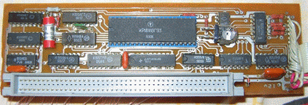
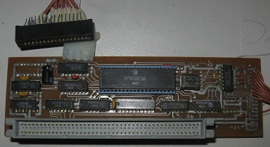

# Контроллер дисковода (Волжский вариант)

Вариант контроллера дисковода для ПЭВМ «Вектор-06Ц», известный в каталоге как волжский. Собственной документации в каталоге нет: ни принципиальной схемы, ни описания, ни методики настройки. Всё, что здесь есть, — два снимка и короткая заметка о маркировке трёх микросхем.

**Материалы в розыске.** Если у вас есть схема, описание, фото платы или сведения о происхождении этих файлов — каталог можно дополнить.

## Источники

| Файл                               | Что это                                                                                               |
| ---------------------------------- | ----------------------------------------------------------------------------------------------------- |
| [FDD_volgski.zip](FDD_volgski.zip) | Архив с исходными материалами: `FDD1.jpg` (800 × 272 точки), `FDD2.jpg` (800 × 436 точек), `info.txt` |
| [FDD1.gif](FDD1.gif)               | Уменьшенная копия `FDD1.jpg`, 384 × 131 точка                                                         |
| [fdd2.gif](fdd2.gif)               | Уменьшенная копия `FDD2.jpg`, 384 × 209 точек                                                         |

Архив `FDD_volgski.zip` (135,7 Кбайт) — единственный источник содержательных сведений; файлы `FDD1.gif` и `fdd2.gif` в каталоге повторяют его изображения в уменьшенном виде и с пониженным качеством. Ни автор, ни откуда получены файлы, ни год в материалах не указаны.

## Заметка `info.txt`

Единственный текст в архиве — 75 байт в кодировке CP866 с переводами строк CRLF, три строки. Заметка перечисляет три микросхемы по их положению на изображении — видимо, там, где маркировка на снимке не читается:

| Положение на изображении | Микросхема |
| ------------------------ | ---------- |
| Левый верхний угол       | К555ИЕ7    |
| Под кварцем              | К155ЛА3    |
| Справа внизу             | К155ЛН3    |

Ни схемы, ни перечня элементов, ни пояснений к назначению этих микросхем в архиве нет; сама заметка не подписана.

## Замечания к источникам

- Изображения не имеют ни заголовков, ни подписей внутри файлов. Назначение снимков определяется только заметкой `info.txt`, которая указывает положение микросхем «в левом верхнем углу», «под кварцем» и «справа внизу»; судя по этим указаниям, заметка относится к одному из двух снимков.
- Разрешение снимков невелико (800 точек по ширине в архиве и 384 точки в GIF-копиях), поэтому маркировка большинства микросхем, номиналы элементов и подписи на них не читаются. Заметка `info.txt` восполняет это только для трёх микросхем.
- В архиве нет ни принципиальной схемы, ни монтажного рисунка, ни описания работы контроллера, ни адреса или издания, по которому его собирали. Сведения о том, что вариант волжский, взяты из описания самого каталога, а не из файлов.
- Кодировка `info.txt` — CP866 (DOS), переводы строк — CRLF; текст заметки перенесён в README без изменений.
- Копии в GIF (384 точки по ширине) — пережатые уменьшения тех же снимков: они удобны для просмотра, но для чтения маркировки микросхем следует открывать JPG из архива.

## Другие варианты

- [Контроллеры дисковода](../README.md) — общий указатель раздела.
