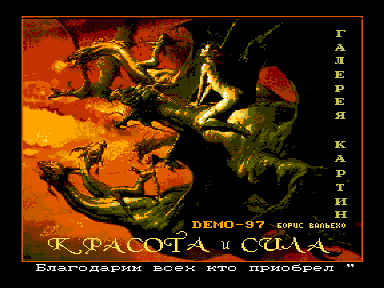
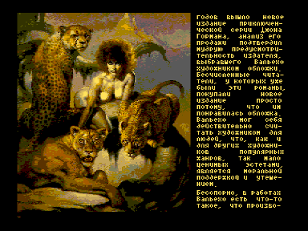

# Галерея картин Б. Вальехо

Демонстрационный альбом для ПК «Вектор-06Ц» с картинами Бориса Вальехо и рассказом о художнике и создании его работ. Автор альбома — С. В. Кучеренко; оригинальное описание датировано 15 сентября 1997 года.

## Запуск и управление

[Образ дискеты galery.fdd](galery.fdd) — загрузочный. Программа на диске запускается файлом `GALERY.COM`.

| Клавиша | Действие                                 |
| ------- | ---------------------------------------- |
| СС      | Просмотр, смена картины                  |
| РУС/ЛАТ | Выход в ДОС                              |
| УС      | Ускоренный вывод текста в бегущей строке |

Музыкальное стереосопровождение для AY звучит только на заставке; при смене картины раздаётся звон колокольчика.

## Файлы на диске

Автор предупреждает, что удаление любого из файлов нарушит работу демонстрационной программы.

| Файл              | Назначение                                        |
| ----------------- | ------------------------------------------------- |
| `GALERY.COM`      | Запуск демонстрации                               |
| `GALERY.TXT`      | Оригинальное описание                             |
| `MICRO.SPR`       | Логотип редакции «MICRO»                          |
| `V00` … `V30.SPR` | Картины с текстом                                 |
| `V.STM`, `V0.STM` | Музыкальное стереосопровождение для AY            |
| `V.TXT`, `VT.TXT` | Текст для бегущей строки, присутствующей не везде |
| `V.ZG1`, `VT.ZG1` | Знакогенераторы для `V.TXT`                       |

Оригинал описания также доступен отдельно: [galery.txt](galery.txt) (кодировка CP866).

## Как создавался альбом

По рассказу автора, для альбома нужно было объединить 30 SPR-файлов с 14 КБ текста, подобрать музыку и скомпоновать материалы. На IBM-совместимом ПК он редактировал 120 параметров `DEMO.COM` в Volkov Commander, обменивался файлами с «Вектором» через `COMMAND.COM`, затем обрабатывал программу с помощью PIP и SID.

В «ДИЗАЙНЕРЕ» автор объединял подготовленные через `TXTTOSPR` текстовые SPR-файлы с картинами, подрезал нижний край и выгружал слайды `V01`–`V30`. Файл `V.STM` получен обработкой `V00.STM` в музыкальном редакторе «БЕТХОВЕН». Автор отмечал, что из-за нехватки времени не успел создать мелкий и хорошо читаемый шрифт для картин.

За программное обеспечение автор благодарил А. Л. Третьякова (`DEMO.COM`, `DESIGNER`, шрифты, `TXTTOSPR` и другие программы) и С. В. Терентьева (файловая система в `DESIGNER`, `COMMAND`, `VPCX` и другие программы).

## Скриншоты

