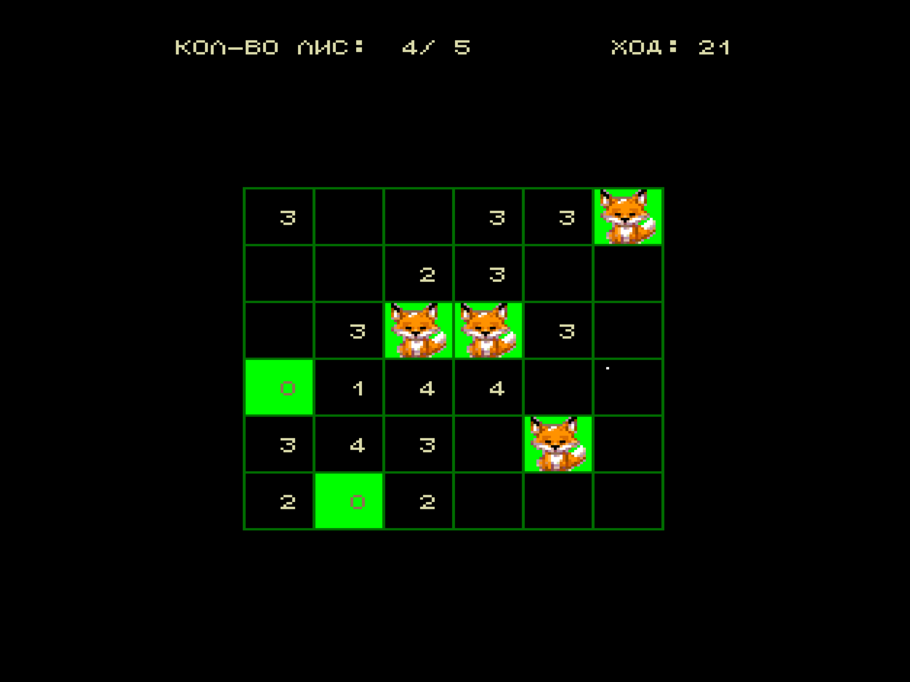

Игра с поддержкой контроллера манипулятора «Мышь» (порт D4).

На поле спрятались лисы. Найдите их за минимальное количество ходов.

Если открыть клетку, в которой нет лисы, отобразится число лис на вертикали, горизонтали и диагоналях от этой клетки.

Клетку поля можно открыть — сделать ход, или отметить пустой — это не считается ходом.

## Управление

- `Пробел` / ПКМ — отметить клетку пустой (нет лисы).
- `ВК` / ЛКМ — открыть клетку (сделать ход).
- Стрелки — сместить курсор.
- `УС` / СКМ — показать или скрыть помогатор с вертикалями, горизонталями и диагоналями для выбранной клетки.

## Горячие клавиши меню

- `1`–`6` — выбрать размер игрового поля.
- `7` — выбрать пункт «Новая игра» и начать игру.

