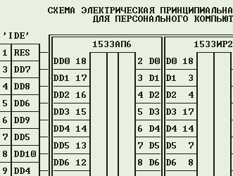

# Контроллер жёсткого диска для «Вектор-06Ц»

Схема контроллера IDE, описание портов и листинг программы чтения и записи секторов. Материал подготовлен по документу `HDD.TXT` из [оригинального архива](hdd.zip); обозначения сигналов, адреса и листинг сохранены по источнику.

## Схема контроллера



Текстовый вариант схемы из оригинального документа:

```
 'IDE'   ╔═══════════════════╦═══════════════════╦═══════════════════╗  'ВУ'
──┬────┐ ║       1533АП6     ║     1533ИР23      ║       1533ИР23    ║ ┌───┬──
 1│RES ├─║      ┌──┬─┬──┐    ║     ┌──┬──┐       ║       ┌──┬──┐     ║─┤AA0│ 3
──┼────┤ ║DD0 18│  │ │  │2 D0║D0 18│  │  │19 DD8 ║DD8   3│  │  │2  D0║ ├───┼──
 3│DD7 ├─║──────┤  │ │  ├────║─────┤  │  ├───────║───────┤  │  ├─────║─┤AA1│ 4
──┼────┤ ║DD1 17│  │ │  │3 D1║D1  3│  │  │2  DD9 ║DD9  18│  │  │19 D1║ ├───┼──
 4│DD8 ├─║──────┤  │ │  ├────║─────┤  │  ├───────║───────┤  │  ├─────║─┤AA2│ 5
──┼────┤ ║DD2 16│  │ │  │4 D2║D2  4│  │  │5  DD10║DD10 17│  │  │16 D2║ ├───┼──
 5│DD6 ├─║──────┤  │ │  ├────║─────┤  │  ├───────║───────┤  │  ├─────║─┤AA3│ 6
──┼────┤ ║DD3 15│  │ │  │5 D3║D3 17│  │  │16 DD11║DD11  4│  │  │5  D3║ ├───┼──
 6│DD9 ├─║──────┤  │ │  ├────║─────┤  │  ├───────║───────┤  │  ├─────║─┤AA4│ 7
──┼────┤ ║DD4 14│  │ │  │6 D4║D4 14│  │  │15 DD12║DD12  7│  │  │6  D4║ ├───┼──
 7│DD5 ├─║──────┤  │ │  ├────║─────┤  │  ├───────║───────┤  │  ├─────║─┤AA5│ 8
──┼────┤ ║DD5 13│  │ │  │7 D5║D5  7│  │  │6  DD13║DD13 14│  │  │15 D5║ ├───┼──
 8│DD10├─║──────┤  │ │  ├────║─────┤  │  ├───────║───────┤  │  ├─────║─┤AA6│ 9
──┼────┤ ║DD6 12│  │ │  │8 D6║D6  8│  │  │9  DD14║DD14 13│  │  │12 D6║ ├───┼──
 9│DD4 ├─║──────┤  │ │  ├────║─────┤  │  ├───────║───────┤  │  ├─────║─┤AA7│10
──┼────┤ ║DD7 11│  │ │  │9 D7║D7 13│  │  │12 DD15║DD15  8│  │  │9  D7║ ├───┼──
10│DD11├─║──────┤  │ │  ├────║─────┤  │  ├───────║───────┤  │  ├─────║─┤ D0│25
──┼────┤ ║/CS 19├──┤ │  │    ║IOW 1├──┤  │       ║ 2    1├──┤  │     ║ ├───┼──
11│DD3 ├─║──────┤/EZ │  │    ║─────┤/EO  │       ║───────┤/EO  │     ║─┤ D1│26
──┼────┤ ║IOR  1│  │ │  │    ║ 3 11│  │  │       ║IOR  11│  │  │     ║ ├───┼──
12│DD12├─║──────┤AB│ │  │    ║─────┤PE│  │       ║───────┤PE│  │     ║─┤ D2│27
──┼────┤ ║      └──┴─┴──┘    ║     └──┴──┘       ║       └──┴──┘     ║ ├───┼──
13│DD2 ├─║                   ║                   ║                   ║─┤ D3│28
──┼────┤ ║                   ║                   ║                   ║ ├───┼──
14│DD13├─║      1533ЛН1      ║      1533ИД7      ║       1533ЛИ1     ║─┤ D4│29
──┼────┤ ║AA0  5┌────┐6   /A0║ЧВВ  1┌──┬──┐      ║IOR   1┌────┐      ║ ├───┼──
15│DD1 ├─║──────┤ &  o───────║──────┤A0│  │      ║───────┤ &  │3 /CS ║─┤ D5│30
──┼────┤ ║AA1  3├────┤4   /A1║ЗВВ  2│  │  │14  3 ║IOW   2│    ├──────║ ├───┼──
16│DD14├─║──────┤ &  o───────║──────┤A1│ 1├──────║───────┤    │      ║─┤ D6│31
──┼────┤ ║AA2 11├────┤10  /A2║AA3  3│  │  │13  2 ║ 4    4├────┤      ║ ├───┼──
17│DD0 ├─║──────┤ &  o───────║──────┤A2│ 2├──────║───────┤ &  │6   5 ║─┤ D7│32
──┼────┤ ║ 3  13├────┤12   4 ║AA4  4├──┤  │10 IOW║/A2   5│    ├──────║ ├───┼──
18│DD15├─║──────┤ &  o───────║──────┤/E1 5├──────║───────┤    │      ║─┤ЧВВ│35
──┼────┤ ║ 5   9├────┤8  RES ║AA6  5│  │  │9  IOR║AA5  12├────┤      ║ ├───┼──
33│ /A1├─║──────┤ &  o───────║──────┤/E2 6├──────║───────┤ &  │11  1 ║─┤ЗВВ│37
──┼────┤ ║      └────┘       ║ 1   6│  │  │      ║AA7  13│    ├──────╜ └───┴──
35│ /A0├─║                   ╙──────┤E3│  │      ╙───────┤    │
──┼────┤ ║                          └──┴──┘              └────┘
36│ /A2├─║
──┼────┤ ║   Примечание: выводы 1,11,20,24,33,45 разъема 'ВУ' - земля.
37│/CS ├─╢               выводы 2 и 44 разъема 'ВУ' - питание +5 V.
──┼────┤ ║               выводы 2,19,22,24,26,30,40 разъема 'IDE' - земля.
38│/CS1├─╫──< лог.'1'
──┼────┤ ║
  │IOW ├─╢
──┼────┤ ║
  │IOR ├─╝
──┴────┘
```

## Порты твердого диска AT

Адреса указаны в шестнадцатеричном виде. Описания приведены по оригинальному документу.

| Порт         | Назначение                                                                                                              |
| ------------ | ----------------------------------------------------------------------------------------------------------------------- |
| `50H`, `58H` | Регистр данных: чтение данных из буфера сектора контроллера и запись в него.                                            |
| `51H`        | Запись: регистр предкомпенсации записи (_Write Precompensation_). Чтение: регистр ошибок.                               |
| `52H`        | Число секторов для операции чтения или записи.                                                                          |
| `53H`        | Текущий или начальный номер логического сектора для чтения или записи.                                                  |
| `54H`        | Старшая часть номера цилиндра: биты 0–1 соответствуют битам 8–9 десятибитового номера цилиндра.                         |
| `55H`        | Младшая часть номера цилиндра: биты 0–7 десятибитового номера.                                                          |
| `56H`        | Выбор устройства и головки для операции чтения или записи.                                                              |
| `57H`        | Запись: регистр команд. Чтение: регистр статуса.                                                                        |
| `5FH`        | Системный сброс. В оригинале рекомендуется им не пользоваться; отмечено сходство с `57H` без обнуления микросхем диска. |

### Регистр ошибок (порт 51H, чтение)

| Бит | Значение                                    |
| --- | ------------------------------------------- |
| 0   | Адресный маркер данных не найден.           |
| 1   | Ошибка на дорожке 0.                        |
| 2   | Команда отвергнута.                         |
| 3   | В оригинальной схеме регистра указан ноль.  |
| 4   | Идентификатор сектора не найден.            |
| 5   | В оригинальной схеме регистра указан ноль.  |
| 6   | Ошибка ECC: некорректируемая ошибка данных. |
| 7   | Плохой блок.                                |

### Команды (порт 57H, запись)

| Команда | Назначение                                                    | Значение `x`                                                     |
| ------- | ------------------------------------------------------------- | ---------------------------------------------------------------- |
| `1xH`   | Сброс на цилиндр 0.                                           | Скорость шага (_step rate_).                                     |
| `7xH`   | Поиск цилиндра.                                               | Скорость шага.                                                   |
| `2xH`   | Чтение сектора.                                               | Повтор и чтение ECC (_retry and ECC-read_).                      |
| `3xH`   | Запись сектора.                                               | Повтор и чтение ECC (_retry and ECC-read_), по тексту оригинала. |
| `50H`   | Форматирование дорожки.                                       | —                                                                |
| `4xH`   | Чтение для проверки.                                          | Повтор (_retry_).                                                |
| `90H`   | Диагностика.                                                  | —                                                                |
| `91H`   | Установка числа головок и секторов для выбранного устройства. | —                                                                |

### Регистр статуса (порт 57H, чтение)

| Бит | Значение                                               |
| --- | ------------------------------------------------------ |
| 0   | `1`: предыдущая команда закончилась с ошибкой.         |
| 1   | Устанавливается при обнаружении индексного отверстия.  |
| 2   | Данные исправлены: ошибка обнаружена и исправлена ECC. |
| 3   | Запрос данных: буфер ждёт данных.                      |
| 4   | Поиск завершён.                                        |
| 5   | Сбой записи.                                           |
| 6   | Устройство готово к операции, если бит 4 равен `1`.    |
| 7   | `1`: выполняется команда; остальные биты недостоверны. |

## Программа чтения/записи секторов

Листинг приведён в нотации ассемблера Intel 8080. Это фрагмент исходной программы: он ссылается на внешние обозначения, включая `BUFFER` и адреса DOS.

```asm
VIN:    MVI     E,001H
        JMP     VINT2

VINT1:  MVI     E,000H
VINT2:  PUSH    D
        PUSH    H
        LHLD    DE35A
        MVI     H,000H
        MOV     D,H
        MOV     E,L
        DAD     H
        DAD     H
        DAD     D
        LDA     DE35C
        MOV     E,A
        MVI     D,000H
        DAD     D
        DAD     H
        LDA     DE35A
        CPI     008H
        JNC     VINT4
        POP     D
        LXI     D,00002H
        XRA     A
        JMP     VINT5

VINT3:  POP     D
        CPI     0FFH
        LXI     D,0F60AH
        JZ      VINT5
        JMP     ERRO1

VINT4:  CPI     0A5H
        JNC     VINT3
        XTHL
        INX     H
        MOV     E,M
        INX     H
        MOV     D,M
        INX     H
        MOV     A,M
        POP     H
VINT5:  DAD     D
        ACI     000H
        MOV     E,L
        MOV     L,H
        MOV     H,A

        CALL    GOTOV    ; готовность
        JZ      ERROR    ; обломись
        PUSH    D
        CALL    SUMM1
        OUT     55H      ; цилиндр мл
        POP     D
        MOV     H,L
        MOV     L,E
        CALL    SUMM1
        OUT     54H      ; цилиндр ст
        LXI     D,0FFB0H
        CALL    SUMM4
        LXI     D,5
        CALL    SUMM2
        OUT     56H      ; номер головки
        MOV     A,L
        INR     A
        OUT     53H      ; номер сектора
        MVI     A,2      ; секторов при операции
        OUT     52H      ; регистр кол-во секторов
        POP     D


        LXI     H,BUFFER ; куда читать 1 кластер


DISK:   MVI     A,0      ; ДИСК  (0,1)

        ORI     20H      ; команда чтения для винчестера
        INR     E        ; расчет
        DCR     E        ; операции
        JZ      SECT1    ; какая операция происходит

        ORI     30H      ; команда записи
SECT1:  OUT     57H      ; регистр команд
        MVI     C,2      ; колич 1 кб блоков

SECT2:  CALL    GOTOV    ; готовность
        JZ      ERRO1    ; обломись
        IN      57H      ; регистр состояния
        ANI     8        ; запрос данных
        JZ      ERRO1    ; обломись
        MVI     B,2      ; колич секторов
SECT3:  INR     E        ; расчет
        DCR     E        ; операции
        JNZ     SAVE     ; какая операция происходит

;чтение сектора
LOAD:   IN      50H      ; метод преобразования 2х8бит в 16бит
        MOV     M,A      ; при запросе в 50 порт считываются 2 байта
        INR     L        ; 1 находится в 50, 2 в 58.
        IN      58H
        MOV     M,A
        INR     L        ; считывание блока
        JNZ     LOAD
        JMP     SECT4

;запись сектора
SAVE:   INR     L
        MOV     A,M
        OUT     58H      ; при записи в 50 порт записываются 2 байта
        DCR     L        ; 1 находится в 50, 2 в 58.
        MOV     A,M
        OUT     50H
        INR     L
        INR     L
        JNZ     SAVE

SECT4:  INR     H
        DCR     B
        JNZ     SECT3
        DCR     C
        JNZ     SECT2

;здесь проверяется выполненная операция
        CALL    GOTOV    ; готовность
        JZ      ERRO1    ; обломись
        ANI     0DDH     ; 11011101
        CPI     50H      ; 01010000 готовность к операции, поиск завершен
        RZ               ; да
        JMP     ERRO1    ; обломись

GOTOV:  PUSH    D
        PUSH    B
        MVI     D,5
GOTO1:  IN      57H     ; регистр статуса
        ANI     0C0H    ; 11100000
        CPI     40H     ; 01000000 устройство готово к операции
        JZ      GOTO2
        DCX     B
        MOV     A,B
        ORA     C
        JNZ     GOTO1
        DCR     D
        JNZ     GOTO1   ; попытки
        OUT     5FH     ; сброс системный
GOTO2:  ANA     A
        POP     B
        POP     D
        IN      57H     ; статус
        RET

ERROR:  POP     PSW
ERRO1:  IN      57H     ; статус
        RRC             ; команда закончена с ошибкой
        IN      51H     ; регистр ошибки
        JC      ERRO2   ; да
        XRA     A       ; ошибки нет
ERRO2:  MOV     B,A     ; код ошибки
        IN      57H     ; статус
        ANI     20H     ; сбой запись
        ORA     B
        MOV     B,A
        IN      57H
        ANI     0C0H
        CPI     40H     ; готово
        MOV     A,B
        JZ      ERRO3
        ORI     10H
ERRO3:  OUT     5FH

        RET             ; возврат

; номер цилиндра расчет
SUMM1:  LXI     D,0FEC0H
        CALL    SUMM4
        LXI     D,14H
SUMM2:  MVI     B,0FFH
SUMM3:  ADD     B
        DAD     D
        JNC     SUMM3
        RET

SUMM4:  XRA     A
        MVI     B,10H
SUMM5:  ADD     B
        DAD     D
        JC      SUMM5
        RET

; это место старта 9 функции дос
        CALL    AE699
        LDA     80H
        ANA     A
        JZ      AEC1E
        LXI     D,5DH
        CALL    AE58A
        MOV     B,H
        MOV     C,L
        LXI     D,0FFBFH
        DAD     D
        JC      AE583
        LDA     5CH
        ANA     A
        JNZ     AEBCF
        LDA     4
        INR     A
AEBCF:  DCR     A
        CPI     2
        JZ      AE583
        CMC
        SBI     0
        CPI     3
        JNC     AE583
        MOV     E,A
        MVI     D,0
AEBE0:  MOV     A,D
        CALL    AEC50
        MOV     A,M
        CMP     C
        JNZ     AEBF2
        INX     H
        MOV     A,M
        SUB     B
        JNZ     AEBF2
        MOV     M,A
        DCX     H
        MOV     M,A
AEBF2:  INR     D
        MOV     A,D
        CPI     3
        JNZ     AEBE0
        MOV     A,E
        CALL    AEC50
        MOV     M,C
        INX     H
        MOV     M,B
        INX     H
        PUSH    H
        LXI     H,0F3BEH
        MVI     A,0FFH
        INX     B
AEC08:  LXI     D,622H
        DAD     D
        ACI     0
        DCX     B
        MOV     D,A
        MOV     A,B
        ORA     C
        MOV     A,D
        JNZ     AEC08
        XCHG
        POP     H
        MOV     M,E
        INX     H
        MOV     M,D
        INX     H
        MOV     M,A
        RET

AEC1E:  XRA     A
AEC1F:  PUSH    PSW
        ADI     41H
        CPI     43H
        CMC
        ACI     0
        MOV     C,A
        CALL    0F809H
        MVI     C,03AH
        CALL    0F809H
        MVI     C,20H
        CALL    0F809H
        POP     PSW
        PUSH    PSW
        CALL    AEC50
        PUSH    H
        INX     H
        MOV     A,M
        CALL    0F815H
        POP     H
        MOV     A,M
        CALL    0F815H
        CALL    AE699
        POP     PSW
        INR     A
        CPI     3
        JNZ     AEC1F
        RET

AEC50:  LXI     H,TEC5EH
        ANA     A
        RZ
        LXI     H,TEC63H
        DCR     A
        RZ
        LXI     H,TEC68H
        RET

TEC5E:  DB 1
        NOP
        DB 2
        NOP
        NOP
TEC63:  NOP
        NOP
        NOP
        NOP
        NOP
TEC68:  NOP
        NOP
        NOP
        NOP
        NOP
```
