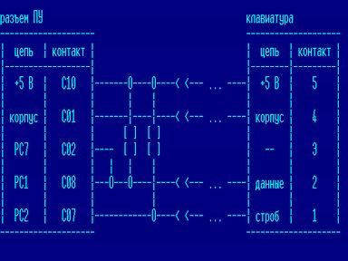

Доставьте радость себе и своим пальцам!

Или: «Как подключить к Вектору клавиатуру от IBM PC»

Опубликовано также в «Вектор-USER» №19.



Ни для кого не секрет, что «родная» клавиатура Вектора, особенно емкостная, никогда не отличалась особым качеством.
Клавиши у нее перекашиваются, застревают, загрязняются так, что их каждые полтора-два месяца приходится чистить (а, простите, какая радость простому пользователю по нескольку раз в год вскрывать свой компьютер, который, к тому же, опломбирован, и чистить у него кнопки).
Расположение клавиш тоже оставляет желать лучшего: привыкнув на работе к клавиатуре профессионального компьютера и попав на Вектор, как-то теряешься - Esc (`АР2`) вместе с функциональными клавишами оказалась где-то справа вверху, клавиша Tab, совершенно незаменимая при программировании на ассемблере, почему-то съехала вниз к пробелу...

Каждый решает эту проблему как может.
Кто-то ищет Вектор с герконовой клавиатурой (где-нибудь в Кишиневе это, может, и просто, а, например, в Омске такая клавиатура - очень большая редкость; я за всю свою жизнь видел всего два таких Вектора).
Кто-то сам делает новую клавиатуру, на свой вкус.

Я предлагаю еще один выход: подключить клавиатуру от IBM-совместимого компьютера.
Мною был разработан способ подключения такой клавиатуры к Вектору и написано несколько вариантов драйверов для различных приложений.
Сам я уже давно пользуюсь этим удобным устройством и могу только лишний раз подтвердить его надежность.
Давайте рассмотрим основные достоинства и недостатки такого подключения.

## Достоинства

- IBM-совместимые компьютеры в нашей стране преобладают над другими моделями, так что, если вы привыкли к клавиатуре своего компьютера на работе, то, придя домой, вам не придется перестраиваться на иное непривычное расположение клавиш;
- рынок компьютеров сейчас весьма богат, так что вы можете выбрать клавиатуру по своему вкусу - с высокими клавишами или с низкими, с мягким нажатием или с жестким, со щелканьем клавиш или без, белую, серую, черную - какую угодно;
- подключение производится очень просто, для этого не нужно вскрывать Вектор, все, что вам для этого понадобится - это одна стандартная пятиштырьковая розетка, два резистора на 6-10 кОм да несколько кусочков провода;
- существующее программное обеспечение позволяет эффективно использовать клавиатуру во многих программах, удобно переключать регистры и вводить любые символы, включая управляющие и псевдографические;
- клавиатура не конфликтует ни с одним из известных мне устройств, подключаемых к разъему ПУ компьютера.

## Недостатки (а недостатки ли это?)

- Стоимость такой клавиатуры составляет около трети стоимости самого Вектора (а то и половину); но вспомните, сколько денег вы уже потратили на свой компьютер - монитор, RAM-диск, дисковод с контроллером, второй дисковод... и все это для того, чтобы удобнее было работать.
  Так почему бы не потратить еще немного и получить при этом существенный выигрыш в удобстве?
- С этой клавиатурой будут работать только те программы, которые или работают в операционной системе, или оснащены специальным встроенным драйвером.
  «...которые работают в операционной системе...» - а это не так уж и мало, ведь существует немало людей, которые занимаются подготовкой текстов; на Векторе есть СУБД, электронные таблицы, справочные системы.
  А чем большую часть своего времени занимается программист?
  Сидит в редакторе и чинит свои исходники.
  Что же до отдельных программ, то я надеюсь, что с опубликованием данной статьи программисты начнут поддерживать это устройство в своих разработках, а в большинстве игрушек клавиатура вообще не нужна - джойстиком играть гораздо удобнее.
- В кировском центре «Виктория» занимаются разработкой контроллера такой же клавиатуры, который позволит использовать внешнюю клавиатуру во всех без исключения программах.
  Но, во-первых, этот проект находится пока еще только на стадии разработки, а во-вторых, зачем покупать дорогостоящий контроллер (для подключения которого, к тому же, нужно вскрывать Вектор), если клавиатура вам нужна в основном для работы в ДОС и в ее приложениях?

## Выбор клавиатуры

Для работы с данным драйвером вам необходима клавиатура, работающая по стандарту PC/XT.
Если вы будете использовать старую 83-клавишную клавиатуру, то никаких проблем возникнуть не должно.
Если же у вас 101-клавишная расширенная клавиатура, то вы должны убедиться в том, что на ней есть переключатель «XT-AT», так как в последнее время распространились клавиатуры без такого переключателя и с разъемом, как на PS/2 (маленькая круглая 6-контактная вилка).

## Подключение

Собственно подключение клавиатуры производится по следующей схеме:

```
разъем ПУ                                           клавиатура
--------------------                                --------------------
|  цепь  | контакт |                                |  цепь  | контакт |
|------------------|                                |--------|---------|
|  +5 В  |   C10   |-------O----O----< <--- ... ----|  +5 В  |    5    |
|        |         |       |    |                   |        |         |
| корпус |   C01   |-------|----|----< <--- ... ----| корпус |    4    |
|        |         |      [ ]  [ ]                  |        |         |
|  PC7   |   C02   |----  [ ]  [ ]                  |   --   |    3    |
|        |         |   |   |    |                   |        |         |
|  PC1   |   C08   |---O---O----|----< <--- ... ----| данные |    2    |
|        |         |            |                   |        |         |
|  PC2   |   C07   |------------O----< <--- ... ----| строб  |    1    |
--------------------                                --------------------
```

## Работа клавиатуры

Для связи клавиатуры с компьютером используется всего две информационных линии - данные и строб (в англоязычной литературе - data и clock).
Нормальное их состояние: data=0, clock=1, при этом компьютер и клавиатура работают сами по себе, никак не общаясь друг с другом.
Если клавиатуре есть что передавать (пользователь нажал или отпустил какую-то клавишу), то она периодически сбрасывает линию clock в «0» и тут же восстанавливает ее обратно, так что длительности состояний «1» и «0» находятся в соотношении примерно 10:1.
Компьютер, обнаружив это, устанавливает линию data в «1», что служит сигналом клавиатуре к передаче следующей последовательности:

```
         __     __    __    __    __    __    __    __    __    __       __
clock ...  |___|  |__|  |__|  |__|  |__|  |__|  |__|  |__|  |__|  |_____|  ...
         __     _____ _____ _____ _____ _____ _____ _____ _____ _____    __
data  ...  |___|     |__0__|__1__|__2__|__3__|__4__|__5__|__6__|__7__|__|  ...
```

Последовательность представляет собой один стартовый бит, равный «1», и восемь битов данных, тактируемые по линии clock.
После передачи порции данных клавиатура устанавливает обе линии в «1», при этом компьютеру лучше вновь установить признак занятости (data=0), чтобы клавиатура не начала передавать следующий байт, пока компьютер обрабатывает только что полученный.

```asm
; Пример программы приема байта данных с клавиатуры
;
IBMKey: mvi     A, 15   ; Установка бита 7 порта 5 в единицу
        out     4       ;  (то есть установка признака готовности
                        ;  компьютера к приему данных)
        lxi     B, 0B00h ;Загрузка счетчика и регистра-накопителя
nx000:  in      5       ; Ожидание единицы на линии строба
        ani     4
        jz      nx000
        dcr     B       ; Проверка значения счетчика
        jz      KeyOvr  ;  и выход, если там 0
        in      5       ; Чтение из порта 5 и сдвиг прочитанного
        rrc             ;  значения таким образом, чтобы бит данных
        rrc             ;  клавиатуры попал во флаг переноса
        mov     A, C    ; Сохранение прочитанного бита в регистре C
        rar
        mov     C, A
nx111:  in      5       ; Ожидание нуля на линии строба
        ani     4
        jnz     nx111
        jmp     nx000   ; Конец цикла
KeyOvr: mvi     A, 14   ; Установка бита 7 порта 5 в единицу
        out     4       ;  (то есть установка признака занятости компьютера)
        mov     A, C
        ret             ; Выход из подпрограммы
;
```

Возможно, данная подпрограмма выглядит запутанной и ненаглядной, но это объясняется тем, что я сразу предлагаю вариант, готовый к работе и оптимизированный по длине.
Процедура ждет, пока клавиатура не начнет передавать данные, читает байт, ждет, пока на линии строба вновь не установится единица, и затем возвращает прочитанный байт в регистре A.
Для динамического опроса клавиатуры в подпрограмме, вызываемой по прерыванию по адресу 038h, можно использовать следующую проверку:

```asm
;
        mvi     B, 80   ; Загрузка счетчика. Опыт показывает, что при числе
                        ;  повторов меньше 70 система реагирует на сигналы
                        ;  клавиатуры с чуть заметным, но все же неприятным
                        ;  запаздыванием. Устанавливать же число больше 90 -
                        ;  пустая трата времени.
noKeys: in      5       ; Чтение значения из порта
        ani     4       ; Фильтрация бита 2 - сигнала строба клавиатуры
        cz      IBMKey  ; Если там "0", то вызывается подпрограмма IBMKey
        jz      KeyEnd  ;  и цикл завершается
        dcr     B       ; Иначе ожидание продолжается,
        jnz     noKeys  ;  пока не кончится счетчик
KeyEnd:
;
```

Перед началом работы микросхема параллельного интерфейса инициализируется так, чтобы старшая тетрада порта C работала на вывод, а младшая - на ввод.
Для этого подходит, например, значение 083h (в данном примере заодно настраивается на ввод и порт B, к которому подключается такое популярное устройство, как джойстик «П»).
И еще один совет по работе с портами - если вы хотите изменить значение одного бита порта 5, то лучше не посылайте в него весь новый байт целиком, а изменяйте только один нужный вам бит путем записи значения в управляющий порт 4.

## Обработка данных

Теперь поговорим об обработке данных.
В начале работы вашей программы рекомендуется произвести сброс клавиатуры (мало ли в каком состоянии она сейчас находится).
Для этого перед настройкой микросхемы интерфейса для нормальной работы установите бит 2 порта 5 в ноль (проще всего отправить значение 080h в порт 4) и подождите не менее 50 мс (три команды HLT при разрешенных прерываниях).
Затем настройте микросхему так, как было описано выше (например, тем же значением 083h), и вызовите подпрограмму IBMKbd для чтения одного байта с клавиатуры.
Клавиатура при сбросе проводит самотестирование и, в случае успеха, должна послать число 0AAh.
Если значение, которое вернула подпрограмма IBMKbd, отличается от этого, то или клавиатура не в порядке, или просто нажата какая-то клавиша.

Дальнейшая обработка данных, полученных от клавиатуры, очень проста: клавиатура посылает просто коды нажатых клавиш, сама организует автоповтор со скоростью 10 символов в секунду, а при отпускании клавиши посылает тот же самый код, но с установленным в «1» старшим битом.
Для тех, кто пишет игры, сразу привожу коды некоторых клавиш:

| Клавиша | Код |
| --- | --- |
| вверх | 048h |
| вниз | 080h |
| вправо | 04Dh |
| влево | 04Bh |
| пробел | 039h |
| ввод | 01Ch |

Остальные коды можно узнать в многочисленных справочниках по IBM PC.

## Драйверы

Дополнительно всем желающим могу предложить (совершенно бесплатно):

- исходные тексты полного драйвера клавиатуры, с перекодировкой алфавитно-цифровых и управляющих символов в стандарт КОИ-8, переключением регистров (постоянным и временным);
- вариант ОС МикроДОС со встроенным драйвером клавиатуры;
- исходные тексты BIOS консоли для ОС МикроДОС с драйвером этой клавиатуры.

С удовольствием отвечу на ваши письма, дам дополнительные разъяснения и консультации, а также с интересом приму ваши замечания и предложения.

Дмитрий Платонов, г. Омск.

P.S. Эта статья целиком была набрана на компьютере «Вектор-06Ц» с клавиатурой от IBM PC/XT.
