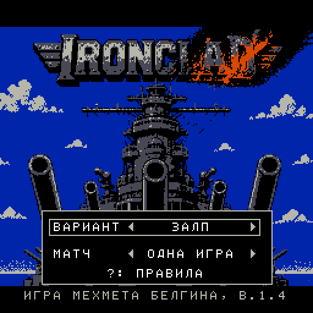
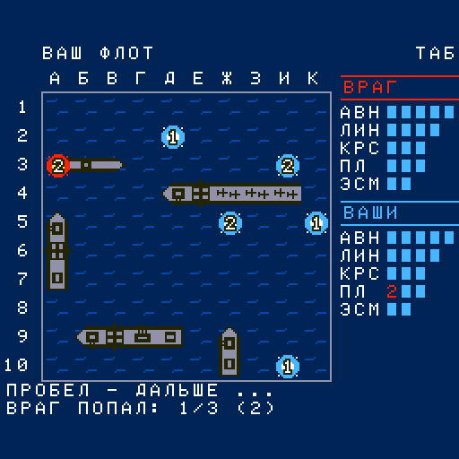
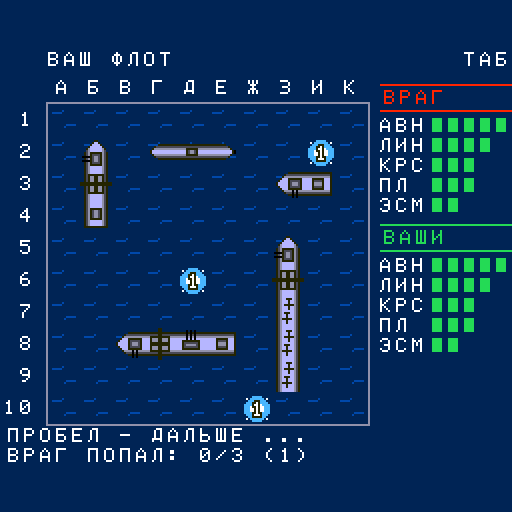

# Ironclad

Порт игры «Морской бой» [Ironclad](https://github.com/mbelgin/ironclad) Mehmet Belgin для MSX2 на Вектор-06Ц. В игре семь наборов правил, включая классический и залповый варианты; противник управляется компьютером.

Версия для Вектора работает с 64 КБ памяти, использует звук на ВИ53 и не требует квазидиска или AY. Картриджная версия использует 8 цветов, дисковая — 16 и загружает изображения победы и поражения с дискеты.

## Образы

Образы из [релиза 1.0](https://github.com/reqw41/ironclad-v06c/releases/tag/v1.0):

- [Русская версия с заставкой](ironclad.rom)
- [Русская версия без заставки](ironclad-nosplash.rom)
- [Английская версия с заставкой](ironclad-en.rom)
- [Английская версия без заставки](ironclad-en-nosplash.rom)
- [Русская дискета](ironclad.fdd)
- [Английская дискета](ironclad-en.fdd)

Картриджные образы с заставкой предназначены для MiSTer и эмуляторов. Версии без заставки меньше и подходят для загрузчиков с ограничением размера, например для Вектора Турбо+ из CP/M.

## Управление

| Клавиша (рус. / англ.) | Действие                                 |
| ---------------------- | ---------------------------------------- |
| Стрелки                | Перемещение курсора                      |
| Пробел                 | Огонь / поставить корабль                |
| Р / R                  | Развернуть корабль                       |
| У / U                  | Убрать последний корабль                 |
| А / Z                  | Авторасстановка                          |
| Б / X                  | Поставить буй-метку                      |
| ТАБ                    | Переключить поле: свой флот / воды врага |
| М / Q                  | Меню (двойное нажатие)                   |
| ?                      | Помощь; в меню — таблица правил          |

Поддерживается джойстик «П»: направления перемещают курсор, первая кнопка заменяет пробел, вторая — ТАБ.

## Скриншоты

[Исходный код и подробности порта](https://github.com/reqw41/ironclad-v06c). Код и графика оригинала принадлежат Mehmet Belgin; порт некоммерческий, у исходного проекта нет лицензии.
