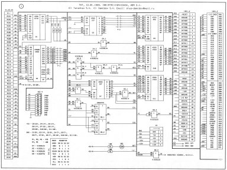
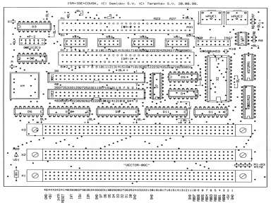

# ISA IDE COVOX

Схема и печатная плата интерфейса ISA, IDE и Covox для «Вектор-06Ц». В архиве представлены материалы в формате PCAD 4.5 и готовые изображения для просмотра.

## Содержимое архива

- [`isa_ide_covox.zip`](isa_ide_covox.zip) — исходные файлы схемы `ISA-3.SCH` и платы `ISA-3.PCB`, а также их чертежи в формате PLT.
- `JPG/` в архиве — две части схемы и изображение печатной платы.
- `PLT/` в архиве — архив программы `plt_print2_5` для печати PLT-файлов PCAD 4.5 и 8.5, её изображение и описание в трёх кодировках.
- `Readme.txt` в архиве указывает версию PCAD и контакт автора файлов.

## История версий программы печати PLT

История ниже относится к программе `plt_print2_5` из архива, а не к версиям интерфейса.

v 1.0.
17.04.2002. - Собственно появилась программа.

v 1.1.
05.10.2002. - Добавил пункт Вид/Зеркало Y. Сделал правильное зеркало текста.

v 1.2. - Исправил ошибку позиционирования, появившуюся в v 1.1.

v 1.3. - Для корректного отображения и печати сделал прорисовку в 2 этапа:
1-полигон, пустоты; 2-все остальное.

v 1.4.
15.12.2002. - Сделал отображение кириллицы. Возможность чтения расширений *.kir.
... Кнопки быстрого доступа. Возможность задавать масштаб. Штриховка
... полигона. Убрал выбор СИ. Выбор любого шрифта. Исправил глюк при
05.01.2003. выводе негатива полигона. Исправил глюк при выводе контактных площадок.
10.01.2003. Программа работает с принтером HP DeskJet 845c.Добавил запуск с командной
строки Plt.exe fileName.plt

v 1.5
16.01.2003. - Исправил прорисовку полигона, толщину контура.
17.01.2003. Сделал замену в тексте апострофа на надчеркивание.

v 1.6
01.02.2003. - Обрезание полигона по контуру выделения PLT файла. Исправил ошибку при
обрезании наклонных линий, прямоугольника, закрашенного прямоугольника по
контуру выделения PLT файла. Можно задавать толщину 0-ых линий.

v 1.7
21.02.2003. - Можно задавать толщину нулевых линий.Теперь негатив может выводится на печать.
Повысил скорость вывода на экран.
27.02.2003. - Сделал возможность изменения цвета слоев и задавать приоритет вывода цвета.
Исправил ошибку вывода стиля текста.
1.03.2003. - Есть возможность отключения вывода цветов по приоритетам, это значительно
повышает скорость вывода изображения. При выходе из программы происходит
сохранение в INI параметров работы программы. Ввел запоминание путей 3-х
последних открытых файлов.

v 1.8
18.03.2003. - Исправил ошибку при выводе зеркального текста. Исправил ошибку, возникшую в v 1.7,
запуск файла как параметра. Теперь полигон безприоритетно выводится на низ листа.
19.03.2003. - Сделал запоминание статуса MAX окна.
20.03.2003. - Исправил ошибку позиционирования текста !!!
21.03.2003. -Наконец-то я понял смысл "нулевой линии для принтера" и сделал все по уму.

v 1.9
21.03.2003. - Изменил вид окна слоев. Убрано меню СЛОИ из главного меню, добавлены CheckBox-ы
вкл./откл. цветов в окно слоев. В окно слоев добавлена кнопка восстановления цветов по
умолчанию.
22.03.2003. - В окно слоев добавлена кнопка обновить лист. Количество ранее открытых файлов
довел до 8.
25.03.2003. - Автоматический выбор ориентации листа. Нумерация ранее открытых файлов.

v 1.95
28.05.2003. - исправлена ошибка при выводе файла, имеющего "резиновые связи". Добавлен пункт в
меню выбора языка.
12.06.2003. - добавлена коррекция "псевдодюймов" в опцию "Вид".

v 2.0
01.11.2003. Программа переписана с нуля. - Добавлен формат PCAD 8.5; - Позиционирование с помощью мышки; - Удобная работа с масштабом; - Повышена скорость обработки PLT файлов; - Улучшена работа со слоями;

v 2.1
20.11.2003. - возможность переключать между цветами по умолчанию и установленными вручную; - восстановка номеров приоритетов по порядку, при нажатии на 'Номер'; - добавлена кнопка 'Применить' в таблицу цвета и приоритета; - исправлена кнопка 'разместить по центру и РАСТЯНУТЬ НА ЛИСТ'; - добавлен выбор между 'Дюйм' и 'Псевдодюйм'; - правильное отображение версии файла; - возможность корректировки высоты шрифта Windows; - исправлена ошибка вывода на печать прямоугольников; - вывод спец. символов в PCAD 8. - в BMP файл записывается весь рисунок в масштабе.

v 2.2
01.03.2004. - исправлена грамматика; - добавил возможность работы программы с некоторыми принтерами HP; - надеюсь исправил цветной фон BMP картинки; - исправил прорисовку линий (pcad45); - исправил разрядность ввода масштаба;
7.03.2004. - добавил кнопки '+','=' - увеличить, '-' - уменьшить, 'c' - позиционирование; - при шрифте PCAD есть замена спец символов в файлах PCAD 8.5;
10.03.2004. - запуск с координатами фрагмента

v 2.3
16.03.2004. - возвратил меню ПОЗИЦИЯ

v 2.4
15.04.2004. - About program -> About; - добавил кнопку 1:1 - сохранение при выходе псевдодюйм/дюйм - шаговое изменение масштаба по 0.5, с нажатым RSHIFT или LSHIFT по 0.05 - при активизации окна не происходит смещения рисунка - BMP файл имеет имя PLT и сохраняется в папку проекта - исправил загрузку с параметром @

v 2.5 - исправил ошибку при изменении масштаба с SHIFT - назначена клавиша 'F' на кнопку 'растянуть,центр' - при активизации окна после своих окон не происходит смещения рисунка - кнопка 1:1 - разместить по центу, масштаб 1:1 - параметры страницы сохраняются до сотых - при нажатии левой кнопки курсор мыши не перемещается

## Изображения

