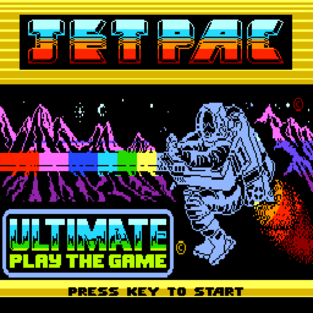
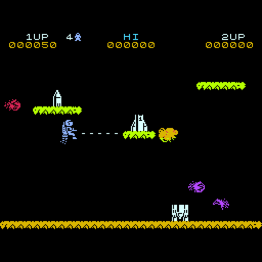

# Jetpac

Порт игры Ultimate Play the Game, выпущенной в 1983 году для ZX Spectrum. Джетмен собирает и заправляет ракету, отбиваясь от пришельцев.

Версия для Вектора-06Ц переведена с Z80 на КР580ВМ80А и работает на машине с 64 КБ памяти, без Z80-платы и квазидиска. В порте попиксельный цвет без атрибутного клэша, 16-цветная заставка и звук на ВИ53; мелодия начала игры взята из версии для BBC Micro.

## Образы

Файлы из [релиза v1.0](https://github.com/reqw41/jetpac-v06c/releases/tag/v1.0):

- [jetpac.c00](jetpac.c00) — для ядра Vector-06C на MiSTer.
- [jetpac.r0m](jetpac.r0m) — тот же образ для эмуляторов.

Образ загружается с адреса `0000h` и содержит заставку, меню и игру. Порт проверен автором в vector06js и Emu80; на MiSTer и реальном Векторе пока не проверен.

## Управление

На заставке — любая клавиша. В меню **1** / **2** выбирают одного или двух игроков, **3** / **4** — клавиатуру или джойстик, **5** или огонь начинает игру.

| Действие            | Клавиши          |
| ------------------- | ---------------- |
| Влево               | ←, Z, C, B или M |
| Вправо              | →, X, V или N    |
| Газ (вверх)         | ↑ или Q–P        |
| Огонь               | Пробел или A–L   |
| Висеть на месте     | Цифры 0–9        |
| Пауза / продолжение | ВК               |

Джойстик «П» работает в обоих режимах управления. Для бессмертия нажмите **F1 + F3** в меню вместо начала игры.

## Скриншоты

## См. также

- [Cosman](../cosman/) — аркада о космонавте с джетпаком.
- [Terminus](../terminus/) — игра со стрельбой и полётами на джетпаке.

Исходный код, инструкции по сборке и подробности порта — в [репозитории проекта](https://github.com/reqw41/jetpac-v06c). Оригинал — Ultimate Play the Game, 1983; порт — Борис Лихачёв, 2026.
