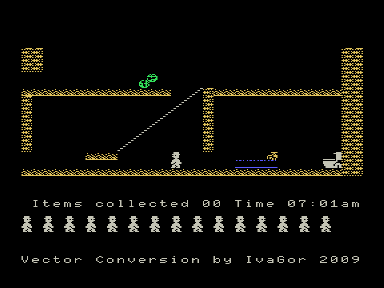
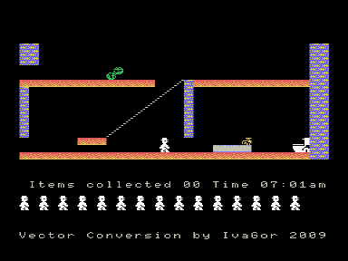

Еще один [Jet Set Willy](../jetset).
Игра Jet Set Willy является адаптацией с MSX.
Версия для MSX была сделана фирмой Hudson в 1985 году.
В отличие от [Jet Set Willy](../jetset), перенесен с ROM-версии MSXного варианта (на MSX был еще кассетный, более качественный вариант, но он сложнее для переноса).

Это первая на Векторе игрушка, использующая улучшенный квазидиск!

В архиве представлены 2 варианта.

## 1. jetset

Работает только на Векторе с Z80 (особенности какого-либо конкретного адаптера не используются, поэтому должно пойти на любом).

Преимущества перед [Jet Set Willy](../jetset): поддерживается цвет (при наличии модифицированного кишиневского квазидиска, автор А. Баркарь, «Радиолюбитель» 11/95; если такой КД не будет обнаружен - игра автоматически ограничится черно-белым режимом), звук выводится через AY (Sound Tracker или R-Sound 2), игровой процесс идет ощутимо быстрее (даже чем на MSX, примерно на 20%, а в ч/б варианте еще примерно на 10% быстрее), отдельные «потерянные» при адаптации Jet Set Willy элементы игрового процесса здесь в наличии.

Недостатки - требуется Z80, для работы в цвете требуется редкий КД (все это критично для работы на реале, [Эмулятор «Башкирия-2М»](../bashkiria_2m) и [Эмулятор «Virtual Vector»](../virtual_vector) поддерживают обе фичи).
На данный момент Z80 и улучшенный квазидиск поддерживает эмулятор Дмитрия Целикова, который можно найти на сайте [http://bashkiria-2m.narod.ru](http://bashkiria-2m.narod.ru).
Недостаток, оставшийся в наследство от ROMовского MSXного варианта (они впихивали в 16 Кб): урезанность некоторых оформительских штучек - заставка, game over, названия комнат.

При работе игры в цветном режиме задействуются адреса 0A000h-0FFFFh нулевой области квазидиска, поэтому, если вы запускаете игру из-под операционной системы, возможна потеря части содержимого КД.

### Управление в игре

- Курсор и пробел
- `F1` - выключить музыку
- `F2` - включить музыку
- `F3` - цветной режим, используются цвета переднего плана (по умолчанию при наличии модифицированного кишиневского квазидиска)
- `F4` - цветной режим, используются цвета фона
- `F5` - черно-белый режим

v1.0 - 04.01.2009

## 2. jetset16

Основное отличие от вышеописанного варианта - обеспечивается цветность игрового процесса, идентичная версии для MSX (т. е. до 16 цветов переднего плана и до 16 цветов фона одновременно).

Недостатки: работает только на Векторе с Z80, причем для обеспечения нормальной играбельности требуется тактовая частота процессора 6 МГц (к игре приложен конфигурационный файл `Vector06c-Z80-6MHz.cfg` для [Эмулятор «Башкирия-2М»](../bashkiria_2m), который нужно скопировать в каталог `config` эмулятора b2m).
Для работы в цвете необходим или модифицированный кишиневский квазидиск, автор А. Баркарь, «Радиолюбитель» 11/95 (см. [Сборник публикаций из журнала «Радиолюбитель»](../radiolubitel/rl)), или кировский, автор В. Саттаров, [Вектор-USER](../vector_user) 26-27.
На данный момент Z80 и улучшенный кишиневский квазидиск поддерживает эмулятор Дмитрия Целикова, который можно найти на сайте [http://bashkiria-2m.narod.ru](http://bashkiria-2m.narod.ru).
Звук выводится через Sound Tracker или R-Sound 2.

При работе игры в цветном режиме задействуются адреса 08000h-0FFFFh нулевой области квазидиска, поэтому, если вы запускаете игру из-под операционной системы, возможна потеря части содержимого КД.

### Управление в игре

- Курсор и пробел
- `F1` - выключить музыку
- `F2` - включить музыку

v1.0 - 10.01.2009

## Автор

Иван Городецкий, Уфа - iig1 на mail.ru

Если у вас есть возможность проверить работоспособность на реале с Z80 - напишите, пожалуйста, мне!
