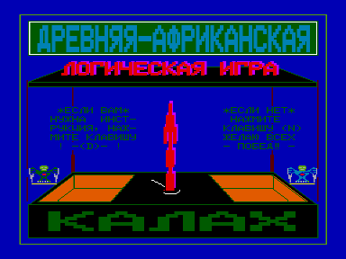
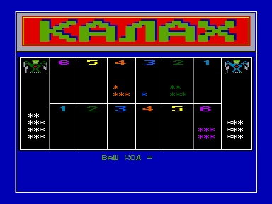

# Калах

Игра со стандартной базовой кассеты. Автор — Б. А. Минаков, Кишинёв, 1988 год.

## Правила игры

Игровое поле состоит из двух рядов малых лунок и двух больших лунок — калахов. Калах игрока находится справа, калах компьютера-соперника — слева. В начале игры компьютер помещает некоторое количество камней в каждую малую лунку.

Игрок забирает все камни из выбранной малой лунки на своей стороне и раскладывает их по одному против часовой стрелки.

- Если последний камень попал в калах, игрок получает повторный ход.
- Если последний камень попал в пустую лунку, все камни из лунки напротив берутся в плен и помещаются в калах игрока, сделавшего ход.

В конце игры выигрывает тот, в чьём калахе больше камней.

## Версии и файлы

- **KALAH1** — оригинальная версия: [кассетный файл](KALAH1.CAS), [дисковый файл](KALAH1.BAS), [листинг](KALAH1.LST).
- **KALAH2** — модифицированная версия с добавленной инициализацией видео и звука: [кассетный файл](KALAH2.CAS), [дисковый файл](KALAH2.BAS), [листинг](KALAH2.LST).

## Запуск в эмуляторе «Башкирия-2М»

1. Удерживая **F3**, нажмите **F11**. Загрузится Бейсик 2.5.
2. Нажмите **F12**.
3. Введите команду `CLOAD""`.
4. В диалоговом окне выберите файл [KALAH2.CAS](KALAH2.CAS).
5. После загрузки выполните команду `RUN`.

## Скриншоты

