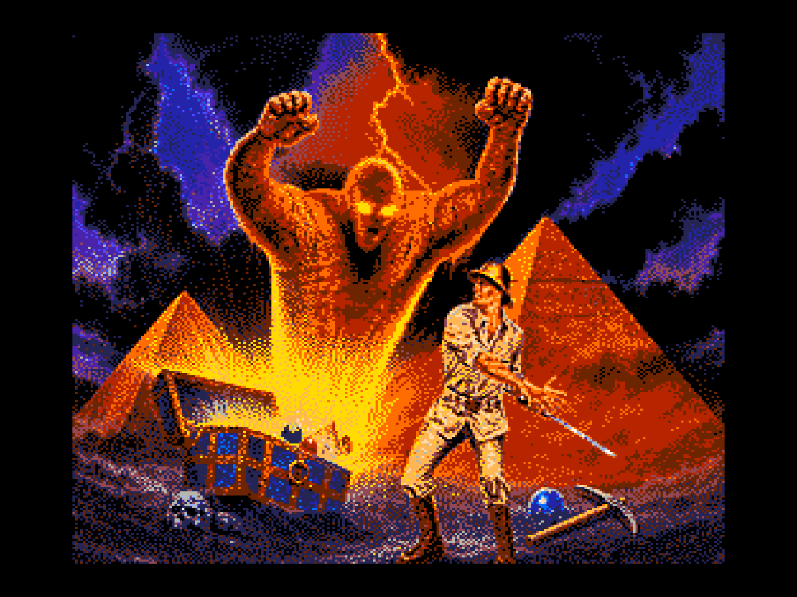
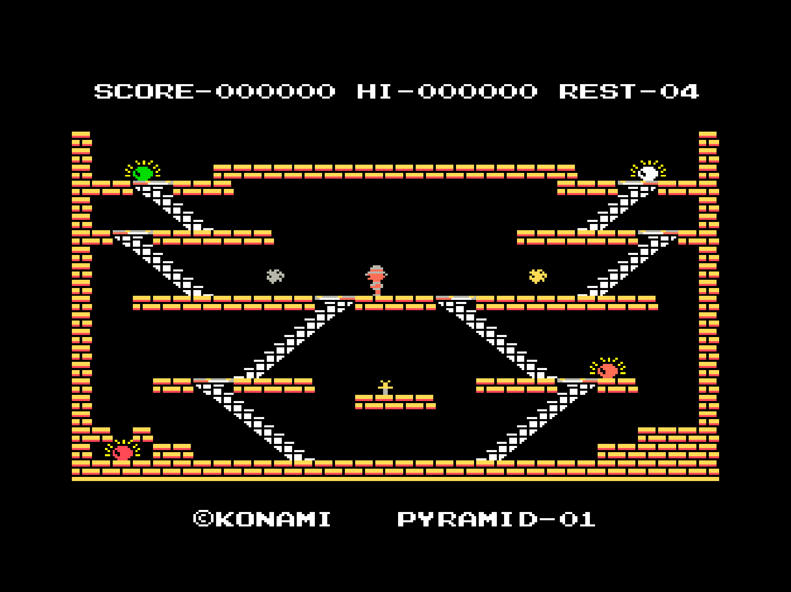

Цветная версия Kings Valley под i8080+VI53 (Z80 и AY тоже должны работать)

Тестировалось на эмуляторе и на Mister FPGA.

Если нажать `F1`+`F5` для старта (вместо пробела) будут работать читы по кнопкам H N G E S.

