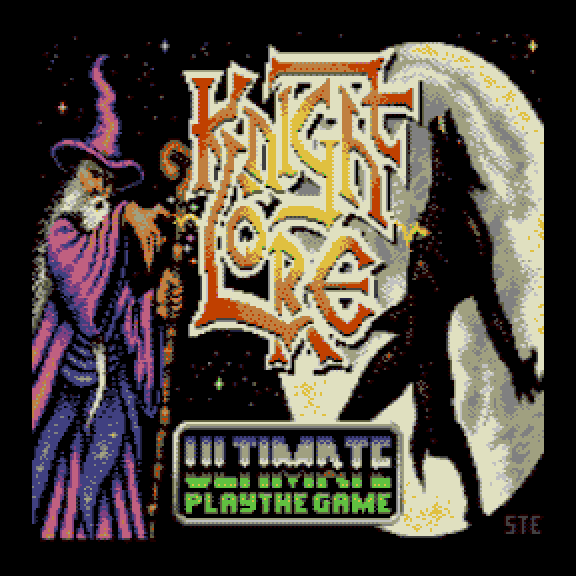
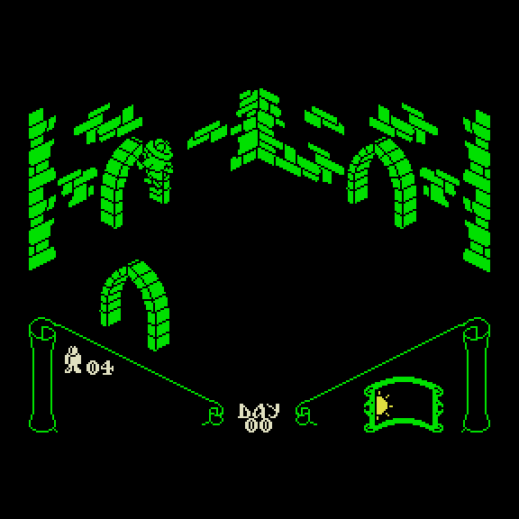

# Knight Lore

Порт изометрической приключенческой игры Ultimate Play the Game, выпущенной в 1984 году для ZX Spectrum. Сабреману предстоит исследовать замок и снять проклятие оборотня, собирая предметы и преодолевая препятствия.

Версия для Вектора-06Ц переведена с Z80 на КР580ВМ80А и работает на машине с 64 КБ памяти, без Z80-платы и квазидиска. Игра чёрно-белая; звук версии для MSX воспроизводится на ВИ53.

## Образы

Файлы из [релиза 1.0](https://github.com/reqw41/knightlore-v06c/releases/tag/v1.0):

- [С заставкой](knightlore.c00) — 16-цветная заставка с мелодией, затем игра.
- [Без заставки](knightlore-notitle.c00) — сразу переходит к меню.
- [Образ с адреса 0100h](knightlore-0100.rom) — без заставки, для обычных ROM-загрузчиков и Вектора Турбо+ под CP/M.

Файлы `.c00` — снимки памяти размером 64 КБ с адреса `0000h`: в ядре Vector-06C для MiSTer используются как `.c00`, в эмуляторах — как `.r0m`. Для запуска на Турбо+ скопируйте образ с адреса `0100h` на диск как `ИМЯ.COM` и выполните `ИМЯ -V T3`.

## Управление

В меню клавишами **1**, **2** или **3** выбирается раскладка, **0** запускает игру.

| Действие             | 1 KEYBOARD | 2 CURSOR | 3 DIRECTIONAL CONTROL |
| -------------------- | ---------- | -------- | --------------------- |
| Поворот / шаг влево  | O          | ←        | ←                     |
| Поворот / шаг вправо | P          | →        | →                     |
| Вперёд / вверх       | Q          | ↑        | ↑                     |
| Вниз                 | —          | —        | ↓                     |
| Прыжок               | A          | Пробел   | Пробел                |
| Взять / бросить      | 0–7        | ↓        | 0–7                   |

**ВК** — пауза. Джойстик «П» работает вместе с клавиатурой: первая кнопка — прыжок, вторая — взять или бросить предмет. В меню кнопка запускает игру, направления переключают раскладку; на заставке кнопка действует как нажатие клавиши.

## Скриншоты

## См. также

- [Knight Lore — адаптация с MSX](../ivagor/) для Вектора с Z80 и квазидиском.
- [Alien 8 — порт с ZX Spectrum](../../alien_8/likhachev/) и [адаптация с MSX](../../alien_8/ivagor/) — другая изометрическая игра Ultimate.
- [Quazatron](../../quazatron/) — изометрическая игра для обычного Вектора-06Ц.

Исходный код, инструкции по сборке и подробности порта — в [репозитории проекта](https://github.com/reqw41/knightlore-v06c). Оригинал — Ultimate Play the Game, 1984; порт — Борис Лихачёв, 2026.
