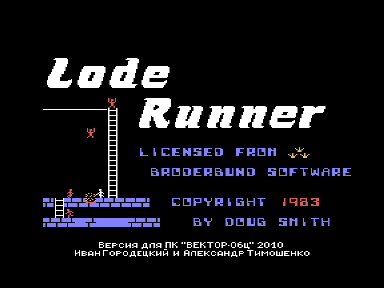
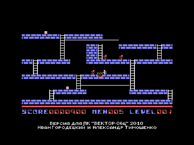

Игра Lode Runner является адаптацией с MSX.
Звук выводится через Sound Tracker или R-Sound 2.

## Управление в игре

1. Клавиши курсора - перемещение.
2. `F1` и `F2` - «прожечь» кирпичи слева-снизу или справа-снизу.
3. Выход в меню с дополнительными опциями во время игры - `АР2` (в b2m - Esc; в Virtual Vector - PgDn).

Клавиши, действующие в меню, написаны в нем самом.

Т. к. раскладки английских букв реала и эмуляторов не совпадают, то в эмуляторах вместо латинских нажимайте соответствующие русские буквы.

## Варианты

- EnhKD - версия, требующая для работы улучшенный квазидиск (Баркаря или Саттарова).
  Рекомендую попробовать именно ее, т. к. она «полноцветная» и не тормозит при переходах между уровнями.
- NoKD - версия, которой не нужен квазидиск.
  Она (надеемся) будет интересна обладателям реалов, не имеющим квазидиска.

Карта всех уровней [http://members.iinet.net.au/~msmcdoug/lrmsxtrs/msxlr_levels.bmp](http://members.iinet.net.au/~msmcdoug/lrmsxtrs/msxlr_levels.bmp)

## Авторы адаптации

- Версия для Вектора-06Ц - Иван Городецкий, г. Уфа, Россия.
- Рекомпиляция игры с Z80 на КР580 - Александр Тимошенко, г. Чернигов, Украина.

## История версий

### v1.0 - 22.04.2010

Версия для Z80.

### v2.0 - 07.05.2010

Версия для КР580ВМ80.

### v2.1 - 12.07.2010

Версия для ПК-6128Ц.

### v2.2 - 01.08.2018

Изменена раскладка клавиатуры для соответствия реалу.

Для быстрой загрузки в реал добавлены файлы wav.
Сначала читается загрузчик (2 блока), его нужно стартовать (`БЛК`+`СБР`).
Затем он загрузит саму игру в быстром формате.

В версии для улучшенного квазидиска распаковщик заменен на более короткий и быстрый.

Значительно ускорен переход между уровнями в версии без квазидиска.
Использован модифицированный распаковщик Дмитрия Целикова.
