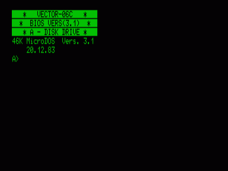
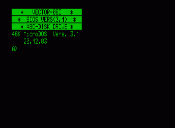
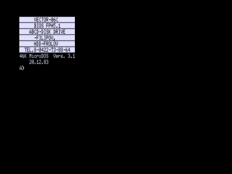
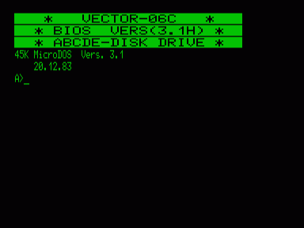
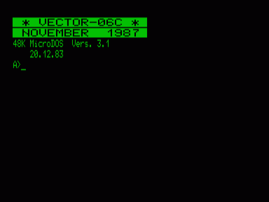

Варианты BIOS 3.1.

- [МикроДОС 3.1 (BIOS 3.1)](a_fdd)
- [МикроДОС 3.1 (BIOS 3.1 ABC)](abc)
- [МикроДОС 3.1 (BIOS FPH5.1)](fph51)
- [МикроДОС 3.1 (BIOS 3.1h)](hdd)
- [МикроДОС 3.1 (BIOS NOVEMBER 1987)](nov87)

