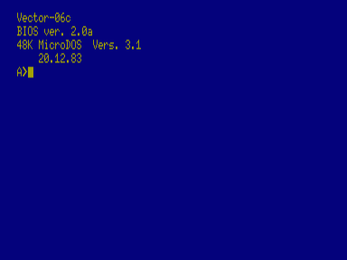
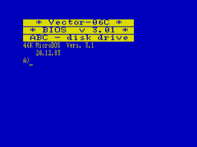
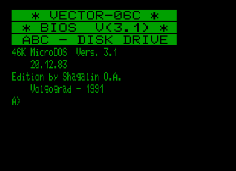
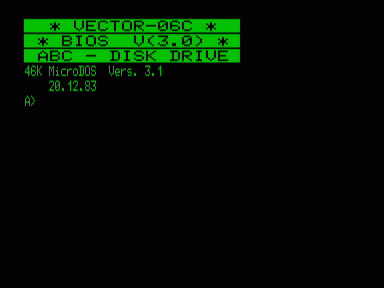
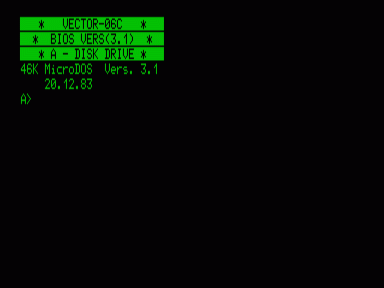
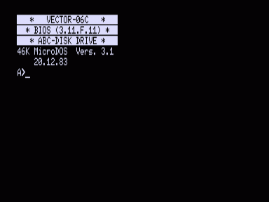
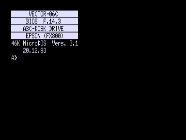
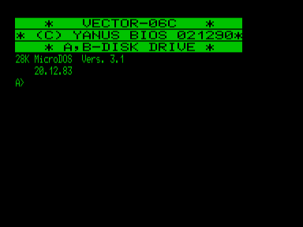

Версии операционной системы МикроДОС и её BIOS для «Вектора-06Ц».

- [МикроДОС 3.1 (BIOS 2.0)](2.0)
- [DOS201](201)
- [MDOS3](3)
- [МикроДОС 3.1 (BIOS 3.0)](3.0)
- [МикроДОС 3.1 (BIOS 3.1)](3.1)
- [МикроДОС 3.1 (BIOS 3.11.F.11)](3.11)
- [Микро-ДОС (BIOS F14)](f14)
- [Микро-ДОС (BIOS FP14.3)](fp14)
- [МикроДОС 28](yanus)

