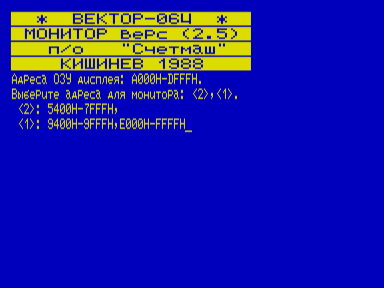
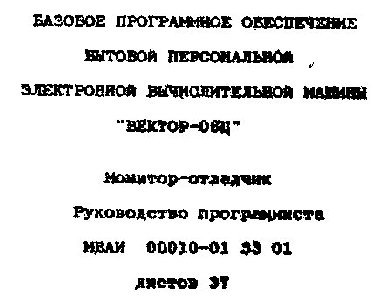
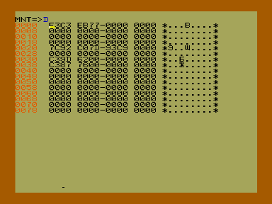
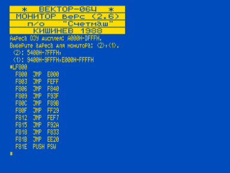
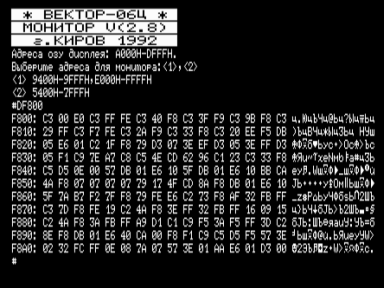
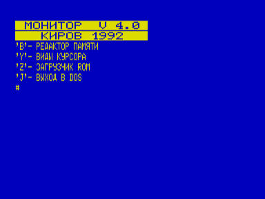
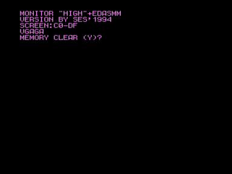

Мониторы-отладчики для «Вектора-06Ц» разных версий.

- [Монитор-отладчик 2.5](2.5)
- [РП «Монитор-отладчик»](kirov)
- [Эмулятор монитора ПЭВМ «Вектор Старт-1200»](mon1200)
- [Монитор v(2.6)](mon26)
- [Монитор-отладчик V(2.8)](mon28)
- [Монитор V 4.0](mon40)
- [Monitor «HIGH»+EDASM](monedasm)

