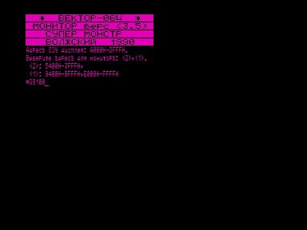
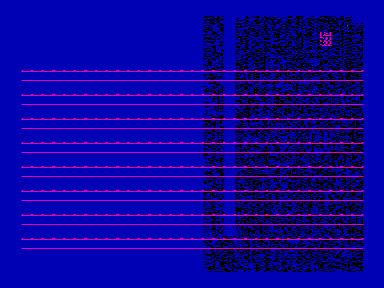

Хакерский загрузчик с магнитофона (v2.0).

Предназначен для взлома и копирования защищенных программ.
Запускается из монитора-отладчика командой G9100.

## В архиве

- `save_b2m.emu` - «сохранение» для эмулятора [http://bashkiria-2m.narod.ru/](http://bashkiria-2m.narod.ru/)
- `save_ramiros.ram` - «сохранение» для эмулятора Игоря Титаря [Эмулятор «Virtual Vector»](../virtual_vector) ([http://vector06c.narod.ru](http://vector06c.narod.ru))

