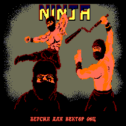
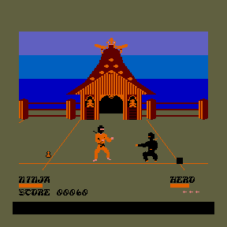

# Ninja

Порт игры Steve Coleman, выпущенной Mastertronic / Entertainment USA в 1986 году. Игровая логика перенесена с версии для ZX Spectrum, графика — с Amstrad CPC с отдельными деталями Atari ST, музыка и звуковые эффекты — с Atari 8-bit.

Порт работает на Векторе-06Ц с КР580ВМ80А и 64 КБ памяти, без Z80-переходника и квазидиска; звук воспроизводится на ВИ53 и спикере. В игре 21 комната. Представлена [альфа-версия v0.5a](https://github.com/reqw41/ninja-v06c/releases/tag/v0.5a).

## Образы

- [Ninja-v06c.r0m](Ninja-v06c.r0m) — для эмуляторов Emu80 и vector06js.
- [Ninja-v06c.c00](Ninja-v06c.c00) — для ядра Vector-06C на MiSTer.

Оба файла — образы памяти размером 64 КБ, загружаемые с адреса `0000h`. Они включают заставку, стартовый экран и игру.

## Управление

На заставке нажмите любую клавишу или огонь джойстика, на стартовом экране — пробел или огонь.

| Клавиша | Действие                                                   |
| ------- | ---------------------------------------------------------- |
| Стрелки | Движение, переход вверх через отверстие в потолке или вниз |
| Пробел  | Удар                                                       |
| ВК      | Пауза                                                      |
| АР2     | Выход из игры                                              |
| УС      | Включение и выключение звука                               |

Поддерживается джойстик «П». При нажатом огне направление выбирает удар: вверх — прыжок с ударом, вниз — удар рукой снизу, вперёд — удар ногой в корпус, назад — бросок оружия, вперёд-вверх — высокий удар ногой, назад-вверх — меч, вперёд-вниз — низкий удар ногой. Направление «вперёд» зависит от того, куда смотрит герой.

## Скриншоты

## Похожие игры

- [Bruce Lee](../brucelee/) — аркада с единоборствами и исследованием комнат.
- [Ninja Kage](../ninjak/) — аркада о ниндзя, порт с MSX.
- [Ninja II](../ninja2/) — игра о ниндзя.

Исходный код и подробности порта — в [репозитории проекта](https://github.com/reqw41/ninja-v06c).
