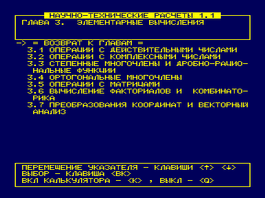
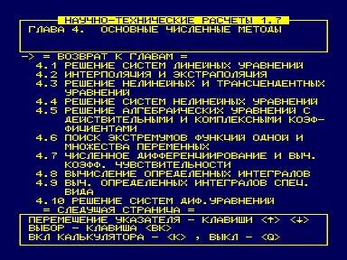

# Научно-технические расчёты

Сборник из семи программ по высшей математике.

## Запуск в эмуляторе «Башкирия-2М»

1. Удерживая **F3**, нажмите **F11**. Загрузится Бейсик 2.5.
2. Нажмите **F12**.
3. Введите команду `CLOAD""`.
4. В диалоговом окне выберите файл с расширением `.cas` из каталога [CAS](CAS/).
5. После загрузки выполните команду `RUN`.

## Скриншоты

