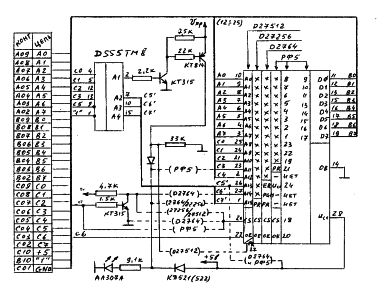

# Программатор РПЗУ-УФ

Программатор для D2716 (РФ2, РФ5), D2764 (РФ4), D27256 и D27512. В [архиве prog.zip](prog.zip) находятся программа `prog.com`, исходная документация `prog.doc` и схема `prog.gif`.

> Документация основана на историческом описании из архива. Перед сборкой и работой сверяйте распиновку, напряжение программирования и режимы стирания с документацией на конкретную микросхему. УФ-излучение опасно для глаз и кожи: используйте закрытый прибор для стирания.

По теме: статьи о программаторах в [COMAN-INFO № 6](../coman_info/06/) и [№ 14](../coman_info/14/). Соответствие описанных устройств этой схеме не установлено.

## Схема



Схема рассчитана на четыре панельки — отдельную для каждого типа ПЗУ. Пунктирные линии обозначают сигналы, которые подключаются только к выводам панельки для микросхемы, указанной в скобках. Автор предлагает использовать плату картриджа с четырьмя панельками, изменив разводку дорожек. Возможен и вариант с одной универсальной панелькой, но для него потребуется аппаратное и программное переключение сигналов.

## Стирание

Перед программированием РПЗУ-УФ стирают ультрафиолетом. В исходной документации описано использование косметического прибора «Фотон» в течение 4–5 минут; для более мощных ламп приведены расстояние 5–15 см и время 3–10 минут. Это исторические примеры, а не универсальные настройки: используйте режимы из документации на микросхему и стирающее устройство.

После стирания все ячейки должны содержать `FF`. Проверьте содержимое перед записью. Если оно отличается от `FF`, микросхема может быть не полностью стерта или неисправна.

## Программирование

Понадобятся программатор, регулируемый источник питания 12–25 В на 200–300 мА и программа `PROG.COM`. По исходному описанию, чтение и просмотр ПЗУ возможны без внешнего источника питания.

Напряжение программирования зависит от конкретной микросхемы. Источник приводит 12,5 В для большинства известных автору импортных микросхем и 23–25 В для РФ2 и РФ5; для РФ4 оно может различаться и иногда указано на корпусе. **Не подбирайте напряжение перебором:** проверьте его по маркировке и технической документации микросхемы.

В стёртой ячейке все биты равны `1`; при программировании необходимые биты сбрасываются в `0`. Если нужный бит остался равен `1`, исходное описание предлагает повторить программирование. Если же в `0` сброшен бит, который должен быть `1`, для исправления необходимо стереть микросхему и запрограммировать её заново.

Автор также описывает исключительный случай использования неполностью стёртой ячейки: например, `FD` может быть запрограммирован в `C5`, поскольку все биты, которые должны остаться равными `1` в `C5`, уже равны `1` в `FD`. Это не заменяет проверку стирания и надёжности микросхемы.

## Работа с PROG.COM

При запуске выберите один из четырёх типов ПЗУ и установите микросхему в соответствующую панельку. Пример меню для РФ4 / 2764:

```text
 КС.ОЗУ:349D                      ПЗУ 2764
 1000 - 2FFF    РАБОЧ. ОБЛАСТЬ    0000 - 1FFF
 ─────────────────────────────────────────────
 Load            Compare           Programming
 Save            reseT             Read
 Dump            Adress            dUmp
 Exit                              Find end
```

Программа располагается с адреса `100H`, буфер ПЗУ в оперативной памяти — с `1000H`. В верхней строке показаны контрольная сумма буфера, его адресный диапазон, тип микросхемы и соответствующий диапазон адресов ПЗУ. Буфер служит источником данных при записи и приёмником при чтении. Контрольную сумму можно использовать для контроля неизменности буфера и результатов работы.

| Команда       | Действие                                                                                                                                 |
| ------------- | ---------------------------------------------------------------------------------------------------------------------------------------- |
| `Load`        | Загрузить файл с диска в буфер. Конечный адрес буфера устанавливается по концу файла.                                                    |
| `Save`        | Сохранить содержимое буфера в файл; границы файла соответствуют границам буфера.                                                         |
| `Dump`        | Просмотреть память компьютера с заданного начального адреса.                                                                             |
| `Compare`     | Сравнить буфер с соответствующей областью ПЗУ.                                                                                           |
| `reseT`       | Выбрать тип микросхемы заново, как при запуске программы.                                                                                |
| `Adress`      | Установить конечный адрес буфера и начальный адрес области ПЗУ; конечный адрес ПЗУ определяется программой.                              |
| `Exit`        | Выйти в ДОС, передав управление на адрес `0000`.                                                                                         |
| `Programming` | Записать содержимое буфера в ПЗУ.                                                                                                        |
| `Read`        | Считать содержимое ПЗУ в буфер.                                                                                                          |
| `dUmp`        | Просмотреть память ПЗУ с заданного начального адреса, не изменяя буфер.                                                                  |
| `Find end`    | Найти с конца ПЗУ первый байт, отличный от `FF`, и показать его адрес. Если такого байта нет, программа сообщает, что микросхема чистая. |

Например, чтобы записать область ОЗУ `1000H–1240H` в ПЗУ начиная с `4200H`, командой `Adress` введите `1240`, затем `4200`. Программа сама определит конечный адрес в ПЗУ. Запись можно выполнять частями; это особенно полезно для D27512 объёмом 64 Кбайт.

### Типовой порядок работы

1. Сотрите микросхему и проверьте, что её ячейки содержат `FF`.
2. Запустите `PROG.COM`, выберите тип микросхемы и установите её в соответствующую панельку.
3. Загрузите данные командой `Load`. При необходимости задайте границы командой `Adress`.
4. Установите требуемое для микросхемы напряжение внешнего источника и выполните `Programming`.
5. Проверьте записанные данные командой `Compare`.
