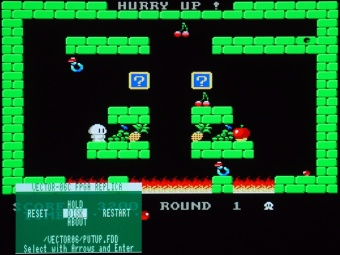

Красивая игра, перенесённая с MSX. Оригинал был написан на Бейсике г-ном Юйчи Аго (吾郷裕一さん),
но для Вектора программа была переписана в машинных кодах.
Было сделано большое количество вариантов Put-Up с разными лабиринтами и спрайтами.

Музыка адаптирована из игры «Snake it» для MSX.

См. также версию Put-Up на Godot: https://github.com/svofski/potap

Ссылки на журнал «MSX Magazine» 1987–10, в котором была опубликована игра:

Рецензия редактора: https://archive.org/details/msx-magazine-1987/MSX%E3%83%9E%E3%82%AC%E3%82%B8%E3%83%B3%201987/MsxMagazine198710.pdf/page/n121
Исходный код для MSX-1: https://archive.org/details/msx-magazine-1987/MSX%E3%83%9E%E3%82%AC%E3%82%B8%E3%83%B3%201987/MsxMagazine198710.pdf/page/n205

