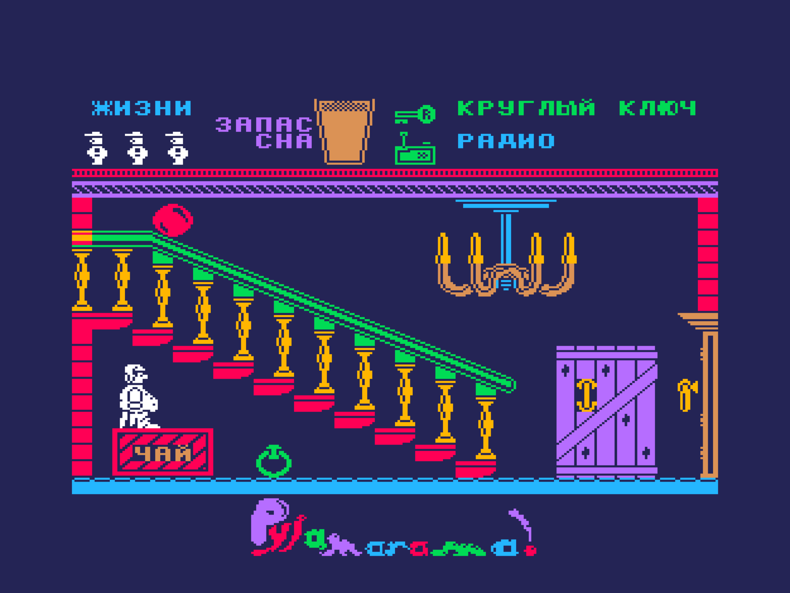

Pyjamarama (Mikro-Gen, 1984, ZX Spectrum 48K) на ванильном Векторе-06Ц: i8080 3 МГц, 64 КБ, без Z80-переходника и без квазидиска.

Версия 0.5a (альфа).

Код игры — ZX-версия V1 по дизассемблированию luny.co.uk, переведённая на i8080 через JS-модель; игровая логика сверена с оригиналом ZX шаг в шаг.

Вывод, звук, ввод, меню и заставка — свои, под Вектор: 8 цветов вместо атрибутов ZX, звук на ВИ53.

Образ памяти **с адреса 0x0000** (формат `.C00` / `.r0m`): на MiSTer (ядро Vector-06C) открывается
через меню ядра как `.C00`, в эмуляторах — как `.r0m`.

| Файл                                             | Что это                                             |
| ------------------------------------------------ | --------------------------------------------------- |
| [`rom/pyjamarama-ru.c00`](rom/pyjamarama-ru.c00) | для MiSTer: русская версия                          |
| [`rom/pyjamarama-ru.r0m`](rom/pyjamarama-ru.r0m) | то же для эмуляторов (Emu80, vector06js)            |
| [`rom/pyjamarama-en.c00`](rom/pyjamarama-en.c00) | для MiSTer: английская версия (оригинальные тексты) |
| [`rom/pyjamarama-en.r0m`](rom/pyjamarama-en.r0m) | то же для эмуляторов                                |

Версии отличаются текстами; в английской HUD устроен как в ZX (энергия и карманы на прежних местах),
в русской блок энергии и карманы сдвинуты на колонку левее, чтобы названия предметов (до 13 знаков
в строке) не обрезались.

## Управление

На заставке — любая клавиша. В меню: **1** — клавиатура, **2** — джойстик «П» (одно из двух),
**0** — начать игру. Для неуязвимости вместо «0» нажать **F1+F3**.

| действие      | клавиши                            |
| ------------- | ---------------------------------- |
| влево, вправо | стрелки (джойстик «П»: наклон)     |
| прыжок        | пробел или ↑ (джойстик «П»: огонь) |
| пауза         | ВК                                 |
| в меню        | АР2                                |

Как и в ZX-оригинале, **в дверь входят прыжком**: подойти и прыгнуть. Дверь слева на кухне (комната 4)
открывается только с дверной ручкой в кармане; три двери в шахту лифта (слева в комнатах 15, 16 и 22) —
только когда лифт включён кнопкой в кухне.

## Что по-другому, чем на ZX

- **Цвет без клэша.** Каждый объект рисуется в своих плоскостях Вектора, цвет попиксельный; фон тёмно-синий
  (в игре) и чёрный (в меню). Палитра задумана по мотивам ремейка MinionSoft для PICO-8 (2023).
  Часть предметов перекрашена: ракета, шкафы в ванной, паутина — белые, сундуки — оранжевые, цветы
  в кашпо — зелёные (таблица `rm_tab` в `src/vec/room.asm`).
- **Заставка** — экран ZX, раскрашенный нейросетью по контуру и подогнанный под палитру Вектора, на весь
  экран 256×256; чёрный бордюр, плавное появление за счёт яркости палитры. Хранится сжатой (ZX0)
  в плоскостях экрана и распаковывается на чёрном экране.
- **Меню** — выбор управления цифрами, как в ZX; в верхней полосе экрана, над игровым полем; логотип
  рисуется один раз и остаётся на весь запуск, меню сдвигается аппаратным скроллингом.
- **Музыка меню** — «Popcorn» (Gershon Kingsley) в ASC-версии Andrew Sendetski, на двух каналах ВИ53
  (мелодия и бас), играет два раза и затихает.
- **Звук** — эффекты оригинала, пересчитанные с бипера ZX на ВИ53; игра их не ждёт.
- **Русские тексты** (`PJ_LANG=ru`, по умолчанию) и английские оригинальные (`PJ_LANG=en`). В русской версии название канистры, пистолета и ведра зависит от состояния («пустая», «разряжен», «пустое») вместо FULL/EMPTY.

Известное ограничение альфы: Уолли одноцветный. Цветную версию для квазидиска с полной 16-цветной
раскраской предполагается сделать отдельно, позже.

## Откуда

Оригинал — Mikro-Gen, 1984. Дизассемблирование ZX — luny.co.uk/pyjamarama (SkoolKit, Ричард Даймонд).
Палитра и оформление меню — по мотивам ремейка MinionSoft (PICO-8, 2023). Музыка — «Popcorn»,
Gershon Kingsley; ASC-версия — Andrew Sendetski. Сжатие — ZX0 Эйнара Саукаса, распаковщик i8080 —
[Иван Городецкий](../../authors/ivagor) (ivagor). Z80.js — Molly Howell (MIT). Порт на Вектор-06Ц — [Борис Лихачёв](../../authors/likhachev), 2026.
