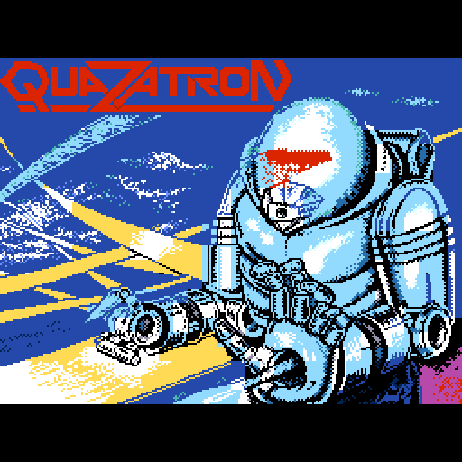
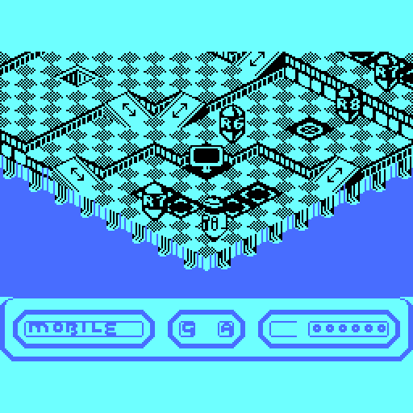

# Quazatron

Порт игры Steve Turner и Graftgold, выпущенной Hewson Consultants в 1986 году для ZX Spectrum.
Версия для Вектора-06Ц переведена с Z80 на КР580ВМ80А и работает на машине с 64 КБ памяти, без Z80-платы, квазидиска и AY.
Звук воспроизводится на ВИ53.

## Образы

Доступны русская и английская версии, с 16-цветной заставкой и без неё:

- [Русская версия с заставкой](quazatron.r0m)
- [Русская версия без заставки](quazatron-nosplash.r0m)
- [Английская версия с заставкой](quazatron-en.r0m)
- [Английская версия без заставки](quazatron-en-nosplash.r0m)

Файлы `.r0m` — снимки памяти размером 64 КБ, загружаемые с адреса `0000h` в совместимых эмуляторах и ядре Vector-06C для MiSTer.
Версии с заставкой распаковывают игру по нажатию клавиши; версии без заставки сразу переходят к меню.

## Управление

В меню: **1** — клавиатура, **2** — джойстик, **ВК** — начать игру.

| Клавиша | Действие                                                  |
| ------- | --------------------------------------------------------- |
| Стрелки | Движение                                                  |
| Пробел  | Огонь; удержание на месте — лифт, пульт или захват дроида |
| W (В)   | Режим окна состояния                                      |
| P (П)   | Пауза; снимается огнём                                    |

Поддерживается джойстик «П»; стрелки и пробел работают и при его выборе. Для режима с неубывающей энергией нажмите **F1 + F3** на заставке игры.

## Скриншоты

Исходный код, инструкции по сборке и подробности порта — в [репозитории проекта](https://github.com/reqw41/quazatron-v06c). Код и графика оригинала принадлежат правообладателям; порт распространяется некоммерчески.
