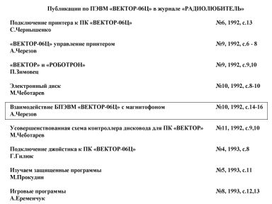
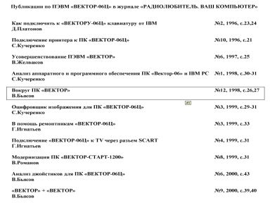
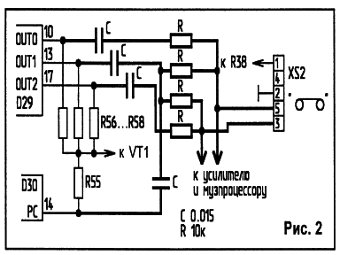
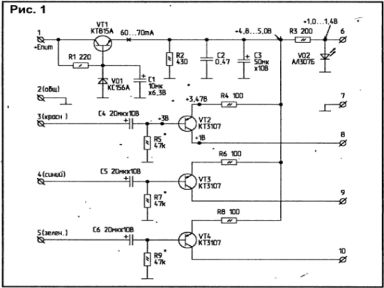

Публикации о «Векторе-06Ц» из журнала «Радиолюбитель» и приложения «Радиолюбитель. Ваш компьютер».

- [Сборник публикаций из журнала «Радиолюбитель»](rl)
- [Сборник публикаций из журнала «РЛ. Ваш компьютер»](rl_vk_publications)
- [XUIDO и стереорежим для ВИ53](rlvk_1997_06_p25)
- [Подключение к TV через разъем SCART (Ваш компьютер)](rlvk_1999_04_p31_scart)

