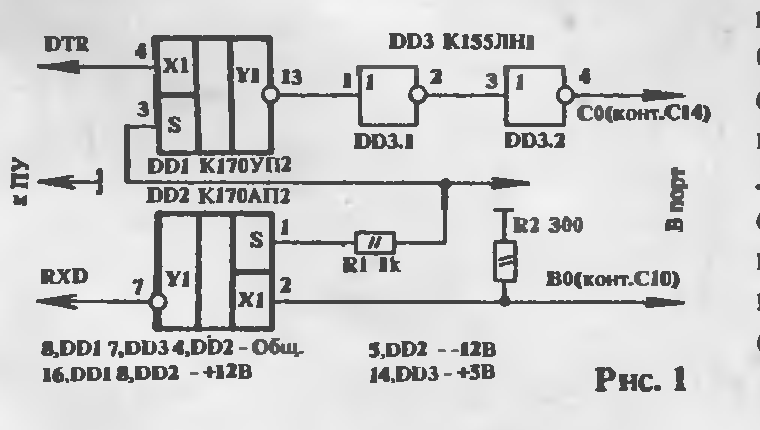

Публикация из «Радиолюбитель» - 1992 - №9. - С.9,10.

П.Зимовец,
245780, Украина,
г.Конотоп, Сумская обл.,

Ниже представлен один из способов реализации последовательного интерфейса С2/RS 232C для ПК типа "Вектор".
Автор применил его для связи своего компьютера с принтером "ROBOTRON CM6329.02M".

Интерфейс предельно прост.
Выполнен в основном программным путем.
В электронной части используется только преобразователь уровней ТТЛ/С2 и С2/ТТЛ.
За основу взят протокол DTR, требующий всего две линии связи с ПК:



Табл.1

| Скорость передачи (бод) | Время на передачу одного бита, мкс | Время на передачу одного бита, такты процессора |
| ----------------------- | ---------------------------------- | ----------------------------------------------- |
| 1200                    | 833,(3)                            | 2088                                            |
| 2400                    | 416,(6)                            | 1043                                            |
| 4800                    | 208,(3)                            | 522                                             |
| 9600                    | 104,1(6)                           | 261                                             |

RXD - данные от ПК;
DTR - готовность принтера (ПУ).

После включения ПУ в сеть линия DTR переводится в состояние ВКЛ (сигналом от ПУ).
При этом по линии DTR через преобразователь С2/ТТЛ в порт С, а точнее в линию С0 этого порта приходит логический "нуль".
Перед очередной передачей данных драйвер проверяет наличие "нуля" в линии С0.
При наличии "единицы" программа зацикливается в ожидании "нуля".
"Единица" означает, что буфер данных ПУ заполнен и дальнейший прием станет возможным только после распечатки его содержимого.

Электрическая схема преобразователя показана на рис.1.
Она представляет собой несколько переработанный вариант схемы преобразователя из статьи А.Долгого ("Радио" N6/89 г.).
Следует предостеречь от попыток собрать описанный в этой статье транзисторный вариант преобразователя.
Опыт автора показал, что желаемого результата при этом достичь не удается.
Контакты С14, С18 соответствуют разъему на плате "Вектора".
Необходимые уровни напряжения питания - +5В, +12В, -12В можно снять непосредственно с платы ПК.

Рассмотрим технологию разработки драйвера.
Полагаю, что это будет интересным и полезным для многих начинающих пользователей ПК, которые захотят сами проделать аналогичный путь.

Вначале мной была написана коротенькая программа, формировавшая на выходе одного из портов пользователя меандр (годится любой сигнал).
С помощью частотомера затем был определен период Т одного колебания.
Далее по формуле Т/н был рассчитан период времени, соответствующий одному такту (н - количество тактов на один период, суммируется по всем инструкциям, участвующим в формировании одного периода колебания).

В моем ПК длительность такта получилась равной 399 нс, что соответствует тактовой частоте 2,5 МГц.

В табл.1 приведены результаты дальнейших несложных расчетов (для тактовой частоты 2,5 МГц).

Формат передаваемого на ПУ байта должен быть следующим:

1. Стартовый бит (лог."0");
2. 7 или 8 бит данных причем 0-й бит передается первым, а 7-й или 8-й последним;
3. Один или несколько стоповых бит (лог."1").

Следует отметить, что 7 первых бит полностью определяют код символа в соответствии со стандартом КОИ-7.
При передаче информации в стандарте КОИ-8 и распечатке дампов используют 8 бит данных.

Какие же рекомендации можно дать на следующем, важнейшем этапе - написании драйвера?
Здесь все во многом определяется квалификацией программиста.

Самое сложное в том, что программа должна быть жестко "привязанной" по времени.
Во время побитной передачи данных на ПУ строго регламентирована длительность передачи каждого бита (см. табл.1).
В связи с этим каждое, пусть и незначительное, изменение в программе, изменяющее общее число тактов от одного вывода в порт до следующего, влечет за собой скрупулезный подсчет и программную коррекцию команд и тактов процессора.
Поэтому не стоит удивляться, увидев в программе автора группы команд, на первый взгляд совершенно бессмысленных.
Они служат только для временной задержки.

Для меня остался открытым вопрос, одинаковое ли количество тактов затрачивает процессор, обрабатывая команды условной передачи управления при выполнении и невыполнении условия перехода.
К сожалению, мне не удалось это проверить.
В имеющейся информации по процессору 580 ВМ80 такой информации я не нашел.
Логически рассуждая, можно прийти к выводу, что при невыполнении условия перехода несколько тактов, во время которых адрес перехода не заносится в память процессора, должны быть потеряны.

Проверить этот вывод проще всего экспериментально, написав специальную программу, выводящую в один из портов поочередно "0" и "1", и замеряя частоту на выходе.
Один раз - когда условие перехода не выполняется.
Второй раз - при выполнении условия перехода.
При этом нужно проследить, чтобы в программу не было внесено других изменений, влияющих на частоту.
По разности частот можно было бы определить количество "потерянных" тактов.

Текст драйвера представлен в табл.2 (для работы со скоростью 1200 бод).

```
        DCX     H
        MVI     A,091H
        OUT     04H         ;настроить порт
        DI
M0:     IN      05H
        ANI     01H
        JZ      M00         ;буфер ПУ занят
        JMP     M0
M00:    INX     H
        MOV     A,H
        SUB     D
        JNZ     M01
        MOV     A,L
        SUB     E
        JNZ     M02
        JMP     EXIT        ;выход
M01:    NOP
        MOV     A,L
        MOV     A,L
        MOV     A,L
M02:    MOV     A,L
        MOV     A,L
        CALL    TIM0
        XRA     A
        MOV     B,A
        OUT     06H         ;стартовый бит
        MOV     A,M
        CALL    TIM1
        OUT     06H
        MOV     C,A
        MOV     C,A
M1:     INR     B           ;счетчик бит
        MOV     C,A
        MOV     A,B
        CPI     08H         ;8 бит данных
        JNZ     M2
        CALL    TIM3
        MVI     A,01H
        OUT     06H         ;1-й стоповый
        CALL    TIM1
        MVI     A,01H
        OUT     06H         ;2-й стоповый
        CALL    TIM1
        MVI     A,01H
        OUT     06H         ;3-й стоповый
        JMP     M0
M2:     MOV     A,C
        RRC
        CALL    TIM2
        OUT     06H
        JMP     M1
;
;ЗАДЕРЖКА ВРЕМЕНИ
TIM1:   NOP
        NOP
        NOP
        NOP
        NOP
        NOP
        NOP
        NOP
        NOP
        NOP
TIM3:   NOP
TIM2:   PUSH    B
        MVI     B,00H
        LXI     B,0000H
        LXI     B,0000H
        POP     B
TIM0:   PUSH    PSW
        PUSH    B
        PUSH    D
        PUSH    H
        MVI     A,00H
MET:    NOP
        NOP
        INR     A
        CPI     62
        JNZ     MET
        POP     H
        POP     D
        POP     B
        POP     PSW
        RET
EXIT:   EI
        RST     0
```

Табл.2

Для любителей поэкспериментировать - табл.3.

При переходе к другой скорости передачи никаких изменений в драйвере, кроме TIM0, не требуется.
Автор опробовал описываемый драйвер при скорости 9600 бод.
Первые 7 бит данных передавались безошибочно.
Однако последний (8-й) может быть передан с ошибкой.

| Скорость передачи (бод) | Время выполнения п/п TIM0, такты процессора |
| ----------------------- | ------------------------------------------- |
| 1200                    | 1962                                        |
| 2400                    | 917                                         |
| 4800                    | 396                                         |
| 9600                    | 135                                         |

Табл.3

На скорости 1200 бод этот эффект пропал, а промежуточные режимы не опробывались.
Жгут, соединяющий ПК и ПУ не был экранирован.
Абсолютная ошибка времени, присутствующая в программе, составляет два такта.
На скорости 9600 бод она дает погрешность: 2 х 100/261=0,76%.
На меньших скоростях она меньше.

Драйвер использует системный стек, но это не обязательно.
Стек можно организовать в любом месте ОЗУ.
Если драйвер будет загружаться с адреса 40Н, то вершину стека удобно поместить по адресу 100Н.
Автору известны три текстовых редактора для ПК "Вектор".
Это "СТАРТ-1200", "EDACM", "RETEX".
О "RETEX"е разговор особый - если эта тема заинтересует пользователей, то автор может предоставить материал о включении драйвера в состав этого редактора.

С "EDACM"ом никаких проблем: загружаете в HL 2800Н (адрес начала текстового буфера), в DE - адрес конца буфера и передаете управление драйверу.
Буфер распечатывается на ПУ.
Следует помнить, что вершина стека располагается по адресу 5000Н.
Если текст длинный, то директивой "Х" следует изменить содержимое SP, а затем выйти в редактор и загрузить текст.

Сложнее с распечаткой буфера "СТАРТ-1200".
Для экономии ОЗУ этот редактор по-своему кодирует некоторые символы.
Кроме того, он не заполняет буфер идущими подряд пробелами или знаками табуляции, а суммирует их и в буфер выдает уже сумму.
В "Мониторе" редактора "СТАРТ-1200" имеются средства для расшифровки и распечатки такого буфера (п/п 7341Н - выдача текста на принтер), но эта подпрограмма рассчитана на параллельный интерфейс "CENTRONIX".
Лучшее, что можно в этом случае придумать, - это расшифровать буфер перед каждой посылкой строки на ПУ.
Однако такой драйвер еще предстоит написать.
Второй выход - это написать еще одну подпрограмму, преобразовывающую стандарт буфера "СТАРТ-1200" в стандарт ASCII.
Досконально этим вопросом автор пока не занимался.
Программа, приведенная в табл.4, написана и опробована в сжатые сроки.
Пробелы, идущие в строке подряд (от 2 до 9), интерпретируются, как один знак табуляции.

```
        DI
T0:     MOV     C,L
T0T:    INX     H
        MOV     A,H
        SUB     D
        JNZ     T01
        MOV     A,L
        SUB     E
        JZ      T02
T01:    MOV     A,M
        ANA     A
        JZ      CR
        CPI     01H
        JZ      SP
        CPI     09H
        JC      HT
        JMP     T0
HT:     MVI     A,09H
HT1:    MOV     M,A
        JMP     T0
SP:     MVI     A,20H
        JMP     HT1
CR:     MOV     A,L
        SUB     C
        CPI     04H
        JZ      T02
        MVI     A,0DH
        MOV     M,A
        JMP     T0T
T02:    EI
        RST     0
```

Табл.4

На той же полосе после статьи начинается другой материал, не относящийся к «Вектору-06Ц» (не расшифрован).
