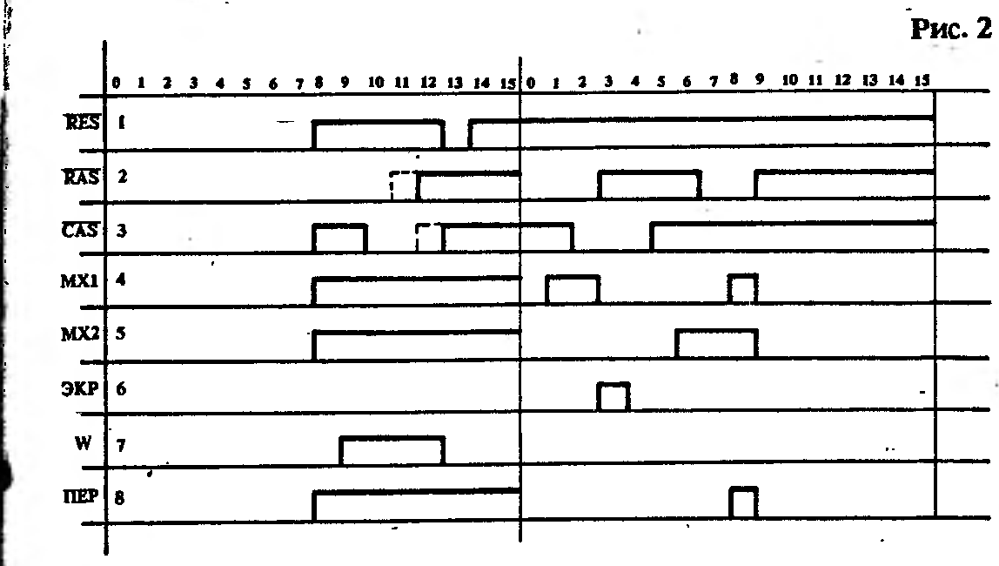
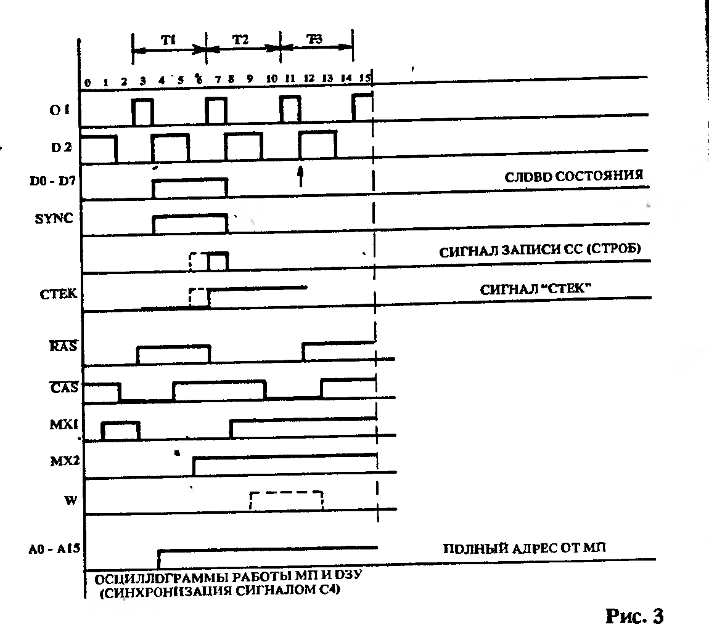
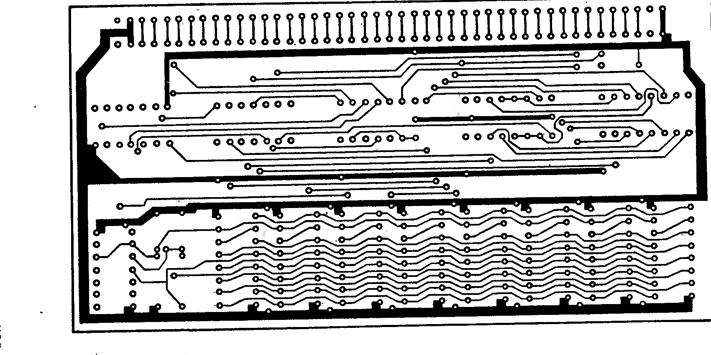
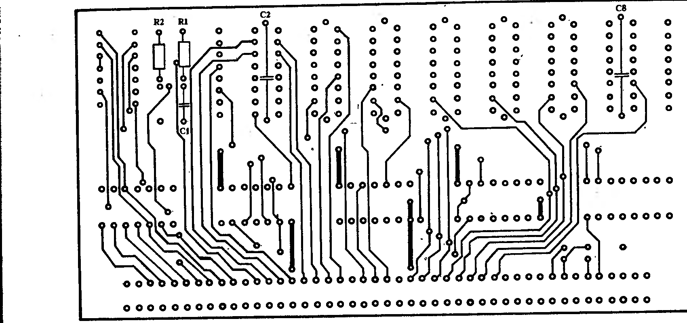

Публикация из «Радиолюбитель» - 1992 - №10. - С.8-10.

## ЭЛЕКТРОННЫЙ ДИСК

М.ЧЕБОТАРЕВ,
222852, Пуховичский р-н,
пос.Дружный,
ул.Чепика, 24 - 69.

Внутренней памяти ПК "Вектор-06Ц" (32 Кбайта без экранных областей) пользователю не хватает для решения многих задач.
Поэтому для расширения его возможностей необходим электронный диск (ЭД).
Дополнительные 256 Кбайт памяти позволяют получить:

1. Копирование дискет по 256 Кбайт при работе с одним дисководом;
2. Быструю загрузку ДОС и других прикладных программ;
3. Еще один диск при работе с ДОС;
4. Экономичное использование дисковода.

Первоначально изготовленные варианты ЭД на микросхемах ОЗУ К565РУ5 были довольно большого размера, с большим количеством микросхем.
К тому же электронный диск значительно нагружал собственный блок питания компьютера.
Да и работа ЭД оставляла желать лучшего: то диск "в холодную" отказывался нормально работать, то, наоборот, сбои начинались после прогрева.
Много хлопот доставлял подбор емкостей на сигналах управления ОЗУ `RAS` и `CAS` (что значительно усложняет наладку, особенно, для радиолюбителей, не имеющих специальных приборов).

К тому же, и изготовление печатной платы большого размера тоже требует немалого опыта.

Для уменьшения габаритов ЭД были выбраны микросхемы ОЗУ К565РУ7.
Разработанная мною схема диска состоит из восьми микросхем ОЗУ и всего шести микросхем управления (Рис. 1а,б).
Размер платы 130х65 (рис. 4).
Печатная плата разработана Левданским П. П.
На плате дополнительно устанавливаются: R1 - 300 Ом, R2 - 1 кОм, C1 - 150 пФ, C2...C8 - 22Н...100Н.

При разработке электрической схемы я обнаружил, что ЭД в принципе не может работать с "Вектором".
Изучение сигналов, необходимых для диска, показало, что они в компьютере разведены неверно (кстати, поэтому и диск на РУ5 работает неустойчиво).
Необходимо исправить это положение путем минимальных переделок.

Рассмотрим порядок работы электрической схемы ЭД, а также его программирование на языке Ассемблер.
Известны два способа обращения к ЭД:

1. Обращение "стеком";
2. Обращение "адресностью".

Сам электронный диск аппаратно разбит на четыре 64-Кбайтные зоны.
Активная зона, а также режим работы ЭД переключаются программно занесением в порт 10Н управляющего слова.
Управляющее слово имеет следующий формат:

| D7 | D6 | D5 | D4 | D3 | D2 | D1 | D0 |
| --- | --- | --- | --- | --- | --- | --- | --- |
| XX | XX | adr | stek | adrS | adrS | adrA | adrA |

где:
D7, D6 (XX) - свободно;
D5 (adr) - разрешение "адресности";
D4 (stek) - разрешение "стека";
D3, D2 (adrS) - адрес (номер) зоны диска, с которой работает стек;
D1, D0 (adrA) - адрес зоны диска, с которой работает "адресность".
Более подробно все эти биты будут описаны ниже.

Рассмотрим первый способ.
Обращение "стеком" позволяет переписывать какую-либо область ОЗУ компьютера в любую область ЭД.
В этом режиме все команды, связанные со стеком, будут работать с ЭД.
Разберем короткую программу занесения области ОЗУ 1000Н...4000Н в нулевую область диска:

```
START   EQU   0100H     ; начальный адрес программы
DOS     EQU   0000H     ; адрес выхода в ДОС
STEK    EQU   0000H     ; адрес вершины стека
BEGADR  EQU   1000H     ; адрес нач. копир. зоны ОЗУ
START   :LXI  SP,STEK   ; начальные установки
        LXI   HL,BEGADR
        MVI   A,10H     ; задание упр. сл. 10H=00010000B
        OUT   10H
CICLE   :MOV  D,M       ; считывание
        INX   H         ; слова из ОЗУ
        MOV   E,M       ; компьютера
        INX   H         ; по адресу в HL
        PUSH  D         ; зап. сл. в ОЗУ ЭД по адресу в SP
        MOV   A,H       ; проверка на завершение цикла
        CPI   40H
        JM    CICLE
        JMP   DOS
```


Дешифрация номера порта осуществляется м/с DD2 и DD1.
На них подаются инверсные старшие адреса МП А8...А15 (ШАВ0-ШАВ8).
Запись управляющего слова в DD4 будет производиться по фронту импульса, приходящего на синхронизирующий вход с выхода DD2.
Задание зоны ЭД происходит двумя младшими битами (D0, D1) для режима "адресность" и битами D2, D3 для режима "стек".

### ЗАПИСЬ

Работа в двух режимах происходит независимо друг от друга, зона ЭД задается отдельно.
Сигнал разрешения на работу "стеком" с ЭД - бит D4, "адресностью" - бит D5.
Биты D0, D3 поступают на вход мультиплексора DD5, переключающий старший бит A8 адреса памяти, т.е. зону.
Биты D4, D5 поступают на DD6.1, разрешая один или другой режим.



После выполнения первых двух команд на выходе DD4 устанавливаются биты: 10Н=00010000В.
Бит D4=1 совместно с сигналом СТЕК=1 переключает мультиплексор DD5 на прием битов D2, D3 (нулевая зона) и передачу их на выход.
Эти сигналы поступают на DD6.2, передающий на адрес A8 памяти поочередно биты D2 и D3.
Переключение происходит сигналом `RAS` с некоторой задержкой RC-цепью.
Бит D4=1 поступает на DD6.1, разрешая прохождение сигнала СТЕК=1.
С выхода D6.1 сигнал через DD16.3 (ЛА3) блокирует прохождение сигнала `CAS` на внутреннее ОЗУ, а также закрывает DD28 - выходы ОЗУ.
Таким образом, происходит разделение обращения к ЭД и ОЗУ.
Этот же сигнал на выходе DD6.1 (БЛК) разрешает прохождение сигнала CAS на ЭД (через элемент DD1.3).

При выполнении операций со стеком ЭД подменяет внутреннее ОЗУ.
В остальных случаях ЭД отключен.

Рассмотрим работу программы далее.
Так как запись в стек происходит с уменьшением адреса, запись в диск будет производиться с заданного адреса (в нашем случае 0000Н - строка программы: STEK EQU 0000H) и ниже.

Поскольку при операциях со стеком МП сначала уменьшает адрес SP, а только затем записывает данные, в нашем случае первая записанная информация будет с адреса FFFFH.
Затем считываем из ОЗУ последовательно два байта в регистровую пару DE и отправляем их в стек: начинается запись ячеек памяти парами в ЭД - при каждой операции счетчик стека уменьшается на 2.
Аналогично происходит считывание из ЭД командой POP.

Рассмотрим второй режим работы - "адресность".
В этом случае обращаться ко всему диску нельзя: дешифратор на DD3 и DD1.2 позволяет обращаться только к области A000 - DFFF (40 - 56 Кбайт) каждой зоны диска в соответствии с требованиями ОС.
Вместо 2-й и 3-й экранной области используется указанная выше область ЭД.
Микропроцессор работает с ней как с ОЗУ, за исключением того, что при записи информации в экранную область происходит ее вывод на экран монитора, а при записи в ЭД этого не происходит.
Поэтому, когда необходимо вывести сообщение на экран, ОС (или любая другая программа) отключает на это время диск (упр.слово - 0) и производит запись в экранную область.
Вывод на монитор (телевизор) осуществляется постоянно видеоконтроллером компьютера.
Поскольку он работает независимо от ЭД, пользователь даже не замечает, когда процессор работает с ЭД на адресах экранной области.
Режим "адресность" отличается от "стека" тем, что в первом случае указанная область ОЗУ полностью заменяется ЭД; возможно использование команд перехода (JMP, JNZ, CALL, CPB, PCHL и др.), записи и считывания из памяти как стеком, так и непосредственной адресацией (1-я и 2-я версии MDOS дают эту возможность: основное ядро ОС загружается в ЭД, освобождая тем самым 46 Кбайт под прикладные программы).

ЭД позволяет включать оба режима вместе (D4, D5 = 1), что и используется ОС и общим тестом компьютера.

Теперь рассмотрим осциллограммы работы памяти диска (РУ7), т.е. порядок следования сигналов.
Для обращения к ОЗУ диска необходимо выставить:

1. 8 бит 1-го адреса (старш.часть адреса); затем через интервал времени подать сигнал `RAS`, по отрицательному фронту которого происходит запоминание;
2. Вторые 8 бит (младш.часть адреса).
Запоминание произойдет по сигналу `CAS`.
Затем выдаются данные на шину данных.

Однако нужные нам сигналы не следуют в необходимой временной последовательности - проявились ошибки электрической схемы "Вектора".
Сигнал СТЕК, переключающий адрес, приходит после сигнала `RAS`.
Следовательно, не произойдет запоминания адреса стека.
Этот дефект радиолюбители стараются убрать подбором емкостей.
Но устойчивой работы ЭД таким образом добиться нельзя.

С проблемой удалось справиться иначе, причем с минимальными переделками.
В результате все сигналы были разведены по времени с промежутками времени 80 нс.

Эти сигналы хорошо просматриваются на осциллографе, если отрегулировать развертку на 80 нс в клетке, и начало каждого сигнала совпадает с вертикальной разметкой осциллографа.
Равномерная расстановка сигналов предотвращает их недопустимый сдвиг при нагреве компьютера.

Сигналы управления ОЗУ задаются запрограммированной соответствующим образом микросхемой DD36 (155РЕ3).
На рис.2 приведена правильная карта прошивки.

Для удобства мы будем рассматривать временную диаграмму по клеткам (80 нс) осциллографа (на рисунках клетки пронумерованы).

Рассмотрим процесс чтения ОЗУ начиная с 5-й клетки правой стороны карты прошивки (рис.2).
На 5-й клетке сигналы `RAS`=1, `CAS`=1, MX1=0, MX2=0 - схема находится в исходном состоянии;

2. На 6-й клетке сигнал MX2, переключающий мультиплексоры DD11..DD14, равен единице.
На их выход проходит старший байт адреса ШАП0-7;
3. На 7-й клетке появляется сигнал `RAS`=0 и происходит запоминание старшего байта адреса;
4. На 8-й клетке - MX1=1, и на выход мультиплексоров DD11...DD14 проходит младший байт адреса.
В это же время происходит переключение микросхемы на распределение сигналов, соответствующее левой половине рис.2.
Это осуществляется микросхемой DD23.2 (ЛА3) при совпадении сигнала переключения (9-й вывод РЕ3) и сигнала управления от DD15.3 (управляющее слово МП).
5. На 10-й клетке левой половины рис.2 появляется сигнал `CAS`=0 - происходит запоминание младшего байта адреса и выдача данных.

Для уменьшения количества микросхем исключены развязки между входами и выходами К565РУ7.
Чтобы не происходило замыкание между данными из компьютера на запись в РУ7 и ее выходом, фронт сигнала WE должен приходить раньше сигнала `CAS` (9-я клетка левой половины рис.2).

Единственный элемент в схеме, который, возможно, потребуется подобрать, - это конденсатор C1.
Назначение цепочки R1C1 - задержать изменение A8 после прихода `RAS` на одну клетку, чтобы это изменение A8 совпало с изменениями других адресов.

Перепрограммирование К155РЕ3 не решило всех проблем.
На ЭД сигнал СТЕК приходит одновременно с сигналом `RAS` (Рис.3).
Поэтому запоминания старшего байта адреса по срезу импульса `RAS` не происходит (поскольку первого в этот момент времени еще нет).
Сдвинуть же по времени сигнал `RAS` (а вместе с ним и все остальные) просто невозможно, поскольку тогда выдача данных с ЭД произойдет позже момента чтения данных микропроцессором.
Отсюда следует, что сигнал СТЕК из компьютера должен приходить раньше, чем `RAS`.
Это удалось получить с помощью маленькой переделки в схеме ПК.

Запись слова состояния МП в регистр управляющего слова происходит по сигналу, формируемому DD22.1 по сигналу МП SYNC и строба с DD33.4.
Импульс SYNC приходит значительно раньше строба, что позволяет использовать в качестве строба сигнал C2 с выхода счетчика DD35.
Для изменения схемы достаточно перерезать печатную дорожку с выхода 11 элемента DD33.4 и тонким проводком соединить с первым выводом DD33.1 той же микросхемы, на которую приходит сигнал C2.

Все описанные выше изменения в компьютере необходимо внести и при использовании ЭД на К565РУ5.







На страницах 8-10 также напечатан материал «Обмен опытом» А.Тимченко (г.Донецк) «Градации яркости при подключении ПК "Юниор" к ч/б монитору» - к теме «Вектор-06Ц» не относится, не расшифрован.
