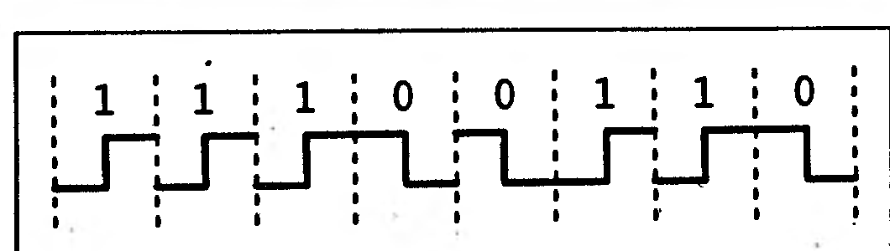

Публикация из «Радиолюбитель» - 1992 - №10. - С.14-16.

А.ЧЕРЕЗОВ, 236018, г. Калининград

В домашних компьютерах традиционно используют для хранения программ и данных магнитные ленты.
Поскольку дисковод стоит довольно дорого, а магнитофон имеется сейчас практически в каждой семье, такое положение сохранится, вероятнее всего, еще длительное время.
Тем более, что надежность хранения информации при работе с качественной лентой и магнитофоном не уступает надежности хранения на дискете.
Преимущество магнитных дисков только в скорости доступа, т.е. в большем удобстве для пользователей.
Объем хранимой информации на 60-минутной кассете при рациональном использовании - 0,5...1 Мбайт, тогда как стандартная емкость дискеты (при использовании доступных дисководов) колеблется в пределах 360...720 Кбайт.

Поэтому знакомство с принципами хранения информации на магнитной ленте (применительно к ПК) может оказаться полезным (тем более, что при записи на дискеты используются практически те же способы).

При записи на ленту цифровой информации мы должны позаботиться о том, чтобы она была приведена к аналоговому виду.
Как превратить число (например, байт) в аналоговый сигнал для записи его на магнитофон?
Мы знаем, что байт - это число от 0 до 255, но попытка представлять каждый байт своим уровнем напряжения (или тока) не удалась бы: пришлось бы разделить диапазон используемых при записи токов на 256 уровней и, следовательно, при чтении их распознавать.
Очевидно, что здесь очень велика вероятность ошибки.
Да и аппаратная часть была бы очень сложной.
Опыт использования магнитных носителей информации показал, что надежно с ними можно работать, только применяя два уровня - "0" и "1".
Следовательно, запись и чтение должны производиться побитно (обычный последовательно передаваемый цифровой сигнал).
Поскольку магнитная индукция, используемая при записи, не вызывается постоянным током, то непосредственно записать на ленту этот сигнал нельзя (запись будет отсутствовать при следовании подряд нескольких "нулей" или "единиц").
Кроме того, чередование записываемых "нулей" и "единиц" должно происходить со звуковой частотой (в диапазоне частот работы магнитофона).
Еще одна серьезная трудность - это проблема синхронизации: необходимо точное определение начала байта, файла.
Известно, что даже в магнитофонах очень высокого класса магнитная лента движется не со строго постоянной скоростью.
Поэтому, даже "поймав" с помощью какого-либо способа необходимый байт начала файла, мы рискуем сбиться в процессе чтения.
В специализированных накопителях на магнитных лентах применяют специальную синхродорожку: бит с информационной дорожки читают в момент появления синхронизирующего бита на синхродорожке.
Поскольку мы такой "роскоши" себе позволить не можем, приходится искать так называемые самосинхронизирующиеся способы записи.

Таких способов достаточно много (не менее двух десятков), но на БПЭВМ традиционно применяются только два самых простых в той или иной модификации - частотное кодирование и фазовое кодирование.
В результате получается сигнал, обеспечивающий самосинхронизацию и, кроме того, меняющийся по частоте и фазе.
Это дает возможность непосредственной записи его на ленту.
Первоначально домашние компьютеры использовали частотное кодирование.
Его применяли на ПК "Sinclair", "Atari", "TI" и даже на первых IBM PC, которые первоначально предназначались для использования совместно с бытовым телевизором и магнитофоном (при ОЗУ в 16 K, 1981 г.).



Первые отечественные промышленные ПК, создаваемые, конечно, не без оглядки на Запад, тоже применяют этот способ (часто называемый "Kansas City").
Его можно обнаружить, например, на "Агате" и "Корвете".
Практически тот же самый способ частотной модуляции применяется сейчас в дисководах для гибких дисков и в старых типах "винчестеров" (в мире "серьезных" ПК данный способ получил название "MFM").

В более поздних отечественных, действительно домашних, компьютерах, таких как "РК-86", "Орион", "Специалист" и т.п., используется уже способ фазового кодирования (называемый "Manchester").
Это более прогрессивный способ, поскольку позволяет достичь вдвое большей скорости записи (следовательно и информационной емкости кассеты) при той же физической плотности и той же надежности, что и в частотном способе.
В "Векторе-06Ц" применяют оба способа, но так как частотное кодирование используется у нас только в "Бейсике-Корвет", мы подробно рассмотрим только фазовое кодирование.

Способ фазового кодирования иллюстрируется рисунком.
Договоримся называть период записи одного бита просто периодом.
При записи бита период делится на две равные части: в первом полупериоде записывается инверсное значение бита, а во втором - его действительное значение.
Таким образом, в середине каждого периода обязательно происходит смена состояния: из "1" в "0" при записи бита "0", из "0" в "1" при записи "единицы" (на границе между двумя периодами может и не быть).
Теперь понятно, почему этот способ называется фазовым кодированием: в сигнале присутствует одна частота (при записи только "нулей" или только "единиц" будет слышен звук одного тона, и частота его будет равна 1/период), и этот сигнал меняется только по фазе на 180 градусов.
То обстоятельство, что в середине периода всегда присутствует переход "0/1" или "1/0", как раз и используется для синхронизации.
Программа чтения дожидается этого перепада и сразу после него читает значение бита, затем ждет окончания текущего периода и т.д.
Из прочитанных битов формируются байты.
Как же программой задается длительность периодов?
Ответ Вы знаете - с помощью константы записи.

Константа записи - это число, от которого зависит длина периода.
Записав в порт 01 (в "Векторе" это адрес порта, используемого при взаимодействии с магнитофоном) инверсное значение бита, программа, уменьшая на 1 значение константы записи до тех пор, пока она не станет "нулем", ждет окончания первого полупериода.
Затем выдает в порт 01 реальное значение бита и снова просчитывает до нуля значение константы записи.
При записи следующего периода процесс повторяется.
Еще одна константа (константа чтения) нужна при считывании битов: после чтения значения бита из второго полупериода нам необходимо попасть в середину первого полупериода следующего периода и ждать очередной синхронизирующий перепад.
Именно в середину периода, чтобы возможные колебания скорости ленты не вывели нас из его границ.
Возможные перепады на границе между периодами не несут полезной информации - они пропускаются во время просчитывания константы чтения.
Очевидно, что константа чтения должна быть в полтора раза больше константы записи.
Так оно и есть: вспомните, например, стандартные константы "Монитора-отладчика" - 32Н и 4ВН (50 и 75).
В принципе, константа чтения может заметно отклоняться от "идеального" значения, лишь бы она выполнила основную функцию - обеспечила пропуск возможного перепада на границе между периодами, чтобы он не был воспринят как синхронизирующий.
Пришла пора привести подпрограммы записи и чтения байта, а затем уже выяснять, как при чтении разбираться, где начало байта в потоке битов и где начало файла в потоке байтов.
В табл.1 приведена подпрограмма записи байта, уже ставшая стандартной для ПК, выполненного на 580-м процессоре.

```
Табл. 1

OUTBYTE:    PUSH    D
            PUSH    B
            PUSH    PSW
            MOV     D,A
            MVI     C,8
CBIT:       MOV     A,D
            RLC
            MOV     D,A
            MVI     A,1
            XRA     D
            ANI     01
            OUT     00
            CALL    WWAIT
            MVI     A,0
            XRA     D
            ANI     01
            OUT     00
            CALL    WWAIT
            DCR     C
            JNZ     CBIT
            POP     PSW
            POP     B
            POP     D
            RET

WWAIT:      LDA     NW
CNW:        DCR     A
            JNZ     CNW
            RET
```

При вызове подпрограммы OutByte аккумулятор должен содержать записываемый байт, а ячейка NW - константу записи.
Биты выводятся в нулевой разряд порта 01 через порт 00, чтобы не менять состояние других разрядов порта 01.
При использовании этой подпрограммы на других ПК не забудьте изменить адреса портов, а также учтите, что в этих ПК порты могут адресоваться как ячейки памяти.
Поэтому вывод в них должен производиться командой STA или с использованием косвенной адресации ячейки памяти командой MOV M,A.

Нужно отметить, что разные магнитофоны могут содержать разное количество усилителей записи, а усилители, как известно, - это инверторы.
Поэтому нет гарантии, что на ленту запишутся именно те сигналы, которые сформирует подпрограмма OutByte: все может быть записано в инверсном виде.
То же самое касается и чтения.
Поэтому Вам необходимо узнать: нужно ли инвертировать прочитанную с магнитофона информацию?

Чтобы отметить начало файла (или другой логически самостоятельной записи на ленте) принято записывать "синхробайт", записываемый подпрограммой.

При чтении происходит поиск (ожидание) синхробайта, и только после этого происходит собственно чтение.
При частотном кодировании и "MFM" применяют синхробайт 0Е5Н, а при фазовом - байт 0Е6Н (почему именно эти значения - мне неизвестно).

Подпрограмма чтения после вычисления константы чтения (может быть фиксированной, заданной заранее) последовательно читает биты с ленты и "вдвигает" их в аккумулятор (или любой другой регистр).
Аккумулятор выступает в роли восьмибитового "окна", скользящего вдоль цепочки битов на ленте.
Как только покажется байт 0Е6Н или его инверсная копия 19Н - синхробайт найден и, следовательно, найдено начало файла или части файла (синхронизируемой независимо).
По виду прочитанного синхробайта можно легко определить, нужно ли инвертировать информацию, прочитанную с ленты.
Если прочитан 19Н - то нужно (ведь был записан 0Е6Н).

Для того, чтобы прочитанный байт 0Е6Н не оказался случайным, синхробайт дополняется служебными дополнительными байтами.
Перед синхробайтом записывают 256 нулевых байтов, а справа - четыре байта 0D2H.
В принципе, внутри файла может оказаться последовательность из 0Е6Н и четырех 0D2H, которая будет воспринята как синхробайт.
Но вероятность такого совпадения чрезвычайно мала (менее 1/256).
Кроме того, 256 нулей в начале файла легко определяются пользователем на слух.
При их воспроизведении слышен звук одного тона, а не шум, как при воспроизведении файла.

Подпрограмма чтения байта с ленты (табл.2) тоже уже стала стандартной.
От этого стандарта отступают немногие программисты.
Подпрограмма работает в двух режимах:

1. Чтение байта с поиском синхробайта (прочитанный байт в этом случае будет первым после синхронизирующего);
2. Чтение без поиска синхробайта - обычный режим чтения всех байтов файла, когда синхробайт был уже найден ранее и синхронизация обеспечена.

При входе в подпрограмму аккумулятор должен содержать 0FFH для первого режима или 08 для второго.
При выходе прочитанный байт находится в аккумуляторе.

```
Табл. 2

INBYTE:     PUSH    B
            PUSH    D
            MVI     C,0
            MOV     D,A
INSTAT:     IN      01
            ANI     10H
            MOV     E,A
SYN:        IN      01          ; ож. перепада в середине периода
            ANI     10H
            CMP     E
            JZ      SYN
            RLC
            RLC
            RLC
            RLC                 ; вдвиг прочитанного бита в перенос
            MOV     A,C
            RAL
            MOV     C,A         ; доб. прочитанного бита в рег. C
            LDA     NR
RWAIT:      DCR     A           ; задержка на константу чтения
            JNZ     RWAIT
            MOV     A,D
            ORA     A
            JP      WITHOUT     ; если (D)<80H, то чт. без поиска синхр.
            MOV     A,C
            CPI     0E6H
            JNZ     C19
            XRA     A
            STA     NEGATE      ; не инвертировать
            JMP     RBYTE
C19:        CPI     19H
            JNZ     INSTAT
            MVI     A,0FFH
            STA     NEGATE      ; инвертировать
RBYTE:      MVI     D,09
WITHOUT:    DCR     D
            JNZ     INSTAT
            LDA     NEGATE
            XRA     C           ; если (Negate)=0FFH, то байт инверт.
            POP     D
            POP     B
            RET
```

Вам, конечно, известно, что разные системные и прикладные программы работают на "Векторе" с файлами различного формата: программы на Бейсике записываются в своем формате, текстовые файлы программы RETEX - в своем и т.д.
Все эти форматы записаны одним и тем же способом фазового кодирования.
Для их записи-чтения подходят приведенные подпрограммы OutByte и InByte.
Различаются они только расположением синхробайтов и другой служебной информации, а также константами чтения и записи.
Рассмотрим для примера два формата: MON и ROM.

Для удобства договоримся о простой "нотации" для записи формата.
Запись X[Y] будет означать, что при записи файла в описываемом формате X раз производится запись данных [Y], например, "256[00]" - это запись 256 нулей.

Формат MON - один из самых простых форматов на "Векторе", но достаточно удобный и надежный.

Формат "Монитора-отладчика" для ПК "Вектор-06Ц":

```
256[00],[E6],4[D2],
[имя(11байт)],3[00],
256[00],[E6],
[#1,#2],[#3,#4],
[data],
[#5].
```

Здесь data - это собственно записываемая информация, #1 и #2 - старший и младший байты адреса расположения данных соответственно, #3 и #4 - старший и младший байты адреса конца данных (последнего записываемого байта).
#5 - контрольная сумма, являющаяся результатом простого суммирования всех байтов блока data с помощью команды ADD.
Контрольная сумма служит для контроля правильности считанной информации: если сумма, высчитанная при записи, не совпадет с суммой, высчитанной при чтении, то это означает, что произошла ошибка при чтении.
Причиной может быть: искажение данных на ленте, случайные помехи при передаче, неисправность магнитофона и т.п.
Имя может иметь и меньше 11 символов: при чтении "Монитор" читает имя до первого нуля (но не больше 11 байт), а затем проверяет наличие еще двух нулей.
"Монитор" может работать в разных режимах чтения и записи.
Например, есть формат MON без имени, практически совпадающий с форматом "Монитора РК-86" (но по-разному вычисляются контрольные суммы).
В "РК-86" применяются двухбайтные контрольные суммы.
Поэтому из "Монитора-отладчика" может быть прочитан файл "РК-86", но сообщение "Ошибка" будет выдано даже в случае безошибочного чтения.

Формат MON поддерживают и некоторые другие программы.
Например, популярный графический редактор "Карандаш" записывает свои файлы в этом формате: имя файла всегда "ГРАФБЛОК" (не 11, а 8 символов), адрес начала 434АН или 7FC0H.
Таким образом, изображение, сформированное программой "Карандаш", может быть использовано в программах, которые пишутся с помощью "Монитора-отладчика" и "Редактора-Ассемблера".

Надежность формата MON заметно снижается при записи файлов большого объема.
Это и понятно: при большой длине файла вероятность сбоя в самосинхронизации повышается.
При этом, если сбой происходит в одном бите, то дальнейшее чтение файла уже полностью идет неправильно.
Если записывать большой файл частями, надежность повышается.
При этом можно повысить скорость записи (уменьшив константу записи) и компенсировать избыток служебных байтов.
Именно так и сделано в формате ROM.
Это самый удачный из всех известных мне форматов записи на магнитную ленту.

В формате ROM каждые 32 информационных байта снабжаются своим синхробайтом 0Е6Н и своей контрольной суммой.
Назовем эту информационную единицу подблоком (мне не встречалась информация о каком-либо другом названии, поэтому считаю возможным пользоваться своей терминологией).
Восемь таких подблоков объединены в более крупную единицу - блок.
Блок содержит 256 информационных байтов, остальные - служебные.
Программа чтения (загрузчик, расположенный в ПЗУ) при загрузке изображает на экране прочитанный блок прямоугольником 6х8 точек.
Подблоки в этом прямоугольнике изображаются горизонтальными полосками длиной в 6 точек.
Основное назначение этой карты загрузки - сохранять для программы чтения информацию о том, правильно ли был прочитан тот или иной байт (полоска на экране).
7ЕН (01111110В - те самые 6 точек) - если подблок прочитан правильно, или 00, если прочитан неверно.

Для контроля правильности следования блоков в файле блоки нумеруются.
Последний блок имеет номер 1, после его успешного прочтения загрузка завершается.
Номер блока записан в специальном служебном подблоке (я привык его называть именным, поскольку в нем содержится и имя файла).
Кроме имени файла и номера блока, именной подблок содержит полную информацию о расположении и объеме файла: адрес загрузки (только старший байт, т.к. длина блока 256 байт) и общее число блоков в файле.
Загрузчик следит за тем, чтобы номера последовательно идущих блоков отличались не более, чем на единицу.
Каждый подблок (кроме именного) тоже имеет свой номер: от 0 до 7.
Они не обязательно должны следовать в строгом порядке, так как адрес записи 32 байт вычисляется в зависимости от этого номера.
Главное, чтобы в блоке присутствовали все 8 информационных подблоков, иначе чтение следующего (с номером на единицу меньше) блока уже не будет производиться.
Блоки могут дублироваться: если номера блоков совпадают, они будут записываться в одну и ту же область памяти, и если в только что прочитанном блоке есть пустые места (это загрузчик проверяет по картинке на экране, где правильно прочитанные подблоки отобразились "полосками"), следующий блок, если он дублирующий, может восполнить эту недостачу.
Если же номер следующего блока на единицу меньше, а текущий блок прочитан не полностью (не все подблоки), то загрузчик очищает память для чтения заново, поскольку дальнейшее чтение не имеет смысла.
Можно, в принципе, записать каждый блок и по три раза, но это нецелесообразно, так как дублирование и так доводит надежность этого формата практически до 100%.

Константа записи не задана строго.
Она может быть любой в пределах 15Н...33Н, обеспечивая скорость записи 900...2500 бод.
Однако, скорость потока информационных битов будет примерно на треть ниже (треть всего потока - служебная информация; на каждые 256 байт информации 113 служебных байтов: имя файла, номера блоков и подблоков, контрольные суммы и т.д.).
Таким образом, при минимальной константе записи обеспечивается информационный поток около 200 байт в секунду, т.е. примерно 1600 бод (один блок в секунду).
Описание формата ROM приведено в табл. 3.

Как видно из описания, файл начинается с длинного маркера начала файла.
По нему загрузчик вычисляет константу чтения (подсчитывает длительность 32-х полупериодов, находит среднее арифметическое, а затем умножает на 1,5).
Каждый блок начинается с маркера из 16 нулей, каждый подблок - с маркера в четыре нуля.
Именной блок имеет маркер из четырех 55Н.
После синхробайта идет номер подблока (+80Н), а в случае именного подблока - байт 00.
В дублирующем блоке к номерам прибавляют 88Н (загрузчик все равно игнорирует старшие 5 битов этого байта).
Контрольная сумма подсчитывается по 34 байтам между синхробайтом и самой суммой.
Обратите внимание, что после номера подблока в информационном подблоке записана контрольная сумма именного подблока этого же блока (#4): таким образом, загрузчик может определить принадлежность подблока данному блоку.

```
Табл. 3

4[25[00],25[55H]],            [data8 (32 байта)],
16[00],                        [#12];
4[55],[E6],                    16[00],
2[00],[имя(25 байт)],          4[55],[E6],
2[00],                         2[00],
[#1],[#2],[#3],                [имя (25 байт)],
[#4];                          2[00],
4[00],[E6],                    [#1],[#2],[#3-1],
[80],[#4],                     [#13];
[data1 (32 байта)],            4[00],[E6],
[#5];                          [80],[#13],
...                            [data 9 (32 байта)],
4[00],[E6],                    [#14];
[87],[#4],                     ...

#1 - старший байт адреса загрузки, #2 - общее количество блоков,
#3 - номер текущего блока, #4 - контрольная сумма 34-х байт
именного подблока данного блока. Для первого блока #2=#3.
```

Надо отметить, что программы, работающие с ROM-файлами, не используют под имя все 25 байт.
Обычно эти 25 байт распределяются следующим образом: первые 14 байт - служебная информация (первоначально она использовалась для организации защиты от копирования, но сейчас эта "защита" игнорируется почти всеми копировщиками), оставшиеся 11 байт - имя файла.
В первые 14 байт часто записывают "имя" системы, производившей первую запись данного файла, или дату разработки.
Начальным загрузчиком эти 25 байт полностью игнорируются.

При чтении ROM-файла загрузчиком рисуется не только карта загрузки.
В экранную область памяти помещены также все служебные ячейки загрузчика и его стек.
Это делает процесс загрузки еще более наглядным.
Стек растет, начиная с адреса 0DCF0H.
Константа чтения (NR) записывается в ячейку 0DEF6H (самая верхняя в первом столбце), число NEGATE (00/FF) записывается под ней в ячейке 0DEF4H, и вы можете видеть, инвертирует ли компьютер байты, поступающие с магнитофона.
Начиная с ячейки 0DED0H, до ячейки с числом NEGATE расположен буфер объемом 35 байт для записи в него подблоков (35 байт = 34 байт + контрольная сумма); если контрольные суммы в помещенном в буфер информационном подблоке совпадают, то из буфера 32 байта переносятся в основную память.

Очевидно, что ROM-формат предоставляет возможность чтения не обязательно всего файла, но и любого блока на выбор (при наличии соответствующей программы), а также прочитать имя файла и номер блока из любого блока этого файла, что позволяет легко ориентироваться на магнитной ленте с ROM-файлами.

Программа, осуществляющая эти действия, должна уметь вычислять константу чтения не по маркеру начала файла, а по самому "телу" файла.
Все это осуществимо, и автором разработаны соответствующие программы.
Кроме этого следует отметить, что ROM-загрузчик оставляет возможность автоматического запуска файла после загрузки.
Программы, реализующие и использующие ROM-автозапуск, также разработаны автором этой статьи.
