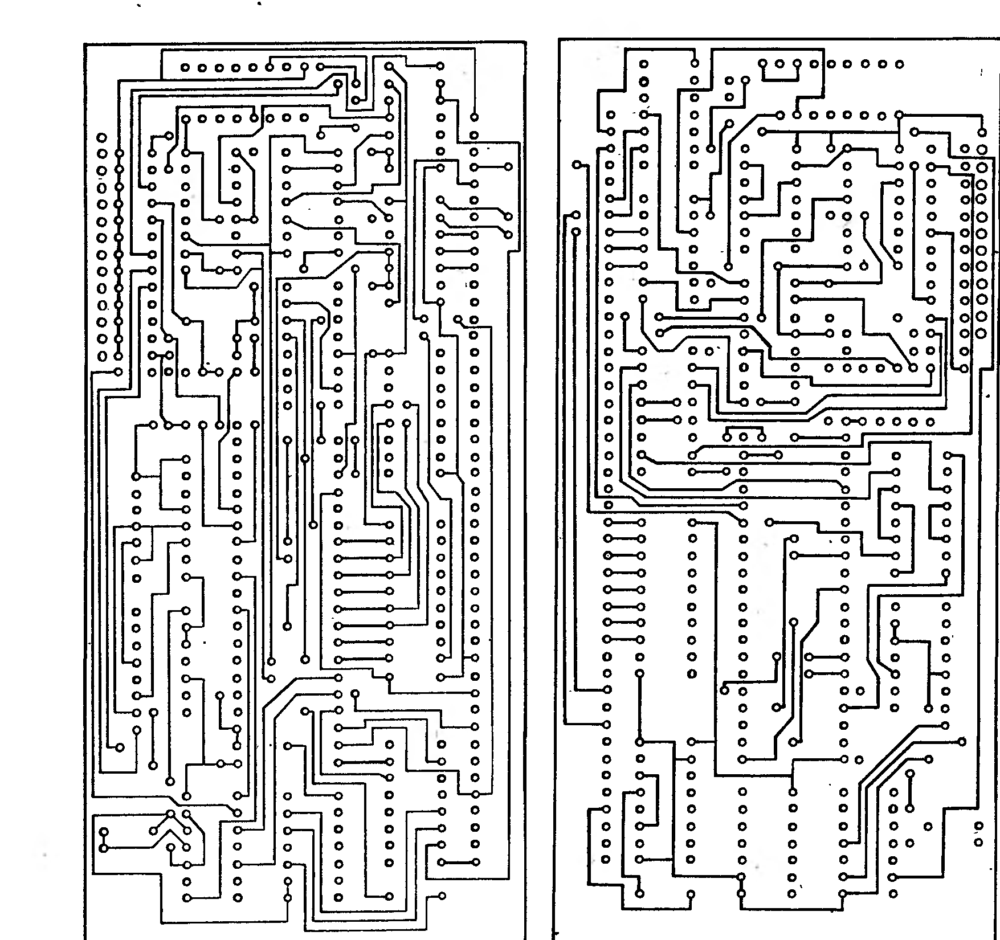

Публикация из «Радиолюбитель» - 1992 - №11. - С.9,10.

Распространенная среди радиолюбителей стандартная схема контроллера имеет немало недостатков, которые устранены в предлагаемом варианте (Рис. 1).
Печатная плата, разработанная Балабановичем В.В., показана на рис. 2.
При форматировании дискет с использованием контроллера, изготовленного по стандартной схеме, выяснилось, что наибольшее число ошибок - на дискетах "ИЗОТ".
Поэтому для отработки схемы был выбран именно этот тип дискет.

Количество ошибок резко возрастает, начиная с 50-й дорожки.
Сначала была введена предкомпенсация, выполняющая предварительную фазовую коррекцию сигнала записи для уменьшения фазовых искажений при воспроизведении информации.
Фазовое искажение появляется вследствие перекрытия соседних импульсов тока воспроизведения.
При этом их вершины сдвигаются в сторону большего временного интервала между импульсами.
Таким образом, компенсация этих искажений в процессе записи должна заключаться в уменьшении более короткого интервала между импульсами при переходе к интервалу большой длительности.

Схема предкомпенсации выполнена на двух микросхемах: К555ИР1 и К555КП2 (см. рис. 1).
Контроллер 1818ВГ93 на выходах 17 и 18 имеет сигналы, показывающие направление корректировки выходных импульсов при записи.
Эти сигналы и были использованы для управления схемой предкомпенсации.

Данные с выхода 31 К1818ВГ93 поступают на вход регистра DD11.
На тактовый вход регистра заводится частота 8 МГц.
Таким образом, задержка импульсов на каждом следующем выходе регистра - 125 нс.
В нормальном положении используется 2-й выход регистра.
В зависимости от сигналов с контроллера импульс на КП2 проходит с первого выхода регистра или с четвертого.
Соответственно задержка уменьшается на 125 нс или увеличивается на 250 нс.
Опыт эксплуатации дисководов японского производства "ТЕАС" показал, что при таких сдвигах импульсов во времени - минимум ошибок.

![Рис. 1. Усовершенствованная схема контроллера дисковода для ПК "Вектор": контроллер гибких дисков DD8 K1818ВГ93 с шинами ШАБ0-7, D0-D7, дешифратором адреса DD4 K555ИД4, элементами DD1 K555ЛЕ1, DD2 K555ЛА4, формирователем адреса DD3 K580ВА86, одновибратором предкомпенсации DD5 K555АГ3 (C1 4,7мк, R2 560k), регистром сдвига предкомпенсации DD11 K155ИР1 и мультиплексором DD13 K555КП2, элементами DD6/DD9 K555ЛИ1 на выходах МОТОР/ШАГ/Направление/Разрешение записи/Защита/Дор.00/ИНДЕКС/ГОТОВ (резисторы R4-R9 330 Ом), кварцевым генератором на ZQ1 8МГц/DD10 K555ИЕ5/DD14 K555ИЕ7 (R1 560-1,2к, R10 1к), триггерами DD7/DD12 K555ТМ8 и DD15 K555ТМ2](p9-disk-controller-schematic.png)

При применении дисководов других фирм временные задержки могут быть другими.
Это можно осуществить, изменяя тактовую частоту и выбираемые выходы регистра.

Кроме того, в схему была введена синхронизация при приеме данных (как в схеме контроллера "Балтик", "РЛ" №5/91 г.).
Синхронизация осуществляется DD15 (К555ТМ2).

Ранее сигнал с дисковода поступал на одновибратор для формирования импульса с заданной длительностью.
Эти импульсы не были синхронизированы с процессами в контроллере.

В доработанной схеме импульс, приходящий от дисковода, предварительно запоминается в первом триггере и по срезу тактового импульса выдается на вход 27 контроллера.
По фронту тактового импульса происходит переключение счетчика DD14 (К555ИЕ7).
С выхода счетчика синхронизирующие импульсы поступают на контроллер (таким образом, в контроллере разделяются импульсы данных и стробимпульсы).

После введения в схему временных задержек количество ошибок при форматировании уменьшилось со 120 до 30.
Введение синхронизации приема данных отдельно изменило этот показатель со 120 до 60.
При одновременном применении обеих доработок число ошибок уменьшилось до 5.
На дискетах других фирм ошибок не было.
После размагничивания головок дисковода ошибки исчезли и на дискетах "ИЗОТ".

При изменении схемы адресация портов была оставлена прежней.
Ниже приводится таблица адресов портов обращения к контроллеру.

**1. адр.порт. = 000111хх (1C, 1D, 1E, 1F)**

- зп в/в - Запись упр. сл. в триггер ТМ8

- данные - данные упр. сл.

Формат управляющего слова:

| D7  | D6  | D5  | D4  | D3  | D2   | D1  | D0  |
| --- | --- | --- | --- | --- | ---- | --- | --- |
| XX  | XX  | DD  | DD  | XX  | Side | AB  | XX  |

D7, D6, D3, D0 (XX) - свободно;
D5, D4 (DD) - плотность записи;
D2 (Side) - выбор стороны дисковода;
D1 (AB) - выбор дисковода.

**2. Адреса обращения к 1818ВГ93:**

| Порт | Код      | Чтение       | Запись     |
| ---- | -------- | ------------ | ---------- |
| 1B   | 00011011 | Pr состояния | Pr команд  |
| 1A   | 00011010 | Pr дорожки   | Pr дорожки |
| 19   | 00011001 | Pr сектора   | Pr сектора |
| 18   | 00011000 | ДАННЫЕ       | ДАННЫЕ     |

М.ЧЕБОТАРЕВ, 222852, Минская обл., Пухович. р-н, пос. Дружный

На странице 10 также опубликован материал «Доработка "ZX-Spectrum"» Е.Баренбойма - к ПК "Вектор" отношения не имеет, здесь не расшифровывается.
