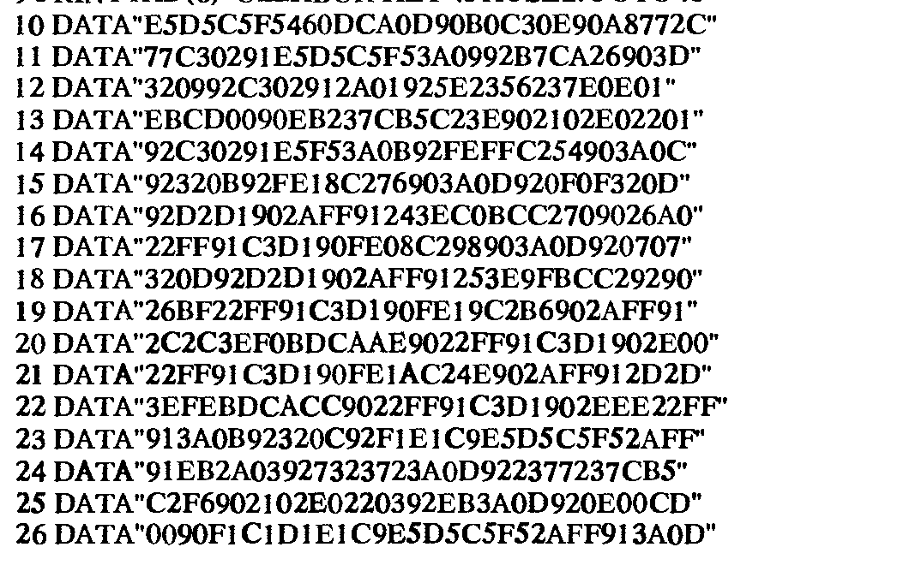
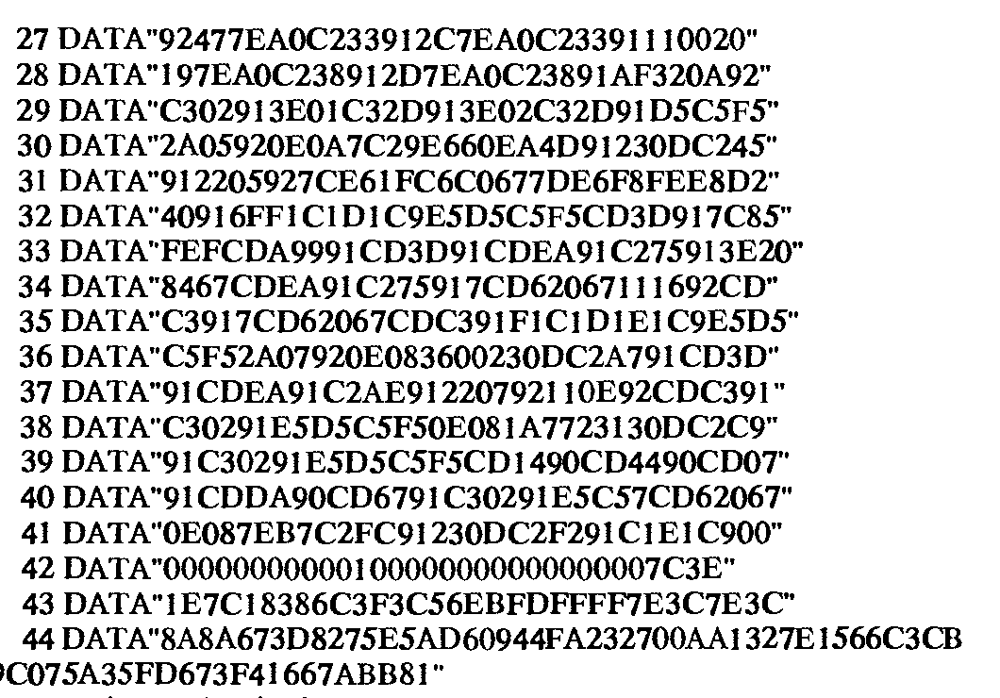

Публикация из «Радиолюбитель» - 1993 - №8. - С.12,13.

АЛЕКСАНДР ЕРЕМЕНЧУК, 15 л.,
278019, Молдова,
г.Тирасполь, пос.Днестровск,
ул.Строителей, 11 - 52.

## ИГРОВЫЕ ПРОГРАММЫ

Предлагаю читателям "РЛ" две игровые программы, написанные для ПК "Вектор-06Ц". Первая из них логическая, вторая - динамическая, известная под названием "ПИТОН".

### Программа «Ход конём»

```basic
5 REM НАЧАЛО
10 CLEAR:CLS:COLOR15:DIMA(9,9),X(9,9),Y(9,9),B(9,9):GOSUB 530
20 CLS:X=INT(RND(1)*7)+1:Y=INT(RND(1)*7)+1:A(X,Y)=1
25 REM РИСОВАНИЕ ИГРОВОЙ ДОСКИ
30 FORI=0TO160STEP20:PLOT48+I,20,1:LINESTEP0,160:PLOT48,I+20,1:LINESTEP160,0:NEXTI:GOSUB 430:H=X:L=Y:X=0:Y=1
40 CURO,24:X=0:P$=CHR$(48+Y):GOSUB 450:X=9:GOSUB 450:Y=Y+1:IFY<>9THEN 40
50 X=1:Y=0
60 CURO,24:Y=0:P$=CHR$(64+X):GOSUB 450:Y=9:GOSUB 450:X=X+1:IFX<>9THEN 60
70 PLOT28,0,1:LINESTEP200,200,B
80 Y=201:X=229:FORI=0TO10:PLOTX,Y,1:LINESTEP-200,0:PLOTX,Y,1:LINESTEP0,-200:X=X+1:Y=Y+1:NEXTI
90 PLOT0,240,2:LINE1,2,BS:PRINT"ЖЕЛАЕТЕ ХОДИТЬ ПЕРВЫМ (D/N)"
100 X=H:Y=L:I=RND(1):G$=INKEY$:IFG$=""THEN 100
110 IFG$<>"N"ANDG$<>"D"THEN 100
120 LINE1,2,BS:PRINTG$:IFG$="D"THEN 150
130 H=X:L=Y:GOSUB 240:A=X:B=Y:X=H:Y=L:GOSUB 440:IFZ=1THENW$="Я ПРОИГРАЛ":GOTO 480
140 A(A,B)=1:X=A:Y=B:GOSUB 430
145 REM ВВОД ХОДА ИГРОКА
150 CURO,24:COLOR0:PLOT0,215,1:LINESTEP255,40,BF:COLOR15:PLOT0,240,2:LINE1,2,BS:PRINT"ВАШ ХОД-";
160 I=RND(1):G$=INKEY$:IFG$=""THEN 160
170 PRINTG$;:A=ASC(G$)-64
180 I=RND(1):G$=INKEY$:IFG$=""THEN 180
190 IFG$="P"THENW$="ВЫ ПРОИГРАЛИ":GOTO 480
200 PRINTG$:B=ASC(G$)-48:IFA<1ORA>8ORB<1ORB>8THEN 150
210 IFA(A,B)=1THEN 150
220 K=0:GOSUB 650:IFK=0THEN 150
230 GOSUB 440:X=A:Y=B:A(A,B)=1:GOSUB 430:GOTO 130
235 REM НАЧАЛО П/П ОПРЕДЕЛЕНИЯ ХОДА
240 GOSUB 420:Z=0:J=0:GOSUB 340:IFI=0THENZ=1:RETURN
250 IFI=1THEN 400
260 D=1:FORJ=1TOD
270 X=X(0,J-1):Y=Y(0,J-1):GOSUB 340:IFI=0THENRETURN
280 GOSUB 460
290 NEXTJ
300 D1=0:FORJ=1TOD:IFX(J,0)=0THEND1=D1+1
310 NEXTJ:IFD1=DTHENI=1:GOTO 330
320 I=INT(RND(1)*D)+1:IFX(I,0)=0THEN 320
330 X=X(0,I-1):Y=Y(0,I-1):B(X,Y)=1:RETURN
340 I=0:A=X-2:B=Y+1:GOSUB 360:A=X-1:B=Y+2:GOSUB 360:A=X+1:B=Y+2:GOSUB 360:A=X+2:B=Y+1:GOSUB 360:A=X+2:B=Y-1:GOSUB 360
350 A=X+1:B=Y-2:GOSUB 360:A=X-1:B=Y-2:GOSUB 360:A=X-2:B=Y-1:GOSUB 360:RETURN
360 IFA>8ORA<1ORB>8ORB<1THENRETURN
370 IFA(A,B)=1THENRETURN
380 IFB(A,B)=1THENRETURN
390 X(I,0)=A:Y(I,0)=B:I=I+1:RETURN
400 FORJ=0TO7:X=X(0,J):Y=Y(0,J):IFA(X,Y)=0THENRETURN
410 NEXTJ
420 FORI=0TO7:FORJ=0TO7:B(I,J)=0:NEXTJ:NEXTI:RETURN
430 P$="":GOTO 450
440 COLOR0:P$="":GOSUB 450:COLOR15:P$="*":GOTO 450
450 PLOT31+(X)*20,(Y*20)+3,2:LINE3,2,BS:PRINTP$:RETURN
460 O=I-1:G=J:J=9:FORK=0TOO-1:X=X(G,K):Y=Y(G,K):GOSUB 340:IFI=1THENX(G,0)=0
470 NEXTK:J=G:RETURN
475 REM КОНЕЦ П/П ОПРЕДЕЛЕНИЯ ХОДА
480 CURO,24:PLOT127,240,2:LINE1,2,BS:PRINTW$;:PLOT0,220,2:PRINT"ЖЕЛАЕТЕ ПОИГРАТЬ ЕЩЕ (D/N)"
490 G$=INKEY$:IFG$=""THEN 490
500 IFG$="D"THENCLEAR:CLS:GOTO 20
510 IFG$<>"N"THEN 490
515 REM КОНЕЦ
520 CLS:STOP
525 REM НАЧАЛО П/П ВЫВОДА ПРАВИЛ ИГРЫ
530 PLOT20,210:LINE4,4,BS:PRINT"ХОД КОНЕМ"
540 CURO,19:PRINTTAB(13)"ПРАВИЛА ИГРЫ"
550 PRINTTAB(2)"ВЫ И КОМПЬЮТЕР ХОДИТЕ ПО ОЧЕРЕДИ."
560 PRINTTAB(2)"ТОТ КТО НЕ СМОЖЕТ СДЕЛАТЬ ХОДА -"
570 PRINTTAB(2)"ТОТ ПРОИГРАЛ"
580 PRINTTAB(2)"ХОДИТЬ НАДО ПО ПРАВИЛАМ КОНЯ В ШАХМАТАХ."
590 PRINTTAB(2)"ХОДИТЬ НА ЗАНЯТЫЕ КЛЕТКИ НЕЛЬЗЯ."
600 PRINTTAB(2)"ВВОДИТСЯ СНАЧАЛА БУКВА, ПОТОМ ЦИФРА."
610 PRINTTAB(2)"ЕСЛИ ВЫ ПРОИГРАЛИ, ТО ВВЕДИТЕ "PP""
620 PLOT60,0,2:LINE1,2,BS:PRINT"НАЖМИТЕ ЛЮБУЮ КЛАВИШУ"
630 A$=INKEY$:IFA$=""THEN 630
635 REM КОНЕЦ П/П ВЫВОДА ПРАВИЛ ИГРЫ
640 RETURN
650 H=X-2:L=Y+1:GOSUB 670:H=X-1:L=Y+2:GOSUB 670:H=X+1:L=Y+2:GOSUB 670:H=X+2:L=Y+1:GOSUB 670:H=X+2:L=Y-1:GOSUB 670
660 H=X+1:L=Y-2:GOSUB 670:H=X-1:L=Y-2:GOSUB 670:H=X-2:L=Y-1:GOSUB 670:RETURN
670 IFH=AANDL=BTHENK=1
680 RETURN
```

### «ПИТОН»

```basic
1 DIMA(34),A$(90):SCREEN0,0,64,64,173,173,82,82,34,34,64,64,173,173,82,82,34,34:SCREEN2,6:COLOR6,64,6:IFPEEK(-28129)=60THEN 48
2 PRINTTAB(10)"МИНУТКУ, Я ПРОВЕРЮ":RESTORE44:READA$:I=1
3 GOSUB45:A(I)=A:I=I+1:IFI<>35THEN 3
4 J=1:RESTORE10:K=-28672
5 READA$:I=1:B=0
6 GOSUB45:POKEK,A:B=(B+A)AND255:K=K+1:IFI<>17THEN 6
7 IFA(J)<>BTHENPRINT"ОШИБКА ПРИ ВВОДЕ. ПРОВЕРЬ СТРОКУ";J+9:STOP
8 J=J+1:IFJ<>35THEN 5
9 PRINTTAB(6)"ОШИБОК НЕТ":PAUSE2:GOTO 48
10 DATA"E5D5C5F5460DCA0D90B0C30E90A8772C"
11 DATA"77C30291E5D5C5F53A0992B7CA26903D"
12 DATA"320992C302912A01925E2356237E0E01"
13 DATA"EBCD0090EB237CB5C23E902102E02201"
14 DATA"92C30291E5F53A0B92FEFFC254903A0C"
15 DATA"92320B92FE18C276903A0D920F0F320D"
16 DATA"92D2D1902AFF91243EC0BCC2709026A0"
17 DATA"22FF91C3D190FE08C298903A0D920707"
18 DATA"320D92D2D1902AFF91253E9FBCC29290"
19 DATA"26BF22FF91C3D190FE19C2B6902AFF91"
20 DATA"2C2C3EF0BDCAAE9022FF91C3D1902E00"
21 DATA"22FF91C3D190FE1AC24E902AFF912D2D"
22 DATA"3EFEBDCACC9022FF91C3D1902EEE22FF"
23 DATA"913A0B92320C92F1E1C9E5D5C5F52AFF"
24 DATA"91EB2A03927323723A0D922377237CB3"
25 DATA"C2F6902102E0220392EB3A0D920E00CD"
26 DATA"0090F1C1D1E1C9E5D5C5F52AFF913A0D"
27 DATA"92477EA0C233912C7EA0C23391111002"
28 DATA"197EA0C238912D7EA0C23891AF320A92"
29 DATA"C302913E01C32D913E02C32D91D5C5F5"
30 DATA"2A05920E0A7C29E660EA4D91230DC245"
31 DATA"912205927CE61FC6C0677DE6F8FEE8D2"
32 DATA"40916FF1C1D1C9E5D5C5F5CD3D917C83"
33 DATA"FEFCDA9991CD3D91CDEA91C275913E20"
34 DATA"8467CDEA91C275917CD62067111692CD"
35 DATA"C3917CD62067CDC391F1C1D1E1C9E5D5"
36 DATA"C5F52A07920E083600230DC2A791CD3D"
37 DATA"91CDEA91C2AE91220792110E92CDC391"
38 DATA"C30291E5D5C5F50E081A7723130DC2C9"
39 DATA"91C30291E5D5C5F5CD1490CD4490CD07"
40 DATA"91CDDA90CD6791C30291E5C57CD62067"
41 DATA"0E087EB7C2FC91230DC2F291C1E1C900"
42 DATA"00000000000100000000000000007C3E"
43 DATA"1E7C18386C3F3C56EBFDFFFF7E3C7E3C"
44 DATA"8A8A673D8275E5AD60944FA232700AA1327E1566C3CB9C075A35FD673F41667ABB81"
45 A1$=MID$(A$,2*I-1,1):GOSUB46:A=D*16:A1$=MID$(A$,2*I,1):GOSUB46:A=A+D:RETURN
46 Q=48:IFASC(A1$)>64THENQ=55
47 D=ASC(A1$)-Q:RETURN
48 CLEAR2000:GOSUB50
49 CLS:PRINTTAB(3)"***ПИТОН***":PRINTTAB(1)"ТАБЛИЦА РЕКОРДОВ":FORI=1TO9:PRINTI;A$(I);A(I):NEXTI:GOTO53
50 FORI=1TO9:A$(I)="..........":A(I)=5:NEXTI:RETURN
51 CURO,24:PRINT"ДЛИНА";D:RETURN
52 A=INT(RND(1)*254)+1:RETURN
53 CURO,12:INPUT"УРОВЕНЬ (0-3)";U:IFU>3ORU<0THEN53
54 POKE&91FF,16,160,2,224,2,224:POKE&9207,0,160,5,0,0,24,192:GOSUB52:B=A:GOSUB52:POKE&9205,A,B:POKE&9171,U*5+240
55 CLS:PLOT0,240,1:LINESTEP255,0:D=5:GOSUB51:A=USR(&919E)
56 G$=INKEY$:POKE&920B,ASC(G$):A=USR(&91D4):IFPEEK(&920A)=0THEN56
57 IFPEEK(&920A)=2THENPLAY"L3205CPCPDPDPPFPFPD8":D=D+20-U*5:GOSUB51:A=USR(&919E):POKE&9209,PEEK(&9209)+20-U*5:GOTO56
58 FORI=1TO9:IFD>A(I)THEN60
59 NEXTI:GOSUB52:GOTO49
60 FORJ=9TOI+1STEP-1:A(J)=A(J-1):A$(J)=A$(J-1):NEXT:A(I)=D:CURO,24:INPUT"ВАШЕ ИМЯ";A$(I):GOTO49
```

Строки `DATA` (машинный код звукового драйвера) в журнале разнесены по колонкам страниц 12 и 13; ниже - фрагменты сканов, по которым они прочитаны:





## Другие материалы на странице 13

### «SSTV PICTURE» (Е.Чикуров)

ЕВГЕНИЙ ЧИКУРОВ, 10 класс,
426075, г.Ижевск,
ул.Союзная, 37 - 36.

По просьбе ЧА4УРЕ я составил предлагаемую ниже программу, которая предназначена для просмотра SSTV картинок, принятых с помощью компьютера "ZX-SPECTRUM" и записанных на магнитную ленту.

Программа позволяет просматривать картинки, не манипулируя клавишами компьютера, причем при загрузке очередного рисунка предыдущий все время находится на экране, и только после полной загрузки происходит быстрая смена кадра. Можно также последовательно просматривать картинки, составленные графическими редакторами ART STUDIO, ARTIST, GRAfmax и т.п.

```basic
10 REM SSTV PICTURE
20 FOR F=1 TO 12
30 READ A:POKE(59999+F),A
40 NEXT F
50 BORDER 1:POKE 23570,16
60 LOAD""CODE 3E4:RANDOMIZE USR6E4
70 GO TO 50
100 DATA 33,48,117,1,0,27,17,0,64,237,176,201
```

### «Программа-шифратор» (А.Виленчик)

ВИЛЕНЧИК АНДРЕЙ, 15 лет.
Тел. (0172) 20-18-14.

Предлагаю вам программу-шифратор для IBM-совместимых компьютеров. Она позволит защитить любую информацию или программное средство от несанкционированного доступа.

Программа набрана на IBM PC (строки 10-290: `rem Vilencryptor ver 1.1`, ввод инициалов и пароля, побайтовая обработка файлов по списку), к ПК "Вектор-06Ц" отношения не имеет, поэтому здесь не расшифровывается; текст статьи с разбором программы занимает вторую колонку стр.13.

### «Возвращаясь к напечатанному»

Нижняя часть второй колонки стр.13 - письма читателей с исправлениями к ранее опубликованным программам (в частности, к программе перевода текстов из "РЛ" №12 за 1992 г. и к программе "Защита"). Блок набран мелким шрифтом с дефектами печати, полностью достоверно расшифровать его по скану не удалось; в нём упоминаются: правка строк 70/290/440/450 программы перевода, замена кода 192 на 195 в программе "Защита" (иначе происходит возврат в BASIC), а также приём деактивации стартовой строки в копировщике COPY 86/M. Адрес автора письма: 256921, Украина, Ровенская обл., г.Кузнецовск, м-н Бетмы, 19/2 - 28, тел.(03636) 2-51-73.

## Примечания к расшифровке

- Скан не имеет текстового слоя; обе программы перепечатаны по изображениям страниц 12-13.
- Строки `DATA` в «Питоне» содержат машинный код звукового драйвера (адреса 9000h-9221h). Они распознаны двумя независимыми проходами OCR (русская и английская модели) с обязательной проверкой на осмысленность соседних байтов; тем не менее отдельные шестнадцатеричные знаки могли быть прочитаны неверно - при наборе программы их следует сверять со сканом.
- В строке 14 удалено ошибочно вставленное при распознавании `D5C5`: сумма оставшихся байтов строки (82h) совпадает со значением из таблицы строки 44, по которой программа проверяет правильность ввода.
- В журнале список «Питона» напечатан в две колонки с переносом длинных строк; порядок строк восстановлен по номерам.
- Команда `CURO` (позиционирование курсора) в скане набрана именно так; в OCR она встречается как «CUR0», «CURO».
- В строке 70 (`LINESTEP200,200,B`) и в строках с `LINE...,BS` режимы `B`, `BF`, `BS` воспроизведены как напечатано.
- Присваивания вида `I=RND(1)` в строках 100, 160 и 180 воспроизведены по скану (в OCR они выглядят как `I-RND(1)`, `1I=RND(1)`).
- Название игры во второй колонке стр.12 набрано прописными: «ПИТОН».
- В строке 1 «Питона» число в журнале разорвано переносом строки (`...=6` и на следующей строке `0THEN 48`); прочитано как `=60`.
- Опечатка журнала: в строке 610 выводится текст `ЕСЛИ ВЫ ПРОИГРАЛИ, ТО ВВЕДИТЕ "PP"` (в скане именно «PP»).
