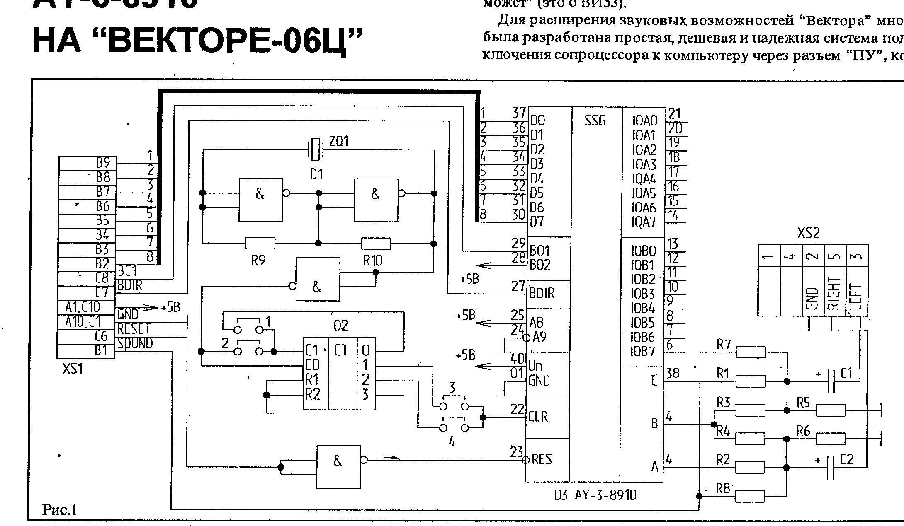
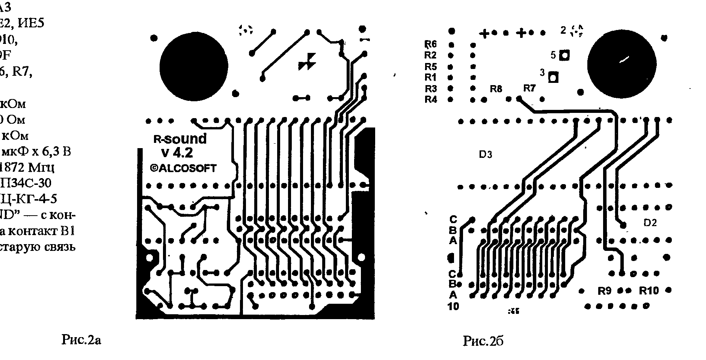
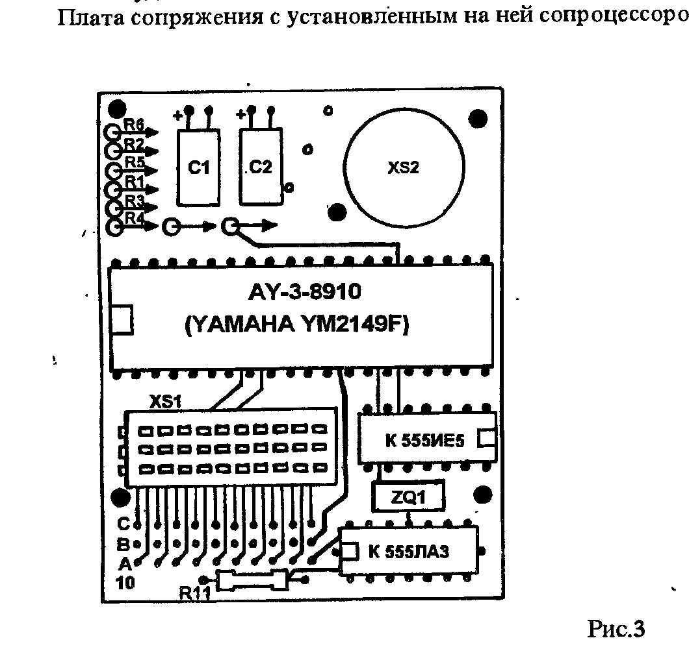

Публикация из «Радиолюбитель» - 1995 - №6. - С.8-11.

См. также [карточку R-SOUND](../../../ay/kostinevich).

Р.КОСТИНЕВИЧ, 222120, Беларусь, г.Борисов

В последнее время все больше разных моделей компьютеров стали оснащаться музыкальными сопроцессорами AY-3-8910/12 или их функциональными аналогами YAMAHA YM 2149F, позволяющими сильно украсить звуковое сопровождение игровых и других программ всевозможными музыкальными и шумовыми эффектами. "Вектор-06Ц", в котором в качестве трехканального генератора звука используется таймер КР580ВИ53, не имеет возможности регулировать громкость, создавать шумы и различные звуковые эффекты, легко получаемые на AY-3-8910. Попытки при помощи программных ухищрений добиться регулировки громкости на "Векторе" нельзя назвать успешными, ибо "рожденный ползать летать не может" (это о ВИ53).

Для расширения звуковых возможностей "Вектора" мной была разработана простая, дешевая и надежная система подключения сопроцессора к компьютеру через разъем "ПУ", которая не требует собственного источника питания и легко повторяется.

## СХЕМА И КОНСТРУКЦИЯ

Система "R-SOUND" (так я ее назвал) имеет собственный генератор тактовой частоты и место для установки второго гнезда "ПУ", что удобно для пользователей, подключивших к разъему принтер или джойстики, поскольку она совершенно "прозрачна" для этой периферии. Тактовая частота 1,7734 МГц, подаваемая на сопроцессор, позволяет программистам при написании собственных программ использовать блоки данных из программ, написанных для "ZX-SPECTRUM-128" и других компьютеров с AY-3-8910. Частота музыкального тона остается такой же как на компьютере-оригинале, что особенно важно при создании музыкальных редакторов. Система программно не "конфликтует" ни с одним из известных периферийных устройств массового применения (джойстик "ПУ", "УСПИД"-джойстик, принтер) и позволяет в полной мере производить обмен данными между компьютером и сопроцессором, осуществлять программный и аппаратный (нажатие "ВВОД"+"БЛК") сброс программируемого генератора звука, а также пользоваться звуковыми возможностями "родной" ВИ53 через совмещенный аудиовыход. Простота схемы и небольшое количество деталей обеспечивают высокую надежность и малые материальные затраты на ее изготовление.



Список элементов (как в оригинале, рядом с рис. 1):

```text
D1 — К555ЛА3
D2 — К555ИЕ2, ИЕ5
D3 — AY-3-8910,
     YM2149F
R1, R2, R5, R6, R7,
R8 — 10 кОм
R3, R4 — 20 кОм
R9, R10 — 620 Ом
R11 — 5,1 кОм
C1, C2 — 10 мкФ х 6,3 В
ZQ1 — 14,1872 МГц
XS1 — СНП34С-30
XS2 — ОНЦ-КГ-4-5
Линия "R-SOUND" — с кон-
денсатора С58 на контакт В1
разъема "ПУ", старую связь
обрезать.
```

Теперь на "Векторе-06Ц" можно исполнять довольно серьезные музыкальные партии, используя одновременно 6 каналов вывода звука и один программно-формируемый, четырьмя из которых можно управлять только по частоте. Три оставшиеся управляются по:

- частоте - каждый канал отдельно (правый, левый, средний);
- громкости - каждый канал отдельно;
- наличию/отсутствию тона - каждый канал отдельно;
- наличию/отсутствию шумов - каждый канал отдельно;
- частоте шума - все каналы вместе;
- частоте изменения амплитуды (огибающей) - все каналы;
- рисунку огибающей (атака, затухание) - все каналы вместе.

Собранное по схеме (рис.1) из исправных деталей устройство в наладке не нуждается и начинает работать сразу после подключения к ПК при условии, что вы имеете хотя бы одну программу, поддерживающую стандарт "R-SOUND". О программном обеспечении будет сказано ниже.

Плата сопряжения с установленным на ней сопроцессором имеет 2 разъема: один - для подключения к гнезду "ПУ", другой - обычное пятиконтактное гнездо для соединения смешанных аналоговых выходов сопроцессора и таймера со стереофоническим усилителем посредством соединительного шнура. Для инвертирования сигнала RESET, формируемого портом ввода/вывода D27 (КР580ВВ55А), а также для построения генератора тактовой частоты применена микросхема К555ЛА3, но возможно применение любой другой функционально аналогичной ТТЛ микросхемы. Рисунок печатной платы (рис.2а, 2б) в таком случае придется слегка изменить. Для совмещения аудиовыходов компьютера и сопроцессора в компьютере необходима небольшая переделка. Следует припаять к любой ножке конденсатора С58 (выход на магнитофон) экранированный провод. Другой его конец надо пустить на контакт В01 разъема "ПУ". Дорожку, идущую к этому контакту - обрезать, тем самым подключив к контакту В01 сразу четыре канала звука вместо одного, как было раньше.



Размещение деталей на плате показано на рис.3. Резисторы R9 и R10 устанавливаются под микросхемой D1 со стороны, обратной расположению остальных деталей. Конденсаторы С1, С2 - любые электролитические емкостью от 1 до 47 мкФ. Все резисторы - МЛТ 0,125. Разъем XS2 тоже устанавливается на плату лицевой стороной обратно расположению других деталей.



Количество программ, ориентированных на систему "R-SOUND", постоянно растет. Не исключено, что пользователи, сами собравшие плату сопряжения сопроцессора с компьютером, захотят попробовать себя в программировании музыки при помощи сопроцессора. Найти литературу, посвященную вопросам программирования AY-3-8910, довольно трудно, поэтому попытаюсь восполнить этот пробел, приведя известные мне проверенные сведения.

## ПРОГРАММИРОВАНИЕ СОПРОЦЕССОРА

Конструкция программируемого генератора звука (ПГЗ) такова, что микропроцессору с помощью команд необходимо только инициировать выработку звуковых эффектов, после чего и генератор, и управляющий им процессор выполняют возложенные на них задачи независимо друг от друга, до следующего сеанса обмена данными. Именно поэтому его и называют сопроцессором, т.к. процессор и ПГЗ работают параллельно и не мешают друг другу.

Важнейшим элементом сопроцессора является область памяти, состоящая из шестнадцати управляющих регистров, которые доступны как для записи, так и для считывания. При выборе регистра используются только младшие 4 бита данных, поэтому старшие разряды должны находиться в состоянии "0000".

Данные, поступающие в регистры, задают функции генератора: активен/неактивен, включен/выключен канал А, В, С, шум, управление огибающей и т.д.

Шестнадцать регистров разбиты на группы, задающие последовательность выполнения функций генератора и их параметры.

Регистры R14 и R15 для программирования звука не используются, их назначение - управление внутренними восьмиразрядными портами ввода/вывода и описываться здесь они не будут.

### Управление тональными генераторами (Регистры R0...R5)

Каждый из каналов А, В и С снабжен собственным тональным генератором, вырабатывающим прямоугольные импульсы требуемой частоты. Эта частота получается путем деления частоты тактового генератора 1,7734 МГц на 16 с последующим делением полученного результата на двенадцатиразрядную величину, соответствующую значению комбинации содержимого регистров грубого (нечетные регистры) и чистого (четные) тона. Четные регистры служат для хранения младшего байта коэффициента деления, нечетные - старших четырех бит. Пары регистров 0-1, 2-3, 4-5 отвечают за частоту тона в каналах А, В и С соответственно.

Таким образом, чтобы вызвать звучание ноты (например, ля первой октавы - 440 Гц), необходимо в регистры грубого и чистого тона (возьмем для примера правый канал) R0 и R1 заслать коэффициент деления равный 252 (1773400:16:252=439,83134). Погрешность неизбежна, но на слух ее и Моцарт вряд ли заметил бы.

### Управление генератором шума (Регистр R6)

Требуемая частота шумового сигнала получается, во-первых, путем деления частоты тактового генератора 1,7734 МГц на шестнадцать, и во-вторых, последующего деления полученного результата на пятиразрядную величину, размещаемую в пяти младших разрядах регистра R6.

### Управление смесителем (Регистр R7)

Регистр R7 является многофункциональным, он управляет тремя смесителями тон/шум и двумя каналами ввода/вывода:

| R7         | R6         | R5  | R4  | R3     | R2  | R1     | R0  |
| ---------- | ---------- | --- | --- | ------ | --- | ------ | --- |
| Порты      |            |     |     | Каналы |     | Каналы |     |
| IOA        | IOB        | C   | B   | A      | C   | B      | A   |
| Всегда "1" | Всегда "1" | ШУМ | ШУМ | ШУМ    | ТОН | ТОН    | ТОН |

Смесители, как было сказано ранее, объединяют частоты генераторов тона и шума каждого из трех каналов. Управление каналами позволяет добиться следующих комбинаций тона и шума:

- тон выключен, шум выключен (пауза);
- тон включен, шум выключен;
- тон выключен, шум включен;
- и тон, и шум включены.

Задание комбинации программируется в шести младших разрядах регистра R7. Два старших разряда регистра используются для управления портами ввода/вывода и здесь описываться не будут. Управление смесителем осуществляется побитно. Бит, установленный в "ноль", разрешает звучание тона или шума, а установленный в "единицу" - запрещает его.

К примеру, заслав в регистр R7 число E8H (11101000), вы разрешаете звучание тона во всех трех каналах, а шум генерируется только в канале В.

### Управление амплитудой (Регистры R8, R9, R10)

Амплитуды сигналов, вырабатываемых каналами А, В и С, задаются содержимым пяти младших разрядов регистров R8, R9 и R10 соответственно. Собственно говоря, громкость сигналов регулируется только четырьмя младшими разрядами регистров, а пятый разряд используется как флаг разрешения/запрета изменения амплитуды сигнала регистрами R11, R12 и R13. Бит, установленный в этом разряде в "1", разрешает управление амплитудой сигнала при помощи генератора огибающей, установленный в "0" - запрещает управление.

### Управление генератором огибающей (Регистры R11, R12, R13)

В ПГЗ реализовано два независимых способа создания сложных форм огибающей выходного сигнала. В первом случае программированием регистров R11 и R12 можно изменить частоту огибающей, а во втором - с помощью содержимого регистра R13 - ее форму.

Частота (период) огибающей образуется, во-первых, делением частоты тактового генератора на 256, и во-вторых, делением полученного результата на программируемое шестнадцатиразрядное значение. Эта шестнадцатиразрядная величина образуется объединением содержимого регистров R12 и R11, где R12 содержит старший байт, а R11 - младший байт коэффициента деления генератора огибающей.

Генератор формы огибающей путем деления частоты огибающей на 16 образует и выдает на регулятор амплитуды форму огибающей, представленную шестнадцатью фиксированными уровнями напряжения на один цикл, закодированными в четырехразрядном выходном счетчике. Требуемая форма огибающей получается путем управления этим счетчиком (уменьшение или увеличение содержимого) и задания режима повтора цикла огибающей либо отсутствием такого повтора.

Управление формой и циклом огибающей определяется содержимым четырех младших разрядов регистра R13. Каждый из этих четырех разрядов управляет генератором огибающей.

Регулятор амплитуды посредством своих трех четырехразрядных выходов (по одному на каждый канал) осуществляет амплитудное управление цифро-аналоговыми преобразователями каналов А, В и С, на которые подается от смесителя суммарный сигнал: шум и/или тон.

Зависимость формы выходных сигналов от комбинаций чисел в младших разрядах регистра R13 показана в Табл.1. Остальные комбинации являются повторением вышеописанных и никаких новых форм сигнала не вырабатывают.

Табл.1

| R3  | R2  | R1  | R0  | Форма сигнала                                                                                                                                                                                                                                 |
| --- | --- | --- | --- | --------------------------------------------------------------------------------------------------------------------------------------------------------------------------------------------------------------------------------------------- |
| 1   | 0   | 0   | 0   | Постепенное уменьшение уровня сигнала за один период огибающей от максимального до минимального значения, затем резкий скачок к максимальному уровню с последующим повторением полученной формы сигнала в каждом следующем периоде огибающей. |
| 1   | 0   | 0   | 1   | Постепенное уменьшение уровня сигнала за один период огибающей от максимального до минимального значения с последующим удержанием минимального уровня.                                                                                        |
| 1   | 0   | 1   | 0   | Постепенное уменьшение уровня сигнала за один период огибающей от максимального до минимального значения, затем в следующем периоде постепенное увеличение уровня сигнала с последующим повторением полученной формы сигнала.                 |
| 1   | 0   | 1   | 1   | Постепенное уменьшение уровня сигнала за один период огибающей от максимального до минимального значения, затем резкий скачок к максимальному уровню и его удержание во всех последующих периодах.                                            |
| 1   | 1   | 0   | 0   | Форма сигнала является обратной по отношению к комбинации "1000".                                                                                                                                                                             |
| 1   | 1   | 0   | 1   | Форма сигнала является обратной по отношению к комбинации "1001".                                                                                                                                                                             |
| 1   | 1   | 1   | 0   | Форма сигнала является обратной по отношению к комбинации "1010".                                                                                                                                                                             |
| 1   | 1   | 1   | 1   | Форма сигнала является обратной по отношению к комбинации "1011".                                                                                                                                                                             |

## ПРОГРАММИРОВАНИЕ ПЛАТЫ "R-SOUND"

На плате сопряжения ПГЗ с компьютером "Вектор-06Ц" находится разъем, предназначенный для подключения к гнезду "ПУ" компьютера и тем самым обеспечивающий связь между компьютером и сопроцессором при содействии внешнего порта ввода/вывода D27. Программистам эта микросхема известна как порты 5, 6 и 7.

Управление режимами работы сопроцессора (прием/передача, автономная работа) осуществляется при помощи комбинаций состояний двух шин микросхемы: BC1 и BDIR. В плате "R-SOUND" для этих сигналов предусмотрены следующие соединения:

- 1-й бит порта 5 - BC1;
- 2-й бит порта 5 - BDIR;
- 3-й бит порта 5 - RESET.

Обмен данными между ПГЗ и компьютером происходит через посредство порта 6. Таким образом, меняя числовые комбинации на выходе пятого порта и производя запись/считывание данных из порта 6, мы можем программировать звук в сопроцессоре и осуществлять программный его сброс. Аппаратный сброс происходит при нажатии и отпускании клавиш "ВВОД"+"БЛК".

## ФОРМАТ УПРАВЛЯЮЩИХ СЛОВ

Разумеется, для успешного программирования сопроцессора необходимо предварительно задать управляющее слово для внутреннего порта ввода/вывода компьютера, обеспечив тем самым его работу в том или ином режиме. Так, последовательность команд

```asm
MVI A, 88H
OUT 4
```

готовит порт для записи данных в сопроцессор, а последовательность

```asm
MVI A, 8AH
OUT 4
```

позволяет в дальнейшем считать информацию из текущего регистра ПГЗ.

В табл. 2 приведен формат управляющих слов, адресуемых сопроцессору через пятый порт и воздействующих на шины BDIR и BC1, тем самым обеспечивая правильную работу компьютера с сопроцессором.

Табл.2

| Управляющее слово | Функция сопроцессора                     |
| ----------------- | ---------------------------------------- |
| 02                | Чтение из текущего регистра сопроцессора |
| 04                | Запись данных в текущий регистр          |
| 06                | Выбор регистра                           |
| 08                | Программный RESET (сброс)                |

На простейших примерах это выглядит так:

```asm
; УСТАНОВКА ТЕКУЩЕГО РЕГИСТРА
MVI A,NREG  ; Загружаем в аккумулятор номер регистра,
OUT 6       ; выдаем его на шину данных порта 6.
MVI A,6     ; Управляющее слово выбора регистра
OUT 5       ; выдаем в пятый порт,
XRA A       ; обнуляем аккумулятор и гасим
OUT 5       ; строб. Регистр выбран.

; ПЕРЕДАЧА ДАННЫХ В РЕГИСТР
MVI A,DATA  ; Загружаем в аккумулятор данные,
OUT 6       ; выставляем их на ШД порта 6.
MVI A,4     ; Управляющее слово записи данных в
            ; регистр
OUT 5       ; засылаем в порт 5,
XRA A       ; обнуляем аккумулятор и гасим
OUT 5       ; строб. Данные переданы в текущий регистр.

; ЧТЕНИЕ ДАННЫХ ИЗ РЕГИСТРА
MVI A,2     ; Управляющее слово для считывания
            ; данных
OUT 5       ; из тек. регистра выдаем в порт 5 и
IN 6        ; считываем содержимое регистра из порта 6.
PUSH PSW    ; Помещаем в стек считанные данные,
XRA A       ; обнуляем аккумулятор и
OUT 5       ; гасим управляющий строб.
POP PSW     ; Возвращаем из стека данные.

; СБРОС СОПРОЦЕССОРА
MVI A,8     ; В А - управляющее слово для сброса ПГЗ,
OUT 5       ; отсылаем его в порт 5,
XRA A       ; и тут же гасим строб. ПГЗ сбрасывает
OUT 5       ; все регистры в "0" и прекращает работу.
```

Разумеется, вместо команды MVI A,DATA может быть любая другая команда, загружающая аккумулятор либо из памяти, либо из какого-нибудь регистра микропроцессора.

Для того чтобы вызвать звук хотя бы в одном канале, необходимо установить громкость в требуемом канале, заслать в регистр 7 сопроцессора байт, разрешающий работу этого канала, и в регистры управления тональными генераторами записать двенадцатиразрядное числовое значение для установки высоты звука. Записав в регистр 7 ПГЗ байт, разрешающий звучание и тона, и шума, мы получаем тон-шум. А если захочется звуковых эффектов - запишите в регистр управления амплитудой (R8, R9, R10) байт, задающий громкость, но с единицей в пятом разряде. Тогда, записав в регистры 11, 12 сопроцессора значение частоты и в регистр 13 - формы огибающей, получаем звуковой эффект. В табл. 3 приведены коэффициенты деления тактовой частоты 1,7734 МГц, позволяющие тональным генераторам сопроцессора охватить весь музыкальный диапазон звучания.

Табл.3

| Нота  | Суб-контр-октава | Контр-октава | Большая октава | Малая октава | 1-я октава | 2-я октава | 3-я октава | 4-я октава |
| ----- | ---------------- | ------------ | -------------- | ------------ | ---------- | ---------- | ---------- | ---------- |
| до    | -                | 0D3DH        | 069FH          | 034FH        | 01A8H      | 00D4H      | 006AH      | 0035H      |
| до#   | -                | 0C80H        | 0640H          | 0320H        | 0190H      | 00C8H      | 0064H      | 0032H      |
| ре    | -                | 0BCCH        | 05E6H          | 02F3H        | 0179H      | 00BDH      | 005EH      | 002FH      |
| ре#   | -                | 0B22H        | 0591H          | 02C8H        | 0164H      | 00B2H      | 0059H      | 002CH      |
| ми    | -                | 0A82H        | 0541H          | 02A0H        | 0150H      | 00A8H      | 0054H      | 002AH      |
| фа    | -                | 09E8H        | 04FFH          | 027BH        | 013DH      | 009FH      | 004FH      | 0028H      |
| фа#   | -                | 095DH        | 04AEH          | 0257H        | 012CH      | 0096H      | 004BH      | 0025H      |
| соль  | -                | 08D6H        | 046BH          | 0235H        | 011BH      | 008DH      | 0047H      | 0023H      |
| соль# | -                | 0857H        | 042CH          | 0216H        | 010BH      | 0085H      | 0043H      | 0021H      |
| ля    | 0FBEH            | 07DFH        | 03F0H          | 01F8H        | 00FCH      | 007EH      | 003FH      | 0020H      |
| ля#   | 0EDCH            | 076EH        | 03B7H          | 01DCH        | 00EEH      | 0077H      | 003BH      | 001EH      |
| си    | 0E07H            | 0703H        | 0382H          | 01C1H        | 00E0H      | 0070H      | 0038H      | 001CH      |

На примере многих программ, написанных для компьютера "ZX-SPECTRUM", я убедился, что умелое программирование сопроцессора позволяет достичь ошеломляющих звуковых сочетаний, которые пользователям "Вектора-06Ц" могли только сниться. "R-SOUND" позволяет вам сыграть на "Векторе" сложнейшие музыкальные партии, украшенные звучанием ударных инструментов и прочими звуковыми эффектами, ограниченными лишь вашей фантазией. Надеюсь, со временем, благодаря вашим усилиям, сопроцессор приживется к "Вектору", так же как он прижился к "Синклеру", "ATARI-800", "ZX-PROFI", "Ориону", "M$X", "ZX-SCORPION" и ко многим другим компьютерам. Теперь же, когда в кишиневском центре "Компьютер" разработали способ замены микропроцессора КР580ВМ80А на более мощный и популярный Z80, что позволяет использовать обширное программное обеспечение "ZX-SPECTRUM"-совместимых компьютеров, эти надежды становятся еще реальнее. Адаптировать программу для Z80 на "Вектор" теперь не составляет большого труда - в скором времени вы сами в этом убедитесь.

Желающие иметь готовые платы "R-SOUND", программное обеспечение и сопутствующую информацию могут получить их, выслав в адрес автора заявку, чистый конверт с марками и обратным адресом.

В заключение хочу поблагодарить Олега Филатова (г.Минск) за помощь в выяснении функций регистров сопроцессора и другие сведения, Олега Бутовича (г.Борисов), Григория Луппова (г.Киров) и других программистов и пользователей - за программную поддержку, разумную критику и дельные советы по улучшению характеристик схемы.

## Литература

1. AY-3-8910 и AY-3-8912. Краткое руководство. ASTEC OPT 148, 1993.

## Примечания к расшифровке

- Скан не имеет текстового слоя; текст набран по изображениям страниц 8-11, иллюстрации и таблицы вырезаны из сканов.
- В таблице 1 коды разрядов читаются по мелким клеткам (первый столбец скана): 1000, 1001, 1010, 1011, 1100, 1101, 1110, 1111.
- В таблице 3 клетка «Суб-контр-октава» для нот от «до» до «соль#» в журнале пуста (коэффициент деления не помещается в 12 разрядов); прочерки поставлены при расшифровке. Числа таблицы прочитаны по столбцам скана; в отдельных разрядах возможны неточности (например, «фа»/«большая октава» - 04FFH, что на 1% отличается от половины соседнего значения).
- Значения управляющих слов `88H` и `8AH` прочитаны по увеличенному фрагменту; в полностраничном OCR они распознавались как «8H» и «3AH».
- Имя системы в журнале набрано как «R-SOUND» (в OCR встречается «B-SOUND», «ЗОЧМО»).
- Надписи внутри рисунка платы («R-SOUND», «V4.2» и др.) набраны очень мелко и здесь не расшифровывались полностью.
