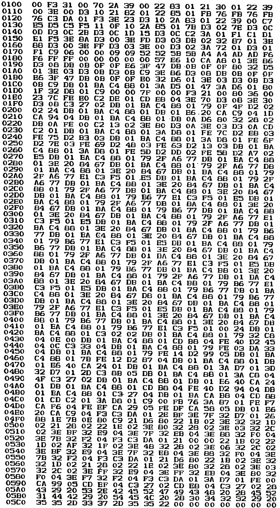

Публикация из «Радиолюбитель» - 1995 - №7. - С.35.

**ПРИЕМ SSTV НА ПК «ВЕКТОР»**

Компьютер «Вектор-06Ц» обладает прекрасными возможностями.
Но, к сожалению, ничего нет для работы SSTV.

Настоящая программа позволяет через магнитофонный вход принимать картинки в одном из трех режимов: 8, 16, 32 с.
Количество градаций яркости - 8, разрешение - в 8 и 16 секундном режиме 128 на 128 точек, а в 32 секундном 256 на 256.
Переключение режимов осуществляется клавишами СС + F1, F2, F3, соответственно для 8, 16 и 32 секундного режима.
Кроме того, нажатие клавиши СС очищает экран и осуществляет принудительную кадровую синхронизацию.
Очень желательно осуществить гальваническую развязку, включив между компьютером и трансивером согласующий трансформатор.

У автора можно заказать всю программу SSTV, которая работает и на передачу.

С. БЕРГИЧ (ER1DB),
277038, г. Кишинев, ул. Роз, 13/1 - 108.

---

## Программа

Вся программа приема напечатана в журнале в виде дампа машинного кода - 77 строк с адресами от 0100 до 05C0, по 16 байт в строке.
Дамп приведен изображением:

Побайтовая расшифровка дампа в этом README не приводится: символы в дампе мелкие, а ошибка в одном байте машинного кода не видна при чтении и делает программу нерабочей.
В каталоге [vector06c/sstv](../../../sstv) есть приемная версия этой программы (образ `sstv.fdd`); выборочная сверка ее файла с оттиском по уверенно читаемым строкам расхождений до адреса 05B0 не выявила, но последняя строка оттиска (05C0) прочитывается иначе (ее хвост - нули, а не продолжение кода), поэтому заменять журнальный дамп файлом из образа нельзя.

Управляющие клавиши программы (по описанию в журнале): СС+F1 - режим 8 с, СС+F2 - 16 с, СС+F3 - 32 с, нажатие СС - очистка экрана и принудительная кадровая синхронизация.

---

В правой колонке той же полосы продолжается публикация «Главы из руководства пользователя контроллера пакетной связи TNC2» (В.Чепыженко, 222310, г.Молодечно-3, а/я 5) - к ПК «Вектор» отношения не имеет, здесь не расшифровывается.
