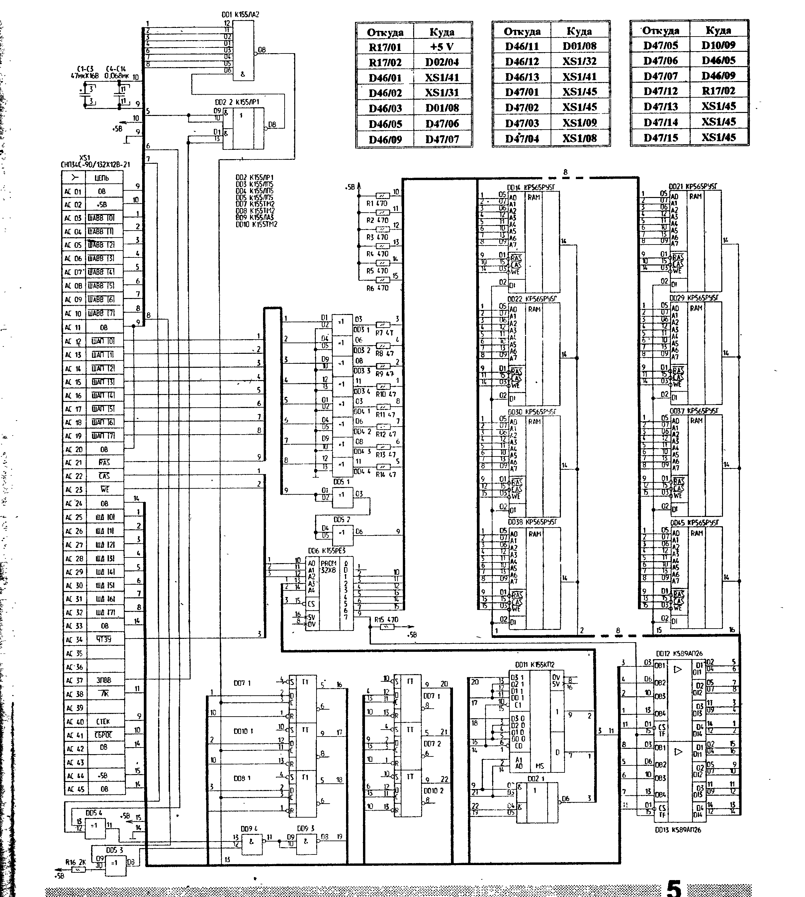
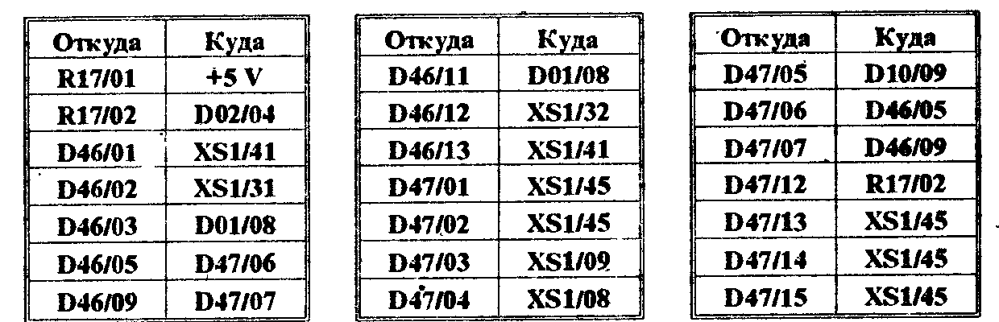

Публикация из «Радиолюбитель» - 1995 - №11. - С.4,5.

## 1. ПРИНЦИП РАБОТЫ КВАЗИДИСКА (ПРОГРАММНАЯ МОДЕЛЬ)

Квазидиск представляет собой 4 банка ОЗУ по 64К. Доступ к ОЗУ квазидиска возможен либо с использованием стековых операций (на всем адресном пространстве 64К для заданного банка), либо заменой области с адресами 0A000H...0DFFFH собственного ОЗУ БПЭВМ аналогичной областью указанного банка квазидиска.

Первый способ используется для организации доступа к квазидиску, который позволяет эмулировать работу несъемного дискового накопителя объемом 235К. Второй позволяет скрыть от пользователя экранные плоскости с адресами 0A000H...0BFFFH и 0C000H...0DFFFH, что позволяет использовать операционную систему Микро-ДОС версии 3.1 с областью для транзитных программ 46К...48К (в зависимости от версии BIOS).

## 2. УПРАВЛЕНИЕ КВАЗИДИСКОМ

Для управления квазидиском используется порт с адресом 10Н.

Биты 7...0:

| D7 | D6 | D5 | D4 | D3-D2 | D1-D0 |
| --- | --- | --- | --- | --- | --- |
| Замена экрана 3 | Замена экрана 1-2 | Замена экрана 0 | Замена стека | Стек. банк | Экран. банк |

Где:

- экран. банк - банк, с которым будет произведен обмен областями экрана 0, 1-2 и 3;
- стек. банк - банк, с которым будут работать стековые операции;
- экран 3 - область ОЗУ 08000H...09FFFH;
- экран 1-2 - область ОЗУ 0A000H...0DFFFH;
- экран 0 - область ОЗУ 0E000H...0FFFFH;
- замена - сигналы управления;
- 0 - операции с квазидиском отключены;
- 1 - операции с квазидиском включены.

Примеры:

```asm
MVI A,10110011B ; обращение к ОЗУ 0A000H...0DFFFH
OUT 10H         ; происходит на банк 3 квазидиска

MVI A,00011000B ; стековые операции происходят в
OUT 10H         ; банке 2
```

## 3. ПРОГРАММНОЕ ОБЕСПЕЧЕНИЕ

### 3.1. Микро-ДОС (BIOS-FP)

Представляет адаптированный под модифицированный квазидиск вариант Микро-ДОС с BIOS 5.1 (Филиппов Е., драйвер для работы с дисководами - Темиразов Д.). В отличие от исходного варианта использует для замены всю область экранного ОЗУ (с адресами 08000H...0FFFFH) с банка 0.

Совместима с Микро-ДОС (BIOS 3.1) вплоть до объема информации на квазидиске 235К-64К (161К). При заполнении выше этого объема часть информации при смене типа СС будет потеряна.

### 3.2. Работа с 32К экраном (16-цветный режим) в среде Микро-ДОС (BIOS-FP)

Замена старших 32К ОЗУ на банк 0 позволяет, разместив программу пользователя в нижней половине ОЗУ, элементарно переключать режимы работы либо в среде Микро-ДОС, либо работы с 16-цветным экраном с разрешением 256 точек на 256 точек.

Такой режим позволяет, например, разрабатывать программы графических редакторов различного назначения с вводом-выводом информации не через накопитель на магнитной ленте (МЛ), а непосредственно на дисковые накопители или на квазидиск. Примером может служить программа-редактор спрайтовой графики CHAKCO.COM (автор - Филиппов Е.В.), дисковый вариант BASIC 2.5 для модифицированного КД, картинный словарь русского и английского языков и ряд других программ.

Разработанная для Микро-ДОС BIOS 3.1 версия популярного интерпретатора BASIC 2.5 ДИСК (автор - Филиппов Е.В.) программно эмулирует данный режим работы, что сказывается прежде всего на скорости переключения режимов полного экрана и Микро-ДОС, а также на размере требуемой для этого части программы. Помимо этого, данный подход весьма сложно реализуется и непригоден для использования при разработке программ на языках высокого уровня.

При использовании Микро-ДОС BIOS-FP исчезают, например, ограничения на размер игровых программ, т.к. требуемая в каждый момент информация (части программы или дополнительные данные) могут быть перекачаны с дисков или с квазидиска. Такой подход позволяет разрабатывать для "Вектора-06Ц" сложные стратегические игры (типа SPACE QUEST или аналогичные на IBM PC).

Переключение в режим работы с 32К экранами:

```asm
MVI A,00000000H
OUT 10H
```

Переключение в режим работы в Микро-ДОС:

```asm
MVI A,11100000B
OUT 10H
```

Предупреждение:

В программе желательно предусмотреть собственную подпрограмму обработки прерываний, обеспечивающую включение режима 256х256 точек и обработку клавиатуры, т.к. блок драйверов BIOS-FP не обладает такими возможностями. Поэтому не рекомендуется пользоваться системными функциями Микро-ДОС, использующими ввод-вывод на консоль (например функции 6, 9 и 10).

Для возврата в Микро-ДОС в этом случае необходимо вызвать подпрограмму настройки блока драйверов:

```asm
DI
MVI A,11100000H
OUT 10H
CALL 0F800H
EI
JMP 0BD03H   ; "теплый старт"
```

### 3.3. Применение трансляторов C и PASCAL совместно с пакетами графики и спрайтов

При использовании стандартного квазидиска невозможно обеспечить работу программ, написанных на языках высокого уровня, в ином графическом режиме кроме одноцветного экрана 512х256 точек. Это связано с тем, что область 0E000H...0FFFFH содержит коды Микро-ДОС и не может быть использована для работы в качестве экрана 0. В результате нельзя использовать такие стандартные CP/M трансляторы как BDS C или PASCAL, для разработки игровых программ или графических редакторов.

Если использовать модифицированный квазидиск и Микро-ДОС (BIOS-FP), при условии подключения библиотек графических функций (таких как рисование точки, линии, выбор цвета, закраска и др.), а также библиотеки спрайтовой мультипликации, разработка полноценных графических и игровых программ на языках высокого уровня станет вполне возможной.

## 4. МОДИФИКАЦИЯ КВАЗИДИСКА

Вся модификация квазидиска сводится к тому, что на плату дополнительно устанавливаются еще один резистор (R17) и по одной микросхеме: К155ТМ2 (КР1533ТМ2) - D46 и К155РЕ3 (КР556РТ4) - D47. В связи с тем, что на сегодняшний день "гуляет" несколько принципиальных электрических схем, имеющих различия в позиционном обозначении микросхем, приведена электрическая принципиальная схема электронного диска до модификации, а в таблице дан список цепей для добавляемых в схему элементов.

Кроме того, на плате необходимо удалить две цепи: D02/04...D10/09 и D05/11...D09/13.



Список цепей для добавляемых в схему элементов (три пары столбцов "Откуда"-"Куда", как в оригинале):

| Откуда | Куда | Откуда | Куда | Откуда | Куда |
| --- | --- | --- | --- | --- | --- |
| R17/01 | +5 | D46/11 | D01/08 | D47/05 | D10/09 |
| R17/02 | D02/04 | D46/12 | XS1/32 | D47/06 | D46/05 |
| D46/01 | XS1/41 | D46/13 | XS1/41 | D47/07 | D46/09 |
| D46/02 | XS1/31 | D47/01 | XS1/45 | D47/12 | R17/02 |
| D46/03 | D01/08 | D47/02 | XS1/45 | D47/13 | XS1/45 |
| D46/05 | D47/06 | D47/03 | XS1/09 | D47/14 | XS1/45 |
| D46/09 | D47/07 | D47/04 | XS1/08 | D47/15 | XS1/45 |



## Примечания к расшифровке

- Скан не имеет текстового слоя; текст расшифрован по изображениям, иллюстрации вырезаны из сканов.
- Таблица цепей набрана в журнале очень мелким шрифтом (~6 пт). Значения прочитаны по увеличенным фрагментам скана (по каждому столбцу отдельно); в отдельных клетках возможны ошибки чтения. Повторяющиеся коды (`D01/08`, `XS1/41`, `XS1/45`) и пара `D47/06`-`D46/05`, встречающаяся в прочитанном виде дважды, воспроизведены без исправлений.
- Обозначение версии BIOS в скане читается как «BIOS-FP» (в OCR путаются «F»/«Е»/«P»); в тексте оно оставлено в таком виде.
- Имя файла редактора спрайтов читается неуверенно: по начертанию это `CHAKCO.COM` либо `CHARGD.COM`; в тексте оставлен вариант `CHAKCO.COM`.
- Первый пример управляющего слова (`10110011B`) в журнале противоречит самой таблице битов: при D6=0 замена области 0A000H...0DFFFH (экран 1-2) не включается. Пример воспроизведён как напечатано, без исправлений.
- Сокращение «СС» в разделе 3.1 («при смене типа СС») в скане читается неоднозначно.
- Подпись автора в сканах страниц 4-5 не обнаружена.
