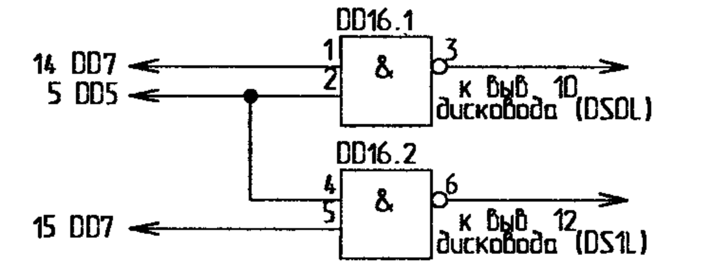

Публикация из «Радиолюбитель» - 1996 - №2. - С.7.

**В.КУЗЬМИН,** 394033, г.Воронеж

**ВОЗВРАЩАЯСЬ К НАПЕЧАТАННОМУ**

**УСОВЕРШЕНСТВОВАННАЯ СХЕМА КОНТРОЛЕРА ДИСКОВОДА ДЛЯ ПК «ВЕКТОР»**
(«РЛ» №11, 1992, с.9)

При повторении контроллера дисковода для ПК «Вектор» были обнаружены ошибки.
10-й контакт разъема дисковода должен быть соединен с 15-ой ножкой микросхемы DD7, 12-й - с 14-ой, 32-й - с 10-ой.
1-я и 15-я ножки микросхемы DD12 надо соединить с общим проводом.
Выход логического элемента DD2.1 имеет не 8-ой, а 6-ой номер.
Номинал резистора R4 - 10 кОм, резисторов R5...R8 - 1 кОм.
Кроме того, сигналы выбора дисковода DS0, DS1 приходят на разъем непосредственно с регистра управления DD7, из-за чего светодиод дисковода не гаснет даже когда обращения к дисководу нет.
Для устранения этого недостатка можно доработать контроллер в соответствии с рисунком.

Схема, к которой относится заметка, опубликована в [«РЛ» №11 за 1992 г., с.9](../1992_11_p09/README.md).

---

В верхней части той же полосы опубликован материал В.Жильцова «Буферизация процессора» (плата с буферами К555АП6 в панельку Z-80 для «Синклера»), к ПК «Вектор» отношения не имеет и здесь не расшифровывается.

Обозначения элементов в заметке набраны мелким шрифтом; прочтение «R4», «R5...R8», «DD7», «DD12», «DS0, DS1» проверено по скану увеличением.
Номер элемента в фразе «выход логического элемента DD2.1» в оттиске читается неоднозначно (похож и на DD7.1) - в тексте оставлено DD2.1, как в схеме 1992 г., где DD2 - К555ЛА4.
Рисунок в оттиске очень мелкий, его подписи (DD6.1, DD6.2, DD7, DD5, «к дисководу (DS0)») прочитаны с увеличением и могут содержать неточности в номерах выводов.
