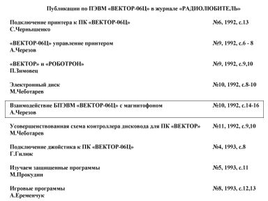

Сборник публикаций по «Вектор-06Ц» из журнала «Радиолюбитель»

[Подключение принтера к ПК «ВЕКТОР-06Ц»](1992_06_p13)

С.Чернышенко

№6, 1992, с.13

[«ВЕКТОР-06Ц» управление принтером](1992_09_p06)

А.Черезов

№9, 1992, с.6 - 8

[«ВЕКТОР» и «РОБОТРОН»](1992_09_p09)

П.Зимовец

№9, 1992, с.9,10

[Электронный диск](1992_10_p08)

М.Чеботарев

№10, 1992, с.8-10

[Взаимодействие БПЭВМ «ВЕКТОР-06Ц» с магнитофоном](1992_10_p14)

А.Черезов

№10, 1992, с.14-16

[Усовершенствованная схема контроллера дисковода для ПК «ВЕКТОР»](1992_11_p09)

М.Чеботарев

№11, 1992, с.9,10

[Подключение джойстика к ПК «ВЕКТОР-06Ц»](1993_04_p08)

Г.Гилюк

№4, 1993, с.8

[Изучаем защищенные программы](1993_05_p11)

М.Прокудин

№5, 1993, с.11

[Игровые программы](1993_08_p12)

А.Еременчук

№8, 1993, с.12,13

[Доработка клавиатуры БПЭВМ «ВЕКТОР-06Ц»](1994_02_p13)

Я.Устинский

№2, 1994, с.13

[Выбор оптимальной ПЧ](1994_03_p20)

С.Грищенко

№3, 1994, с.20

[Построение графиков на ПК «ВЕКТОР-06Ц»](1994_04_p19)

О.Филатов

№4, 1994, с.19

[Искатель алмазов](1994_04_p20)

И.Онищенко

№4, 1994, с.20,21

№5, 1994, с.18,19

[Электронный частотомер](1995_02_p14)

С.Демидов

№2, 1995, с.14

[Музыкальный стереофонический трехголосный сопроцессор для ПЭВМ «ВЕКТОР-06Ц» и «КРИСТА-2»](1995_05_p11)

В.Шашков

№5, 1995, с.11

[Музыкальный сопроцессор AY-3-8910 на «ВЕКТОРЕ-06Ц»](1995_06_p08)

Р.Костиневич

№6, 1995, с.8-11

[Прием SSTV на ПК «ВЕКТОР»](1995_07_p35)

С.Бергич

№7, 1995, с.35

[Модификация квазидиска для БПЭВМ «ВЕКТОР-06Ц»](1995_11_p04)

А.Баркарь

№11, 1995, с.4,5

[Частотомер и измеритель параметров сигнала](1995_12_p08)

И.Соловьев

№12, 1995, с.8

[Усовершенствованная схема контроллера дисковода для ПК «ВЕКТОР» («РЛ» №11, 1992, с.9)](1996_02_p07)

В.Кузьмин

№2, 1996, с.7

