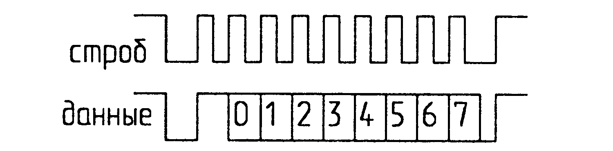

Публикация из «Радиолюбитель. Ваш компьютер» - 1996 - №2. - С.23,24.

Д.ПЛАТОНОВ, 644048, г.Омск

**КАК ПОДКЛЮЧИТЬ К «ВЕКТОРУ-06 Ц» КЛАВИАТУРУ ОТ IBM**

Мною разработан способ подключения такой клавиатуры к «Вектору» и написано несколько драйверов для различных приложений.
Сам я уже давно пользуюсь этим удобным устройством и могу только лишний раз подтвердить ее надежность.

**ДОСТОИНСТВА**

Преобладание IBM-совместимых ПК исключает неудобство «перестройки» под непривычное расположение клавиш; есть возможность выбора клавиатуры на любой вкус — клавиши высокие или низкие, мягкие или жесткие, серые или белые — какие угодно; подключение производится очень просто, для этого даже не нужно вскрывать «Вектор».
Все, что вам понадобится — это одна пятиштырьковая розетка, два резистора (6...10 кОм) и провода.
Существующее программное обеспечение позволяет эффективно использовать клавиатуру во многих программах, удобно переключать регистры, вводить любые символы, включая управляющие и псевдографические.
Клавиатура не конфликтует ни с одним из известных мне устройств, подключаемых к разъему ПУ «Вектора».

**НЕДОСТАТКИ (а недостатки ли это?)**

Стоимость такой клавиатуры составляет треть, а то и половину стоимости «Вектора»; с ней работают только те программы, которые или работают в ДОСе (имеется в виду микроДОС Вектор-06Ц), или оснащены специальным встроенным драйвером.
«...Которые работают в ДОСе...» — это не так уж и мало, ведь существует немало людей, которые занимаются только подготовкой текстов.
На «Векторе» есть и СУБД, и электронные таблицы, и справочные системы.
А чем большую часть своего времени занимается программист? «Сидит» в редакторе и «чинит» свои исходники.
В большинстве игрушек клавиатура вообще не нужна — джойстик гораздо удобнее.
В Кировском центре «Виктория» занимаются разработкой контроллера этой же клавиатуры, который позволяет использовать внешнюю клавиатуру во всех без исключения программах.
Но, во-первых, этот проект находится пока только на стадии разработки, а во-вторых, зачем покупать дорогостоящий контроллер, для подключения которого надо лезть в компьютер, если клавиатура вам нужна в основном для работы в ДОС и ее приложениях?

**ВЫБОР КЛАВИАТУРЫ**

Для работы с данным драйвером необходима клавиатура, работающая по стандарту PC/XT.
Если вы будете использовать старую 83-клавишную клавиатуру, никаких проблем возникнуть не должно.
Если же вы приобрели 101-клавишную клавиатуру — убедитесь, есть ли на ней переключатель «XT-AT».

Клавиатура подключается по схеме, приведенной на рис.1.


**РАБОТА КЛАВИАТУРЫ**

Для связи клавиатуры с ПК используются всего две информационные линии — строб и данные (clock, data).

Нормальные их состояния — data=0, clock=1.
При этом компьютер и клавиатура работают сами по себе, никак не общаясь друг с другом.
Если клавиатуре есть что передать, она периодически сбрасывает линию clock в «0» и тут же восстанавливает ее обратно, так что длительности состояний «1» и «0» находятся в соотношении примерно 10:1.
Компьютер, обнаружив это, устанавливает линию data в «1», что служит сигналом клавиатуре к передаче следующей последовательности: один стартовый бит, равный 1, и восемь битов данных, тактируемых по линии clock (рис.2).
После передачи порции данных клавиатура устанавливает обе линии в «1», при этом компьютеру лучше вновь установить признак занятости (data=0), чтобы клавиатура не начала передавать следующий байт, пока обрабатывается только что полученный.



**ПРОГРАММА ПРИЕМА БАЙТА ДАННЫХ С КЛАВИАТУРЫ**

```asm
IBMKey: mvi     A,15    ; Установка бита 7 порта 5
        out     4       ;  в единицу (установка
                        ;  признака
                        ;  готовности ПК к приему
                        ;  данных).
        lxi     B,0B00H ; Загрузка счетчика и
                        ;  регистра-накопителя.
nx000:  in      5       ; Ожидание 1 на линии строба.
        ani     4
        jz      nx000
        dcr     B       ; Проверка значения счетчика
        jz      KeyOvr  ;  и выход если там 0.
        in      5       ; Чтение из порта 5 и
        rrc             ;  сдвиг прочитанного
        rrc             ;  значения таким образом,
                        ;  чтобы бит данных клавиатуры
                        ;  попал во флаг переноса.
        mov     A,C     ; Сохранение прочитанного
        rar             ;  бита
        mov     C,A     ;  в регистре С.
nx111:  in      5       ; Ожидание нуля на линии
        ani     4       ;  строба.
        jnz     nx111
        jmp     nx000   ; Конец цикла.
KeyOvr: mvi     A,14    ; Установка бита 7 порта 5 в
        out     4       ;  единицу (то есть установка
                        ;  признака занятости
                        ;  компьютера).
        mov     A,C
        ret             ; Выход из подпрограммы.
```

Возможно, все это выглядит ненаглядно, но это вариант, готовый к работе и оптимизированный по длине.
Процедура ждет, пока клавиатура не начнет передавать данные, читает байт, далее — ждет пока на линии строба вновь установится «1», затем возвращает прочитанный бит в регистре А.
Для динамического опроса клавиатуры в подпрограмме, вызываемой по прерыванию по адресу 038h, можно использовать следующую проверку:

```asm
        mvi     B,80    ; Загрузка счетчика. При
                        ;  числе повторов меньше 70
                        ;  система реагирует на
                        ;  сигналы клавиатуры с чуть
                        ;  заметным, но неприятным
                        ;  запаздыванием.
                        ; Устанавливать число
                        ;  больше 90 — пустая трата
                        ;  времени.
polKey$: in     5       ; Чтение значения из порта.
        ani     4       ; Фильтрация бита 2 — строб
                        ;  клавиатуры.
        cz      IBMKey  ; Если там 0, вызывается
                        ;  подпрограмма IBMKey
        jz      KeyEnd  ;  иначе цикл завершается.
        dcr     B       ; Иначе ожидание,
        jnz     polKey$ ;  пока не кончится счетчик.
KeyEnd:
```

Перед началом работы микросхема параллельного интерфейса инициализируется так, чтобы старшая тетрада порта С работала на вывод, а младшая — на ввод.
Для этого подходит, например, значение 083h (в данном примере заодно настраивается на ввод и порт В, к которому подключается джойстик «П»).
Если вы хотите изменить значение одного бита порта 5, лучше не посылайте в него весь новый байт целиком, а изменяйте только один нужный вам бит путем записи значения в управляющий порт 4.
В начале работы вашей программы рекомендуется произвести сброс клавиатуры (мало ли в каком состоянии она может находиться).
Для этого перед настройкой микросхемы интерфейса для нормальной работы установите бит 2 порта 5 в ноль (проще всего отправить значение 080h в порт 4) и подождите не менее 50 мс (три команды HLT при разрешенных прерываниях).
Затем настройте микросхему так, как было описано выше (083h), и вызовите подпрограмму IBMKey для чтения одного байта с клавиатуры.
Клавиатура при сбросе проводит самотестирование и, в случае успеха, должна послать число 0AAh.
Если значение, которое вернула подпрограмма IBMKey, отличается от этого, значит или клавиатура не в порядке, или просто нажата какая-то клавиша.

Дальнейшая обработка данных, полученных от клавиатуры, очень проста: она посылает коды нажатых клавиш, сама организует автоповтор со скоростью 10 символов в секунду, а при отпускании клавиши посылает тот же самый код, но с установленным в единицу старшим битом.

Для тех, кто пишет игры, привожу коды некоторых клавиш: вверх — 048h, вниз — 080h, вправо — 04Dh, влево — 04Bh, пробел — 039h, ввод — 01Ch.
Остальные коды можно узнать в многочисленных справочниках по IBM PC.

Совершенно бесплатно предлагаю всем желающим все, что касается программной поддержки подключения IBM-клавиатуры к «Вектору».
Отвечу на любые вопросы и приму все замечания и предложения.

## Примечания к расшифровке

- Скан не имеет текстового слоя; текст расшифрован по изображениям страниц (OCR с ручной сверкой по фрагментам скана).
- В скане мелкие знаки в шестнадцатеричных константах и в мнемониках листингов читаются неуверенно.
  Эти места сверены с авторским, более полным вариантом той же статьи в разделе [«Подключение клавиатуры IBM»](../../../ibm_keyboard) (там же приведены те же листинги и значения 15, 14, 0B00h, 083h, 080h, 0AAh, 038h, а также коды клавиш 048h, 080h, 04Dh, 04Bh, 039h, 01Ch).
- Адрес прерывания в журнале набран как «038h»; метки в листингах набраны строчными буквами (`nx000`, `nx111`, `polKey$`, `KeyOvr`, `KeyEnd`) — сохранено как в журнале.
- Схема (рис.1) и временные диаграммы (рис.2) вырезаны из сканов; мелкие подписи на схеме (номера контактов разъема ПУ: C10, C01, C02, C08, C07) прочитываются уверенно, толщины проводников и начертание символов переданы как в оригинале.
- На той же странице 24 опубликовано начало статьи С.Веремеенко «PEMDU под микроскопом» (видеоприставка Dendy) — к «Вектору» отношения не имеет, здесь не расшифровывается.
- Подпись «Радиолюбитель. Ваш компьютер 2/96» — нижний колонтитул страниц.
