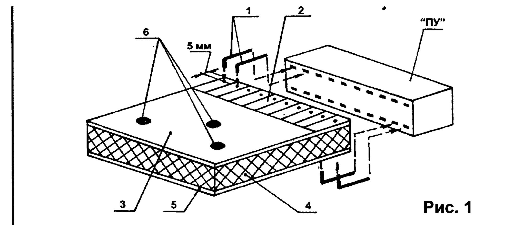

Публикация из «Радиолюбитель. Ваш компьютер.» - 1996 - №10. - С.21.

**1. КОНСТРУКЦИЯ РАЗЪЕМА**

Тем, кто приобрел УВП (устройство вывода печатающее) «Электроника МС-6312», подключить его к ПК «Вектор-06Ц» не составит труда, т.к. параллельный интерфейс «CENTRONICS» реализуется через разъем «ПУ» на задней стенке ПК.
Таблица соединений и адресных шин дана в инструкции по эксплуатации УВП (табл.8) и в руководстве по эксплуатации «Вектора».
Необходимо изготовить только разъем (рис.1) к колодке «ПУ».

Для этого я взял две пластины из фольгированного гетинакса размером 25х50 мм и просверлил по краям, отступив 5 мм, десять отверстий.
Каждое отверстие должно располагаться напротив своего вывода на колодке «ПУ».
Отверстия просверлены на расстоянии 5 мм от края для того, чтобы потом, вставив штырьки в виде буквы «Г» с маленьким хвостиком, можно было припаять их к дорожкам со стороны фольги.
Длина дорожек протравленной фольги - 20 мм.

Для получения одинаково расположенных отверстий необходимо сверлить пластины гетинакса, сложив их вместе.
Между верхней и нижней пластинами гетинакса нужно проложить такую же по размерам пластину из диэлектрика (пластмассы).
Толщина пластины - порядка 2 мм.
Ее толщина подбирается так, чтобы верхние «штырьки» попали в верхний ряд «С» колодки «ПУ», а нижние - в ряд «А» колодки.



Теперь остается только подпаять концы ленточного кабеля к дорожкам и зафиксировать кабель, зажав его двумя крышечками из пластика снизу и сверху.
Эти крышечки крепятся с помощью трех миниатюрных болтиков.

Штырьки - выводы диодов Д226 соответствующей длины, загнутые в виде буквы «Г».
На крышечках лучше сделать надписи «Верх» и «Низ», чтобы не путаться при подключении такой самодельной вилки к «ПУ».

Пояснения к рисунку:

1 - «штырьки»;
2 - дорожки;
3 - гетинакс (верхняя пластина);
4 - диэлектрик;
5 - гетинакс (нижняя пластина);
6 - крепежные отверстия.

**2. РАБОТА С УВП**

Для формирования различных шрифтов в BASIC V2.5 нужно ESC-последовательности давать в виде кодов.
Чтобы получить «русские» буквы, необходимо набрать на клавиатуре «управляющую» команду:

```basic
001 LPRINT CHR$(27)+CHR$(82)+CHR$(1).
```

Теперь через LPRINT "" можно вводить свой текст, нумеруя строки.
Полученную программу запустите через RUN.
Следует помнить, что «большие» русские буквы (А, Б, В...) печатаются при «горящем» светодиоде РУС/ЛАТ, а «маленькие» - когда надпись «РУС/ЛАТ» не светится.

**3. ПОЛУЧЕНИЕ КОПИЙ ТЕКСТА ПРОГРАММ**

Чтобы распечатать текст какой-нибудь BASIC-программы, необходимо:

1. Дать принтеру «управляющую» программу.
2. Загрузить программу, с текста которой вы хотите получить копию, через директиву MERGE "".
3. Получить распечатку с помощью директивы LLIST (номера строк распечатки).

«Управляющая» программа имеет вид:

```basic
001 LPRINT CHR$(27)+CHR$(82)+CHR$(2)
002 LPRINT "НУЖЕН PRINTER"
```

Слово «НУЖЕН» надо набирать при «горящем» светодиоде РУС/ЛАТ, а слово «PRINTER» - латинскими буквами.
Запустите «управляющую» программу через RUN и вы увидите, что УВП напечатает слово «НУЖЕН» русским шрифтом, а «PRINTER» - латинским.
По существу, строка 002 нужна только для контроля печати.

Теперь следует дать директиву CSAVE «ПЕЧАТЬ» и записать «управляющую» программу на магнитную ленту - программа пригодится не раз.

Не забывайте, что запускать «управляющую» программу следует при ВКЛЮЧЕННОМ принтере!
Если кончилась бумага - вставьте новый лист, нажмите кнопку «ЛИНИЯ» на УВП и печатайте дальше.

---

На с.21 над заголовком статьи, сразу после окончания предыдущего материала, напечатаны подпись и адрес: «С.КУЧЕРЕНКО, 255240, Киевская обл., г.Вышгород, ул.Студенческая, 1-b - 40» (номер дома набран с латинской буквой «b»). Подписи под данной статьей на этой странице нет - авторство указано по оглавлению сборника.

В верхней части страницы 21 опубликовано окончание предыдущей статьи (дисковая подсистема, с пометкой «Продолжение следует»), также подписанной С.Кучеренко; к данному материалу оно не относится и здесь не расшифровывается.
