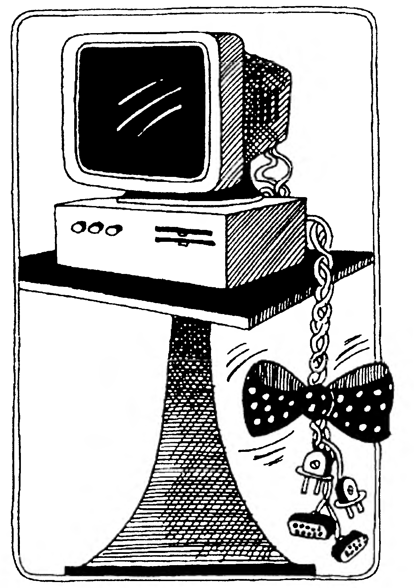

Публикация из «Радиолюбитель. Ваш компьютер» - 1998 - №1. - С.30,31.

С.КУЧЕРЕНКО,
255240, Украина,
Киевская обл., г.Вышгород,
ул.Студенческая, 1"Б" — 40.

**АНАЛИЗ АППАРАТНОГО И ПРОГРАММНОГО ОБЕСПЕЧЕНИЯ ПК «ВЕКТОР-06» И IBM PC**

Идея написать эту статью зрела у меня давно.
«Последней каплей» стало письмо одного из пользователей ПК «Вектор», в котором он сетовал на трудности в приобретении программ, отсутствие новинок, и при этом задавал вопрос: чем «Вектор» лучше или хуже «ZX-Spectrum».
Такие же вопросы я задавал себе в 1992 году (тогда я приобрел свой «Вектор»).
На радиорынке г.Киева в то время был пик популярности «Синклера» и входил в моду IBM-совместимый «ПОИСК».
О «Векторе» никто и не слышал... Приходилось доставать программы посредством почтовых отправлений (бандеролей).
Причем на 10 программ приходилось 2...3 хороших.
Кроме двух кассет с базовым набором программ и пяти кассет с играми, я ничего не имел.
Литературы — тоже никакой, а вопросов было много.

В 1994 году, волей случая, я познакомился с харьковским программистом С.Терентьевым, через которого приобрел электронный диск (ЭД) на 256 Кб и контроллер дисковода, все на одной плате.
С этого момента у меня начался «прорыв в новые технологии».

«Но при чем тут IBM PC, — спросит читатель, — «Вектор» ведь 8-разрядная машина, один к одному «Синклер»!

Как это ни парадоксально, но «Вектор» мощнее «ZX-Spectrum» по быстродействию, и по эффективности приближен к IBM PC (по скорости считывания с ГМД, вывода на экран, печати и т.д.).
«Вектор» имеет графику высокого качества (приближенную к VGA), шину CENTRONICS и другие достоинства.
Неразвитое программное обеспечение — беда отечественных программистов, которые, освоив Паскаль и азы Ассемблера, написали множество упрощенных по графике и логике программ.
Чем и подорвали мнение о «Векторе» как о хорошем ПК.
Несомненно, отсутствие литературы по Ассемблеру тоже отдаляет пользователей от работы на ПК.
В настоящее время ПК «Вектор-06Ц» позволяет работать на профессиональном уровне.

**АППАРАТНОЕ ОБЕСПЕЧЕНИЕ**

Расширенные аппаратные ресурсы перечислены мною ниже.
При этом я не указал некоторые устройства (например энергонезависимый таймер, световое перо, сканер), в связи с тем что они в настоящее время находятся в стадии разработки.

Сегодня подключены к моему «Вектору»:

- электронный диск — дополнительное ОЗУ на 256 кБ, плюс контроллер дисковода — и это все на одной плате;
- «мышь» к разъему «ПУ» (параллельно принтеру и независимо от его работы);
- модем (работает в телефонных сетях);
- стереоплата на ИМС AY 3-8910 — позволяет прослушивать музыкальные и игровые программы в режиме стерео;
- оцифровщик видео — плата обработки аналогового видеосигнала (видеокамеры, видеомагнитофона).
  Преобразует видеоизображение в графический SPR-файл.
  Этот файл пользователь затем может вывести на принтер, вставить в свою программу и т.д.
  А также реализован режим мультимедиа, позволяющий получить видеоизображение в движении (записанное на дискету);
- кроме 5-дюймового дисковода, подключен 3-дюймовый дисковод, НЖМД («винчестер») и ЭД на 2 Мб.

Дополнительно есть возможность установки процессора Z80, а также нового процессора ВМ1 с питанием только +5 В и расширенной системой команд.
Принтер к «Вектору» подключается любой.
Я лично подключал безо всяких проблем струйный принтер МС-6312, матричные МС-6313 и СМ-6337.

Могут возразить, что в IBM-совместимых компьютерах есть и мышь, и Sound Blaster, и винчестер.
А при необходимости можно купить и установить многое другое.
Однако Sound Blaster стоит 30$, а стереоплату можно собрать за 8$, получив при этом огромное удовольствие как радиолюбитель (заработала!) и как пользователь (впечатляющие стереоэффекты).

Кроме того, мощность IBM PC растет изо дня в день, программы всё «круче».
Нужны более быстрая видеокарта, 24-скоростной CD-ROM, новый процессор и т.д.
Денег на все это не хватит даже Б.Гейтсу.

**ПРОГРАММНОЕ ОБЕСПЕЧЕНИЕ**

Программное обеспечение ПК «Вектор» сегодня поразительно приближено (визуально) к программам для IBM.
«Вектор» от IBM взял все самое лучшее.
Естественно, для работы вышеперечисленной аппаратуры были написаны грамотные и эффективные программы и драйверы.
Некоторые из них я постараюсь описать вкратце:

- оболочка СО (в составе ДОС Т-34) — аналог Norton Commander, но гораздо удобнее.
  Эта оболочка позволила ПК «Вектор» стать в один ряд с IBM.
  Правда, некоторые программисты из России предлагают свои версии МикроДОС и оболочек.
  Например мне известна оболочка VC — Vector Commander (да простит В.Волков);
- PRINT FX — программа печати текстов различными шрифтами вплоть до рукописного;
- DRAW — графический редактор, пришедший на смену редактору «КАРАНДАШ», позволяет обрабатывать SPR-картинки, печатает в четырех форматах, имеет набор из 15 шрифтов (готика, машинка, итал и т.д.) и другие функции.
  Но самый мощный графический редактор — DESIGNER (создан С.Третьяковым и С.Терентьевым, г.Харьков).
  Он имеет возможности, о которых можно только мечтать:
- пакет утилит конвертации графических файлов из одного формата в другой — PCX, GRF, SCR, SPR, COM со множеством фото- и видеокартинок;
- утилиты Рыкова: Speed disk — оптимизация диска, DE — восстановление стертых файлов;
- англо-русский словарь на 18359 слов и автопоиск неизвестного английского слова;
- новые игровые программы с подгрузкой уровней, занимающие одну дискету (ЦИВИЛИЗАЦИЯ, Kings Bounty);
- RE/COVER — защита директория диска от сбоев при записи (директорий пишется дополнительно на шестую дорожку) — аналог IBM;
- REFORMAT — визуальное форматирование дискеты.
  Программа уникальна, позволяет также проверять и восстанавливать диски.
  Она создана с помощью GRAF16.REL.
  REFORMAT — лучший из форматировщиков.
- GRAF16.REL — позволяет писать на языке Ассемблер программы при помощи перемещаемых REL-подпрограмм.
  Не имеет аналогов.
  Прилагается описание работы;
- KOD — перекодирует любой файл в набор КОИ-7, КОИ-7/01, ОИ-8, АЛЬТЕРНАТИВ, старую кодировку ГОСТа и выводит на печать (при этом сохраняет BAK-файл).
  С помощью этой программы и программы COMMAND с IBM на «Вектор» очень легко переносить текстовые файлы любого размера;
- программа КОМПОНОВЩИК позволяет объединить за несколько секунд графический SPR-файл, музыкальный STM-файл и TXT-файл в исполняемую программу (COM-файл).
  На фоне картинки снизу в бегущей строке проходит ваша текстовая информация и звучит стереомузыка.
  Более того, КОМПОНОВЩИК по завершении текста подгружает следующий созданный вами COM-файл и таким образом прокручивает их в режиме слайдов со скроллингом экрана.
  Прекрасная программа для создания рекламы, видеопрезентаций и поздравлений.

**ГРАФИКА И МУЗЫКА**

Когда я запускал подобные программы, мои знакомые, работающие на IBM, не могли понять, как «Вектор» все это делает, и делает быстро.
Как на экране может находиться картинка (которую только что я имел на IBM PC в виде PCX-файла размером 320 х 200 dpi при 256 цветах — VGA режим), выводиться текст и звучать стереомузыка одновременно.
Впрочем, секрета тут никакого.
Все это — результат работы нескольких программ.

Расскажу как это делается.
Вначале на IBM PC посредством резидентной программы PCXGRAB и нерезидентной VPIC «нарезаются» необходимые PCX-картинки.
Для перекачки VGA-графики на «Вектор» используются программы COMMANDO.COM и VPCX.COM (автор — С.Терентьев).
Копирование PCX-файла осуществляется через COMMANDO, а преобразование в SPR-формат — через программу VPCX, которая благодаря оригинальному алгоритму создает картинку на экране монитора с разрешением 256 х 256 dpi любыми цветами из 256-цветовой палитры.

При этом SPR-картинка (копия) абсолютно неотличима от PCX-оригинала.
Дальнейшая судьба SPR-файлов зависит от фантазии программиста или пользователя.
Я, например, таким образом скомпоновал программу UFOLOGY («Энциклопедия инопланетных существ») по мотивам известной игры на IBM PC «UFO».
Энциклопедия занимала целую дискету.
Подобные DEMO и энциклопедии известны на IBM PC в виде обучающих и информационных программ на CD-ROM.
Что касается музыки, здесь большая заслуга принадлежит STM-файлам, которые взяты с ПК «ZX-Spectrum».
О них «Радиолюбитель» неоднократно публиковал статьи.
Для редактирования STM-файлов на ПК «Вектор» имеется музыкальный редактор «БЕТХОВЕН».

Однако картинки ПК «ZX-Spectrum» выглядят по сравнению с SPR-графикой очень бледно и примитивно, хотя многие программы позволяют переносить ZX-графику на «Вектор» (D.COM, C640+.COM, ZXCOPY.COM, CINCOPY.COM и другие).

Об игрушках для ПК «Вектор» надо писать отдельную статью.
Все игры — разные.
Есть хорошие, есть и плохие.
Самые известные игры, как правило, имеют хороший сюжет и красивую графику.
В последнее время стали появляться более красивые игры — выпуклые формы, начальное меню, смена и подгрузка уровней, наличие стереомузыки и т.д.

В завершение хочу отметить следующее.
Благодаря программистам из Харькова, Омска, С.-Петербурга, Кишинева «Вектор-06Ц» сейчас выходит на новый, более высокий уровень.
С.Терентьев издал в г.Харькове брошюры серии «Библиотека ПК «Вектор-06Ц» («Вектор» изнутри.
Руководство для начинающих специалистов» — вып.1 и «Системные программы МикроДОС» — вып.2).

Желающим приобрести брошюры и новейшие программы привожу адрес:
310177, Украина, г.Харьков-177, ул.Золочевская, 30/1 — 55, Терентьеву С.В.

## Примечания к расшифровке

- Скан не имеет текстового слоя; текст расшифрован по изображениям страниц.
  Статья сверстана в три колонки, порядок чтения: с.30 — колонки 1→2→3, затем с.31 — колонки 1→2→3.
- Латинские названия программ набраны в журнале латиницей и в OCR путаются с кириллицей; они прочитаны отдельным проходом распознавания с английской моделью (`ZX-Spectrum`, `IBM PC`, `VGA`, `CENTRONICS`, `Sound Blaster`, `Norton Commander`, `Vector Commander`, `PRINT FX`, `DRAW`, `DESIGNER`, `Speed disk`, `RE/COVER`, `REFORMAT`, `KOD`, `PCXGRAB`, `VPIC`, `COMMANDO`, `COMMANDO.COM`, `VPCX.COM`, `PCX`, `GRF`, `SCR`, `SPR`, `COM`, `UFOLOGY`, `UFO`, `DEMO`, `CD-ROM`, `STM`, `TXT`, `Kings Bounty`, `ZXCOPY.COM`).
- Места, которые в скане читаются неуверенно (мелкий кегль, узкие штрихи):
  - сокращение кодировки в списке `КОИ-7, КОИ-7/01, ОИ-8, АЛЬТЕРНАТИВ` — напечатано именно «ОИ-8» (оба прохода OCR дают те же три знака; распространённое написание — «ДКОИ-8»);
  - «ДОС Т-34» — так набрано в журнале;
  - `DE` — вторая утилита Рыкова названа двумя латинскими буквами;
  - `GRAF16.REL` — написано без «H» (возможно, опечатка вместо `GRAPH16.REL`);
  - последнее имя в списке конвертеров `CINCOPY.COM` прочитывается неуверенно (возможны варианты `CMPCOPY.COM`, `CINCOPY.COM`);
  - модели принтеров приведены как напечатано: `МС-6312`, `МС-6313`, `СМ-6337`.
- Иллюстрация в нижней части с.31 вырезана из скана; подпись «Рисунок О.Попова» в журнале стоит под рисунком.
- Колонтитул страниц: «Радиолюбитель. Ваш компьютер 1/98».
