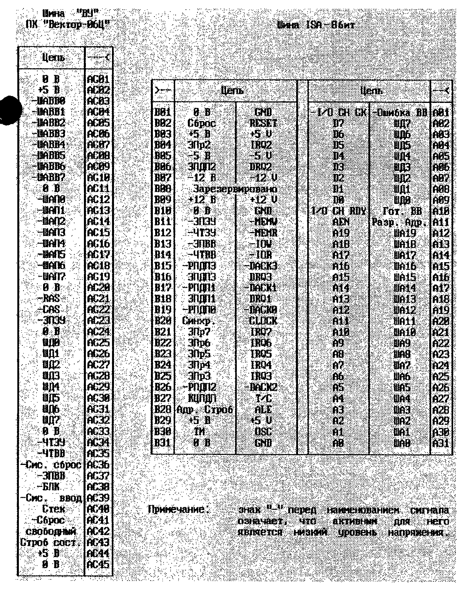
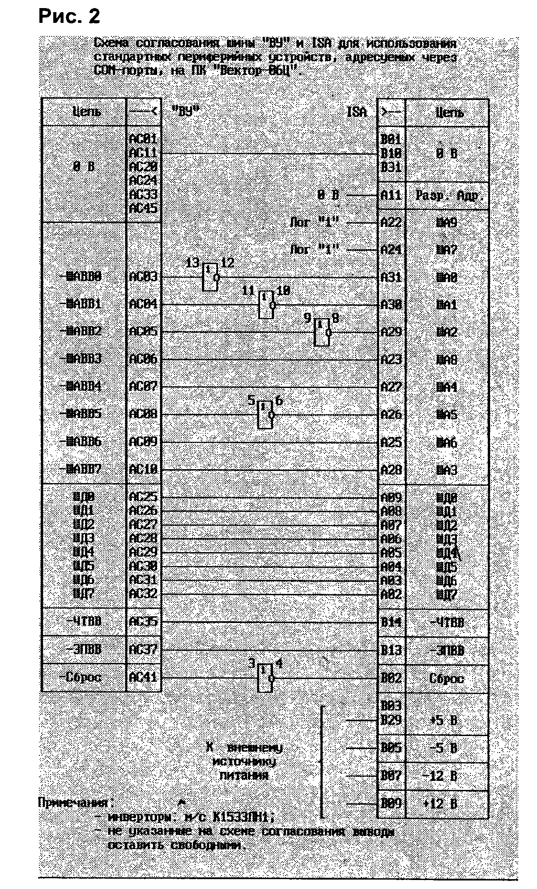
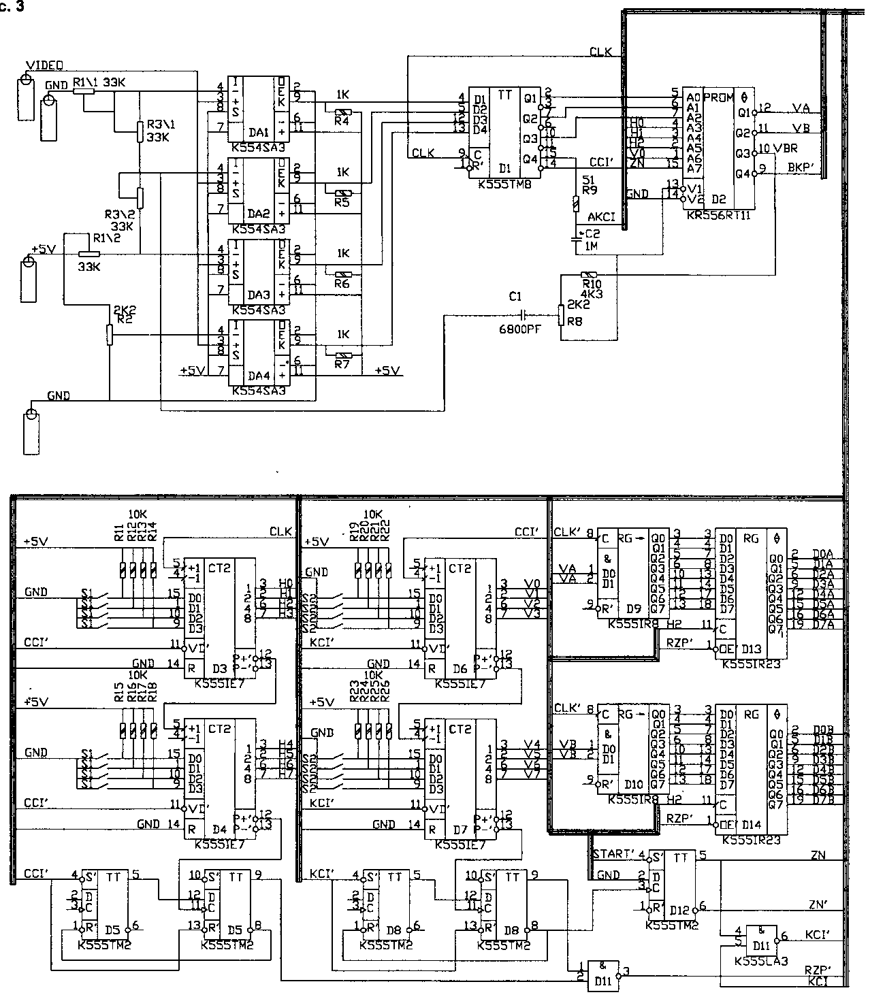
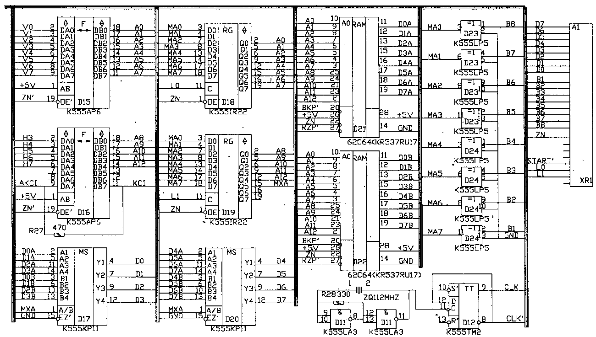

Публикация из «Радиолюбитель. Ваш компьютер» - 1999 - №3. - С.29-31.

С.КУЧЕРЕНКО,
Украина, г. Вышгород.

Данная схема была разработана и практически испытана Сергеем Терентьевым (г.Харьков, центр "Тень"). Схема существовала в "сыром" виде, и мне пришлось отдать ее на обработку в PCAD. Среди отечественных 8-разрядных машин только ПК "Вектор" обладает превосходной (цветной, почти VGA — по аналогии с IBM PC) графикой и возможностями для подключения периферии: электронный диск на 256 Кб (или на 1 Мб), трехдюймовый дисковод, винчестер, сканер, стереоплата на микросхеме AY 3-8910, мышь и т.д. А совсем недавно через шину ISA к разъему "ПУ" был подключен стандартный модем, что позволило "Вектору" работать в сетях BBS и Internet! Для этого С.Терентьевым были написаны программы, поддерживающие работу модема. Но это — тема отдельной статьи. На рис.1 приведена распайка контактов шины "ПУ" или шины ISA. На рис.2 показана схема согласования шин.

Итак, схема оцифровщика (рис.3) представляет собой плату-адаптер, которая позволяет преобразовывать и записывать на дискету в виде SPK-файла ("сбрасывать на диск") видеоизображение от видеокамеры или видеомагнитофона. Принцип классический — изображение фиксируется на экране монитора, картинка синхронизируется по кадрам и строкам (в этот момент начинает мигать светодиод "РУС/ЛАТ" компьютера) и затем при нажатии клавиши "РУС" происходит запись SPK-файла. Изображение — черно-белое, и занимает весь экран. Запись цветовой палитры потребовала бы усложнения схемы оцифровщика. Но это еще не все. Пользователь может записать последовательность кадров движущегося изображения на дискету, а затем "прокрутить кино". Эффект поразительный! В центре экрана в рамке вы можете в течение минуты увидеть "живое видео" (кино без звукового сопровождения). Очень большую роль при оцифровке изображения играет хорошая видеокамера. И несмотря на простоту схемы (всего двухбитовая яркость), "кино" получается превосходное.

Плата подключается к шине "ПУ" компьютера. Питание подается от отдельного стабилизированного источника +5 В. Переменные резисторы R1 и R3 (регулировки "ЯРКОСТЬ" и "КОНТРАСТНОСТЬ") на видеовходе — сдвоенного типа. Минипереключатели S1 и S2 служат для выбора координат картинки. Схему условно можно разделить на три части: слева вверху размещены компараторы, в центре — счетчики, справа — ОЗУ и разъем.

Несколько слов о работе элементов схемы.

Компараторы DA1...DA4 предназначены для связи аналоговой и цифровой частей схемы. Они включены в схему нестандартно [1]. За счет этого скорость нарастания выходного напряжения по сравнению со стандартной увеличена почти в 3 раза (18 В/мкс). Время выборки при этом составляет не более 100 нс!

D1 служит для фиксации уровней отсчета АЦП.

D2 — АЦП и узел для формирования сигналов VA, VB ("вибрато") и ВКР' (выбор кристаллов памяти).

D11 — генератор и вспомогательная логика для формирования сигналов KSI' (кадровых синхроимпульсов) и RZP' (разрешение записи)

D3, D4 и D6, D7 — счетчики вертикальной и горизонтальной позиции (источник адресов ОЗУ).

D9 и D10 — накопитель байтов изображения после АЦП.

D5 и D8 — узлы формирования "окон" во времени (отсекание смысловой части видеосигнала) и формирование сигналов RZP' и "занято".

D13, D14 — "защелки" байтов видеоизображения.

D15, D16 — шинный формирователь, "пропускает" адрес при запоминании устройством кадра.

D18, D19 — "защелка" адреса при считывании информации компьютером.

D21, D22 — статическое ОЗУ.

D17 и D20 — демультиплексоры данных при считывании информации компьютером.

Собранный из заведомо исправных элементов оцифровщик в настройке не нуждается.

Таблицу прошивки микросхемы D2, готовую плату оцифровщика (двусторонняя, с металлизацией отверстий), программную поддержку вы можете приобрести у С.Терентьева по адресу: 310177, Украина, г.Харьков-177.

Литература

1. В помощь радиолюбителю. Вып.№95, С.55.

Примечания к расшифровке:

- Схема оцифровщика (рис.3) набрана в журнале на двух страницах — на с.30 и на с.31; обе части приведены здесь отдельными рисунками.
- Мелкие надписи внутри рисунков (обозначения элементов, позиционные номера на схеме и подпись под рис.2) в сканах читаются плохо и здесь не расшифрованы; сами рисунки приведены в полном виде.
- В тексте статьи обозначения сигналов набраны вперемешку латиницей и кириллицей: `VA`, `VB`, `KSI'`, `RZP'` — латиницей, `ВКР'` — кириллицей (так в журнале).
- На с.29 перед статьей напечатано окончание предыдущего материала (доработка ПК "Робик" и редактор TLW2B) с подписью С.Кучеренко и адресом; к данной статье оно не относится и здесь не расшифровывается.
