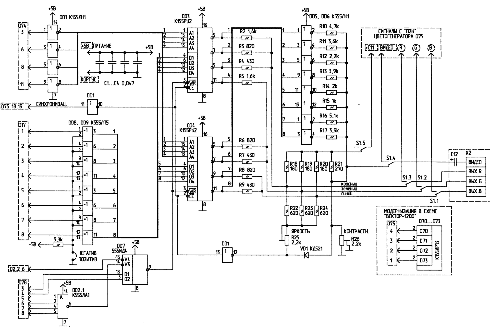

Публикация из «Радиолюбитель. Ваш компьютер.» - 1999 - №8. - С.31.

В.РОМАНОВ,
г.Рыбница.

Предлагаемая схема предназначена для модернизации бытового компьютера типа «Вектор-старт-1200», обеспечивающей полную программную совместимость с широко распространенным «Вектор-06Ц».
После доработки изображение, фон, бордюр будут формироваться так же как в «Векторе-06Ц».
Кроме того, полностью сохраняется совместимость и с «родными» программами.

Собрать схему можно как внутри компьютера навесным монтажом, так и отдельным устройством, подключаемым к системному разъему компьютера (что предпочтительнее, так как места внутри маловато).
В таком варианте схема немного изменяется: убирается S1, дополнительно устанавливается разъем для видео.

Если в модуле цветности вашего телевизора на выходе стоит микросхема К174АФ5, то DD8, DD9 можно не ставить, а завести сигналы с D17 напрямую.
В модулях цветности на МС К174ХА17 DD8, DD9 можно заменить восемью инверторами любого типа, например К555ЛН1 или другими.
Если в телевизоре стоит разъем типа SCART, тоже нужна инверсия на DD8 и DD9.

---

Надпись на схеме: «X2 и LC-фильтр по питанию для цепи R18...R21. На микросхемах DD8, DD9 собран переключатель НЕГАТИВ/ПОЗИТИВ».

Абзац о варианте с отдельным устройством в оригинале обрывается на слове «видео» (так напечатано); продолжение в скане страницы 31 отсутствует.

На странице 31 также начата статья А.Заступневича (г.Минск) «Еще раз о сжатии видеоизображений» - к ПК «Вектор» отношения не имеет, здесь не расшифровывается.
