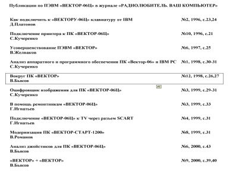

Сборник публикаций по «Вектор-06Ц» из журнала «Радиолюбитель. Ваш компьютер»

[Как подключить к «ВЕКТОРУ-06Ц» клавиатуру от IBM](1996_02_p23)

Д.Платонов

№2, 1996, с.23,24

[Картридж](../../cartrige) для ПК"Вектор-06Ц"

В.Шашков

№5, 1996

[Подключение принтера к ПК «ВЕКТОР-06Ц»](1996_10_p21)

С.Кучеренко

№10, 1996, с.21

[Усовершенствование ПЭВМ «ВЕКТОР»](../rlvk_1997_06_p25)

В.Желваков

№6, 1997, с.25

[Анализ аппаратного и программного обеспечения ПК «Вектор-06» и IBM PC](1998_01_p30)

С.Кучеренко

№1, 1998, с.30-31

[Вокруг ПК «ВЕКТОР»](1998_12_p26)

В.Быков

№12, 1998, с.26,27

[Оцифровщик изображения для ПК «ВЕКТОР-06Ц»](1999_03_p29)

С.Кучеренко

№3, 1999, с.29-31

[В помощь ремонтникам «ВЕКТОР-06Ц»](1999_03_p33)

Г.Игнатьев

№3, 1999, с.33

[Подключение «ВЕКТОР-06Ц» к TV через разъем SCART](../rlvk_1999_04_p31_scart)

Г.Игнатьев

№4, 1999, с.31

[Модернизация ПК «ВЕКТОР-СТАРТ-1200»](1999_08_p31)

В.Романов

№8, 1999, с.31

[Анализ джойстиков для ПК «ВЕКТОР-06Ц»](2000_06_p43)

В.Быков

№6, 2000, с.43

[«ВЕКТОР» + «ВЕКТОР»](2000_09_p39)

В.Быков

№9, 2000, с.39,40

В розыске:

Квазиджойстик для ПК"Вектор-06Ц"

С.Кучеренко

№3, 1996

Генератор узоров и расчет конуса на бейсике

В.Усов

Эмулятор ZX-Spectrum на Векторе

В.Фролов

№4, 1996

Озвучивание клавиш на ПК"Вектор-06Ц"

В.Иванов

№6, 1996

Программа "генератор сюжетов"

В.Усов

№7, 1996

Установка Z-80 в ПК"Вектор-06Ц"

В.Шашков

№9, 1996

Защита программ от дизассемблирования и копирования

К.Палло

№1, 1997

