УТВЕРЖДЕН ИРПД.466214.001 РЭ-ЛУ

МАШИНА ВЫЧИСЛИТЕЛЬНАЯ ЭЛЕКТРОННАЯ ЦИФРОВАЯ ПЕРСОНАЛЬНАЯ БЫТОВАЯ ПК-6128Ц

Руководство по эксплуатации

ИРПД.466214.001 РЭ

# МАШИНА ВЫЧИСЛИТЕЛЬНАЯ ЭЛЕКТРОННАЯ ЦИФРОВАЯ ПЕРСОНАЛЬНАЯ БЫТОВАЯ ПК-6128Ц

**Руководство по эксплуатации**

## СОДЕРЖАНИЕ

| Раздел | Стр. |
| --- | --- |
| 1. Общие указания | 3 |
| 2. Технические данные | 5 |
| 3. Комплект поставки | 8 |
| 4. Требования по технике безопасности | 10 |
| 5. Устройство и работа изделия | 11 |
| 6. Подготовка к работе и порядок работы | 18 |
| 7. Техническое обслуживание | 25 |
| 8. Правила хранения | 26 |
| 9. Возможные неисправности и методы их устранения | 27 |
| 10. Гарантийные обязательства | 29 |
| Приложение 1. Оснащение телевизионного приемника цветного изображения RGB-входом | 30 |
| Приложение 2. Сигналы на выходных соединителях БПЭВМ | 33 |
| Приложение 3. Схемы распайки кабелей | 36 |
| Приложение 4. Гарантийный талон | 38 |
| Приложение 5. Отрывной талон на гарантийный ремонт | 39 |
| Приложение 6. Отрывной талон на техническое обслуживание | 41 |
| Приложение 7. Модуль электронный системный. Схема электрическая принципиальная, сборочный чертеж. Перечень элементов | 43 |
| Приложение 8. Модуль электронный питания. Схема электрическая принципиальная | 52 |
| Приложение 9. Блок клавиатуры. Схема электрическая принципиальная | 55 |

## 1. ОБЩИЕ УКАЗАНИЯ

1.1. Машина вычислительная электронная цифровая персональная бытовая (далее по тексту БПЭВМ) выпускается заводом-изготовителем в двух модификациях:

1) ПК-6128 — с блоком накопителей на гибких магнитных дисках;
2) ПК-6128.01Ц — с подключением бытового кассетного магнитофона.

1.2. БПЭВМ должна устойчиво функционировать в следующих климатических условиях:

1) температуре окружающего воздуха от 5 до 40 °С;
2) относительной влажности воздуха — от 40 до 80 % при температуре 25 °С;
3) атмосферном давлении от 84 до 107 кПа (от 630 до 800 мм рт. ст.).

1.3. При покупке БПЭВМ потребуйте проверить качество ее работы путем выполнения действий, указанных в разделе 6 данного руководства по эксплуатации.

1.4. Убедитесь в сохранности пломб на БПЭВМ.
Проверьте ее комплектность и наличие гарантийного и отрывных талонов.
Убедитесь, что в гарантийном и отрывных талонах поставлены штамп магазина, разборчивая подпись или штамп продавца и дата продажи.

1.5. Талоны на техническое обслуживание и гарантийный ремонт отрываются только после того, как работа фактически выполнена.
Помните, что при утере гарантийного талона вы фактически лишаетесь права на гарантийный ремонт.

1.6. Распаковка БПЭВМ производится перед началом эксплуатации.
Предварительно выдержите БПЭВМ в упаковке в помещении при температуре (20±5) °С в течение шести часов.

1.7. Перед тем как включать БПЭВМ, внимательно ознакомьтесь с настоящим руководством и другими эксплуатационными документами, поставляемыми с БПЭВМ, в первую очередь с указанием мер безопасности, а также с органами управления и надписями на корпусе БПЭВМ.

1.8. Ежедневное техническое обслуживание производит пользователь.
Ремонт БПЭВМ производит представитель специализированных ремонтных предприятий.

Примечание. Завод-изготовитель оставляет за собой право вносить непринципиальные изменения в изделие, не ухудшающие его качественные показатели и программную совместимость.

## 2. ТЕХНИЧЕСКИЕ ДАННЫЕ

2.1. Технические данные БПЭВМ и ее составных частей приведены в табл. 1.

Таблица 1

| Наименование | Техническая характеристика |
| --- | --- |
| Процессор | базовый микропроцессор КР1821ВМ85 с тактовой частотой 3 МГц; быстродействие — 0,7·10⁶ оп/с; разрядность — 8 разрядов; количество команд — 80; количество уровней прерывания — 5 |
| Память | оперативное запоминающее устройство емкостью 128 Кбайт; постоянное запоминающее устройство с интерпретатором языка Бейсик и программой-загрузчиком с дисковода емкостью 16 Кбайт |
| Интерфейс | системная шина; параллельный интерфейс ввода-вывода — 24 линии; локальная сеть со скоростью обмена 46 Кбод; программируемый последовательный интерфейс; интерфейс связи с бытовым кассетным магнитофоном; интерфейс связи с накопителем на гибком магнитном диске; два интерфейса связи с манипулятором типа «Джойстик» |
| Устройство отображения информации | телевизионный приемник цветного или черно-белого изображения. Форматы: алфавитно-цифровой (символ/строка) — 32/25, 40/25, 42/25, 64/25, 80/25; графический — 256×256 при любых 16 цветах из 256 цветов цветовой палитры, 512×256 при любых 4 цветах из 256 цветов цветовой палитры |
| Звуковой синтезатор | четыре канала — три канала аппаратно-формируемые и один канал программно-формируемый |
| Внешние запоминающие устройства | два накопителя на гибких магнитных дисках: число дорожек — 80; двойная плотность записи; число сторон — 2; число секторов на дорожке — 5; диаметр гибкого магнитного диска — 133 мм; объем памяти сектора — 1 Кбайт; объем памяти одного накопителя — 800 Кбайт; скорость обмена — 500 Кбод. Накопитель на бытовом кассетном магнитофоне (кассета МК-60): при фазовой модуляции объем информации — 0,512 Мбайт, скорость обмена — 1500–2400 бод; при частотной модуляции объем информации — 0,56 Мбайт, скорость обмена — 1200 бод |
| Клавиатура | 70 клавиш, размещение по стандарту «ИЦУКЕН» |
| Манипулятор типа «Джойстик» | используется в качестве устройства управления перемещением динамических графических объектов на экране телевизионного приемника и дублирует клавиши управления блока клавиатуры |
| Электропитание | однофазная сеть напряжением 220 В ±10 %; частота — 50 ±1 Гц; потребляемая мощность не более 15 Вт |
| Габаритные размеры | блок системный — 415×236×70 мм; блок накопителей на ГМД — 265×247×150 мм; манипулятор типа «Джойстик» — 125×100×175 мм |

2.2. БПЭВМ обладает рядом дополнительных возможностей:

1) непосредственное подключение печатающего устройства типа EPSON FX-85, KAYT-8010M, ROBOTRON;
2) подключение дополнительных устройств внешней памяти;
3) подключение в общую локальную сеть.

2.3. В состав программного обеспечения БПЭВМ входят:

1) системное программное обеспечение;
2) прикладное программное обеспечение;
3) тестовое программное обеспечение.

2.4. Системное программное обеспечение дает возможность использовать программы БПЭВМ Вектор-06Ц, а также программы пользователя, написанные в операционных системах CP/M-80, МикроДОС.
В состав системного программного обеспечения входят для:

ПК-6128Ц — макроассемблер, интерпретатор языка Бейсик, текстовый редактор;

ПК-6128.01Ц — ассемблер-редактор, интерпретатор языка Бейсик, монитор-отладчик.

2.5. В состав прикладного программного обеспечения входят графический редактор, игровые программы.

2.6. Тестовое программное обеспечение используется для проверки функционирования БПЭВМ и ее составных частей.

## 3. КОМПЛЕКТ ПОСТАВКИ

3.1. Для БПЭВМ ПК-6128Ц:

| Наименование | Количество |
| --- | --- |
| Блок системный № \_\_\_\_ | 1 шт. |
| Блок накопителей на ГМД № \_\_\_\_ | 1 шт. |
| Манипулятор типа «Джойстик» № \_\_\_\_ | 1 шт. |
| Комплект монтажных частей: | |
| Кабель соединительный (к телевизионному приемнику) | 1 шт. |
| Кабель соединительный (к блоку накопителей на ГМД) | 1 шт. |
| Устройство соединительное (для доработки телевизионного приемника) | 1 шт. |
| Шуруп 1-2,5×7.01,9 | 2 шт. |
| Гибкий магнитный диск с программным обеспечением | 2 шт. |
| Гибкий магнитный диск (без записи) | 3 шт. |
| Эксплуатационные документы: | |
| БПЭВМ ПК-6128Ц. Руководство по эксплуатации | 1 шт. |
| Блок накопителей на ГМД. Руководство по эксплуатации | 1 шт. |
| Манипулятор типа «Джойстик». Руководство по эксплуатации | 1 шт. |
| Накопитель на ГМД. Паспорт | 2 шт. |
| Эксплуатационные документы на программное обеспечение: | |
| Тесты устройств. Руководство пользователя | 1 шт. |
| Операционная система ОС6128Ц. Руководство программиста | 1 шт. |
| Операционная система ОС6128Ц. Руководство пользователя | 1 шт. |
| Графический редактор. Руководство пользователя | 1 шт. |
| Упаковка | 1 шт. |
| Таблицы прошивки микросхем ПЗУ | 3 шт. |

3.2. Для БПЭВМ ПК-6128.01Ц:

| Наименование | Количество |
| --- | --- |
| Блок системный № \_\_\_\_ | 1 шт. |
| Манипулятор типа «Джойстик» № \_\_\_\_ | 1 шт. |
| Комплект монтажных частей: | |
| Кабель соединительный (к телевизионному приемнику) | 1 шт. |
| Кабель соединительный (трехжильный) (к магнитофону) | 1 шт. |
| Устройство соединительное (для доработки телевизионного приемника) | 1 шт. |
| Шуруп 1-2,5×7.01,9 | 2 шт. |
| Кассета МК-60 с программным обеспечением | 2 шт. |
| Эксплуатационные документы: | |
| БПЭВМ ПК-6128.01Ц. Руководство по эксплуатации | 1 шт. |
| Манипулятор типа «Джойстик». Руководство по эксплуатации | 1 шт. |
| Руководство пользователя (наименование в скане неразборчиво) | 1 шт. |
| Монитор-отладчик. Руководство программиста | 1 шт. |
| Ассемблер-редактор. Описание языка | 1 шт. |
| Интерпретатор языка Бейсик. Описание языка | 1 шт. |
| Интерпретатор языка Бейсик. Описание применения | 1 шт. |
| Упаковка | 1 шт. |
| Таблицы прошивки микросхем ПЗУ | 3 шт. |

Примечание. Телевизионный приемник и бытовой кассетный магнитофон в комплект поставки не входят.

## 4. ТРЕБОВАНИЯ ПО ТЕХНИКЕ БЕЗОПАСНОСТИ

4.1. БПЭВМ устанавливается в месте, удобном для проведения работы, на расстоянии не менее одного метра от отопительной системы.

4.2. Не рекомендуется устанавливать БПЭВМ в сырых помещениях.
Нельзя закрывать вентиляционные отверстия системного блока.

4.3. Будьте осторожны! Во избежание несчастных случаев и выхода из строя изделия категорически запрещается:

1) включать БПЭВМ при снятой крышке;
2) оставлять БПЭВМ во включенном состоянии без наблюдения;
3) подключать к соединителям устройства, не предусмотренные руководством по эксплуатации;
4) при включенной БПЭВМ одновременное прикосновение к металлическим частям БПЭВМ (телевизора, магнитофона, блока накопителей на ГМД, дополнительных устройств) и к устройствам, подключенным к шине «земля» или эквивалентным им (батареи центрального отопления и т.п.).

4.4. Перед включением БПЭВМ убедитесь в отсутствии повреждения изоляции сетевого шнура, повреждения корпуса.

Не подключайте БПЭВМ к неисправным телевизору, магнитофону, блоку накопителей на ГМД.

4.5. При работе с цветным или черно-белым телевизором рекомендуется находиться на максимальном расстоянии от него, которое обеспечивается длиной соединительного кабеля.

4.6. Если Вы работаете в текстовом режиме (512×256 точек на экране), то советуем Вам использовать черно-белый телевизор или монитор.

4.7. В разработанных Вами программах рекомендуем задавать оптимальное соотношение числа символов в строке и строк на экране, которое определяется разрешающей способностью телевизора и удобством в работе.

## 5. УСТРОЙСТВО И РАБОТА ИЗДЕЛИЯ

5.1. БПЭВМ ПК-6128Ц (ПК-6128.01Ц) соответствует требованиям ГОСТ 27201-87 и предназначена для диалогового режима с высокой степенью интерактивности и может быть использована в системе образования для оснащения кабинетов вычислительной техники и информатики, в личном пользовании, а также для решения научно-технических, планово-экономических и других задач в сфере науки и производства.

5.2. В БПЭВМ используется общая оперативная память для микропроцессора и контроллера графического дисплея емкостью 128 Кбайт, управляемая диспетчером памяти.
Диспетчер памяти разделяет ОЗУ на четыре банка по 32 Кбайт, причем любой из этих банков может быть использован как видео ОЗУ или как оперативная память для микропроцессора.
Диспетчер памяти позволяет подключать экранное ОЗУ к старшим 32 Кбайт адресной шины микропроцессора либо подключать дополнительные 32 Кбайт для организации видео ОЗУ за пределами непрерывного адресного пространства микропроцессора.

5.3. Конструктивно БПЭВМ ПК-6128Ц состоит из:

1) блока системного;
2) блока накопителей на ГМД;
3) манипулятора типа «Джойстик»;

БПЭВМ ПК-6128.01Ц конструктивно аналогичен БПЭВМ ПК-6128Ц (отсутствует блок накопителей на ГМД).

5.4. Системный блок является основной составной частью БПЭВМ, содержит в своем составе: блок клавиатуры, позволяющий оперативно управлять работой БПЭВМ; системный модуль, который обеспечивает выполнение программ, хранение и обработку информации, организацию диалога с пользователем; модуль питания, обеспечивающий электропитание системного блока.

5.5. Принцип работы блока клавиатуры основан на сканировании матрицы клавиш и анализе результатов сканирования, по которому формируется информация в БПЭВМ.

5.6. Электронный модуль питания подключается к первичной сети напряжением 220 В, частотой 50 Гц.
Выходное напряжение стабилизируется путем изменения длительности и частоты повторения импульсов.

5.7. Электронный системный модуль состоит (см. схему электрическую) из следующих функциональных узлов:

1) узла управления;
2) центрального процессора;
3) узла синхронизации;
4) узла начальной загрузки и запуска;
5) дисплейного узла;
6) диспетчера памяти;
7) параллельных программируемых интерфейсов и таймера;
8) узла сопряжения с магнитофоном;
9) узла сопряжения с манипулятором типа «Джойстик»;
10) ОЗУ;
11) узла локальной сети;
12) контроллера дисковода.

5.8. Узел управления обеспечивает диспетчеризацию функционирования узлов системного модуля, дешифрацию внешних устройств, управление переключением ОЗУ и ПЗУ, обработкой прерываний от контроллера дисплея, управление диспетчером памяти, обращением к устройствам ввода/вывода.
Адреса портов ввода/вывода приведены в таблице 2.

5.9. Центральный процессор выполнен на микросхеме типа КР1821ВМ85 и предназначен для выполнения следующих функций:

1) вычисления адресов операндов и команд;
2) содержательной обработки операндов;
3) обмена информацией с другими устройствами;
4) реакции на воздействие с клавиатуры и устройств пользователя.

5.10. Узел синхронизации служит для формирования ряда синхронизирующих сигналов, поступающих на другие узлы БПЭВМ.

5.11. Узел начальной загрузки и запуска позволяет при включении питания производить сброс микропроцессора, подключать ПЗУ к адресной шине, производить загрузку Бейсика и осуществлять взаимную синхронизацию работы микропроцессора и делителя частоты.

5.12. Дисплейный узел служит для считывания информации из ОЗУ и отображения ее на экране телевизора, формирования синхронизации для телевизора, осуществления скроллинга экрана, переключения режима дисплея, регенерации ОЗУ.

5.13. Диспетчер памяти служит для организации перераспределения адресного пространства микропроцессора между процессором и видео ОЗУ, переключения банков памяти по 32 Кбайт, управления чтением-записью.
Распределение адресного пространства между плоскостями экранного ОЗУ представлено на рис. 1 и в таблице 3.

Таблица 2

| Код адреса порта | Значение разрядов адреса порта (7 6 5 4 3 2 1 0) | Порт ввода-вывода |
| --- | --- | --- |
| 00-03 | 0 0 0 0 0 0 A1 A0 | Трехканальный параллельный порт ввода-вывода 078 |
| 04-07 | 0 0 0 0 0 1 A1 A0 | Область адресов порта 0В0 |
| 08-0В | 0 0 0 0 1 0 A1 A0 | Область адресов таймера 079 |
| 0С | 0 0 0 0 1 1 0 0 | Таблица цветности |
| 0D | 0 0 0 0 1 1 0 1 | Установка банка ОЗУ экрана |
| 0Е | 0 0 0 0 1 1 1 0 | Режим диспетчера памяти |
| 0F | 0 0 0 0 1 1 1 1 | Сброс системы |
| 10 | 0 0 0 1 0 0 0 0 | Свободный |
| 11 | 0 0 0 1 0 0 0 1 | Чтение кода абонента локальной сети |
| 12 | 0 0 0 1 0 0 1 0 | Джойстик 2 |
| 13 | 0 0 0 1 0 0 1 1 | Джойстик 1 |
| 10-13 | 0 0 0 1 0 0 A1 A0 | Порт пользователя |
| 14-17 | 0 0 0 1 0 1 A1 A0 | Порт контроллера локальной сети |
| 18-1В | 0 0 0 1 1 0 A1 A0 | Порт контроллера дисковода |
| 1С-1F | 0 0 0 1 1 1 A1 A0 | Порт выбора дисковода и головки |

Примечание. OUT — порт, работающий на вывод информации; IN — порт, работающий на ввод информации; X — любое состояние.

По команде `OUT 0` происходит запись в регистр номера банка ОЗУ, информация с которого будет отображаться на экране видеомонитора.
Возможно подключение любого из четырех банков.
Номер банка задается двумя младшими битами данных.

По команде `OUT E` в регистр записывается байт управления адресом A15 микропроцессора и дополнительным адресом A16.
Наиболее рациональные значения управляющего байта приведены в таблице 4.

5.14. Параллельные программируемые внутренние интерфейсы ввода-вывода обеспечивают передачу данных внутри системного модуля, сканирование и прием информации из модуля клавиатуры, осуществляют программную связь с узлом сопряжения с магнитофоном, обслуживают скроллинг экрана, производят запись математического цвета в таблицу, устанавливают цвет бордюра и определяют режим работы видеоконтроллера.

Таблица 3

| Адресное пространство плоскости | Номер плоскости | Регистр сдвига |
| --- | --- | --- |
| E000-FFFF | 0 | 048 |
| C000-DFFF | 1 | 047 |
| A000-BFFF | 2 | 046 |
| 8000-9FFF | 3 | 045 |

Адресное пространство экранного ОЗУ.

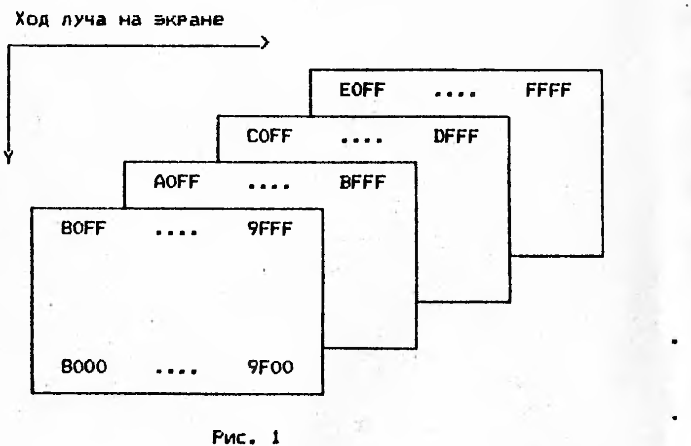

Таблица 4

Наиболее рациональные значения управляющего байта (под общим заголовком «Значение ША15» в оригинале стоят две пары подколонок A15, A16).

Чтение

| Биты 3 2 1 0 | A15 | A16 | A15 | A16 |
| --- | --- | --- | --- | --- |
| 0000 | 0 | 0 | 1 | 0 |
| 0011 | 0 | 0 | 0 | 1 |
| 0010 | 0 | 1 | 1 | 1 |
| 1000 | 0 | 1 | 1 | 0 |
| 1100 | 1 | 1 | 1 | 0 |

Запись

| Биты 7 6 5 4 | A15 | A16 | A15 | A16 |
| --- | --- | --- | --- | --- |
| 0000 | 0 | 0 | 1 | 0 |
| 0011 | 0 | 0 | 0 | 1 |
| 0010 | 0 | 1 | 1 | 1 |
| 1000 | 0 | 1 | 1 | 0 |
| 1100 | 1 | 1 | 1 | 0 |

Необходимый режим работы задается посредством записи в порт с адресом 00 кода управляющего слова.
Назначение разрядов порта показано в табл. 5.

Трехканальный порт 078 предназначен для осуществления программного доступа к периферийным устройствам (печать и др.).

Необходимый режим работы 078 задается посредством записи в порт с адресом 04 кодов управляющего слова.

Адресация каналов этой микросхемы следующая:

PA — порт с адресом 07;
PB — порт с адресом 06;
PC — порт с адресом 05;

Все разряды каналов PA, PB, PC подключены к соединителю.

5.15. Узел сопряжения с магнитофоном обеспечивает сопряжение бытового кассетного магнитофона с БПЭВМ.
Связь осуществляется через порт 01: PC0 (выход на магнитофон) и PC4 (вход с магнитофона).

5.16. Узел сопряжения с манипуляторами типа «Джойстик» предназначен для подключения к БПЭВМ двух манипуляторов типа «Джойстик», позволяющих пользоваться игровыми программами.
Чтение информации с первого «Джойстика» осуществляется по команде `IN 0F`, со второго — по команде `IN 0E`.
Манипуляторы типа «Джойстик» подключаются к соединителям Х2, Х3.

Таблица 5

Назначение разрядов каналов PA, PB, PC (в оригинале ячейки объединены по вертикали; ниже сведены группы разрядов).

| Адрес порта | Разряды канала | При обратном ходе кадровой развертки | При отображении информации |
| --- | --- | --- | --- |
| PA | 0–1 | код сканирования клавиатуры | младший байт адреса регенерации |
| PA | 2–7 | младший байт адреса регенерации экрана | младший байт адреса регенерации экрана |
| PB | 0–4 | адрес (математический код цвета), поступающий на таблицу цветности при ее записи | считывание кода сканирования клавиатуры; математический цвет бордюра поступает на последовательные входы регистров сдвига |
| PB | 5–7 | — | сигнал режима 256×256 или 512×256 |
| PC | 0 | выходной сигнал на магнитофон | выходной сигнал на магнитофон |
| PC | 1–2 | — | — |
| PC | 3 | управление светодиодом РУС | управление светодиодом РУС |
| PC | 4 | входной сигнал с магнитофона | входной сигнал с магнитофона |
| PC | 5 | клавиша СБР | клавиша СБР |
| PC | 6 | клавиша УС | клавиша УС |
| PC | 7 | клавиша РУС/ЛАТ | клавиша РУС/ЛАТ |

5.17. Оперативное запоминающее устройство предназначено для приема, хранения и передачи данных по запросу процессора, контроллера дисплея, локальной сети и устройств пользователя.

ОЗУ реализовано на микросхемах КР565РУ5Г и имеет емкость 128 Кбайт.

5.18. Узел локальной сети построен на микросхеме КР580ВВ51А, которая представляет собой программируемый последовательный интерфейс, работающий в асинхронном режиме на общую сигнальную линию локальной сети класса.
Обмен информацией происходит со скоростью приблизительно 46 Кбод.
Работа происходит по прерываниям (ВТ 6,5 и ВТ 7,5).
Обращение к портам контроллера происходит по адресам 14, 15.
Адрес (номер) абонента локальной сети задается четырьмя перемычками на входе соединителя Х4.
В локальную сеть можно объединять до 16 БПЭВМ.

5.19. Контроллер дисковода выполнен на специализированной БИС контроллера накопителя на ГМД типа КР1818ВГ93.
Для управления контроллером выделены порты внешних устройств с адресами с 18Н по 1ВН.
Адреса между регистрами контроллера распределены следующим образом:

- регистр команд — 1ВН;
- регистр состояния — 18Н;
- регистр текущей дорожки — 1АН;
- регистр сектора — 19Н;
- регистр данных — 16Н.

Кроме того, для задания номера дисковода и управления головкой выделен адрес 1СН.

5.20. Все основные узлы БПЭВМ связаны с центральным процессором через системную магистраль.

Возможность наращивания аппаратных средств обеспечивается магистральной структурой БПЭВМ, наличием параллельного программируемого интерфейса и выводом внутренней системной магистрали на отдельный соединитель ХВ.

5.21. Блок накопителей на ГМД состоит из двух накопителей и источника питания, расположенных в одном корпусе.
Блок накопителей на ГМД соединяется с системным блоком кабелем.

5.22. Манипулятор типа «Джойстик» дублирует клавиши управления клавиатуры БПЭВМ и используется в качестве координатной ручки, позволяющей выполнять перемещения объектов на экране и переключение режимов работы.

## 6. ПОДГОТОВКА К РАБОТЕ И ПОРЯДОК РАБОТЫ

### 6.1. Подготовка к работе

6.1.1. Внимание! Перед включением БПЭВМ необходимо изучить эксплуатационную документацию, поставляемую с БПЭВМ.

6.1.2. В качестве видеомонитора для БПЭВМ без дополнительной доработки можно использовать только телевизоры, имеющие RGB-вход по ГОСТ 24838-87.

6.1.3. Для подключения к БПЭВМ телевизоров, не имеющих RGB-входа, используйте рекомендации, приведенные в Приложении 1.

### 6.2. Органы управления и индикации

6.2.1. В БПЭВМ предусмотрена световая индикация:

«СЕТЬ» — при включении питания системного блока загорается светодиод на передней панели системного блока;

«РУС» — светодиод горит, Вы работаете в регистре клавиатуры в русском алфавите.
Если светодиод не горит, Вы работаете в латинском алфавите.

«СЕТЬ» — при включении питания блока накопителей на ГМД загорается светодиод на боковой стенке блока накопителей.

6.2.2. Клавиатура БПЭВМ логически разделяется на управляющую, алфавитно-цифровую и функциональную.
В состав управляющей клавиатуры входят клавиши СБР, ВВОД, БЛК.

Алфавитно-цифровая и функциональная клавиатура описаны в эксплуатационной документации на программное обеспечение.

6.2.3. Тумблеры включения питания БПЭВМ и блока накопителей на ГМД находятся соответственно на боковой стенке системного блока и на задней стенке блока накопителей.

6.2.4. Потенциометры «+» и «Ф», находящиеся на задней панели системного блока, служат для получения качественного изображения на экране телевизора.

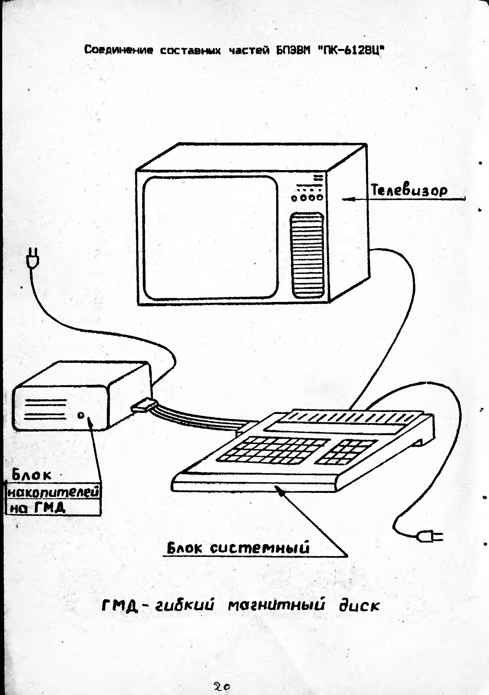

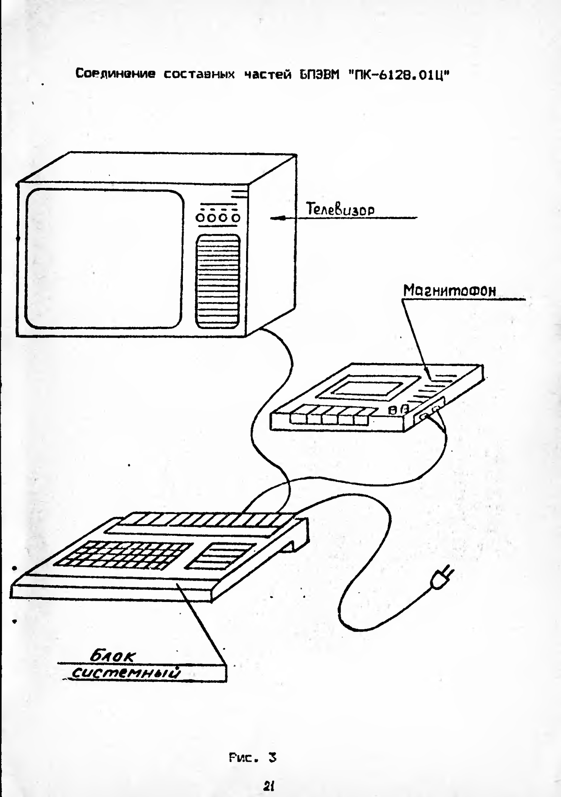

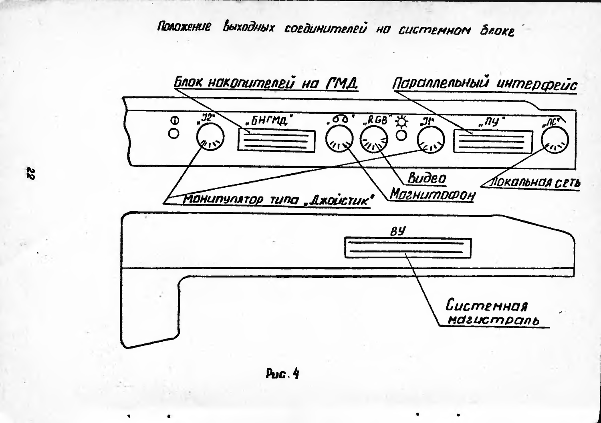

### 6.3. Программное обеспечение

6.3.1. Состав программного обеспечения, записанного на ГМД или кассете, указан на вкладыше ГМД или кассеты, поставляемых с БПЭВМ.
На вкладыше кассеты рядом с именем программы указано, в каком формате записана на ленте эта программа.

6.3.2. Правила пользования программами смотрите в эксплуатационных документах на ПО.

ВНИМАНИЕ! Программы, записанные в COM (в формате загрузчика), вводятся в БПЭВМ в соответствии с пунктом 6.4.2 данного руководства по эксплуатации.

Программы, записанные в MOM (в формате монитора), вводят-выводятся с помощью Монитора-отладчика.

Программы, записанные в ASM (в формате ассемблера), вводятся-выводятся с помощью ассемблера-редактора.

Программы, записанные в BAS (в формате Бейсика), вводят-выводят с помощью интерпретатора языка Бейсик.

6.3.3. Перед началом пользования ГМД с программным обеспечением рекомендуем сделать с него несколько копий с помощью программы копирования и работать с копиями.

6.3.4. Во избежание случайной потери информации на дистрибутивном ГМД рекомендуем заклеить защитные прорези, предохраняющие ГМД от несанкционированной записи.

### 6.4. Порядок работы и проверка работоспособности БПЭВМ

6.4.1. Установку БПЭВМ произведите в следующей последовательности:

1) разместите БПЭВМ, телевизор, блок накопителей на ГМД и магнитофон на столе в соответствии с рис. 2 или рис. 3;
2) перед включением БПЭВМ проверьте состояние соединителей, удалите посторонние предметы, очистите от пыли поверхности устройств, убедитесь в исправности телевизора и магнитофона;
3) подключите кабели устройств к соединителям БПЭВМ (маркировка соединителей указана на корпусе в соответствии с рис. 4).

6.4.2. Включить питание телевизора, блока накопителей на ГМД, перевести переключатели СЕТЬ в положение ВКЛ.
При этом на БПЭВМ и на блоке накопителей загорятся светодиоды СЕТЬ, а на экране телевизора в левом верхнем углу появится надпись:

```text
BASIC ПК-6128Ц V 1.0
АСТРАХАНЬ - 1990
=>
```

Знак «=>» указывает на готовность интерпретатора языка Бейсик к выполнению команд (смотрите документ «Интерпретатор языка Бейсик. Описание языка»).

Этот режим позволяет работать с программами на языке Бейсик, которые могут храниться на магнитофонной кассете, а также вводиться в диалоговом режиме.

Перезапуск интерпретатора языка Бейсик осуществляется одновременным нажатием клавиш БЛК и ВВОД с последующим их отпусканием.

6.4.3. Для работы с программами в формате абсолютного загрузчика необходимо нажать клавишу СБР и одновременно клавиши БЛК и ВВОД.
Не отпуская клавишу СБР, отпустить клавиши БЛК и ВВОД и дождаться, чтобы на экране телевизора появилась информация — восемь пар горизонтальных линий, представляющих собой незаполненную карту загрузки ОЗУ БПЭВМ, и в правом верхнем углу изображение рабочих ячеек программы «начальный загрузчик» (рис. 5).

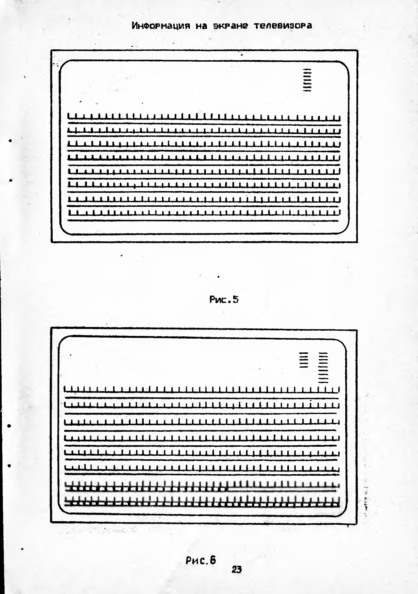

6.4.4. Вставить в магнитофон кассету с загружаемой программой.
Найти необходимую программу.

6.4.5. Включить магнитофон в режим воспроизведения.
При нормальном функционировании БПЭВМ происходит заполнение прямоугольниками промежутков между парами горизонтальных линий (начиная с нижних).
При этом при загрузке очередных 256 байт информации в карте загрузки оказывается заполненным один прямоугольник.
Количество заполненных прямоугольников неодинаково для разных программ (рис. 6).

По завершении ввода информации загруженная программа запускается одновременным нажатием клавиш СБР и БЛК.

После окончания загрузки программы выключить магнитофон.

В случае неудачной загрузки программы повторить пункты 6.4.3, 6.4.4, 6.4.5.

6.4.6. Для работы с блоком накопителей на ГМД необходимо вставить гибкий магнитный диск с программным обеспечением в накопитель А, расположенный снизу, и закрыть замок устройства фиксации.

6.4.7. Нажать клавишу УС и одновременно клавиши БЛК и ВВОД.
Не отпуская клавишу УС, отпустить клавиши БЛК и ВВОД и дождаться, пока на накопителе А не загорится светодиод, показывающий, что произошло обращение к НГМД.
Отпустить клавишу УС.

После загрузки операционной системы на экране телевизора появится следующая информация:

```text
*ПК-6128Ц*
54 Кбайт ОЗУ 01.03.90
А>
```

Она показывает, что БПЭВМ готова к работе в ОС-6128 и что текущим устройством является накопитель А.

Порядок дальнейшей работы с ПК-6128Ц описан в эксплуатационной документации на программное обеспечение.

6.4.8. Для проверки работоспособности БПЭВМ необходимо в соответствии с п.п. 6.4.6, 6.4.7 загрузить ОС и программу «ТЕСТ», выполнить ее в соответствии с руководством пользователя (Тесты устройств).

6.4.9. По окончании сеанса работы для выключения БПЭВМ необходимо:

1) перевести переключатель СЕТЬ на БПЭВМ и на БНГМД в положение ВЫКЛ;
2) отсоединить сетевой кабель от сети 220 В;
3) отсоединить кабели от БНГМД, телевизора и магнитофона.

## 7. ТЕХНИЧЕСКОЕ ОБСЛУЖИВАНИЕ

7.1. Ежедневное техническое обслуживание выполняется владельцем самостоятельно, без нарушения пломб и включает следующие работы:

- визуальный осмотр блоков;
- удаление пыли с поверхности устройств;
- проверку состояния соединителей и кабелей.

Перед выполнением указанных работ необходимо отключить БПЭВМ от сети.

7.2. Техническое обслуживание, при необходимости, производится заводом-изготовителем.
Техническое обслуживание выполняется в течение гарантийного срока эксплуатации, в соответствии с действующими правилами на гарантийное обслуживание.
Техническое обслуживание ремонтом не считается.

Техническое обслуживание включает в себя следующие виды работ:

1) контроль номинальных значений питающих напряжений БПЭВМ;
2) проверку работоспособности БПЭВМ с помощью тестовых программ;
3) восстановление несчитываемого с магнитофона программного обеспечения на прикладываемой кассете.

7.3. Перечень неисправностей и методы их устранения, которые владелец может выполнить самостоятельно, приведены в разделе 9.

7.4. Для выявления других неисправностей в БПЭВМ необходимо выполнить тестовые программы в соответствии с документом «Тестовые программные средства. Руководство пользователя» (для ПК-6128Ц).
При обнаружении дефектов ремонт производится предприятием-изготовителем.

## 8. ПРАВИЛА ХРАНЕНИЯ

8.1. БПЭВМ в упакованном виде должна храниться в помещении при температуре воздуха от 5 °С до 40 °С и относительной влажности воздуха до 80 %.

8.2. В помещении, где хранится БПЭВМ, не должно быть паров кислот, щелочей или других химически активных веществ, пары и газы которых могут вызвать коррозию.

8.3. Распакованные составные части БПЭВМ должны храниться в условиях, соответствующих условиям эксплуатации.

## 9. ВОЗМОЖНЫЕ НЕИСПРАВНОСТИ И МЕТОДЫ ИХ УСТРАНЕНИЯ

9.1. Перечень возможных неисправностей и методы их устранения приведены в табл. 7.

Таблица 7

| Наименование неисправностей, внешнее проявление и дополнительные признаки | Вероятная причина | Способ устранения | Примечание |
| --- | --- | --- | --- |
| Отсутствие качественного изображения | нарушение синхронизации или недостаточная (избыточная) яркость изображения | регулировка потенциометрами «+» и «Ф» на системном блоке | |
| Отсутствие изображения на телевизоре или отсутствие информации с БНГМД (для ПК-6128Ц) или с магнитофона (для ПК-6128.01Ц) | возможность некачественного контактирования, ошибка в подсоединении внешних кабелей | проверить правильность применения кабелей и качество их соединения | |
| Ошибка при вводе информации с ГМД | ошибка в записи на рабочем ГМД | сделать новую копию ПО на новый ГМД. ГМД с ошибочной информацией заново отформатировать | Для ПК-6128Ц |
| Ошибка при вводе информации с магнитофона | загрязнение магнитной головки, некачественная ее регулировка | очистить головку магнитофона и отрегулировать ее относительно магнитной ленты | Для ПК-6128.01Ц |

## 10. ГАРАНТИЙНЫЕ ОБЯЗАТЕЛЬСТВА

10.1. Изготовитель гарантирует соответствие БПЭВМ требованиям технических условий ИРПД.466214.001 ТУ при соблюдении владельцем правил эксплуатации, изложенных в настоящем Руководстве по эксплуатации.

Гарантийный срок эксплуатации БПЭВМ составляет двенадцать месяцев со дня продажи через розничную торговую сеть.

При отсутствии в гарантийном и отрывных талонах отметки торговой организации срок гарантии исчисляется со дня выпуска БПЭВМ заводом-изготовителем.

В течение гарантийного срока эксплуатации владелец имеет право на бесплатное техническое обслуживание БПЭВМ, а в случае нарушения ее работоспособности — на бесплатный ремонт по предъявлению гарантийного талона.
При этом за соответствующий вид обслуживания отрывается один талон.

Техническое обслуживание и ремонт БПЭВМ производятся предприятием-изготовителем БПЭВМ.

Без предъявления гарантийного и отрывных талонов или при нарушении сохранности пломб на БПЭВМ претензии к качеству работы БПЭВМ не принимаются и гарантийный ремонт не производится.

В течение гарантийного срока эксплуатации, установленного на БПЭВМ, ремонт производится за счет владельца в случае, если он эксплуатирует БПЭВМ с нарушением требований настоящего руководства по эксплуатации или не выполняет рекомендаций ремонтного предприятия, направленных на обеспечение нормальной работы БПЭВМ.

Обмен неисправных БПЭВМ осуществляется через торговую сеть по предъявлению справки и гарантийного талона в соответствии с действующими правилами обмена промышленных товаров, купленных в розничной сети государственной и кооперативной торговли.

Документация, прилагаемая к БПЭВМ, при утере не высылается.

10.2. Адрес предприятия-изготовителя БПЭВМ ПК-6128Ц, ПК-6128.01Ц:

Завод «Прогресс»
414052, г. Астрахань
ул. Савушкина, 61 «А».

## ПРИЛОЖЕНИЕ 1

### Оснащение телевизионного приемника цветного изображения RGB-входом

Для обеспечения работы телевизионного приемника в составе БПЭВМ узел дисплея вырабатывает сигнал «видео», который может быть непосредственно подан на вход видео стандартного черно-белого телевизора или монитора.

Бытовые черно-белые телевизоры моделей «Юность-406» (УПТИ-31), «Сапфир-401» (УПТИ-25), «Электроника 404Д» (ПТ-23), «Шилялис-405Д» (УПИТ-16) и т.п., не имеющие входа видео, оснащаются дополнительным соединителем.
При этом сигнал «видео» подается на вход видеоусилителя телевизионного приемника.
Для подключения цветного телевизора или монитора узел дисплея вырабатывает кроме видеосигнала сигналы R, G, B, управляющие интенсивностью каждого из первичных цветов.

RGB-входом могут быть оснащены телевизоры моделей «Горизонт Ц-355Д» (2УСЦТ-50), «Юность Ц-440Д», «Шилялис Ц-455Д» (УПИЦТ-32-10), «Рубин Ц-201», «Рубин Ц-202...Ц-208» (УПИМЦТ-61), «Темп Ц-280», «Альфа Ц-280» (3УСЦТ-61), т.е. телевизоры моделей Ц-202...Ц-208, Ц-255...Ц-280, Ц-281, Ц-355...Ц-380, Ц-404, Ц-440, Ц-445, 2Ц-410 и т.п. (рис. 1 и рис. 2).

Оснащение телевизоров RGB-входом можно произвести самостоятельно, либо по договоренности с предприятием, производящим техническое обслуживание телевизоров, используя устройство соединительное, входящее в комплект монтажных частей, поставляемого с БПЭВМ (см. рис. 4).

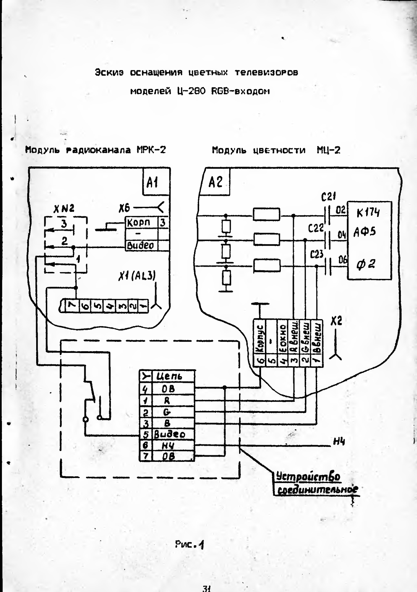

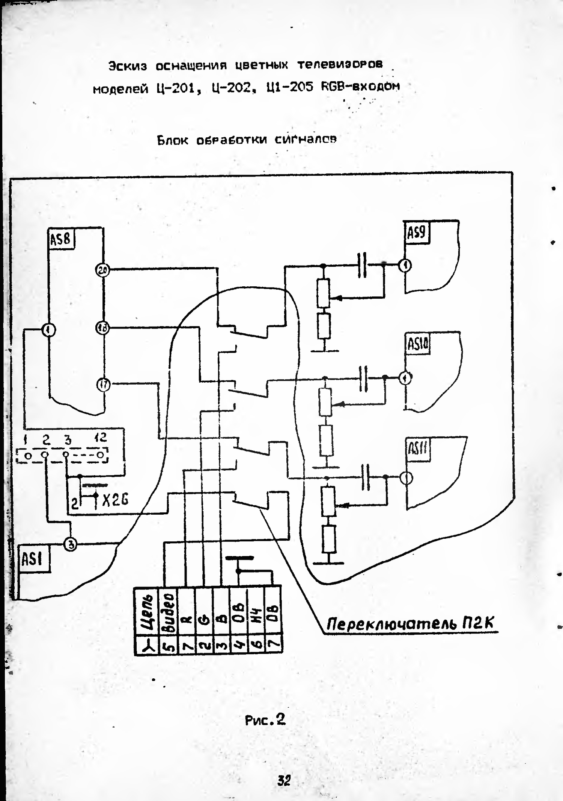

## ПРИЛОЖЕНИЕ 2

### Сигналы на выходных соединителях БПЭВМ

Соединитель выхода RGB

| Сигнал | Контакт | Сигнал | Контакт |
| --- | --- | --- | --- |
| R | 1 | Корпус | 4 |
| G | 2 | Видео | 5 |
| B | 3 | НЧ | 6 |

Соединитель «0-0»

| Сигнал | Контакт | Сигнал | Контакт |
| --- | --- | --- | --- |
| Вход | 1 | Выход | 3 |
| Корпус | 2 | | |

Соединитель параллельного интерфейса «ПУ»

| Сигнал | Контакт | Сигнал | Контакт | Сигнал | Контакт |
| --- | --- | --- | --- | --- | --- |
| +5 В | A01 | Корпус | B01 | OUTTIM | C01 |
| PA7 | A02 | PB7 | B02 | PC7 | C02 |
| PA6 | A03 | PB6 | B03 | PC6 | C03 |
| PA5 | A04 | PB5 | B04 | PC5 | C04 |
| PA4 | A05 | PB4 | B05 | PC4 | C05 |
| PA3 | A06 | PB3 | B06 | PC3 | C06 |
| PA2 | A07 | PB2 | B07 | PC2 | C07 |
| PA1 | A08 | PB1 | B08 | PC1 | C08 |
| PA0 | A09 | PB0 | B09 | PC0 | C09 |
| +5 В | A10 | Корпус | B10 | Пог. 1 | C10 |

Соединители «Х1», «Х2» для подключения манипулятора типа «Джойстик»

| Сигнал | Контакт | Сигнал | Контакт |
| --- | --- | --- | --- |
| Вверх | 1 | Вниз | 4 |
| Корпус | 2 | Влево | 6 |
| Вправо | 3 | Выстрел | 7 |

Соединитель «ЛС» для подключения локальной сети

| Сигнал | Контакт | Сигнал | Контакт |
| --- | --- | --- | --- |
| A0 ПК | 1 | A2 ПК | 5 |
| Корпус | 2 | Вход ЛС | 6 |
| A1 ПК | 3 | A3 ПК | 7 |
| Выход ЛС | 4 | | |

Соединитель системной магистрали «ВУ» (с. 34–35)

На соединитель выведены сигналы системной магистрали.
Начало перечня (с. 34): ША0, ША1, ША2, ША3, ША4, ША5, ША6.
Продолжение перечня (с. 35) читается в скане неуверенно: БЛК ПЗУ, БЛК, CS ПЗУ, MUX1, ..., СБРОС, ВВОД, ..., RST 7.5, ..., +5 В, +5 В, ОВ, ОВ.

Графические листы Приложения 2 (таблицы сигналов и контактов с рисунками соединителей):

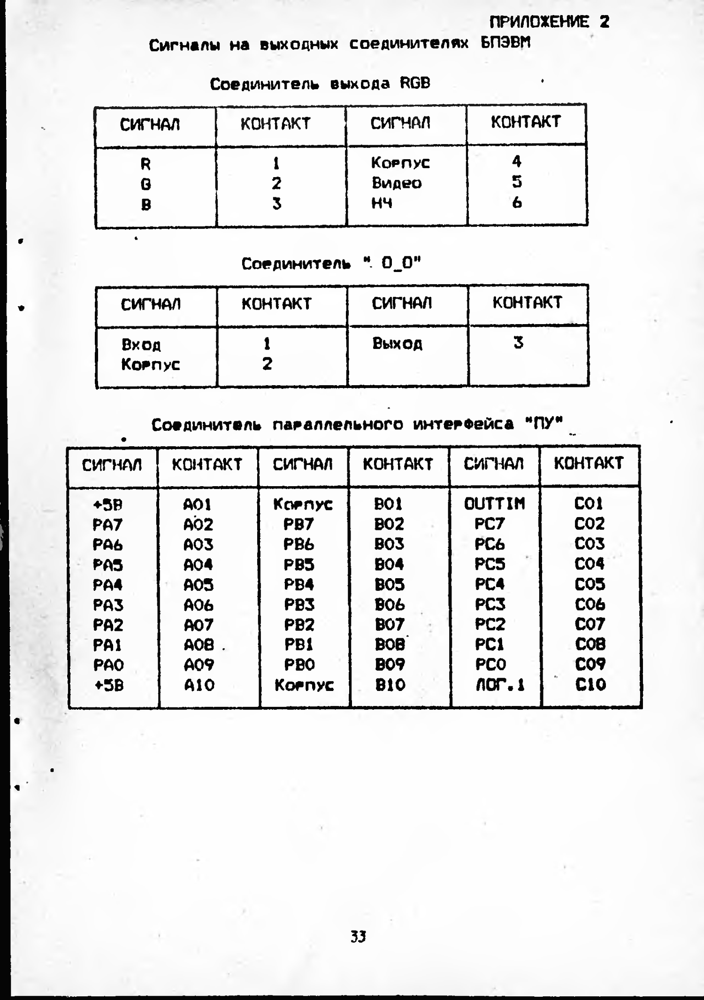

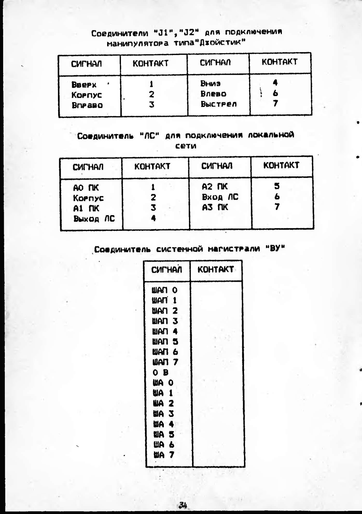

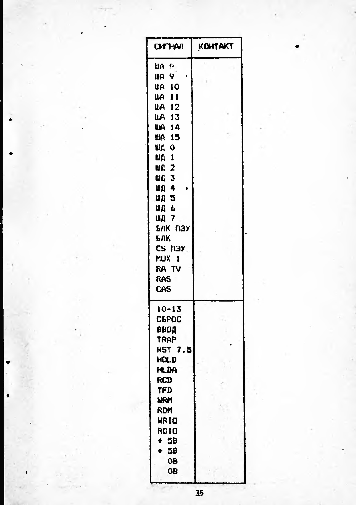

## ПРИЛОЖЕНИЕ 3

### Схемы распайки кабелей

В приложении приведены схемы распайки соединительных кабелей: к магнитофону, к телевизору (соединители Х4, Х2) и к накопителю.

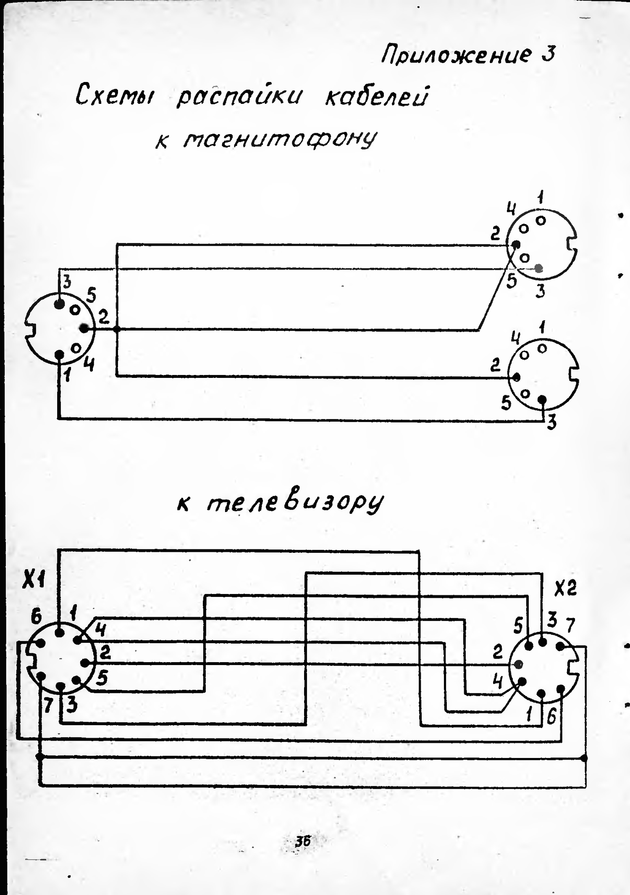

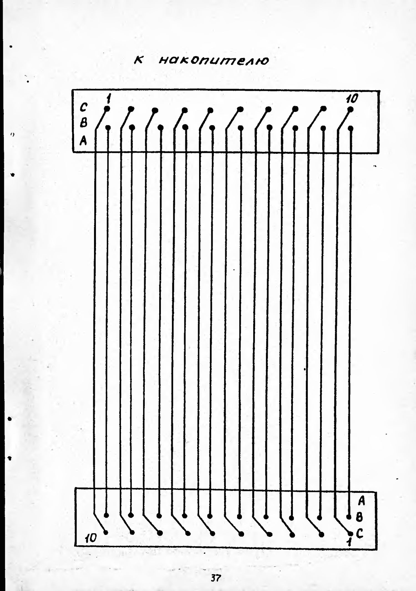

## ПРИЛОЖЕНИЕ 4

### Гарантийный талон

Действителен по заполнении

Наименование предприятия-изготовителя \_\_\_\_\_\_\_\_\_\_\_\_\_\_\_\_\_\_\_\_\_\_\_\_\_\_

Цена \_\_\_\_\_\_\_\_\_\_\_\_\_\_\_\_\_\_\_ руб.
Прейскурант № \_\_\_\_\_\_\_\_\_\_\_\_\_\_\_\_\_\_\_\_\_\_\_\_\_\_

**ГАРАНТИЙНЫЙ ТАЛОН**

Заполняет предприятие-изготовитель

Машина вычислительная электронная цифровая персональная бытовая «ПК-6128Ц» № \_\_\_\_\_\_\_\_\_\_\_\_\_\_\_\_

Дата выпуска \_\_\_\_\_\_\_\_\_\_\_\_\_\_\_\_\_\_\_\_\_\_\_\_\_\_

Представитель ОТК предприятия-изготовителя \_\_\_\_\_\_\_\_\_\_\_\_\_\_\_\_

(штамп ОТК)

Адрес для предъявления претензий к качеству: \_\_\_\_\_\_\_\_\_\_\_\_\_\_\_\_\_\_\_\_\_\_\_\_\_\_

Заполняет торговое предприятие

Дата продажи \_\_\_\_\_\_\_\_\_\_\_\_\_\_\_\_\_\_\_\_\_\_\_\_\_\_

(число, месяц, год)

Продавец \_\_\_\_\_\_\_\_\_\_\_\_\_\_\_\_\_\_\_\_\_\_\_\_\_\_

(подпись или штамп)

Штамп магазина

Заполняется ремонтным предприятием:

Поставлен на гарантийное обслуживание \_\_\_\_\_\_\_\_\_\_\_\_\_\_\_\_

(наименование предприятия, число, месяц, год)

## ПРИЛОЖЕНИЕ 5

### Отрывной талон на гарантийный ремонт

Действителен по заполнении

Наименование предприятия-изготовителя \_\_\_\_\_\_\_\_\_\_\_\_\_\_\_\_\_\_\_\_\_\_\_\_\_\_

**ОТРЫВНОЙ ТАЛОН на гарантийный ремонт**

Заполняет предприятие-изготовитель

Машина вычислительная электронная цифровая персональная бытовая «ПК-6128Ц» № \_\_\_\_\_\_\_\_\_\_\_\_\_\_\_\_

Дата выпуска \_\_\_\_\_\_\_\_\_\_\_\_\_\_\_\_\_\_\_\_\_\_\_\_\_\_

(месяц, год)

Представитель ОТК предприятия-изготовителя \_\_\_\_\_\_\_\_\_\_\_\_\_\_\_\_

(штамп ОТК)

Адрес для возврата талона на предприятие-изготовитель \_\_\_\_\_\_\_\_\_\_\_\_\_\_\_\_\_\_\_\_\_\_\_\_\_\_

Заполняет торговое предприятие

Дата продажи \_\_\_\_\_\_\_\_\_\_\_\_\_\_\_\_\_\_\_\_\_\_\_\_\_\_

(число, месяц, год)

Продавец \_\_\_\_\_\_\_\_\_\_\_\_\_\_\_\_\_\_\_\_\_\_\_\_\_\_

(подпись или штамп)

Штамп магазина

Линия отреза

Заполняет ремонтное предприятие

Гарантийный номер изделия \_\_\_\_\_\_\_\_\_\_\_\_\_\_\_\_

Содержание ремонта. Наименование и номер по схеме замененной детали или узла. Место и характер дефектов:

\_\_\_\_\_\_\_\_\_\_\_\_\_\_\_\_\_\_\_\_\_\_\_\_\_\_

\_\_\_\_\_\_\_\_\_\_\_\_\_\_\_\_\_\_\_\_\_\_\_\_\_\_

Дата ремонта \_\_\_\_\_\_\_\_\_\_\_\_\_\_\_\_\_\_\_\_\_\_\_\_\_\_

(число, месяц, год)

Подпись лица, проводившего ремонт \_\_\_\_\_\_\_\_\_\_\_\_\_\_\_\_

Подпись владельца БПЭВМ, подтверждающая ремонт \_\_\_\_\_\_\_\_\_\_\_\_\_\_\_\_

Штамп ремонтного предприятия с указанием города

## ПРИЛОЖЕНИЕ 6

### Отрывной талон на техническое обслуживание

Действителен по заполнении

Наименование предприятия-изготовителя \_\_\_\_\_\_\_\_\_\_\_\_\_\_\_\_\_\_\_\_\_\_\_\_\_\_

**ОТРЫВНОЙ ТАЛОН на техническое обслуживание машины вычислительной электронной цифровой персональной бытовой «ПК-6128Ц»**

Заполняет предприятие-изготовитель

Машина вычислительная электронная цифровая персональная бытовая «ПК-6128Ц» № \_\_\_\_\_\_\_\_\_\_\_\_\_\_\_\_

Дата выпуска \_\_\_\_\_\_\_\_\_\_\_\_\_\_\_\_\_\_\_\_\_\_\_\_\_\_

(месяц, год)

Представитель ОТК предприятия-изготовителя \_\_\_\_\_\_\_\_\_\_\_\_\_\_\_\_

(штамп ОТК)

Адрес для возврата талона на предприятие-изготовитель \_\_\_\_\_\_\_\_\_\_\_\_\_\_\_\_\_\_\_\_\_\_\_\_\_\_

Заполняет торговое предприятие

Дата продажи \_\_\_\_\_\_\_\_\_\_\_\_\_\_\_\_\_\_\_\_\_\_\_\_\_\_

(число, месяц, год)

Продавец \_\_\_\_\_\_\_\_\_\_\_\_\_\_\_\_\_\_\_\_\_\_\_\_\_\_

(подпись или штамп)

Штамп магазина

Линия отреза

Заполняет ремонтное предприятие

Гарантийный номер БПЭВМ \_\_\_\_\_\_\_\_\_\_\_\_\_\_\_\_

Работы по техническому обслуживанию выполнены в соответствии с действующими правилами на гарантийное обслуживание.

Дата выполнения работ \_\_\_\_\_\_\_\_\_\_\_\_\_\_\_\_\_\_\_\_\_\_\_\_\_\_

(число, месяц, год)

Подпись лица, выполнявшего работу \_\_\_\_\_\_\_\_\_\_\_\_\_\_\_\_

Подпись владельца БПЭВМ, подтверждающая техническое обслуживание \_\_\_\_\_\_\_\_\_\_\_\_\_\_\_\_

Штамп ремонтного предприятия с указанием города

## ПРИЛОЖЕНИЯ 7–9

В скане (файл `6128.djvu`, 42 страницы) приложения 7–9 отсутствуют: документ обрывается на странице 42 (обратная сторона отрывного талона на техническое обслуживание), тогда как по содержанию приложения 7–9 занимают страницы 43–55.
Схемы электрические принципиальные системного модуля, модуля питания и блока клавиатуры, сборочный чертеж и перечень элементов в этот файл не входят.

---

## Примечания к переносу

Документ перенесен из `6128.djvu` (42 страницы, 300 dpi, текстового слоя в файле нет). Текст распознан автоматически и сверен по двум независимым проходам распознавания (модели `tesseract` `rus` и `rus2`, масштабы 100 %, 200 %, а для отдельных чисел и таблиц — до 800 % с клеточной разметкой).

Надежность отдельных фрагментов:

- Прозаический текст разделов 1–10 прочитан устойчиво и сверен по обоим проходам.
- Числовые данные табл. 1 и табл. 7, адрес завода, обозначения микросхем сверены по увеличенным фрагментам; степень `10⁶` в значении быстродействия в оригинале набрана верхним индексом и уверенно не читается — приведена по смыслу величины (0,7·10⁶ оп/с).
- В таблицах 4 и 5 часть ячеек в оригинале объединена по вертикали; при переносе объединенные группы сведены в одну строку.
- В табл. 2 обозначения в графе «Порт ввода-вывода» («078», «0В0», «079») прочитаны неуверенно; они приведены так, как читаются в скане.
- Обозначения сигналов на соединителях (Приложение 2) в оригинале набраны мелким шрифтом внутри графических рамок. Уверенно прочитаны контакты и сигналы соединителей RGB, «0-0», «ПУ», «ЛС». Подпись контакта C10 («Пог. 1») соединителя «ПУ» прочитана неуверенно. Перечень сигналов соединителя системной магистрали «ВУ» (с. 34–35) прочитан частично: номера контактов в оригинале вынесены в графическую рамку и текстом не распознаются.
- В Приложении 1 названия цветовых сигналов набраны латиницей - «R, G, B» и переданы так же.
- Обозначения соединителей «Джойстика» в заголовке таблицы Приложения 2 читаются как «Х1», «Х2», тогда как в п. 5.16 указаны соединители Х2, Х3.
- В таблице соединителя «Джойстик» (Приложение 2) контакт 5 не указан — перечислены только контакты 1, 2, 3, 4, 6, 7.
- Обозначения регистров контроллера дисковода (п. 5.19) в скане набраны с трудом: в разных проходах читается «1ВН» и «18Н»; в переносе принято «команд — 1ВН, состояния — 18Н, текущей дорожки — 1АН, сектора — 19Н, данных — 16Н».
- Шифр документа на обложке и в п. 10.1 читается как ИРПД.466214.001 (в одном из проходов — ИРПАД.466214.001).
- В комплекте поставки для ПК-6128.01Ц (п. 3.2) наименование одного из руководств пользователя в скане не читается.
- Номера рисунков на с. 31–32 (Приложение 1) в скане читаются неоднозначно; рисунки подписаны по их заголовкам.
- Растровые листы вынесены в отдельные PNG: рис. 1 (с. 14, карта адресного пространства экранного ОЗУ), рис. 2–4 (с. 20–22), рис. 5 и 6 (с. 23), эскизы Приложения 1 (с. 31, 32), графические листы Приложения 2 с рисунками соединителей (с. 33–35) и схемы распайки кабелей Приложения 3 (с. 36, 37). Лист с. 22 в скане повернут и развернут при вырезании.
