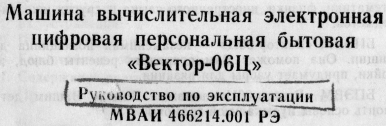
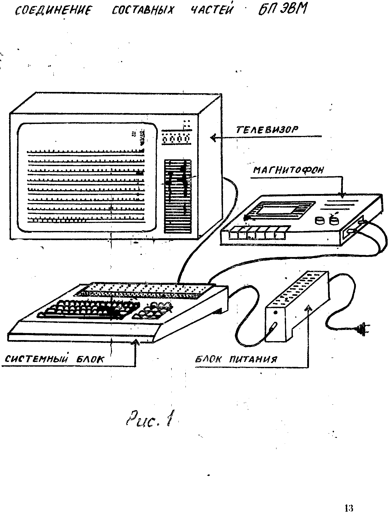
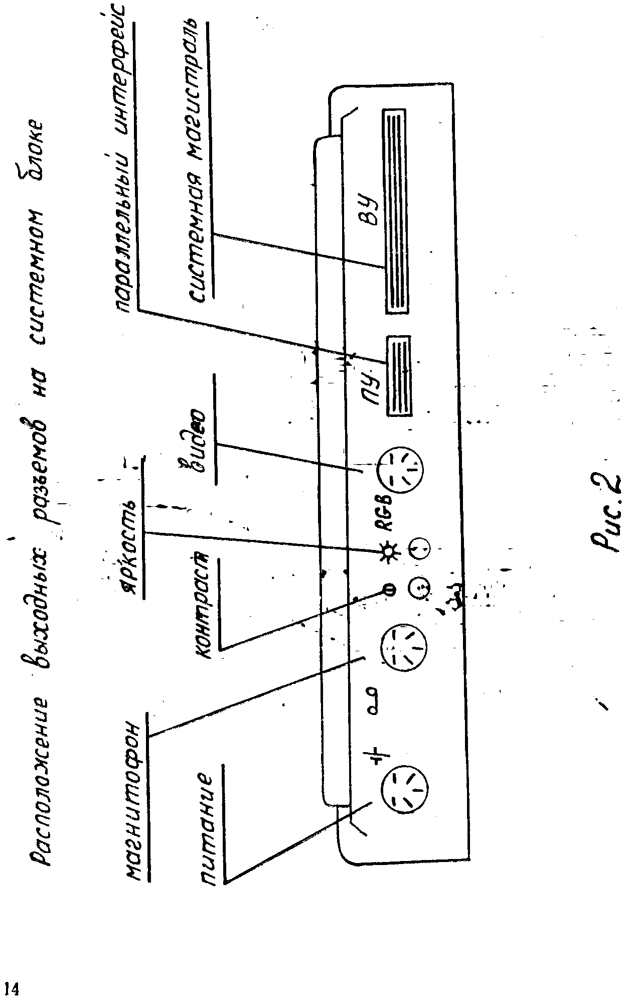
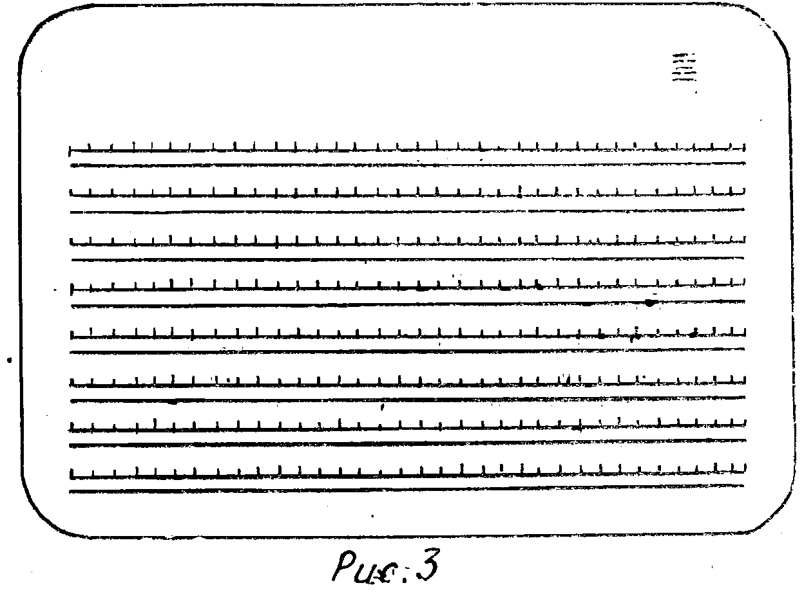
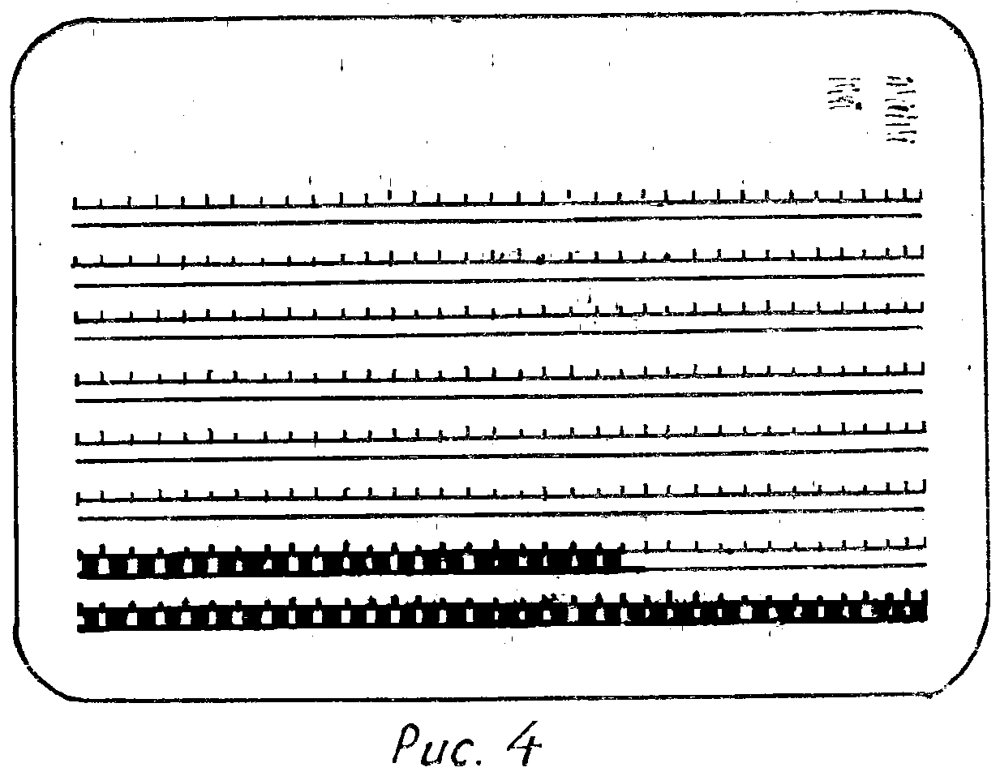
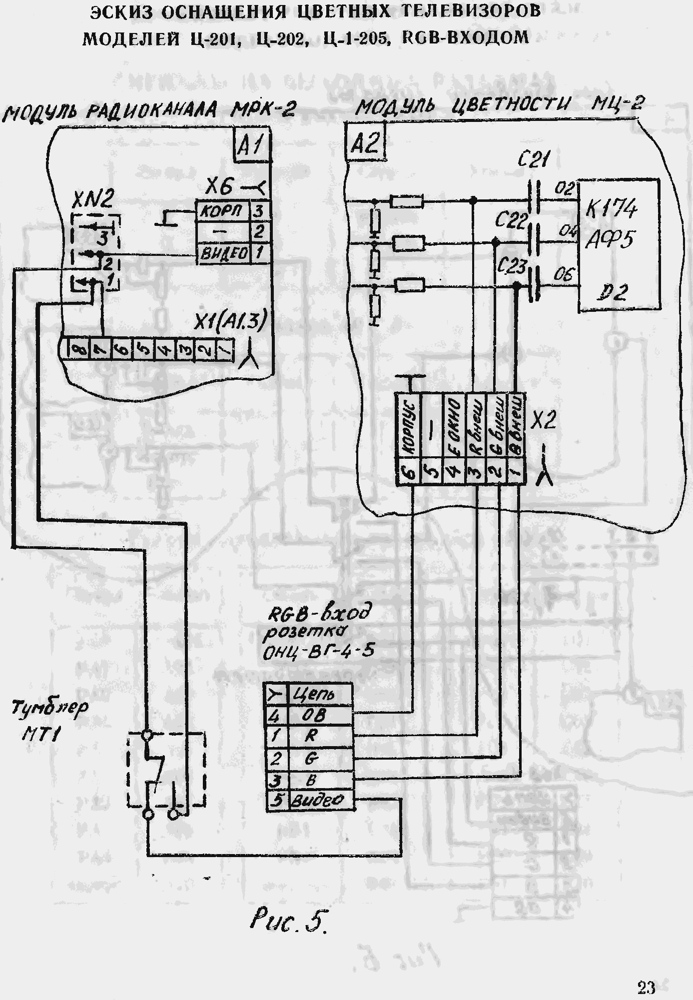
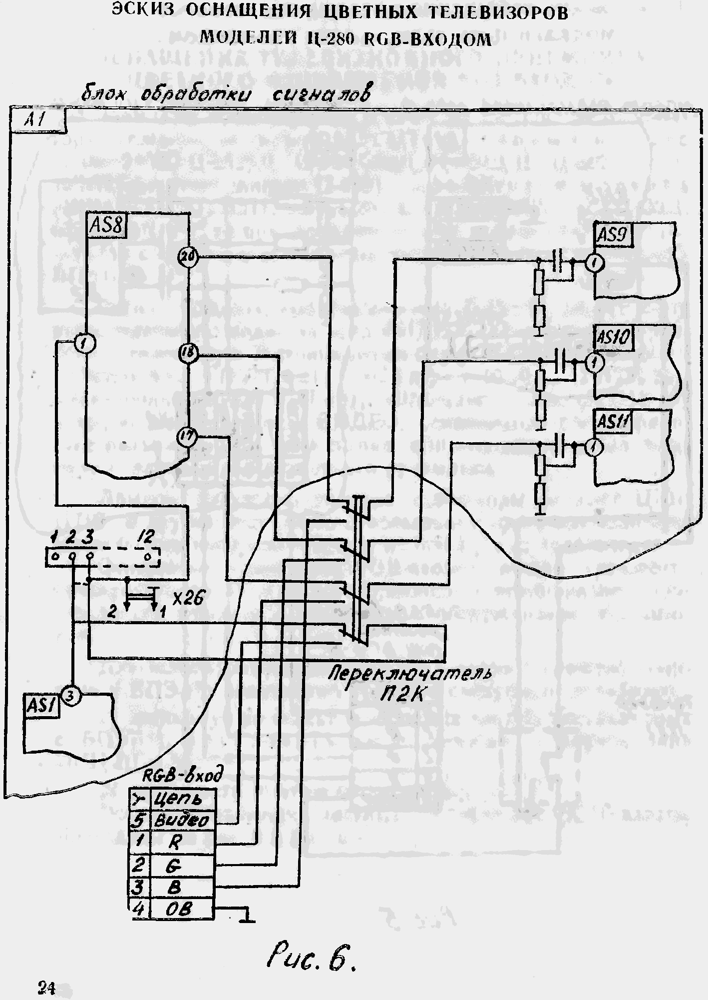
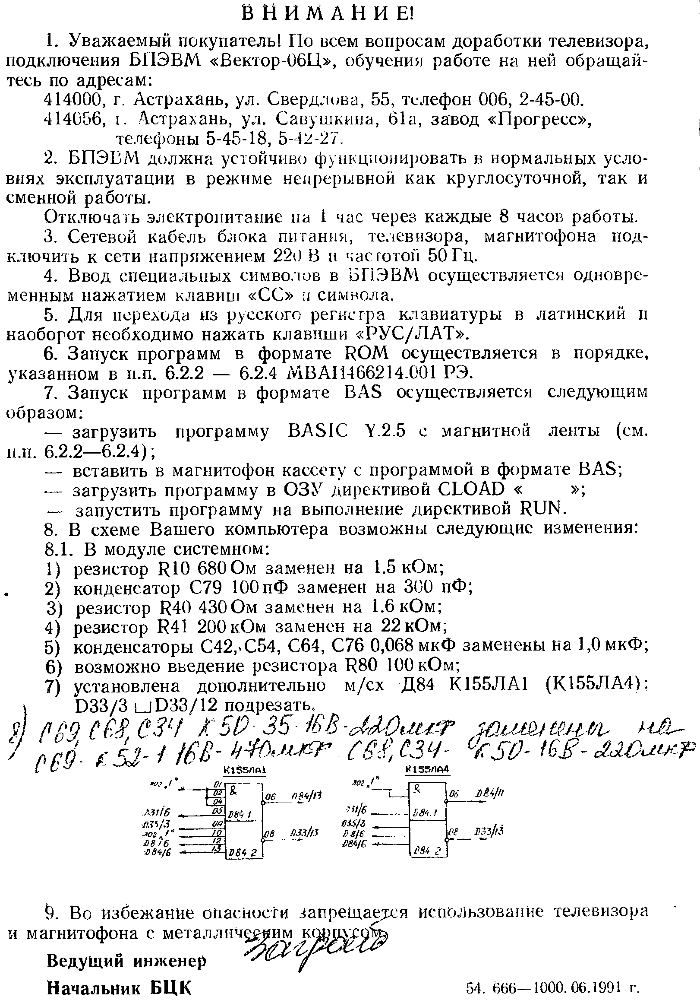
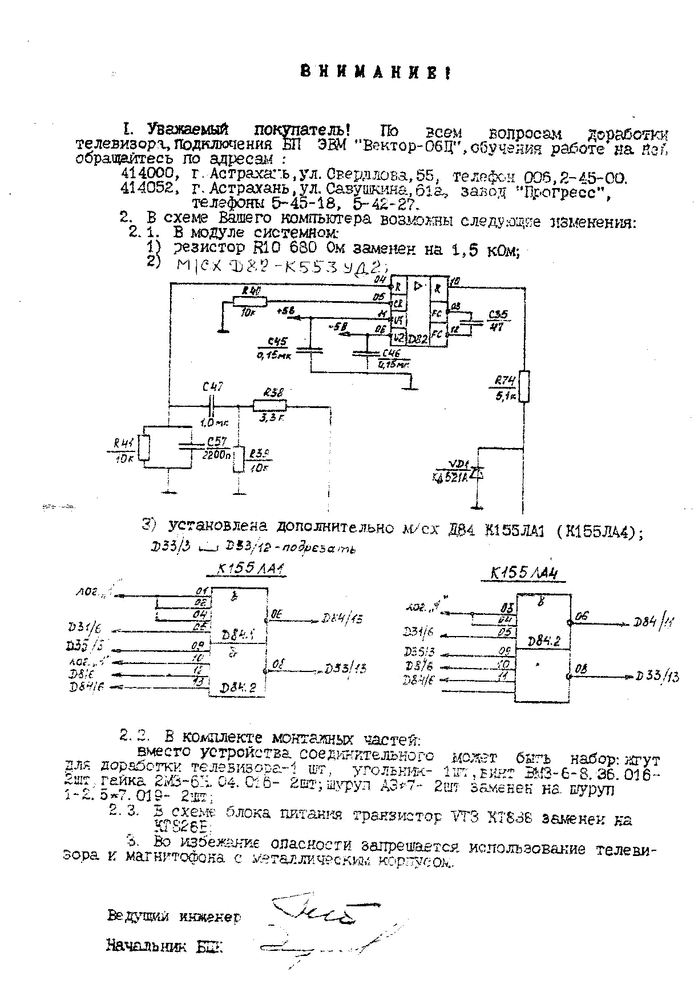

Руководство по эксплуатации БПЭВМ «Вектор-06Ц». — Астрахань: завод «Прогресс», 1991.
С дополнениями (вкладка «ВНИМАНИЕ!»).

**МВАИ 466214.001 РЭ**

# МАШИНА ВЫЧИСЛИТЕЛЬНАЯ ЭЛЕКТРОННАЯ ЦИФРОВАЯ ПЕРСОНАЛЬНАЯ БЫТОВАЯ «ВЕКТОР-06Ц»

Руководство по эксплуатации

МВАИ 466214.001 РЭ

Дорогой товарищ! Вы приобрели бытовую персональную ЭВМ «Вектор-06Ц». Этим Вы сделали первый шаг в удивительный мир компьютерной техники. Мы надеемся, что персональный компьютер будет для Вас не только игрушкой, но и надежным деловым партнером, который поможет в решении Ваших проблем.

БПЭВМ «Вектор-06Ц» станет еще одним членом Вашей семьи, ее другом. Она сможет увлечь Ваших детей живым и интересным делом, она будет для них постоянным товарищем в играх, она станет помощником и учителем при изучении математики, физики, иностранного языка и других школьных предметов.

БПЭВМ «Вектор-06Ц» — незаменимая помощница для женщин. Она поможет Вам сохранить рецепты блюд, выкройки, придумает узоры для вязания.

БПЭВМ «Вектор-06Ц» поможет Вам и Вашим детям освоить основы музыкальной грамоты.

БПЭВМ «Вектор-06Ц» позволит Вам опередить время.

## СОДЕРЖАНИЕ

1. Общие указания — 5
2. Технические характеристики — 6
3. Комплект поставки — 8
4. Требования по технике безопасности — 8
5. Краткое описание изделия — 9
6. Подготовка к работе и порядок работы — 12
7. Техническое обслуживание — 18
8. Возможные неисправности и методы их устранения — 19
9. Правила хранения — 19
10. Гарантийные обязательства — 20
11. Содержание драгоценных материалов — 21
Приложение 1. Оснащение телевизора цветного изображения RGB-входом — 22
Приложение 2. Сигналы на выходных разъемах — 25
Приложение 3. Гарантийный талон — 27
Приложение 4. Отрывной талон на техническое обслуживание — 28
Приложение 5. Отрывной талон на гарантийный ремонт — 30
Приложение 6. Схема электрическая принципиальная модуля системного БПЭВМ «Вектор-06Ц»
Приложение 7. Схема электрическая принципиальная модуля клавиатуры и блока питания БПЭВМ «Вектор-06Ц»
Приложение 8. Сборочный чертеж модуля системного БПЭВМ «Вектор-06Ц» и таблицы прошивок ПЗУ

## 1. ОБЩИЕ УКАЗАНИЯ

1.1. При покупке машины вычислительной электронной цифровой персональной бытовой (БПЭВМ) «Вектор-06Ц» потребуйте проверить качество ее работы путем выполнения действий, указанных в разделе 6 данного «Руководства по эксплуатации» (РЭ).

1.2. Убедитесь в сохранности пломб на БПЭВМ. Проверьте ее комплектность и наличие гарантийного и отрывных талонов. Убедитесь, что в гарантийном и отрывных талонах настоящего РЭ поставлены штамп магазина, разборчивая подпись или штамп продавца и дата продажи.

1.3. Талоны на техническое обслуживание и гарантийный ремонт отрываются работниками предприятия-изготовителя только после того, как работа фактически выполнена. Помните, что при утере гарантийного талона Вы лишаетесь права на гарантийный ремонт!

1.4. Распаковка БПЭВМ производится перед началом эксплуатации. Предварительно выдержите БПЭВМ в упаковке в помещении при температуре (20±5) °С в течение 6 часов.

1.5. Перед тем, как включить БПЭВМ, внимательно ознакомьтесь с настоящим руководством и другими эксплуатационными документами, поставляемыми с БПЭВМ, в первую очередь с указанием мер безопасности, а также с органами управления и надписями на корпусе БПЭВМ.

1.6. БПЭВМ должна устойчиво функционировать при:

1) повышенной рабочей температуре 40 °С;

2) пониженной рабочей температуре 5 °С;

3) повышенной влажности 80% при температуре 25 °С;

4) атмосферном давлении от 84 до 107 кПа (630—800 мм рт. ст.).

Примечание. Завод-изготовитель оставляет за собой право вносить непринципиальные изменения в изделие, не ухудшающие его качественные показатели и программную совместимость.

## 2. ТЕХНИЧЕСКИЕ ХАРАКТЕРИСТИКИ

2.1. Наименование основных функциональных частей БПЭВМ «Вектор-06Ц» и их технические характеристики приведены в табл. 1.

Таблица 1

| Наименование | Техническая характеристика |
| --- | --- |
| Процессор | Базовый микропроцессор КР580ВМ80А с тактовой частотой 3 МГц; Быстродействие — 0,6·10⁶ оп/сек. (типа Рг.-Рг.); Разрядность — 8 разрядов; количество команд — 78. |
| Память | Оперативное запоминающее устройство — 64 Кбайт (ОЗУ пользователя — до 56 Кбайт); Постоянное запоминающее устройство (начальный загрузчик) — 512 байт. |
| Интерфейс | Системная шина; Параллельный интерфейс с 24 линиями ввода/вывода (3×8 линий) + 1 линия. |
| Внешнее запоминающее устройство | Бытовой кассетный магнитофон. Объем информации: при фазовой модуляции — не менее 0,512 Мбайт; Скорость обмена — 1200—2400 бод. |
| Устройство отображения информации | Телевизионный приемник цветного изображения с RGB-входом (см. примечание) или черно-белого изображения. Форматы: алфавитно-цифровой (символ × строка) — 32×25, 40×25, 42×25, 64×25, 80×25; графический (X×Y): 256×256 при любых 16 цветах (градациях яркости) из 256 цветов цветовой палитры, 512×256 при любых 4 цветах (градациях яркости) из 256 цветов цветовой палитры; 1024×256 адресуемых точек (при емкости видео-ОЗУ 32 Кбайта) |
| Звуковой синтезатор | Четыре канала — три канала аппаратно-формируемые и один канал программно-формируемый |
| Клавиатура | 70 клавиш. Размещение цифрового и буквенного поля — типа пишущей машинки. |
| Программное обеспечение | Тестовые программные средства, системные программные средства (интерпретатор языка Бейсик, Ассемблер-редактор, Монитор-отладчик) и прикладные программы. |

Продолжение табл. 1

| Наименование | Техническая характеристика |
| --- | --- |
| Электропитание | Сеть однофазная напряжением (220 +10%/−15%) В, частота (50±1) Гц, потребляемая мощность не более 30 Вт. |
| Габаритные размеры | Блока системного 415×235×70; Блока питания 230×130×65. |
| Масса | Не более 4 кг. |

Примечание. Телевизоры, не оборудованные RGB-входом, необходимо доработать согласно приложению 1.

БПЭВМ «Вектор-06Ц» обладает рядом дополнительных возможностей:

— непосредственное подключение печатающего устройства типа EPSON FX-85, RAVI-8010M, D100, ROBOTRON и др. (интерфейс типа CENTRONICS);

— подключение дополнительных устройств внешней памяти (накопитель на гибком магнитном диске и/или электронный диск емкостью не менее 256 Кбайт);

— загрузка с магнитной ленты и функционирование программ пользователя ПЭВМ «Микроша», «РК-86», КУВТ «Корвет» (при предварительной загрузке соответствующих программ-эмуляторов);

— загрузка с магнитной ленты и функционирование программ пользователя, написанных в операционных системах CP/M-80, МикроДОС при условии отсутствия в них обращения к файловой системе;

— функционирование системных и прикладных программ под управлением операционных систем CP/M-80, МикроДОС (в комплекте с эмулятором дисковой памяти или накопителем на гибких магнитных дисках объемом не менее 256 Кбайт).

## 3. КОМПЛЕКТ ПОСТАВКИ

| Наименование | Количество |
| --- | --- |
| Блок системный | 1 шт. |
| Блок питания | 1 шт. |
| Комплект монтажных частей: | |
| Кабель соединительный (длинный) к телевизионному приемнику | 1 шт. |
| Кабель соединительный (трехвилочный) к бытовому кассетному магнитофону | 1 шт. |
| Кабель питания (короткий) | 1 шт. |
| Устройство соединительное | 1 шт. |
| Розетка ОНЦ-КГ-22 | 1 шт. |
| Шуруп 1-2,5×7,019 | 2 шт. |
| Магнитофонная кассета типа МК-60 с программным обеспечением | 1 шт. |
| Эксплуатационные документы: | |
| Руководство по эксплуатации с гарантийным и отрывными талонами | 1 книга |
| Эксплуатационная документация на программное обеспечение БПЭВМ «Вектор-06Ц»: | |
| Ассемблер-редактор. Описание языка | 1 книга |
| Монитор-отладчик. Руководство программиста | 1 книга |
| Тестовые программные средства. Руководство пользователя | 1 книга |
| Бейсик. Описание языка | 1 книга |
| Упаковка | 1 шт. |

## 4. ТРЕБОВАНИЯ ПО ТЕХНИКЕ БЕЗОПАСНОСТИ

4.1. БПЭВМ устанавливается в месте, удобном для проведения работы, на расстоянии не менее одного метра от отопительной системы.

4.2. Не рекомендуется устанавливать БПЭВМ в сырых помещениях. НЕЛЬЗЯ закрывать вентиляционные отверстия блока питания и системного блока.

4.3. БУДЬТЕ ОСТОРОЖНЫ! Во избежание несчастных случаев и выхода из строя изделия категорически запрещается:

1) включать БПЭВМ при снятой крышке блока питания;

2) оставлять БПЭВМ во включенном состоянии без наблюдения;

3) подключать к разъемам устройства, не предусмотренные РЭ;

4) при включенном компьютере одновременное прикосновение к металлическим частям БПЭВМ (телевизора, магнитофона, дополнительных устройств) и к устройствам, подключенным к шине «Земля» или эквивалентным им (батареи центрального отопления и т. п.).

4.4. Перед включением БПЭВМ убедитесь в отсутствии повреждений изоляции сетевого шнура блока питания, повреждения корпусов блока питания и системного блока. НЕ ПОДКЛЮЧАЙТЕ БПЭВМ к неисправным телевизору и магнитофону!

4.5. При работе с цветным или черно-белым телевизором (монитором) рекомендуется находиться на максимальном расстоянии от него, которое обеспечивается длиной соединительного кабеля.

Если Вы работаете в текстовом режиме (512×256 точек на экране), то советуем Вам использовать черно-белый телевизор или монитор.

В разработанных Вами программах рекомендуем задавать оптимальное соотношение числа символов в строке и строк на экране, которое определяется разрешающей способностью телевизора и удобством в работе.

## 5. КРАТКОЕ ОПИСАНИЕ ИЗДЕЛИЯ

5.1. БПЭВМ «Вектор-06Ц» соответствует требованиям ГОСТ 27201-87 и предназначена для индивидуального применения в бытовых условиях. Поставляемое с БПЭВМ прикладное программное обеспечение позволяет использовать компьютер в диалоговом режиме работы с высокой степенью интерактивности при работе с игровыми программами, прививающими навыки работы на ЭВМ, при изучении основ информатики, для создания информационно-справочных систем, для выполнения вычислительных работ и широкого круга научно-технических, экономических задач, задач управления и обучения.

В БПЭВМ «Вектор-06Ц» используется общая оперативная память для микропроцессора и контроллера графического дисплея объемом 64 Кбайта. Объем экранного ОЗУ при числе адресуемых точек изображения 256×256 и шестнадцати цветах равен 32 Кбайт.

Конструктивно БПЭВМ состоит из двух частей (см. рис. 1) — блока системного и блока питания.

Блок питания предназначен для обеспечения электропитания системного блока. Блок питания импульсный, подключается к первичной сети напряжением 220 В, частотой 50 Гц. Выходное напряжение стабилизируется путем изменения длительности и частоты повторения импульсов.

Системный блок (основной) содержит в своем составе модуль клавиатуры, позволяющий оперативно управлять работой БПЭВМ, и модуль системный, который обеспечивает выполнение программ, хранение и обработку информации, организацию диалога с пользователем.

Принцип работы модуля клавиатуры основан на сканировании матрицы клавиш и анализе результата сканирования, по которому формируется информация в БПЭВМ. Работа клавиш основана на изменении электрической емкости между электродами, выполненными в виде рисунка печатной платы, при перемещении относительно них третьего электрода (металлическая пластина на подвижной части клавиш).

Не прилагайте больших усилий при нажатии клавиш клавиатуры.

Модуль системный состоит из следующих функциональных узлов:

1) узел синхронизации — служит для формирования ряда синхронизирующих сигналов, поступающих на другие узлы БПЭВМ;

2) узел дисплея — обеспечивает считывание информации из ОЗУ в сдвиговые регистры, скроллинг экрана, сопряжение БПЭВМ с телевизором;

3) центральный процессор — предназначен для выполнения следующих функций:

вычисления адресов операндов и команд;

содержательной обработки операндов;

обмена информацией с другими устройствами (узлами);

4) узел управления — обеспечивает формирование временной диаграммы работы системного модуля, обращение к устройствам ввода/вывода, ОЗУ и формирование всех внутренних и внешних управляющих сигналов;

5) узел начальной загрузки и запуска — используется для инициализации работы БПЭВМ путем выполнения программы «загрузчик», записанной в ПЗУ;

6) узел параллельного программируемого интерфейса и таймер обеспечивают передачу данных внутри системного модуля, сканирование и прием информации из модуля клавиатуры, обмен информацией между системным модулем и внешними устройствами;

7) узел сопряжения с магнитофоном — обеспечивает сопряжение бытового кассетного магнитофона с БПЭВМ;

8) оперативное запоминающее устройство — предназначено для приема, хранения и передачи данных по запросу процессора или узла дисплея.

В БПЭВМ предусмотрена возможность подключения внешнего ОЗУ емкостью 256 Кбайт (электронный «квазидиск»), матричного печатающего устройства, контроллера накопителей на гибких магнитных дисках и до четырех НГМД, а также других дополнительных узлов и блоков, расширяющих ее функциональные возможности. Данные узлы и блоки в комплект поставки не входят.

Примечание. Назначение сигналов на контактах разъемов для внешнего подключения приведено в приложении 2 данного РЭ.

5.2. Программное обеспечение

5.2.1. Состав программного обеспечения, записанного на кассете, указан на вкладыше кассеты, поставляемой с БПЭВМ. Рядом с именем программы (файла) указано, в каком формате записана на ленте эта программа.

5.2.2. Правила пользования программами смотрите в эксплуатационных документах на программное обеспечение.

Внимание! Программы, записанные в формате ROM (формат загрузчика), вводятся в БПЭВМ при выполнении действий, указанных в п. 6.2. данного РЭ.

Программы, записанные в формате MON (формат монитора), вводят-выводят с помощью Монитора-отладчика.

Программы, записанные в формате ASM (формат ассемблера), вводят-выводят с помощью Ассемблера-редактора.

Программы, записанные в формате BAS (формат БЕЙСИКА), вводят-выводят с помощью интерпретатора языка БЕЙСИК.

5.3. Органы управления и индикации.

В БПЭВМ предусмотрена световая индикация:

«СЕТЬ» — при включении питания загорается светодиод на блоке питания и светодиод «СЕТЬ» на системном блоке;

«РУС» — горящий светодиод является признаком работы в русском регистре клавиатуры. Если светодиод не горит, то Вы работаете в латинском регистре клавиатуры.

Клавиатура БПЭВМ логически разделяется на три части: управляющая, алфавитно-цифровая и функциональная.

Управляющая клавиатура:

клавиша ВВОД — инициализирует работу программы «начальный загрузчик» для загрузки программ с магнитофона, записанных в формате ROM;

клавиша СБР — используется для запуска программ формата КОМ и для других целей;

клавиша БЛК — предохраняет от случайного нажатия клавиш ВВОД и СБР.

Алфавитно-цифровая и функциональная клавиатура описаны в эксплуатационных документах на программное обеспечение.

Тумблер включения питания БПЭВМ находится на блоке питания.

## 6. ПОДГОТОВКА К РАБОТЕ И ПОРЯДОК РАБОТЫ

6.1. Подготовка к работе.

6.1.1. В качестве видеомонитора для БПЭВМ без дополнительной доработки можно использовать только телевизоры класса 4УСЦТ с RGB-входом по ГОСТ 24838-87.

Для подключения к БПЭВМ телевизоров, не имеющих RGB-входа, используйте рекомендации, приведенные в приложении 1.

6.1.2. Установку БПЭВМ производите в следующей последовательности:

1) разместите составные части БПЭВМ на столе (рис. 1);

2) перед включением БПЭВМ проверьте состояние соединителей, удалите посторонние предметы, очистите от пыли поверхности устройств, убедитесь в исправности телевизора и магнитофона;

ВНИМАНИЕ! Подключение кабелей БПЭВМ производить только при отключенных от сети БПЭВМ, телевизора и магнитофона. Нарушение порядка подключения устройств может привести к выходу из строя телевизора и БПЭВМ.

3) подключите кабели устройств (маркировка соединителей БПЭВМ указана на корпусе — см. рис. 2) в следующей последовательности:

кабель телевизора к разъему «RGB» системного блока и к RGB-входу телевизора;

кабель магнитофона — к разъему «О—О» системного блока (подключать вилкой с пятижильным кабелем), к линейному выходу магнитофона (подключить вилкой с трехжильным кабелем); ко входу магнитофона «запись с электрофона» (подключить вилкой с двухжильным кабелем);

кабель питания к разъему «+» блока системного и к блоку питания;

сетевой кабель блока питания к сети напряжением 220 В и частотой 50 Гц.

Примечание. Звуковое сопровождение программ можно осуществлять через громкоговоритель магнитофона. Для этого необходимо подключить магнитофон к БПЭВМ согласно пункту 6.1.2, нажать на магнитофоне кнопку Пауза, а затем — одновременно кнопки Пуск и Запись.

6.2. Порядок работы и проверка работоспособности БПЭВМ.

6.2.1. Установите в магнитофон кассету с загружаемой программой. Переведите переключатель сети на блоке питания БПЭВМ в верхнее положение. При этом на лицевой панели блока питания и на системном блоке загорятся индикаторы «СЕТЬ». Включите питание телевизора и магнитофона.

6.2.2. Найдите начало вводимой информации на магнитной ленте (при проверке работоспособности БПЭВМ — начало программы «Тест устройств») и переведите магнитофон в режим остановки.

6.2.3. Нажмите одновременно клавиши ВВОД и БЛК на системном блоке, на экране телевизора появится незаполненная «карта загрузки» ОЗУ (см. рис. 3).

Регулировкой органов управления (потенциометрами на задней панели системного блока) добейтесь качественного изображения.

6.2.4. Включите магнитофон в режим воспроизведения. При нормальном функционировании БПЭВМ на экране происходит заполнение прямоугольниками промежутков между парами горизонтальных линий (начиная с нижних). При этом при загрузке очередных 256 байт информации в «карте загрузки» оказывается заполненным один прямоугольник (см. рис. 4).

По завершении ввода информации (программы «Тест устройств») индикатор «РУС» начинает мигать.

Количество заполненных прямоугольников не одинаково для различных программ.

После окончания загрузки программы выключите магнитофон.

6.2.5. Если во время ввода информации изображение стирается и появляется незаполненная «карта загрузки» ОЗУ (см. рис. 3), то необходимо повторить ввод (см. п.п. 6.2.2 — 6.2.4). Причиной ошибок при вводе обычно является неисправность магнитофона.

6.2.6. Если загрузка информации прошла успешно, то для выполнения загруженной программы надо одновременно нажать клавиши СБР и БЛК.

> \* Описание работы программ смотрите в эксплуатационных документах на программное обеспечение.

6.2.7. По окончании сеанса работы для выключения БПЭВМ необходимо:

1) выключить телевизор и магнитофон;

2) перевести переключатель сети на блоке питания БПЭВМ в нижнее положение (при этом на лицевой панели блока питания и системном блоке гаснут светодиоды «СЕТЬ»);

3) отсоединить сетевой кабель блока питания БПЭВМ от сети 220 В, кабели магнитофона и телевизора.

6.3. ВНИМАНИЕ! Перед началом пользования кассетой с программным обеспечением рекомендуем Вам сделать с нее несколько копий и работать с копиями.

Программы (файлы) в формате загрузчика копируются следующим образом:

— загрузить в БПЭВМ программу COPY (смотри п.п. 6.2.2 — 6.2.6). После нажатия клавиш СБР и БЛК на экране появится исходное изображение и надписи COPY, ЧТЕНИЕ. В этом режиме копировщик готов к загрузке копируемой программы;

— найти на кассете копируемую программу и включить магнитофон на воспроизведение. При этом происходит загрузка программы в копировщик. По окончании загрузки на экране надпись ЧТЕНИЕ заменяется на надпись ЖДУ;

— вставить в магнитофон кассету, на которую производится запись. При нажатии на клавишу РУС/ЛАТ происходит запись копируемой программы на магнитофон (при этом на экране надпись ЖДУ меняется на надпись ЗАПИСЬ).

Файлы в формате БЕЙСИКА копируются с помощью интерпретатора языка БЕЙСИК (см. «БЕЙСИК. Описание языка.»).

Файлы в формате Монитора копируются с помощью монитора-отладчика (см. «Монитор-отладчик. Руководство программиста».).

Файлы в формате Ассемблера копируются с помощью ассемблера-редактора (см. «Ассемблер-редактор. Описание языка».).

## 7. ТЕХНИЧЕСКОЕ ОБСЛУЖИВАНИЕ

7.1. Ежедневное техническое обслуживание БПЭВМ выполняется владельцем самостоятельно, без нарушения пломб и включает следующие работы:

1) визуальный осмотр блоков БПЭВМ;

2) удаление пыли с поверхности устройств;

3) проверку состояния соединителей и кабелей.

Перед выполнением указанных работ необходимо отключить блок питания БПЭВМ от сети.

7.2. Техническое обслуживание, при необходимости, производится заводом-изготовителем.

Техническое обслуживание выполняется в течение гарантийного срока эксплуатации в соответствии с действующими правилами на гарантийное обслуживание и ремонтом не считается.

Техническое обслуживание включает в себя следующие виды работ:

1) контроль номинальных значений питающих напряжений блока питания БПЭВМ;

2) проверку работоспособности БПЭВМ с помощью тестовых программ;

3) восстановление несчитываемого с магнитофона программного обеспечения на прикладываемой к БПЭВМ кассете.

7.3. Перечень неисправностей и методы их устранения, которые владелец может выполнить самостоятельно, приведены в разделе 8.

7.4. Для выявления других неисправностей в БПЭВМ необходимо выполнить тестовые программы в соответствии с документом «Тестовые программные средства. Руководство пользователя». При обнаружении дефектов ремонт производится предприятием-изготовителем.

## 8. ВОЗМОЖНЫЕ НЕИСПРАВНОСТИ И МЕТОДЫ ИХ УСТРАНЕНИЯ

Возможные неисправности и методы их устранения приведены в табл. 2.

Таблица 2

| Неисправность, внешнее проявление | Метод устранения, необходимые регулировки | Применяемый инструмент |
| --- | --- | --- |
| Отсутствие качественного изображения: нарушение синхронизации или недостаточная (избыточная) яркость изображения | Регулировка органами управления на системном блоке (потенциометрами на задней панели) | Отвертка |
| Ошибки при вводе информации с магнитофона | Очистить головку магнитофона и отрегулировать положение магнитной головки относительно магнитной ленты | Технический спирт, отвертка |
| Отсутствие изображения на телевизоре или отсутствие ввода информации с магнитофона | Проверить правильность применения кабелей и качество их соединения | — |

## 9. ПРАВИЛА ХРАНЕНИЯ

9.1. БПЭВМ в упакованном виде должна храниться в помещениях при температуре воздуха от 5 до 40 °С и относительной влажности воздуха до 80%.

9.2. В помещениях, где хранится БПЭВМ, не должно быть паров кислот, щелочей или других химически активных веществ, пары или газы которых могут вызвать коррозию, а также должны отсутствовать сильные магнитные поля, вызывающие разрушение информации на кассете типа МК-60.

9.3. Распакованные составные части БПЭВМ должны храниться в условиях, соответствующих условиям эксплуатации:

температура окружающего воздуха (20±5) °С;

относительная влажность воздуха (60±20) %;

атмосферное давление от 84 до 107 кПа или от 630 до 800 мм рт. ст.

## 10. ГАРАНТИЙНЫЕ ОБЯЗАТЕЛЬСТВА

10.1. БПЭВМ «Вектор-06Ц» соответствует утвержденному образцу. Изготовитель гарантирует соответствие БПЭВМ требованиям технических условий МВАИ 466214.001 ТУ при соблюдении владельцем правил эксплуатации, изложенных в руководстве по эксплуатации.

Гарантийный срок эксплуатации БПЭВМ «Вектор-06Ц» составляет 12 месяцев со дня продажи через розничную торговую сеть.

Гарантийный срок хранения — 24 месяца со дня изготовления.

При отсутствии в гарантийном и отрывных талонах отметки торговой организации срок гарантии исчисляется со дня выпуска БПЭВМ предприятием-изготовителем.

В течение гарантийного срока эксплуатации владелец имеет право на бесплатное техническое обслуживание БПЭВМ, а в случае нарушения его работоспособности — на бесплатный ремонт по предъявлении гарантийного талона. Замена магнитофонной кассеты, израсходовавшей свой ресурс, производится потребителем БПЭВМ.

Без предъявления гарантийного и отрывных талонов, при нарушении сохранности пломб на БПЭВМ или при нарушении требований настоящего РЭ, направленных на обеспечение нормальной работы БПЭВМ, претензии к качеству работы БПЭВМ не принимаются и гарантийный ремонт и техническое обслуживание не производится.

Техническое обслуживание и ремонт БПЭВМ производится специализированным ремонтным предприятием, а в случае его отсутствия — предприятием-изготовителем БПЭВМ как в течение гарантийного срока, так и по его истечении.

При необходимости отправки БПЭВМ для ремонта по почте Вам надо упаковать компьютер в упаковку, входящую в комплект поставки, и дополнительно уложить в деревянный (фанерный) ящик либо в другую упаковку, обеспечивающую сохранность БПЭВМ при пересылке по почте. Если Вы приобрели БПЭВМ в пенополистирольной упаковке, то ДОПОЛНИТЕЛЬНОЙ тары для отправки по почте не требуется. При выполнении гарантийного ремонта оплата пересылки БПЭВМ по почте производится за счет предприятия, производившего ремонт.

При неподтверждении дефекта либо при нарушении условий эксплуатации оплата пересылки и ремонта БПЭВМ производится за счет заказчика.

Обмен неисправных БПЭВМ осуществляется через торговую сеть в соответствии с действующими правилами обмена промышленных товаров, купленных в розничной торговой сети государственной или кооперативной торговли.

Документация, прилагаемая к БПЭВМ, при утере не возобновляется!

10.2. Адреса предприятий-изготовителей БПЭВМ «Вектор-06Ц»:

ПО «Счетмаш» 
277619 г. Кишинев, 
ул. Тимошенко, 99.

Приборостроительный завод 
610014 г. Киров, 
ул. Щорса, 95

МПОВТ 
220847 г. Минск, 
ул. Кульман, 1.

Завод «Прогресс» 
414056 г. Астрахань, 
ул. Савушкина, 61 «а».

Завод ЭВТ 
404130 г. Волжский 
Волгоградской области, 
квартал 32.

## 11. СОДЕРЖАНИЕ ДРАГОЦЕННЫХ МАТЕРИАЛОВ

В БПЭВМ «Вектор-06Ц» содержится следующее количество драгоценных материалов:

золото — 1,3854264 г,

серебро — 1,3361876 г,

палладий — 2,2175449 г.

## Приложение 1

### ОСНАЩЕНИЕ ТЕЛЕВИЗИОННОГО ПРИЕМНИКА ЦВЕТНОГО ИЗОБРАЖЕНИЯ RGB-ВХОДОМ

Возможно использование в качестве цветного видеомонитора телевизоров класса 3УСЦТ (торговый индекс Ц-280/280Д, Ц-282/Д, Ц-380/380Д, Ц-380Д-И, Ц-382/382Д), 1УПЦТ-32 (торг. индекс 1Ц-440), телевизоров моделей 3УСЦТ-51, 51ТЦ311, 51ТЦ311Д, 51ТЦ433Д, 61ТЦ433Д, 67ТЦ433Д и т. п., при дополнительном оснащении их RGB-входом с помощью монтажных частей, входящих в комплект БПЭВМ.

Сигнал «Видео», вырабатываемый БПЭВМ, может быть непосредственно подан на вход ВИДЕО стандартного черно-белого телевизора. Бытовые черно-белые телевизоры моделей «Юность-406» (УПТИ-31), «Сапфир-401М» (УПТИ-23), «Электроника-404Д» (ПТ-23), «Шилялис-405Д» (УПИТ-16) и др., не имеющие входа ВИДЕО, оснащаются дополнительным разъемом. При этом сигнал «Видео» подается на вход видеоусилителя телевизионного приемника.

Лампово-полупроводниковые телевизоры моделей Ц701, Ц719 и другие могут быть использованы как видеомониторы черно-белого изображения, при наличии у них видеовхода.

Оснащение телевизоров RGB-входом можно произвести самостоятельно либо по договоренности с предприятием, производящим фирменное техническое обслуживание телевизоров.

Для использования цветного телевизора в качестве монитора к БПЭВМ необходимо провести следующие доработки:

1) используя комплект монтажных частей, поставляемых с БПЭВМ, установить на телевизоре разъем типа ОНЦ-ВГ-4-5/16-Р;

2) произвести монтаж согласно рис. 5.

Эскизы оснащения цветных телевизоров RGB-входом приведены на рис. 5 и рис. 6.

## Приложение 2

### СИГНАЛЫ НА ВЫХОДНЫХ РАЗЪЕМАХ

Разъем выхода «RGB»

| Сигнал | Контакт | Сигнал | Контакт |
| --- | --- | --- | --- |
| R | 1 | Корпус | 4 |
| G | 2 | Видео | 5 |
| B | 3 | | |

Разъем «О—О»

| Сигнал | Контакт |
| --- | --- |
| Выход | 1 |
| Корпус | 2 |
| Вход | 3 |

Разъем параллельного интерфейса «ПУ»

| Сигнал | Контакт | Сигнал | Контакт | Сигнал | Контакт |
| --- | --- | --- | --- | --- | --- |
| +5 В | A01 | …[^b01] | B01 | корпус | C01 |
| PA7 | A02 | PB7 | B02 | PC7 | C02 |
| PA6 | A03 | PB6 | B03 | PC6 | C03 |
| PA5 | A04 | PB5 | B04 | PC5 | C04 |
| PA4 | A05 | PB4 | B05 | PC4 | C05 |
| PA3 | A06 | PB3 | B06 | PC3 | C06 |
| PA2 | A07 | PB2 | B07 | PC2 | C07 |
| PA1 | A08 | PB1 | B08 | PC1 | C08 |
| PA0 | A09 | PB0 | B09 | PC0 | C09 |
| корпус | A10 | лог. «1» | B10 | +5 В | C10 |

[^b01]: Значение сигнала на контакте B01 в скане не читается.

Разъем системной магистрали «ВУ»

| Контакт | Сигнал | Контакт | Сигнал |
| --- | --- | --- | --- |
| AC01 | корпус | AC25 | ШД0 |
| AC02 | +5 В | AC26 | ШД1 |
| AC03 | −ШАВВ0 | AC27 | ШД2 |
| AC04 | −ШАВВ1 | AC28 | ШД3 |
| AC05 | −ШАВВ2 | AC29 | ШД4 |
| AC06 | −ШАВВ3 | AC30 | ШД5 |
| AC07 | −ШАВВ4 | AC31 | ШД6 |
| AC08 | −ШАВВ5 | AC32 | ШД7 |
| AC09 | −ШАВВ6 | AC33 | корпус |
| AC10 | −ШАВВ7 | AC34 | −ЧТЗУ |
| AC11 | корпус | AC35 | −ЧТВВ |
| AC12 | ШАП0 | AC36 | СБР. СИСТ. |
| AC13 | ШАП1 | AC37 | −ЗПВВ |
| AC14 | ШАП2 | AC38 | −БЛК |
| AC15 | ШАП3 | AC39 | ВВОД СИСТ. |
| AC16 | ШАП4 | AC40 | СТЕК |
| AC17 | ШАП5 | AC41 | −СБРОС |
| AC18 | ШАП6 | AC42 | не исп. |
| AC19 | ШАП7 | AC43 | СТРОБ. СОСТ |
| AC20 | корпус | AC44 | +5 В |
| AC21 | −RAS | AC45 | корпус |
| AC22 | −CAS | | |
| AC23 | −ЗПЗУ | | |

Разъем электропитания «+»

| Контакт | Цепь | Контакт | Цепь |
| --- | --- | --- | --- |
| 1 | 0 В | 5 | +12 В |
| 2 | −5 В | 6 | 0 В |
| 3 | +5 В | 7 | +5 В |
| 4 | −5 В | | |

## Приложение 3

Действителен по заполнении

Наименование предприятия-изготовителя: Завод «Прогресс»

Знак качества* ______

Продукция выпускается под контролем Государственной приемки**.

Цена ______

Прейскурант № ______

### ГАРАНТИЙНЫЙ ТАЛОН

Заполняет предприятие-изготовитель

Машина вычислительная электронная цифровая персональная бытовая «Вектор-06Ц» № ______

Дата выпуска ______

Представитель ОТК предприятия-изготовителя ______

(штамп ОТК)

Адрес для предъявления претензий к качеству: г. Астрахань-56, ул. Савушкина, 61«а».

Заполняет торговое предприятие

Дата продажи ______

(число, месяц, год)

Продавец ______

(подпись или штамп)

Штамп магазина

Заполняется ремонтным предприятием:

Поставлен на гарантийное обслуживание ______

наименование ремонтного предприятия, число, месяц, год

Гарантийный номер ______

## Приложение 4

Действителен по заполнении

Наименование предприятия-изготовителя: Завод «Прогресс»

Знак качества* ______

Продукция выпускается под контролем Государственной приемки**.

### ОТРЫВНОЙ ТАЛОН

на техническое обслуживание машины вычислительной электронной цифровой персональной бытовой «Вектор-06Ц»

Заполняет предприятие-изготовитель

Машина вычислительная электронная цифровая персональная бытовая «Вектор-06Ц» № ______

Дата выпуска ______

месяц, год

Представитель ОТК предприятия-изготовителя ______

(штамп ОТК)

Адрес для возврата талона на предприятие-изготовитель: г. Астрахань-52, ул. Савушкина, 61«а».

Заполняет торговое предприятие

Дата продажи ______

(число, месяц, год)

Продавец ______

(подпись или штамп)

Штамп магазина

Линия отреза

Действителен по заполнении

Заполняет ремонтное предприятие

Гарантийный номер БПЭВМ ______

Работы по техническому обслуживанию выполнены в соответствии с действующими правилами на гарантийное обслуживание.

Дата выполнения работ ______

(число, месяц, год)

Подпись лица, выполнявшего работу ______

Подпись владельца БПЭВМ, подтверждающая техническое обслуживание ______

Штамп ремонтного предприятия с указанием города.

## Приложение 5

Действителен по заполнении

Наименование предприятия-изготовителя: Завод «Прогресс»

### ОТРЫВНОЙ ТАЛОН

на гарантийный ремонт

Заполняет предприятие-изготовитель

Машина вычислительная электронная цифровая персональная бытовая «Вектор-06Ц» № ______

Дата выпуска ______

месяц, год

Представитель ОТК предприятия-изготовителя ______

(штамп ОТК)

Адрес для возврата талона на предприятие-изготовитель: г. Астрахань-56, ул. Савушкина, 61«а».

Заполняет торговое предприятие

Дата продажи ______

число, месяц, год

Продавец ______

(штамп или подпись)

Штамп магазина

Линия отреза

Действителен по заполнении

Заполняет ремонтное предприятие

Гарантийный номер изделия ______

Содержание ремонта. Наименование и номер по схеме замененной детали или узла. Место и характер дефектов:

Дата ремонта ______

число, месяц, год

Подпись лица, проводившего ремонт ______

Подпись владельца БПЭВМ, подтверждающая ремонт ______

Штамп ремонтного предприятия с указанием города.

## Дополнения к руководству

К сканам приложена отдельная вкладка (файл `re_v06c_astrahan_plus.djvu`, 3 с.): лист «ВНИМАНИЕ!» с дополнениями, его второй (плохо пропечатанный) оттиск и извещение.

### Вкладка «ВНИМАНИЕ!» (лист 1)

ВНИМАНИЕ!

1. Уважаемый покупатель! По всем вопросам доработки телевизора, подключения БПЭВМ «Вектор-06Ц», обучения работе на ней обращайтесь по адресам:

414000, г. Астрахань, ул. Свердлова, 55, телефон 006, 2-45-00.

414056, г. Астрахань, ул. Савушкина, 61«а», завод «Прогресс», телефоны 5-45-18, 5-47-27.

2. БПЭВМ должна устойчиво функционировать в нормальных условиях эксплуатации в режиме непрерывной как круглосуточной, так и сменной работы.

Отключать электропитание на 1 час через каждые 8 часов работы.

3. Сетевой кабель блока питания, телевизора, магнитофона подключить к сети напряжением 220 В и частотой 50 Гц.

4. Ввод специальных символов в БПЭВМ осуществляется одновременным нажатием клавиш «СС» и символа.

5. Для перехода из русского регистра клавиатуры в латинский и наоборот необходимо нажать клавиши «РУС/ЛАТ».

6. Запуск программ в формате ROM осуществляется в порядке, указанном в п.п. 6.2.2 — 6.2.4 МВАИ 466214.001 РЭ.

7. Запуск программ в формате BAS осуществляется следующим образом:

— загрузить программу BASIC V.2.5 с магнитной ленты (см. п.п. 6.2.2—6.2.4);

— вставить в магнитофон кассету с программой в формате BAS;

— загрузить программу в ОЗУ директивой CLOAD « »;

— запустить программу на выполнение директивой RUN.

8. В схеме Вашего компьютера возможны следующие изменения:

8.1. В модуле системном:

1) резистор R10 680 Ом заменен на 1,5 кОм;

2) конденсатор C79 100 пФ заменен на 300 пФ;

3) резистор R40 430 Ом заменен на 1,6 кОм;

4) резистор R41 200 кОм заменен на 22 кОм;

5) конденсаторы C42, C54, C64, C76 0,068 мкФ заменены на 1,0 мкФ;

6) возможно введение резистора R80 100 кОм;

7) установлена дополнительно м/сх Д84 К155ЛА1 (К155ЛА4); выводы … подрезать (см. рисунок на вкладке).

9. Во избежание опасности запрещается использование телевизора и магнитофона с металлическим корпусом.

Ведущий инженер

Начальник БЦК

54. 666—1000. 06.1991 г.

### Вкладка «ВНИМАНИЕ!» (второй оттиск)

Вторая страница вкладки — плохо пропечатанный оттиск другого варианта того же листа (нумерация пунктов отличается); ниже приведены уверенно читаемые фрагменты, многоточием отмечены места, которые в скане не читаются.

ВНИМАНИЕ!

1. Уважаемый покупатель! По всем вопросам доработки телевизора, подключения ЭВМ «Вектор-06Ц», обучения работе на ней обращайтесь по адресам:

414000, г. Астрахань, ул. Свердлова, 55, телефон 005, 2-45-00.

414056, г. Астрахань, ул. Савушкина, 61«а», завод «Прогресс», телефоны 5-45-18, 5-42-29.

2. В схеме Вашего компьютера возможны следующие изменения:

2.1. В модуле системном:

1) резистор R10 680 Ом заменен на 1,5 кОм;

2) … (схема соединений с К155ЛА1);

3) установлена дополнительно м/сх Д84 К155ЛА1 (К155ЛА4);

2.2. В комплекте монтажных частей: вместо устройства соединительного может быть набор … для доработки телевизора … шт., угольник … шт., винт М3-6-8 … ; шайба … ; шуруп … заменен на шуруп …

2.3. В схеме блока питания транзистор VT3 КТ838 заменен на …

5. Во избежание опасности запрещается использование телевизора и магнитофона с металлическим корпусом.

Ведущий инженер

Начальник БЦК

### Извещение

ВНИМАНИЕ!

В БПЭВМ «Вектор-06Ц» отсутствуют динамическая головка и транзистор VT1-КТ315Б, не влияющие на работоспособность изделия.

## Примечания к тексту

Текст набран по сканам `re_v06c_astrahan.djvu` (30 с.) и `re_v06c_astrahan_plus.djvu` (3 с.); спорные места сверены с распознаванием тех же страниц по другому изданию РЭ «Вектор-06Ц» (Киров). В оглавлении приведены печатные номера страниц, восстановленные по колонцифрам самого руководства (там, где они различимы).

Иллюстрации вырезаны из сканов отдельными PNG: рис. 1 (с. 13), рис. 2 (с. 14), рис. 3 и рис. 4 (с. 16, вырезаны каждая отдельно), рис. 5 (с. 23), рис. 6 (с. 24), а также лист вкладки «ВНИМАНИЕ!» и его второй оттиск. Схемы приложений 6—8 в данный скан не входят и здесь не приводятся.

Остались нечитаемыми либо восстановлены по смыслу:

* сигнал на контакте B01 разъема «ПУ» (приложение 2) — в обоих имеющихся оттисках на этом месте неразборчивое слово;
* обозначения двух потенциометров на задней панели системного блока (п. 6.2.3, табл. 2) — в скане это графические значки;
* рукописные отметки, штампы и даты в гарантийных талонах (приложения 3—5) — не переносились;
* фрагменты второго листа вкладки «ВНИМАНИЕ!», отмеченные многоточием;
* отдельные буквенно-цифровые обозначения моделей телевизоров (приложение 1) и типов разъемов — из-за качества печати возможны неточности в знаках «3»/«З», «4»/«А».

В выходных данных последней страницы: 54. 493—1300. 16.04.1991 г.
