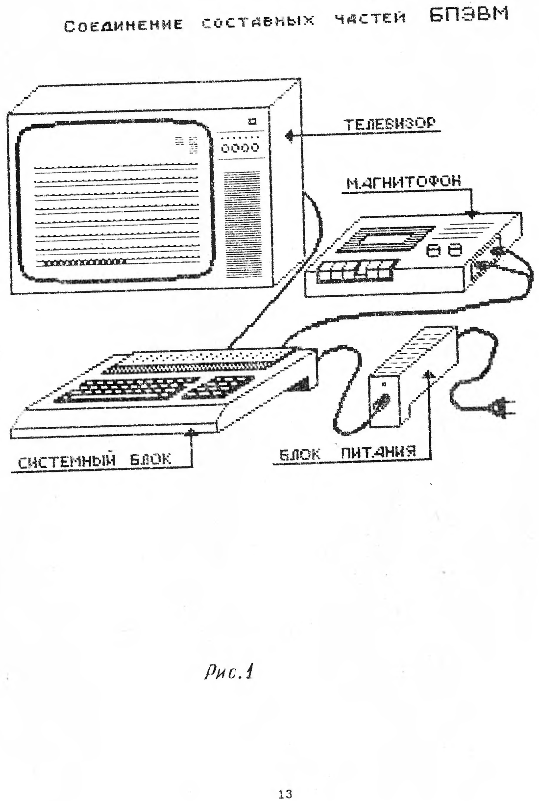
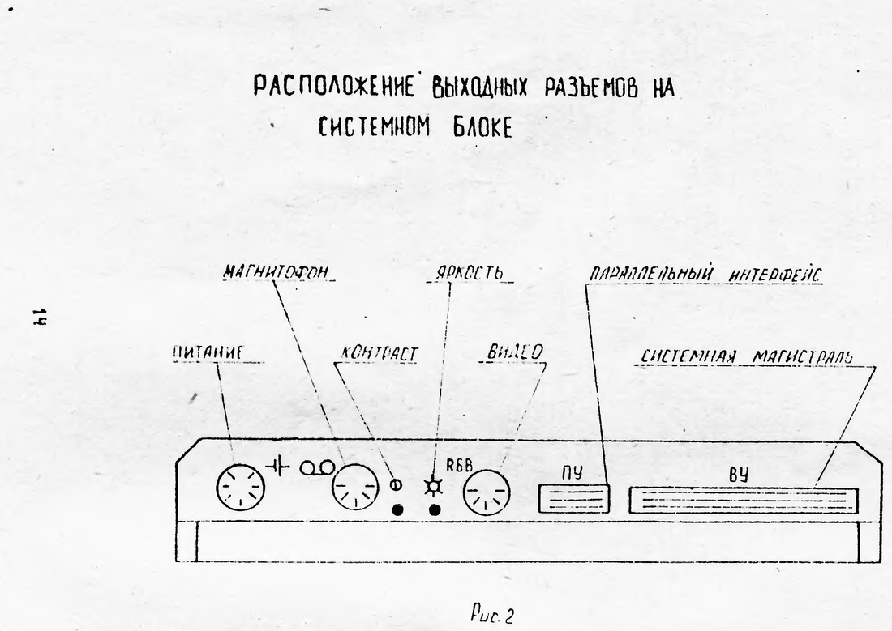
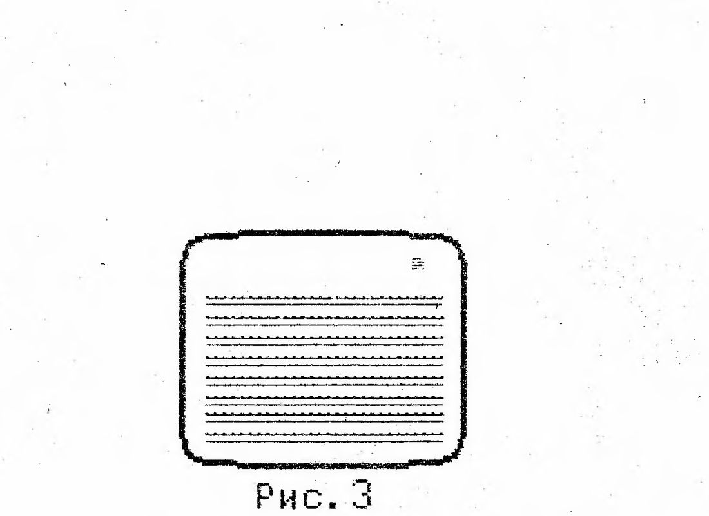
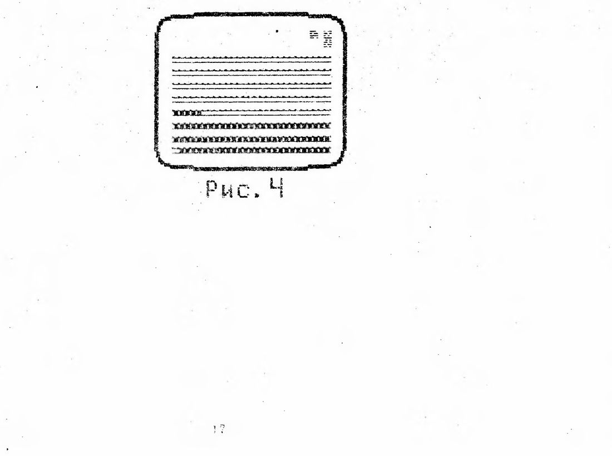
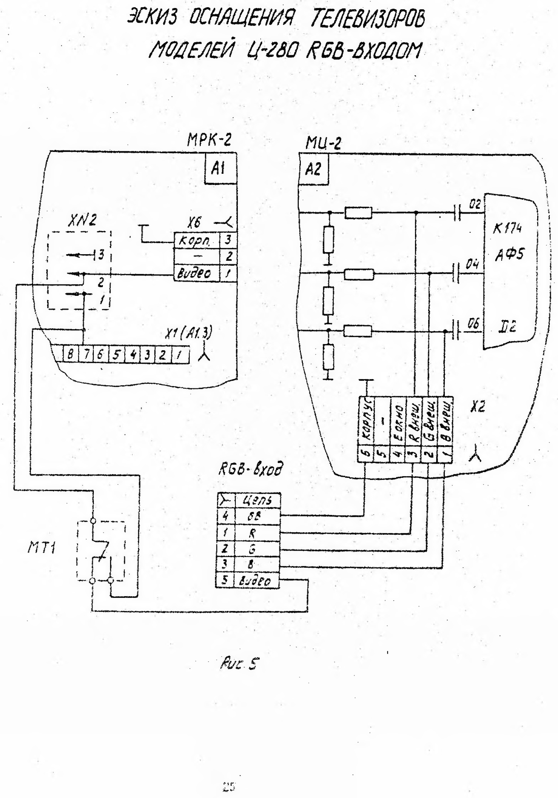
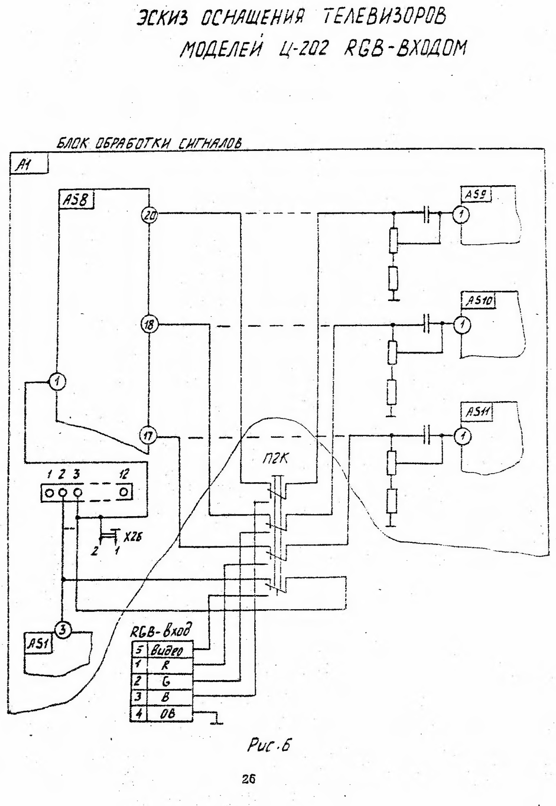

Руководство по эксплуатации ПЭВМ «Вектор-06Ц.01».

Машина вычислительная электронная цифровая персональная бытовая «Вектор-06Ц.01».
Руководство по эксплуатации. МВАИ 466214.001-01 РЭ.

ПО «Счетмаш», г. Кишинев.

Скан: 30 страниц (`_-06.01_.djvu`), 300 dpi. Текстового слоя в файле нет, текст восстановлен распознаванием; обозначения, прочитанные неуверенно, помечены `[?]`, перечень таких мест — в конце документа.

# ОБЛОЖКА

Бытовая персональная
электронная вычислительная
машина

ВЕКТОР-06Ц.01

Руководство по эксплуатации

# ТИТУЛЬНЫЙ ЛИСТ

Машина вычислительная электронная
цифровая персональная бытовая
ВЕКТОР-06Ц.01

Руководство по эксплуатации

МВАИ 466214.001-01 РЭ

# СОДЕРЖАНИЕ

| Раздел | Страница |
| --- | --- |
| 1. Общие указания | 4 |
| 2. Технические характеристики | 5 |
| 3. Комплект поставки | 8 |
| 4. Требования по технике безопасности | 9 |
| 5. Краткое описание изделия | 10 |
| 6. Подготовка к работе и порядок работы | 15 |
| 7. Техническое обслуживание | 19 |
| 8. Возможные неисправности и методы их устранения | 20 |
| 9. Правила хранения | 21 |
| 10. Гарантийные обязательства | 22 |
| 11. Содержание драгоценных материалов | 23 |
| Приложение 1. Оснащение телевизора цветного изображения RGB-входом | 24 |
| Приложение 2. Сигналы на выходных разъемах | 27 |
| Приложение 3. Гарантийный талон | 30 |
| Приложение 4. Отрывной талон на техническое обслуживание | 31 |
| Приложение 5. Отрывной талон на гарантийный ремонт | 33 |
| Приложение 6. Схема электрическая принципиальная модуля системного БПЭВМ «Вектор-06Ц.01» | 35 |
| Приложение 7. Схема электрическая принципиальная модуля клавиатуры и блока питания БПЭВМ «Вектор-06Ц.01» | 37 |
| Приложение 8. Сборочный чертеж модуля системного БПЭВМ и таблица прошивок ПЗУ | 39 |

Приложения 4–8 (страницы 31–39) в имеющийся скан не входят.

# 1. ОБЩИЕ УКАЗАНИЯ

1.1. При покупке машины вычислительной электронной цифровой персональной бытовой «Вектор-06Ц.01» (БПЭВМ) потребуйте проверить качество её работы, путем выполнения действий, указанных в разделе 6 данного «Руководства по эксплуатации» (РЭ).

1.2. Убедитесь в сохранности пломб на БПЭВМ. Проверьте ее комплектность и наличие гарантийного и отрывных талонов, убедитесь, что в гарантийном и отрывных талонах настоящего РЭ поставлены штамп магазина, разборчивая подпись или штамп продавца и дата продажи.

1.3. Талоны на техническое обслуживание и гарантийный ремонт отрываются работниками предприятия-изготовителя только после того, как работа фактически выполнена. Помните, что при утере гарантийного талона Вы лишаетесь права на гарантийный ремонт.

1.4. Распаковка БПЭВМ производится перед началом эксплуатации. Предварительно выдержите БПЭВМ в упаковке в помещении при температуре (20±5)°С в течении 6 часов.

1.5. Перед тем как включить БПЭВМ, внимательно ознакомтесь с настоящим руководством и другими эксплуатационными документами, поставляемыми с БПЭВМ, в первую очередь с указанием мер безопасности, а также с органами управления и надписями на корпусе БПЭВМ.

1.6. БПЭВМ должна устойчиво функционировать при

1) повышенной рабочей температуре 40°С;

2) пониженной рабочей температуре 5°С;

3) повышенной влажности 80% при температуре 25°С;

4) атмосферном давлении от 84 до 107 кПа (630 – 800 мм рт.ст.).

Примечание. Завод-изготовитель оставляет за собой право вносить непринципиальные изменения в изделие, не ухудшающие его качественные показатели и программную совместимость.

# 2. ТЕХНИЧЕСКИЕ ХАРАКТЕРИСТИКИ

Наименование основных функциональных частей БПЭВМ и их технические характеристики приведены в табл. 1.

Таблица 1

| Наименование | Техническая характеристика |
| --- | --- |
| Процессор | базовый микропроцессор КР580ВМ80А с тактовой частотой 3 МГц; быстродействие — 0,6·10⁶[?] оп/сек (типа Рг.-Рг.); разрядность — 8 разрядов; количество команд — 78. |
| Память | оперативное запоминающее устройство — 64 Кбайт (ОЗУ пользователя — до 56 Кбайт); постоянное запоминающее устройство (начальный загрузчик) — 512 байт. |
| Интерфейс | системная шина; параллельный интерфейс с 24 линиями ввода/вывода (3х8 линий) + 1 линия. |
| Внешнее запоминающее устройство | Бытовой кассетный магнитофон. Объем информации: при фазовой модуляции — не менее 0,512 Мбайт; скорость обмена — 1200–2400 бод. |
| Устройство отображения информации | Телевизионный приемник цветного изображения с RGB-входом (см. примечание) или черно-белого изображения. Форматы: алфавитно-цифровой (символ × строка) — 32х25, 40х25, 42х25, 64х25, 80х25; графический (Х×У): 256х256 при любых 16 цветах (градациях яркости) из 256 цветов цветовой палитры, 512х256 при любых 4 цветах (градациях яркости) из 256 цветов цветовой палитры; 1024х256 адресуемых точек (при емкости видеоОЗУ 32 Кбайта). |
| Звуковой синтезатор | Четыре канала — три канала аппаратно-формируемые и один канал программно-формируемый. |
| Клавиатура | 72 клавиши. Размещение цифрового и буквенного поля — типа пишущей машинки. |
| Программное обеспечение | Тестовые программные средства; системные программные средства (интерпретатор языка Бейсик, Ассемблер-редактор, монитор-отладчик) и прикладные программы. |
| Электропитание | Сеть однофазная напряжением (220±22) В[?], частота (50±1) Гц, потребляемая мощность не более 30 Вт. |
| Габаритные размеры | Блока системного 415х235х70; блока питания 230х130х65. |
| Масса | не более 4 кг. |

Примечание. Телевизоры, не оборудованные RGB-входом, необходимо доработать согласно приложению 1.

БПЭВМ обладает рядом дополнительных возможностей:

- непосредственное подключение печатающего устройства типа ЕРБОН FX-85, ВАУ[-8010М[?], 2100, ROBOTRON и др. (интерфейс типа CENTRONICS);

- подключение дополнительных устройств внешней памяти (накопитель на гибком магнитном диске и/или электронный диск емкостью не менее 256 Кбайт);

- загрузка с магнитной ленты и функционирование программ пользователя ПЭВМ «Микроша», «РК-86», КУВТ «Корвет» (при предварительной загрузке соответствующих программ-эмуляторов);

- загрузка с магнитной ленты и функционирование программ пользователя, написанных в операционных системах CP/M-80, МикроДОС при условии отсутствия в них обращения к файловой системе;

- функционирование системных и прикладных программ под управлением операционных систем CP/M-80, МикроДОС (в комплекте с эмулятором дисковой памяти или накопителем на гибких магнитных дисках объёмом не менее 256 Кбайт).

# 3. КОМПЛЕКТ ПОСТАВКИ

| Наименование | Кол. |
| --- | --- |
| БПЭВМ «Вектор-06Ц.01»: | |
| Блок системный № ____ | 1 шт. |
| Блок питания № ____ | 1 шт. |
| Комплект монтажных частей: | |
| Кабель соединительный (длинный) к телевизионному приемнику | 1 шт. |
| Кабель соединительный (трехвилочный) к бытовому кассетному магнитофону | 1 шт. |
| Кабель питания (короткий) | 1 шт. |
| Устройство соединительное | 1 шт. |
| Розетка ОНП-КГ-22 | 1 шт. |
| Шуруп 4х17[?] | 1 шт. |
| Магнитофонная кассета типа МК-60 с программным обеспечением | 1 шт. |
| Эксплуатационные документы: | |
| Руководство по эксплуатации с гарантийным и отрывными талонами | 1 книга |
| Эксплуатационная документация на программное обеспечение БПЭВМ «Вектор-06Ц»: | |
| Ассемблер-редактор. Описание языка | 1 книга |
| Монитор-отладчик. Руководство программиста | 1 книга |
| Тестовые программные средства. Руководство пользователя | 1 книга |
| Бейсик. Описание языка | 1 книга |
| Упаковка | 1 шт. |

# 4. ТРЕБОВАНИЯ ПО ТЕХНИКЕ БЕЗОПАСНОСТИ

4.1. БПЭВМ устанавливается в месте, удобном для проведения работы, на расстоянии не менее одного метра от отопительной системы.

4.2. Не рекомендуется устанавливать БПЭВМ в сырых помещениях. НЕЛЬЗЯ закрывать вентиляционные отверстия блока питания и системного блока.

4.3. БУДЬТЕ ОСТОРОЖНЫ! Во избежании несчастных случаев и выхода из строя изделия категорически запрещается:

1) включать БПЭВМ при снятой крышке блока питания;

2) оставлять БПЭВМ во включенном состоянии без наблюдения;

3) подключать к разъемам устройства, не предусмотренные РЭ;

4) при включенном компьютере одновременное прикосновение к металлическим частям БПЭВМ (телевизора, магнитофона, дополнительных устройств) и к устройствам, подключенным к шине «Земля» или эквивалентным им (батареи центрального отопления и т.п.).

4.4. Перед включением БПЭВМ убедитесь в отсутствии повреждений изоляции сетевого шнура блока питания, повреждения корпусов блока питания и системного блока. НЕ ПОДКЛЮЧАЙТЕ БПЭВМ к неисправным телевизору и магнитофону!

4.5. При работе с цветным или черно-белым телевизором (монитором) рекомендуется находиться на максимальном расстоянии от него, которое обеспечивается длиной соединительного кабеля.

Если вы работаете в текстовом режиме (512х256 точек на экране), то советуем Вам использовать чёрно-белый телевизор или монитор.

В разработанных Вами программах рекомендуем задавать оптимальное соотношение числа символов в строке и строк на экране, которое определяется разрешающей способностью телевизора и удобством в работе.

# 5. КРАТКОЕ ОПИСАНИЕ ИЗДЕЛИЯ

5.1. БПЭВМ «Вектор-06Ц.01» соответствует требованиям ГОСТ 27201-87, МВАИ 466214.001 ТУ и предназначена для индивидуального применения в бытовых условиях. Поставляемое прикладное программное обеспечение позволяет использовать компьютер в диалоговом режиме работы с высокой степенью интерактивности при работе с игровыми программами, прививающими навыки работы на ЭВМ, при изучении основ информатики, для создания информационно-справочных систем, для выполнения вычислительных работ и широкого круга научно-технических, экономических задач, задач управления и обучения.

В БПЭВМ «Вектор-06Ц.01» используется общая оперативная память для микропроцессора и контроллера графического дисплея объемом 64 Кбайта. Объём экранного ОЗУ, при числе адресуемых точек изображения 256х256 и шестнадцати цветах, равен 32 Кбайт.

Конструктивно БПЭВМ состоит из двух частей (см. рис. 1): блока системного и блока питания.

Блок питания предназначен для обеспечения электропитания системного блока. Блок питания — импульсный, подключается к первичной сети напряжением 220 В, частотой 50 Гц. Выходное напряжение стабилизируется путем изменения длительности и частоты повторения импульсов.

Системный блок (основной) содержит в своём составе модуль клавиатуры, позволяющий оперативно управлять работой БПЭВМ, и модуль системный, который обеспечивает выполнение программ, хранение и обработку информации, организацию диалога с пользователем.

Принцип работы модуля клавиатуры основан на сканировании матрицы клавиш и анализе результата сканирования, по которому формируется информация в БПЭВМ.

Не прилагайте больших усилий при нажатии клавиш клавиатуры.

Модуль системный состоит из следующих функциональных узлов:

1) узел синхронизации — служит для формирования ряда синхронизирующих сигналов, поступающих на другие узлы БПЭВМ;

2) узел дисплея — обеспечивает считывание информации из ОЗУ в сдвиговые регистры, скроллинг экрана, сопряжение БПЭВМ с телевизором;

3) центральный процессор — предназначен для выполнения следующих функций:

- вычисления адресов операндов и команд;

- содержательной обработки операндов;

- обмена информацией с другими устройствами (узлами);

4) узел управления — обеспечивает формирование временной диаграммы работы системного модуля, обращение к устройствам ввода/вывода, ОЗУ и формирования всех внутренних и внешних управляющих сигналов;

5) узел начальной загрузки и запуска — используется для инициализации работы БПЭВМ путем выполнения программы «загрузчик», записанной в ПЗУ;

6) узел параллельного программируемого интерфейса и таймер — обеспечивают передачу данных внутри системного модуля, сканирование и прием информации из модуля клавиатуры, обмен информацией между системным модулем и внешними устройствами;

7) узел сопряжения с магнитофоном — обеспечивает сопряжение бытового кассетного магнитофона с БПЭВМ;

8) оперативное запоминающее устройство — предназначено для приема, хранения и передачи данных по запросу процессора или узла дисплея.

В БПЭВМ предусмотрена возможность подключения внешнего ОЗУ емкостью 256 Кбайт (электронный «квази-диск»), матричного печатающего устройства, контроллера накопителей на гибких магнитных дисках и до четырех НГМД, а также других дополнительных узлов и блоков, расширяющих ее функциональные возможности. Данные узлы и блоки в комплект поставки не входят.

Примечание. Назначение сигналов и контактах разъемов для внешнего подключения приведены в приложении 2 данного РЭ.

5.2. Программное обеспечение.

5.2.1. Состав программного обеспечения, записанного на кассете, указан на вкладыше кассеты, поставляемой с БПЭВМ. Рядом с именем программы (файла) указано, в каком формате записана на ленте эта программа.

5.2.2. Правила пользования программами смотрите в эксплуатационных документах на программное обеспечение.

Внимание! Программы, записанные в формате КОМ (формат загрузчика), вводятся в БПЭВМ при выполнении действий, указанных в п. 6.2. данного РЭ.

Программы, записанные в формате МОН (формат монитора), вводят-выводят с помощью Монитора-отладчика.

Программы, записанные в формате ASM (формат ассемблера), вводят-выводят с помощью Ассемблера-редактора.

Программы, записанные в формате BAS (формат Бейсика), вводят-выводят с помощью интерпретатора языка БЕЙСИК.

5.3. Органы управления и индикации.

В БПЭВМ предусмотрена световая индикация:

«СЕТЬ» — при включении питания загорается светодиод на блоке питания и светодиод «СЕТЬ» на системном блоке;

«РУС» — горящий светодиод — признак работы в русском регистре клавиатуры. Светодиод не горит — Вы работаете в латинском регистре.

Клавиатура БПЭВМ логически разделяется на три части: управляющая, алфавитно-цифровая и функциональная.

Управляющая клавиатура:

клавиша «ВВОД» — инициализирует работу программы «начальный загрузчик» для загрузки программ с магнитофона, записанных в формате КОМ;

клавиша «СБР» — используется для запуска программ формата КОМ и для других целей;

клавиша «Блк» — предохраняет от случайного нажатия клавиш «ВВОД» и «СБР».

Алфавитно-цифровая и функциональная клавиатура описаны в эксплуатационных документах на программное обеспечение.

Тумблер включения питания БПЭВМ находится на блоке питания.

Рис. 1. Соединение составных частей БПЭВМ (телевизор, магнитофон, системный блок, блок питания).

Рис. 2. Расположение выходных разъемов на системном блоке.

# 6. ПОДГОТОВКА К РАБОТЕ И ПОРЯДОК РАБОТЫ

6.1. Подготовка к работе.

6.1.1. В качестве видеомонитора для БПЭВМ без дополнительной доработки можно использовать только телевизоры класса ЗУСЦТ[?] с RGB-входом по ГОСТ 24638-87.

Для подключения к БПЭВМ телевизоров, не имеющих RGB-входа, используйте рекомендации, приведенные в приложении 1.

6.1.2. Установку БПЭВМ производите в следующей последовательности:

1) разместите составные части БПЭВМ на столе (рис. 1);

2) перед включением БПЭВМ проверьте состояние соединителей, удалите посторонние предметы, очистите от пыли поверхности устройств, убедитесь в исправности телевизора и магнитофона.

ВНИМАНИЕ!!! Подключение кабелей БПЭВМ производить только при отключенных от сети БПЭВМ, телевизора и магнитофона. Нарушение порядка подключения устройств может привести к выходу из строя телевизора и БПЭВМ.

3) подключите кабели устройств (маркировка соединителей БПЭВМ указана на корпусе — см. рис. 2) в следующей последовательности:

- кабель телевизора к разъему «RGB» системного блока и к RGB-входу телевизора;

- кабель магнитофона — к разъему «0-0» системного блока (подключать вилкой с пятижильным кабелем), к линейному выходу магнитофона (подключить вилкой с трехжильным кабелем), к входу магнитофона «запись с электрофона» (подключить вилкой с двухжильным кабелем);

- кабель питания к разъему питания[?] блока системного и к блоку питания;

- сетевой кабель блока питания к сети напряжением 220 В и частотой 50 Гц.

Примечание. Звуковое сопровождение программ можно осуществлять через громкоговоритель магнитофона. Для этого необходимо подключить магнитофон к БПЭВМ согласно пункту 6.1.2, нажать на магнитофоне кнопку «Пауза», а затем одновременно кнопки «Пуск» и «Запись».

6.2. Порядок работы и проверка работоспособности БПЭВМ.

6.2.1. Установите в магнитофон кассету с загружаемой программой. Переведите переключатель сети на блоке питания БПЭВМ в верхнее положение. При этом на лицевой панели блока питания загорится индикатор, а на системном блоке индикаторы «РУС» и «СЕТЬ». Включите питание телевизора и магнитофона.

6.2.2. Найдите начало вводимой информации на магнитной ленте (при проверке работоспособности БПЭВМ — начало программы «Тест устройств») и переведите магнитофон в режим остановки.

6.2.3. Нажмите одновременно клавиши ВВОД и БЛК на системном блоке. При этом должен погаснуть индикатор «РУС», а на экране телевизора появится незаполненная «карта загрузки» ОЗУ (см. рис. 3).

Регулировкой органов управления (потенциометрами «ось ...»[?], находящимися на задней панели системного блока) добейтесь качественного изображения.

Рис. 3. Незаполненная «карта загрузки» ОЗУ на экране телевизора.

6.2.4. Включите магнитофон в режим воспроизведения. При нормальном функционировании БПЭВМ на экране происходит заполнение прямоугольниками промежутков между парами горизонтальных линий (начиная с нижних). При этом при загрузке очередных 256 байт информации в «карте загрузки» оказывается заполненным один прямоугольник (см. рис. 4).

По завершении ввода информации (программы «Тест устройств») индикатор «РУС» начинает мигать.

* Количество заполненных прямоугольников не одинаково для различных программ.

После окончания загрузки программы выключите магнитофон.

Рис. 4. Заполнение «карты загрузки» ОЗУ при вводе информации с магнитофона.

6.2.5. Если во время ввода информации изображение стирается и появляется незаполненная «карта загрузки» ОЗУ (см. рис. 3), то необходимо повторить ввод (см. п.п. 6.2.2–6.2.4). Причиной ошибок при вводе обычно является неисправность магнитофона.

6.2.6. Если загрузка информации прошла успешно, то для выполнения загруженной программы надо одновременно нажать клавиши СБР и БЛК.

Описание работы программ смотри в эксплуатационных документах на программное обеспечение.

6.2.7. По окончании сеанса работы для выключения БПЭВМ необходимо:

1) выключить телевизор и магнитофон;

2) перевести переключатель сети на блоке питания БПЭВМ в нижнее положение (при этом на лицевой панели блока питания и системном блоке гаснут светодиоды «СЕТЬ»);

3) отсоединить сетевой кабель блока питания БПЭВМ от сети 220 В, кабели магнитофона и телевизора.

6.3. ВНИМАНИЕ! Перед началом пользования кассетой с программным обеспечением рекомендуем Вам сделать с неё несколько копий и работать с копиями.

Программы (файлы) в формате загрузчика копируются следующим образом:

- загрузить в БПЭВМ программу COPY (смотри п.п. 6.2.2–6.2.6). После нажатия клавиш СБР и БЛК на экране появится исходное изображение и надписи COPY, ЧТЕНИЕ. В этом режиме копировщик готов к загрузке копируемой программы;

- найти на кассете копируемую программу и включить магнитофон на воспроизведение. При этом происходит загрузка программы в копировщик. По окончании загрузки на экране надпись ЧТЕНИЕ заменяется на надпись ЖДУ;

- вставить в магнитофон кассету, на которую производится запись. При нажатии на клавишу РУС/ЛАТ происходит выдача копируемой программы из БПЭВМ на магнитофон (при этом на экране надпись ЖДУ меняется на надпись ЗАПИСЬ).

Файлы в формате БЕЙСИКА копируются с помощью интерпретатора языка БЕЙСИК (см. «Бейсик. Описание языка»).

Файлы в формате Монитора копируются с помощью монитора-отладчика (см. «Монитор-отладчик. Руководство программиста»).

Файлы в формате Ассемблера копируются с помощью Ассемблера-редактора (см. «Ассемблер-редактор. Описание языка»).

Примечание. Замена магнитофонной кассеты, израсходовавшей свой ресурс, производится потребителем БПЭВМ.

# 7. ТЕХНИЧЕСКОЕ ОБСЛУЖИВАНИЕ

7.1. Ежедневное техническое обслуживание БПЭВМ выполняется владельцем самостоятельно, без нарушения пломб, и включает следующие работы:

1) визуальный осмотр блоков БПЭВМ;

2) удаление пыли с поверхности устройств;

3) проверку состояния соединителей и кабелей.

Перед выполнением указанных работ необходимо отключить блок питания БПЭВМ от сети.

7.2. Техническое обслуживание, при необходимости, производится заводом-изготовителем.

Техническое обслуживание выполняется в течении гарантийного срока эксплуатации в соответствии с действующими правилами на гарантийное обслуживание и ремонт.

Техническое обслуживание включает в себя следующие виды работ:

1) контроль номинальных значений питающих напряжений блока питания БПЭВМ;

2) проверку работоспособности БПЭВМ с помощью тестовых программ;

3) восстановление не считываемого с магнитофона программного обеспечения на прикладываемой к БПЭВМ кассете.

7.3. Перечень неисправностей и методы их устранения, которые владелец может выполнить самостоятельно, приведены в разделе 8.

7.4. Для выявления других неисправностей в БПЭВМ необходимо выполнить тестовые программы в соответствии с документом «Тестовые программные средства. Руководство пользователя». При обнаружении дефектов ремонт производится предприятием-изготовителем.

# 8. ВОЗМОЖНЫЕ НЕИСПРАВНОСТИ И МЕТОДЫ ИХ УСТРАНЕНИЯ

Возможные неисправности и методы их устранения приведены в табл. 2.

Таблица 2

| Неисправность, внешнее проявление | Метод устранения | Применяемый инструмент |
| --- | --- | --- |
| Отсутствие качественного изображения: нарушение синхронизации или недостаточная (избыточная) яркость изображения | Регулировка органами управления на системном блоке (потенциометрами «...»)[?] | Отвертка |
| Ошибки при вводе информации с магнитофона | Очистить головку магнитофона и отрегулировать положение магнитной головки относительно магнитной ленты | Технический спирт, отвертка |
| Отсутствие изображения на телевизоре или отсутствие ввода информации с магнитофона | Проверить правильность применения кабелей и качество их соединения | — |

# 9. ПРАВИЛА ХРАНЕНИЯ

9.1. БПЭВМ в упакованном виде должна храниться в помещениях при температуре воздуха от 5 до 40°С и относительной влажности воздуха до 80%[?].

9.2. В помещениях, где хранится БПЭВМ, не должно быть паров кислот, щелочей или других химически активных веществ, пары или газы которых могут вызвать коррозию, а также должны отсутствовать сильные магнитные поля, вызывающие разрушение информации на кассете типа МК-60.

9.3. Распакованные составные части БПЭВМ должны храниться в условиях, соответствующих условиям эксплуатации:

- температура окружающего воздуха (20±5)°С;

- относительная влажность воздуха (60±20)%;

- атмосферное давление 84 до 107 кПа или 630 до 800 мм рт.ст.

# 10. ГАРАНТИЙНЫЕ ОБЯЗАТЕЛЬСТВА

10.1. БПЭВМ «Вектор-06Ц.01» соответствует утвержденному образцу. Изготовитель гарантирует соответствие БПЭВМ требованиям технических условий МВАИ 466214.001-01 ТУ при соблюдении владельцем правил эксплуатации, изложенных в руководстве по эксплуатации.

Гарантийный срок эксплуатации БПЭВМ «Вектор-06Ц» составляет 12 месяцев со дня продажи через розничную торговую сеть.

Гарантийный срок хранения — 24 месяца со дня изготовления.

При отсутствии в гарантийном и отрывных талонах отметки торговой организации срок гарантии исчисляется со дня выпуска БПЭВМ предприятием-изготовителем.

В течении гарантийного срока эксплуатации владелец имеет право на бесплатное техническое обслуживание БПЭВМ, а в случае нарушения его работоспособности — на бесплатный ремонт по предъявлению гарантийного талона. Замена магнитофонной кассеты, израсходовавшей свой ресурс, производится потребителем БПЭВМ.

Без предъявления гарантийного и отрывных талонов, при нарушении сохранности пломб на БПЭВМ или при нарушении требований настоящего РЭ, направленных на обеспечение нормальной работы БПЭВМ, претензии к качеству работы БПЭВМ не принимаются и гарантийный ремонт и техническое обслуживание не производится.

Техническое обслуживание и ремонт БПЭВМ производится специализированным ремонтным предприятием, а в случае его отсутствия — предприятием-изготовителем БПЭВМ как в течении гарантийного срока, так и по его истечению.

При необходимости отправки БПЭВМ для ремонта по почте, Вам надо упаковать компьютер в упаковку, входящую в комплект поставки, и дополнительно уложить в деревянный (фанерный) ящик, либо в другую упаковку, обеспечивающую сохранность БПЭВМ при пересылке по почте. Если Вы приобрели БПЭВМ в пенополистирольной упаковке, то дополнительной тары для отправки по почте не требуется. При выполнении гарантийного ремонта оплата пересылки БПЭВМ по почте производится за счет предприятия, производившего ремонт.

При неподтверждении дефекта либо при нарушении условий эксплуатации оплата пересылки и ремонта БПЭВМ производится за счет заказчика.

Обмен неисправных БПЭВМ осуществляется через торговую сеть в соответствии с действующими правилами обмена промышленных товаров, купленных в розничной торговой сети государственной или кооперативной торговли.

Документация, прилагаемая к БПЭВМ, при утере не возобновляется!

10.2. Адреса предприятий-изготовителей БПЭВМ:

- ПО «Счетмаш», 277612, г. Кишинев, ул. Тимошенко, 98.

- Приборостроительный завод, 610014, г. Киров, ул. Щорса, 95.

- Завод ППЭВМ, 220847, г. Минск.

- Завод «Прогресс», 414052, г. Астрахань, ул. Савушкина, 61 «а».

- Завод ЭВТ, 404130, г. Волжский, Волг. обл., квартал 32.

# 11. СОДЕРЖАНИЕ ДРАГОЦЕННЫХ МАТЕРИАЛОВ

В БПЭВМ содержится следующее количество драгоценных материалов:

- золото — 1,3854264 г;

- серебро — 1,3361876 г;

- палладий — 2,2175449 г.

# ПРИЛОЖЕНИЕ 1

## ОСНАЩЕНИЕ ТЕЛЕВИЗИОННОГО ПРИЕМНИКА ЦВЕТНОГО ИЗОБРАЖЕНИЯ RGB-ВХОДОМ

Возможно использование в качестве цветного видеомонитора телевизоров класса ЗУСЦТ (торговый индекс Ц-280/280д, Ц-282/282д, Ц-380/380д, Ц-380д-И, Ц-382/382д), 1УНЦТ-32 (торг. индекс Ц-440), телевизоров моделей ЗУСЦТ-51, 51ТЦ311, 51ТЦ311д, 51ТЦ433д, 51ТЦ433А, 67ТЦ433д и т.п., при дополнительном оснащении их RGB-входом с помощью монтажных частей, входящих в комплект БПЭВМ.

Сигнал «Видео», вырабатываемый БПЭВМ, может быть непосредственно подан на вход ВИДЕО стандартного чёрно-белого телевизора.

Бытовые чёрно-белые телевизоры моделей «Юность-406» (УПТИ-31), «Сапфир-401м» (УПТИ-23), «Электроника-404Д» (ПТ-23), «Шилялис-405д» (УНИТ-16) и др., не имеющие входа ВИДЕО, оснащаются дополнительным разъёмом. При этом сигнал «Видео» подаётся на вход видеоусилителя телевизионного приемника.

Лампово-полупроводниковые телевизоры моделей ЦТ-61, ЦТ-19 и другие могут быть использованы как видеомониторы черно-белого изображения, при наличии у них видеовхода.

Оснащение телевизоров RGB-входом можно произвести самостоятельно, либо по договоренности с предприятием, производящем фирменное техническое обслуживание телевизоров.

Для использования цветного телевизора в качестве монитора к БПЭВМ необходимо провести следующие доработки:

1) используя комплект монтажных частей, поставляемых с БПЭВМ, установить на телевизоре разъем типа ОНЦ-ВГ-4-5/16-В;

2) произвести монтаж согласно рис. 5.

Эскизы оснащения цветных телевизоров RGB-входом приведены на рис. 5 и рис. 6.

Рис. 5. Эскиз оснащения телевизоров моделей Ц-280 RGB-входом (модуль радиоканала МРК-2, модуль цветности МЦ-2, разъем).

Рис. 6. Эскиз оснащения телевизоров моделей Ц-202 RGB-входом (блок переработки сигналов, разъем).

# ПРИЛОЖЕНИЕ 2

## СИГНАЛЫ НА ВЫХОДНЫХ РАЗЪЕМАХ

### Разъем выхода «RGB»

| Сигнал | Контакт | Сигнал | Контакт |
| --- | --- | --- | --- |
| R | 1 | корпус | 4 |
| G | 2 | Видео | 5 |
| B | 3 | | |

### Разъем «0-0»

| Сигнал | Контакт | Сигнал | Контакт |
| --- | --- | --- | --- |
| выход | 1 | | 4 |
| корпус | 2 | | 5 |
| вход | 3 | | |

### Разъем параллельного интерфейса «ПУ»

| Сигнал | Контакт | Сигнал | Контакт | Сигнал | Контакт |
| --- | --- | --- | --- | --- | --- |
| +5В | А01 | —[?] | В01 | корпус | С01 |
| РА7 | А02 | РВ7 | В02 | РС7 | С02 |
| РА6 | А03 | РВ6 | В03 | РС6 | С03 |
| РА5 | А04 | РВ5 | В04 | РС5 | С04 |
| РА4 | А05 | РВ4 | В05 | РС4 | С05 |
| РА3 | А06 | РВ3 | В06 | РС3 | С06 |
| РА2 | А07 | РВ2 | В07 | РС2 | С07 |
| РА1 | А08 | РВ1 | В08 | РС1 | С08 |
| РА0 | А09 | РВ0 | В09 | РС0 | С09 |
| корпус | А10 | лог. «1» | В10 | +5В | С10 |

### Разъем системной магистрали «Ш»[?]

| Контакт | Сигнал | Контакт | Сигнал |
| --- | --- | --- | --- |
| АС01 | корпус | АС24 | корпус |
| АС02 | +5В | АС25 | ШД0 |
| АС03 | -ШАВВ0 | АС26 | ШД1 |
| АС04 | -ШАВВ1 | АС27 | ШД2 |
| АС05 | -ШАВВ2 | АС28 | ШД3 |
| АС06 | -ШАВВ3 | АС29 | ШД4 |
| АС07 | -ШАВВ4 | АС30 | ШД5 |
| АС08 | -ШАВВ5 | АС31 | ШД6 |
| АС09 | -ШАВВ6 | АС32 | ШД7 |
| АС10 | -ШАВВ7 | АС33 | корпус |
| АС11 | корпус | АС34 | -ЧТЗУ |
| АС12 | ШАП0 | АС35 | -ЧТВВ |
| АС13 | ШАП1 | АС36 | СБР.СИСТ. |
| АС14 | ШАП2 | АС37 | -ЗПВВ |
| АС15 | ШАП3 | АС38 | -БЛК |
| АС16 | ШАП4 | АС39 | ВВОД СИСТ. |
| АС17 | ШАП5 | АС40 | СТЕК |
| АС18 | ШАП6 | АС41 | -СБРОС |
| АС19 | ШАП7 | АС42 | не исп. |
| АС20 | корпус | АС43 | СТРОБ.СОСТ. |
| АС21 | -RAS | АС44 | +5В |
| АС22 | -CAS | АС45 | корпус |
| АС23 | -ЗПЗУ | | |

### Разъем электропитания

| Контакт | Цепь | Контакт | Цепь |
| --- | --- | --- | --- |
| 1 | 0 В | 5 | +12 В[?] |
| 2 | -5 В | 6 | 0 В |
| 3 | +5 В | 7 | +5 В |
| 4 | -5 В | | |

# ПРИЛОЖЕНИЕ 3

Действителен по заполнению

Кишиневское ПО «Счетмаш». Продукция выпускается под контролем Государственной приемки.

Цена ... руб.

Прейскурант № ...

## ГАРАНТИЙНЫЙ ТАЛОН

Заполняет предприятие-изготовитель

Машина вычислительная электронная цифровая персональная бытовая «Вектор-06Ц.01»

Дата выпуска ______________

Представитель ОТК ______________

(штамп ОТК)

Адрес для предъявления претензий к качеству: 278300, МССР, г. Дубоссары, ул. З. Космодемьянской, 62.

Заполняет торговое предприятие:

Дата продажи ______________

(число, месяц, год)

Продавец ______________

(подпись или штамп)

Штамп МАГАЗИН

Заполняется ремонтным предприятием:

Поставлен на гарантийное обслуживание ______________

наименование ремонтного предприятия, число, месяц, год

Гарантийный номер ______________

# ОБОРОТ ПОСЛЕДНЕЙ СТРАНИЦЫ

Дорогой товарищ! Вы приобрели бытовую персональную ЭВМ «Вектор-06Ц.01». Этим Вы сделали первый шаг в удивительный мир компьютерной техники. Мы надеемся, что персональный компьютер будет для Вас не только игрушкой, но и надежным деловым партнером, который поможет в решении Ваших проблем.

БПЭВМ «Вектор-06Ц.01» станет еще одним членом Вашей семьи, её другом. Она сможет увлечь Ваших детей живым и интересным делом, она будет для них постоянным товарищем в играх, она станет помощником и учителем при изучении математики, физики, иностранного языка и других школьных предметов.

БПЭВМ «Вектор-06Ц.01» — незаменимая помощница для женщин. Она поможет Вам сохранить рецепты блюд, выкройки, придумает узоры для вязания.

БПЭВМ «Вектор-06Ц.01» поможет Вам освоить основы музыкальной грамотности.

БПЭВМ «Вектор-06Ц.01» позволит Вам опередить время.

# ПРИМЕЧАНИЯ К РАСПОЗНАВАНИЮ

Текст восстановлен по сканам без текстового слоя (300 dpi) двумя независимыми проходами распознавания; расхождения сверялись по изображению. Места, отмеченные `[?]`, читаются неуверенно:

- 1.4 — температура при распаковке `(20±5)°С` (второй проход даёт «(2±5)»);
- 9.1 — влажность хранения `до 80%` (второй проход даёт «до 86%»);
- Таблица 1 — быстродействие процессора: показатель степени в скане читается как «5», но по смыслу и по родственному РЭ — 0,6·10⁶ оп/сек (0,6 млн.);
- Таблица 1 — допуск напряжения питания `(220±22) В`;
- Таблица 1 — печатающие устройства: `ВАУ[-8010М` (возможно «BAY-8010M»);
- Раздел 3 — `Шуруп 4х17` (в скане «А3Х7», размер читается неуверенно);
- Раздел 6.1.1 — класс телевизоров (в скане «ФУСИТ», вероятно «ЗУСЦТ»);
- Раздел 6.1.2 — обозначение разъема «питание» (в скане читается фрагментарно, сверено по рис. 2 и приложению 2);
- Раздел 6.2.3 — подписи потенциометров на задней панели (в скане неразборчивы);
- Таблица 2 — подписи потенциометров (в скане неразборчивы);
- Приложение 2 — контакт В01 разъема «ПУ» (в скане залит, значение не читается); название разъема магистрали (в скане «ВУ»);
- Приложение 2 — таблица разъема электропитания: цепь +12 В читается неуверенно.

Графические материалы не перечерчены, а вырезаны из страниц скана в отдельные PNG: рис. 1 (`p13-fig1-soedinenie.png`, стр. 13), рис. 2 (`p14-fig2-razemy.png`, стр. 14 — страница в скане повернута, фрагмент развернут), рис. 3 (`p17-fig3-karta-zagruzki.png`, стр. 17, верхняя часть), рис. 4 (`p17-fig4-karta-zagruzki.png`, стр. 17, нижняя часть), рис. 5 (`p25-fig5-tv-c280.png`, стр. 25), рис. 6 (`p26-fig6-tv-c202.png`, стр. 26). Страница 17 содержит только графику; её подписи в скане читаются фрагментарно, поэтому разделение на рис. 3 и рис. 4 сделано по тексту п.п. 6.2.3–6.2.4 и по расположению изображений. Бланки отрывных талонов (приложения 4–5) в скан не входят.
