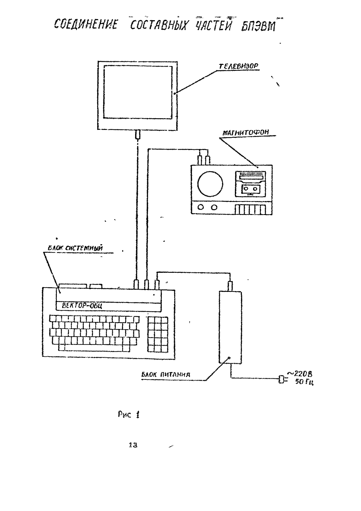
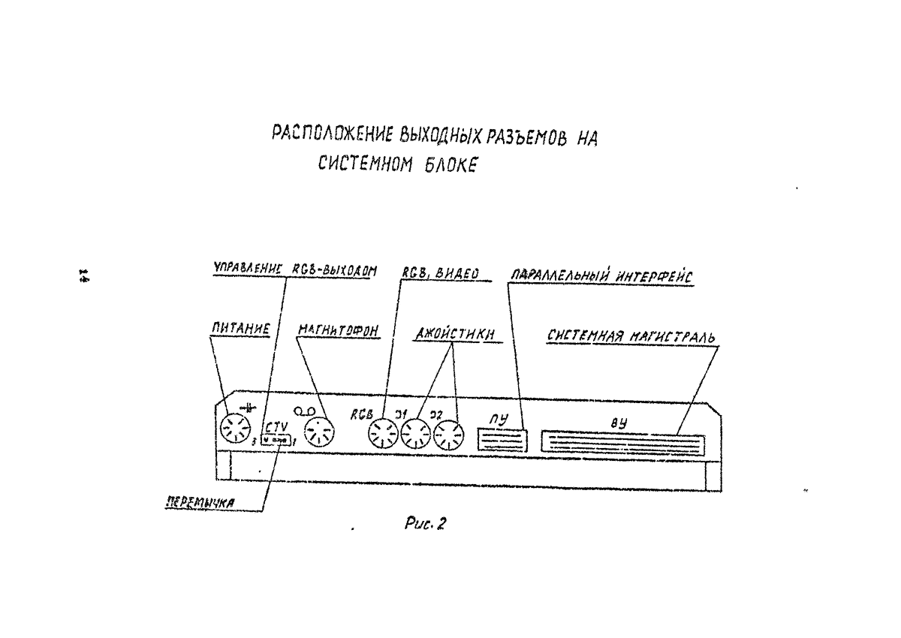
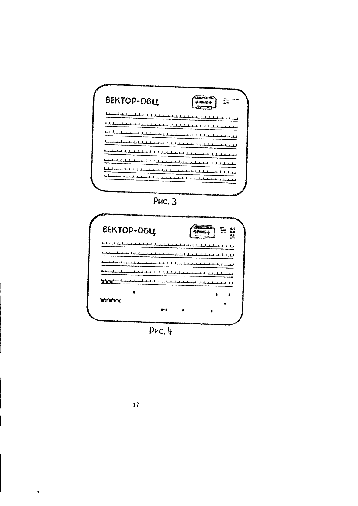
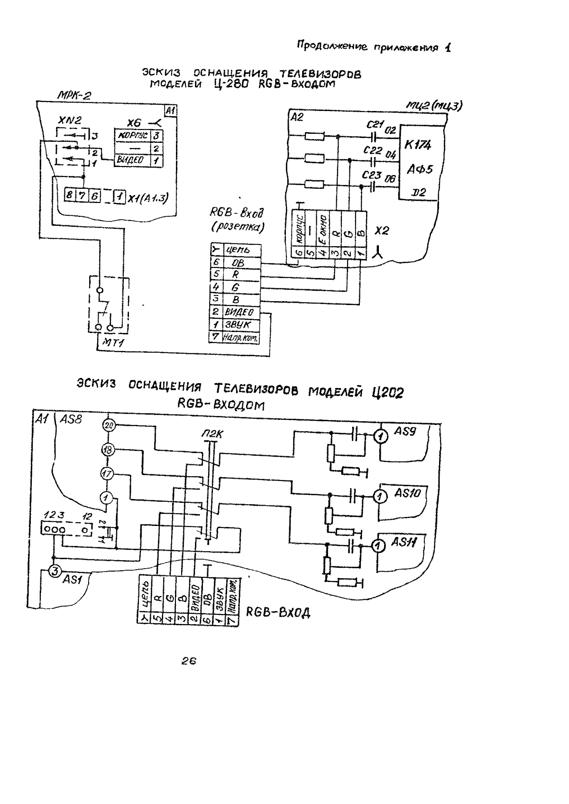
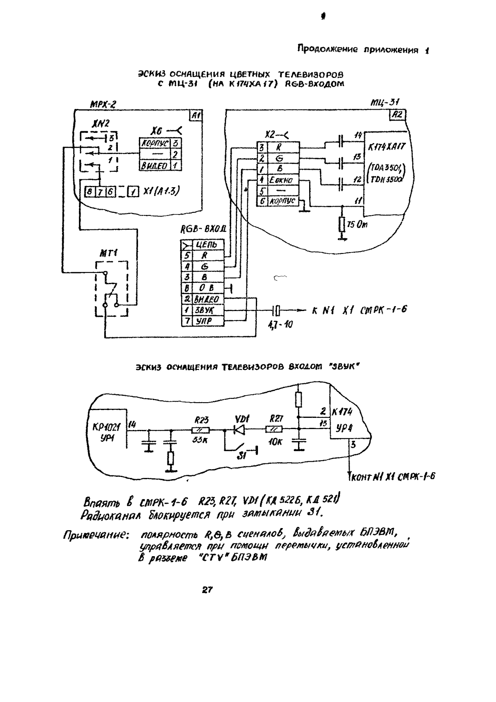
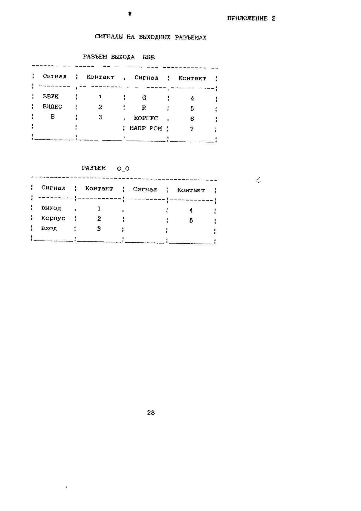
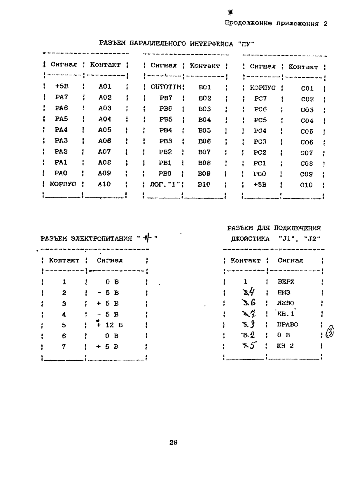
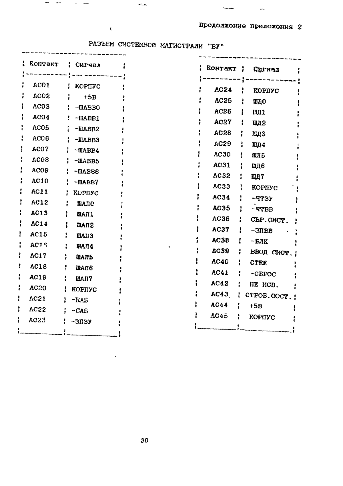
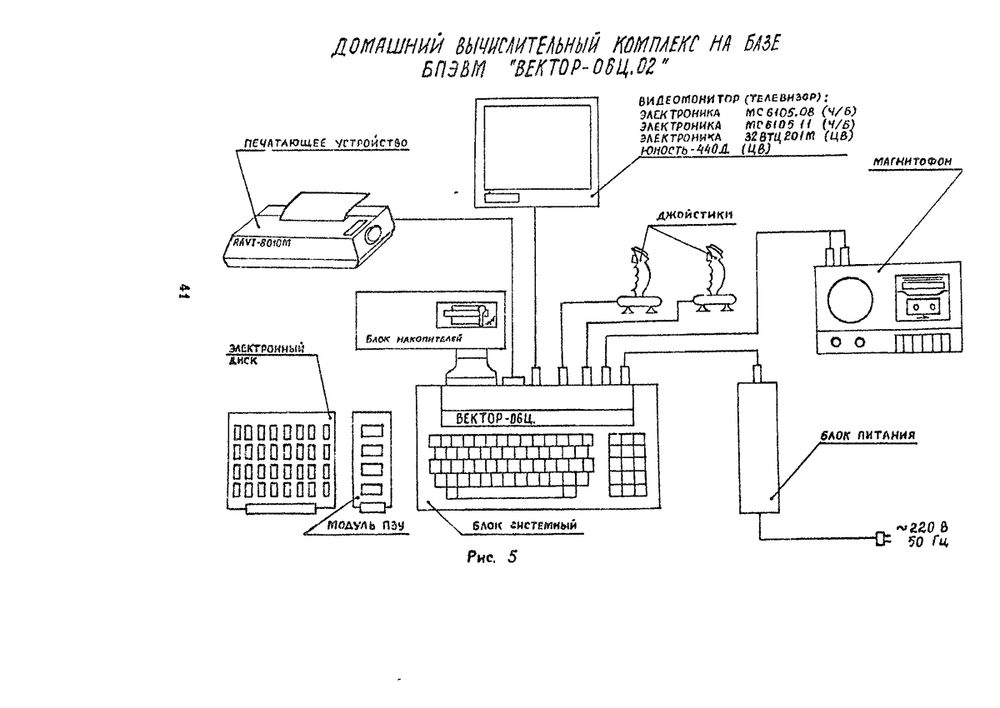

Руководство по эксплуатации машины вычислительной электронной цифровой персональной бытовой «Вектор-06Ц.02». МВАИ 466214.001-02 РЭ. Изготовитель — Кишиневское ПО «Счетмаш».

Скан: `0602.djvu` (42 страницы, титул, основной текст с 4 по 24 с., приложения 1–5 и 9, лист с рис. 5). Отдельный лист изменений к РЭ — `changes.djvu`.

# МАШИНА ВЫЧИСЛИТЕЛЬНАЯ ЭЛЕКТРОННАЯ ЦИФРОВАЯ ПЕРСОНАЛЬНАЯ БЫТОВАЯ «ВЕКТОР-06Ц.02»

Руководство по эксплуатации
МВАИ 466214.001-02 РЭ

## Обращение к покупателю

Дорогой товарищ! Вы приобрели бытовую персональную ЭВМ «Вектор-06Ц.02». Этим Вы сделали первый шаг в удивительный мир компьютерной техники. Мы надеемся, что персональный компьютер будет для Вас не только игрушкой, но и надежным деловым партнером, который поможет в решении Ваших проблем.

БПЭВМ «Вектор-06Ц.02» станет еще одним членом Вашей семьи, ее другом. Она сможет увлечь Ваших детей живым интересным делом, она будет для них постоянным помощником и учителем при изучении математики, физики, иностранного языка и других школьных предметов.

БПЭВМ «Вектор-06Ц.02» - незаменимая помощница для женщин. Она поможет Вам сохранить рецепты блюд, выкройки, придумает узоры для вязания.

БПЭВМ «Вектор-06Ц.02» поможет Вам развить навыки музыкальной грамотности.

БПЭВМ «Вектор-06Ц.02» станет основой Вашего домашнего вычислительного комплекса, который Вы создадите сами, приобретая постепенно необходимые Вам дополнительные внешние устройства: принтер, монитор, дисковод, электронный диск, модуль ПЗУ, джойстик. Многие из этих устройств уже выпускаются и Вы можете найти их в магазинах, некоторые готовятся к производству.

БПЭВМ «Вектор-06Ц.02» - это перспективная модель, которую можно оснастить всеми указанными устройствами.

БПЭВМ «Вектор-06Ц.02» позволит Вам опередить время!

ВНИМАНИЕ: Требуйте проверки работоспособности БПЭВМ «Вектор-06Ц.02» в магазине!

## Содержание

1. Общие указания
2. Комплект поставки
3. Основные технические характеристики
4. Указания по технике безопасности
5. Краткое описание изделия
6. Подготовка к работе и порядок работы с изделием
7. Техническое обслуживание изделия
8. Возможные неисправности и методы их устранения
9. Правила хранения
10. Гарантийные обязательства
11. Содержание драгоценных материалов
- Приложение 1. Оснащение телевизора цветного изображения RGB-входом
- Приложение 2. Сигналы на выходных разъемах
- Приложение 3. Гарантийный талон
- Приложение 4. Отрывной талон на техническое обслуживание
- Приложение 5. Отрывной талон на гарантийный ремонт
- Приложение 6. Схема электрическая принципиальная модуля системного БПЭВМ «Вектор-06Ц.02»
- Приложение 7. Схема электрическая принципиальная модуля клавиатуры и блока питания БПЭВМ «Вектор-06Ц.02»
- Приложение 8. Сборочный чертеж модуля системного БПЭВМ «Вектор-06Ц.02»
- Приложение 9. Перечень предприятий, выполняющих гарантийное обслуживание БПЭВМ «Вектор-06Ц.02» по зонам деятельности

## 1. Общие указания

1.1. При покупке машины вычислительной электронной цифровой персональной бытовой «Вектор-06Ц.02» (БПЭВМ) потребуйте проверить качество ее работы, путем выполнения действий, указанных в разделе 6 данного «Руководства по эксплуатации» (РЭ).

1.2. Убедитесь в сохранности пломб на БПЭВМ. Проверьте ее комплектность и наличие гарантийного и отрывных талонов. Убедитесь, что в гарантийном и отрывных талонах настоящего РЭ поставлены штамп магазина, разборчивая подпись и штамп продавца и дата продажи.

1.3. Талоны на техническое обслуживание и гарантийный ремонт отрываются работниками ремонтного предприятия только после того, как работа фактически выполнена. После проведения технического обслуживания или ремонта БПЭВМ должна быть опломбирована работниками ремонтного предприятия. ПОМНИТЕ, что при утере гарантийного талона Вы лишаетесь права на гарантийный ремонт!

1.4. Распаковка БПЭВМ производится перед началом эксплуатации. Предварительно выдержите БПЭВМ в упаковке в помещении при температуре (20±5) °С в течение 6 часов.

1.5. Перед тем как включить БПЭВМ, внимательно ознакомьтесь с настоящим руководством и другими эксплуатационными документами, поставляемыми с БПЭВМ, в первую очередь с указанием мер безопасности, а также с органами управления и надписями на корпусе БПЭВМ.

1.6. БПЭВМ должна устойчиво функционировать при:

1. повышенной рабочей температуре 40 °С;
2. пониженной рабочей температуре 5 °С;
3. повышенной влажности 80 % при температуре 25 °С;
4. атмосферном давлении от 84 до 107 кПа (630-800 мм рт. ст.).

Примечание. Завод-изготовитель оставляет за собой право вносить непринципиальные изменения в изделие, не ухудшающие его качественные показатели и программную совместимость.

## 2. Комплект поставки

В комплект поставки машины вычислительной электронной цифровой персональной бытовой «Вектор-06Ц.02» входит:

| Наименование | Количество |
| --- | --- |
| Блок системный | 1 шт. |
| Блок питания | 1 шт. |
| **Комплект монтажных частей:** | |
| Кабель соединительный (длинный) к телевизионному приемнику | 1 шт. |
| Кабель соединительный (трехвилочный) к бытовому кассетному магнитофону | 1 шт. |
| Кабель питания (короткий) | 1 шт. |
| Устройство соединительное | 1 шт. |
| Розетка ОНп-КГ-22 | 1 шт. |
| Шуруп 1-2,5х7,019 | 2 шт. |
| Магнитофонная кассета типа МК-60 с программным обеспечением | 1 шт. |
| **Эксплуатационные документы:** | |
| Руководство по эксплуатации с гарантийным и отрывными талонами | 1 книга |
| Эксплуатационная документация на программное обеспечение БПЭВМ «Вектор-06Ц.02»: | |
| - Ассемблер-редактор. Описание языка | 1 книга |
| - Монитор-отладчик. Руководство программиста | 1 книга |
| - Тестовые программные средства. Руководство пользователя | 1 книга |
| - Бейсик. Описание языка | 1 книга |
| Упаковка | 1 шт. |

## 3. Основные технические характеристики

3.1. Наименование основных функциональных частей БПЭВМ и их технические характеристики приведены в табл. 1.

Таблица 1

| Наименование | Техническая характеристика |
| --- | --- |
| Процессор | базовый микропроцессор КР580ВМ80А с тактовой частотой 3 МГц; быстродействие - 0,6·10⁶ оп/сек (типа Рг.-Рг.); разрядность - 8 разрядов; количество команд - 78 |
| Память | оперативное запоминающее устройство - 64 Кбайт (ОЗУ пользователя - до 56 Кбайт); постоянное запоминающее устройство (начальный загрузчик) - 2 Кбайт |
| Интерфейс | системная шина; параллельный интерфейс с 24 линиями ввода/вывода; два интерфейса внешних устройств типа «джойстик» |
| Внешнее запоминающее устройство | базовый вариант - бытовой кассетный магнитофон. Объем информации при фазовой модуляции не менее 0,512 Мбайт, скорость обмена - 1200-2400 бод |
| Устройство отображения информации | телевизионный приемник цветного изображения с RGB-входом, черно-белого изображения или видеомонитор |
| Форматы | алфавитно-цифровой (символ х строка) - 32х25, 40х25, 42х25, 64х25, 80х25; графический (XхY): 256х256 при любых 16 цветах (градациях яркости) из 256 цветов цветовой палитры, 512х256 при любых 4 цветах (градациях яркости) из 256 цветов цветовой палитры, 1024х256 адресуемых точек (при емкости видео-ОЗУ 32 Кбайт) |
| Звуковой синтезатор | 4 канала - три канала аппаратно-формируемые и один канал программно-формируемый |
| Клавиатура | 70 клавиш, размещение цифрового и буквенного поля - типа пишущей машинки |
| Программное обеспечение | Тестовые программные средства; системные программные средства (интерпретатор языка Бейсик, Монитор-отладчик, Ассемблер-редактор, язык Паскаль) и прикладные программы |
| Электропитание | сеть однофазная напряжением (220 +…/−…) В, частота (50±1) Гц, потребляемая мощность не более 25 Вт |
| Габаритные размеры, мм | Блока системного 415х235х70; Блока питания 230х130х65 |
| Масса | не более 3 кг |

*Допуск на напряжение питания в скане неразборчив (см. «Примечания к оцифровке»).*

Примечание. Телевизоры, не оборудованные RGB-входом, необходимо доработать согласно приложению 1.

БПЭВМ обладает рядом дополнительных возможностей:

- непосредственное подключение печатающего устройства типа ЕПСОН РХ-85, КАУ!-8010М, 2100, РОБОТРОН и др. (интерфейс типа CENTRONICS); *наименования моделей распознаны неуверенно, см. «Примечания к оцифровке»*;
- подключение дополнительных устройств внешней памяти: накопитель на гибком магнитном диске (НГМД) и/или электронный диск емкостью 256 Кбайт, внешнее ПЗУ (подключается к разъему «ПУ»);
- проведение начальной загрузки БПЭВМ из НГМД, ПЗУ, квазидиска программой «загрузчик», «зашитой» в ПЗУ БПЭВМ;
- загрузка с магнитной ленты и функционирование программ пользователя ПЭВМ «Микроша», «РК-86», КУВТ «Корвет» (при предварительной загрузке соответствующих программ-эмуляторов);
- загрузка с магнитной ленты и функционирование программ пользователя, написанных в операционных системах CP/M-80, Микродос, при условии отсутствия в них обращения к файловой системе;
- функционирование системных и прикладных программ под управлением операционных систем CP/M-80, Микродос (в комплекте с эмулятором дисковой памяти или накопителем на гибких магнитных дисках объемом не менее 256 Кбайт).

Примечание. Дополнительные устройства рекомендуется подключать согласно схеме, приведенной на рис. 5.

## 4. Указания по технике безопасности

4.1. БПЭВМ устанавливается в месте, удобном для проведения работы, на расстоянии не менее одного метра от отопительной системы.

4.2. Не рекомендуется устанавливать БПЭВМ в сырых помещениях. НЕЛЬЗЯ закрывать вентиляционные отверстия блока питания и системного блока.

4.3. БУДЬТЕ ОСТОРОЖНЫ! Во избежание пожара, несчастных случаев и выхода из строя изделия категорически запрещается:

1. включать БПЭВМ при снятой крышке блока питания;
2. оставлять БПЭВМ во включенном состоянии без наблюдения;
3. подключать к разъемам устройства, не оговоренные в РЭ;
4. при включенном компьютере одновременное прикосновение к металлическим частям БПЭВМ (телевизора, магнитофона, дополнительных устройств) и к устройствам, подключенным к шине «Земля» или эквивалентным им (батареи центрального отопления и т.п.).

4.4. Перед включением БПЭВМ убедитесь в отсутствии повреждений изоляции сетевого шнура блока питания, повреждения корпусов блока питания и системного блока. НЕ ПОДКЛЮЧАЙТЕ БПЭВМ к неисправным телевизору и магнитофону!

4.5. При работе с цветным или черно-белым телевизором рекомендуется находиться на максимальном расстоянии от него, которое обеспечивается длиной соединительного кабеля.

Если Вы работаете в текстовом режиме (512х256 точек на экране), то советуем Вам использовать черно-белый телевизор или монитор.

В разработанных Вами программах рекомендуем задавать оптимальное соотношение числа символов в строке и строк на экране, которое определяется разрешающей способностью телевизора и удобством в работе.

## 5. Краткое описание изделия

5.1. БПЭВМ «Вектор-06Ц.02» соответствует требованиям ГОСТ 27201-87, МВАИ 466214.001 ТУ и предназначена для индивидуального применения в бытовых условиях. Поставляемое прикладное программное обеспечение позволяет использовать компьютер в диалоговом режиме работы с высокой степенью интерактивности при работе с игровыми программами, прививающими навыки работы на ЭВМ, при изучении основ информатики, для создания информационно-справочных систем, для выполнения вычислительных работ и широкого круга научно-технических, экономических задач, задач управления и обучения.

В БПЭВМ «Вектор-06Ц.02» используется общая оперативная память для микропроцессора и контроллера графического дисплея объемом 64 Кбайт. Объем экранного ОЗУ, при числе адресуемых точек изображения 256х256 и шестнадцати цветах, равен 32 Кбайт.

Конструктивно БПЭВМ состоит из двух частей (см. рис. 1) - блока системного и блока питания.

Блок питания предназначен для обеспечения электропитания системного блока. Блок питания - импульсный, подключается к первичной сети напряжением 220 В, частотой 50 Гц. Выходное напряжение стабилизируется путем изменения длительности и частоты повторения импульсов.

Системный блок (основной) содержит в своем составе модуль клавиатуры, позволяющий оперативно управлять работой БПЭВМ, и модуль системный, который обеспечивает выполнение программ, хранение и обработку информации, организацию диалога с пользователем.

Принцип работы модуля клавиатуры основан на сканировании матрицы клавиш и анализе результата сканирования, по которому формируется информация в БПЭВМ.

Не прилагайте больших усилий при нажатии клавиш клавиатуры.

Модуль системный состоит из следующих функциональных узлов:

1. узел синхронизации - служит для формирования ряда синхронизирующих сигналов, поступающих на другие узлы БПЭВМ;
2. узел дисплея - обеспечивает считывание информации из ОЗУ в сдвиговые регистры, скроллинг экрана, сопряжение БПЭВМ с телевизором;
3. центральный процессор - предназначен для выполнения следующих функций:
   - вычисления адресов операндов и команд;
   - содержательной обработки операндов;
   - обмена информацией с другими устройствами (узлами);
4. узел управления - обеспечивает формирование временной диаграммы работы системного модуля, обращение к устройствам ввода/вывода, ОЗУ и формирование всех внутренних и внешних управляющих сигналов;
5. узел начальной загрузки и запуска - используется для инициализации работы БПЭВМ путем выполнения программы «загрузчик», записанной в ПЗУ;
6. узел параллельного программируемого интерфейса и таймер обеспечивают передачу данных внутри системного модуля, сканирование и прием информации из модуля клавиатуры, обмен информацией между системным модулем и внешними устройствами;
7. узел сопряжения с магнитофоном - обеспечивает сопряжение бытового кассетного магнитофона с БПЭВМ;
8. оперативное запоминающее устройство - предназначено для приема, хранения и передачи данных по запросу процессора или узла дисплея;
9. узел сопряжения с внешними устройствами типа «джойстик».

В БПЭВМ предусмотрена возможность подключения внешнего ОЗУ емкостью 256 Кбайт (электронный «квази-диск»), матричного печатающего устройства, контроллера накопителей на гибких магнитных дисках и до четырех НГМД, а также других дополнительных узлов и блоков, расширяющих ее функциональные возможности. Перечисленные узлы и блоки в комплект поставки не входят.

Примечание. Назначение сигналов на контактах разъемов для внешнего подключения приведены в приложении 2 данного РЭ.

Рис. 1. Соединение составных частей БПЭВМ (блок системный «Вектор-06Ц», блок питания, телевизор, магнитофон):

Рис. 2. Расположение выходных разъемов на системном блоке. Подписи на рисунке: управление RGB-выходом, «RGB», «Видео», параллельный интерфейс, системная магистраль, перемычка «51/52»:

### 5.2. Программное обеспечение

5.2.1. Состав программного обеспечения, записанного на кассете, указан на вкладыше кассеты, поставляемой с БПЭВМ. Рядом с именем программы (файла) указано в каком формате записана на ленте эта программа.

5.2.2. Правила пользования программами смотрите в эксплуатационных документах на программное обеспечение.

Внимание! Программы, записанные в формате КОМ (формат загрузчика), вводятся в БПЭВМ при выполнении действий, указанных в п. 6.2 данного РЭ.

Программы, записанные в формате МОМ (формат монитора), вводят-выводят с помощью Монитора-отладчика.

Программы, записанные в формате ASM (формат Ассемблера), вводят-выводят с помощью Ассемблера-редактора.

Программы, записанные в формате BAS (формат БЕЙСИКА), вводят-выводят с помощью интерпретатора языка БЕЙСИК.

### 5.3. Органы управления и индикации

В БПЭВМ предусмотрена световая индикация:

- «СЕТЬ» - при включении электропитания загорается светодиод на блоке питания и светодиод «СЕТЬ» на системном блоке;
- «РУС» - горящий светодиод - признак работы в русском регистре клавиатуры. Светодиод не горит - Вы работаете в латинском регистре.

Клавиатура БПЭВМ логически разделяется на три части: управляющая, алфавитно-цифровая и функциональная.

Управляющая клавиатура:

- клавиша «ВВОД» - инициализирует работу программы «начальный загрузчик» для загрузки программ с магнитофона, записанных в формате КОМ;
- клавиша «СБР» - используется для запуска программ формата КОМ и для других целей;
- клавиша «БЛК» - предохраняет от случайного нажатия клавиш «ВВОД» и «СБР».

Алфавитно-цифровая и функциональная клавиатуры описаны в эксплуатационных документах на программное обеспечение.

Тумблер включения питания БПЭВМ находится на блоке питания.

## 6. Подготовка к работе и порядок работы с изделием

### 6.1. Подготовка к работе

6.1.1. В качестве видеомонитора для БПЭВМ без дополнительной доработки можно использовать только телевизоры класса УСЦТ с RGB-входом по ГОСТ 24838-87 или видеомониторы типа «Электроника МС6105.08».

Для подключения к БПЭВМ телевизоров, не имеющих RGB-входа, используйте рекомендации, приведенные в приложении 1.

6.1.2. Установку БПЭВМ произведите в следующей последовательности:

1. разместите составные части БПЭВМ на столе (рис. 1);
2. перед включением БПЭВМ проверьте состояние соединителей, удалите посторонние предметы, очистите от пыли поверхности устройств, убедитесь в исправности телевизора и магнитофона.

   ВНИМАНИЕ!!! Подключение кабелей БПЭВМ производить только при отключенных от сети БПЭВМ, телевизора и магнитофона. Нарушение порядка подключения устройств может привести к выходу из строя телевизора и БПЭВМ!

3. подключите кабели устройств (маркировка соединителей БПЭВМ указана на корпусе - см. рис. 2) в следующей последовательности:
   - кабель телевизора к разъему «RGB» системного блока и RGB-входу телевизора;
   - кабель магнитофона - к разъему «О_О» системного блока (подключить вилкой с пятижильным кабелем), к линейному выходу магнитофона (подключить вилкой с трехжильным кабелем), ко входу магнитофона «запись с электрофона» (подключить вилкой с двужильным кабелем);
   - подключите «джойстики» (при их наличии) к разъемам Д1 и/или Д2 (использование «джойстиков» возможно только при наличии программной поддержки);
   - кабель питания к разъему блока системного и к блоку питания;
   - сетевой кабель блока питания к сети напряжением 220 В и частотой 50 Гц.

Примечание. Звуковое сопровождение программ можно осуществлять через громкоговоритель магнитофона. Для этого необходимо подключить магнитофон к БПЭВМ согласно п. 6.1.2, нажать на магнитофоне кнопку ПАУЗА, а затем одновременно кнопки ПУСК и ЗАПИСЬ.

### 6.2. Порядок работы и проверка работоспособности БПЭВМ

6.2.1. Включите питание телевизора и магнитофона. Найдите начало вводимой информации на магнитной ленте (при проверке работоспособности БПЭВМ - начало программы «Тест устройств»).

Переведите переключатель на блоке питания БПЭВМ в верхнее положение. При этом на лицевой панели блока питания загорится светодиод, а на системном блоке индикатор «СЕТЬ». На экране телевизора появится незаполненная «карта загрузки» ОЗУ (см. рис. 3). Регулировкой органами управления телевизора (монитора) добейтесь качественного изображения.

6.2.2. Если «карта загрузки» не появилась, нажмите одновременно клавишу ВВОД и БЛК на системном блоке.

Включите магнитофон в режим воспроизведения. При нормальном функционировании БПЭВМ на экране происходит заполнение прямоугольниками промежутков между парами горизонтальных линий (начиная с нижних). При этом при загрузке очередных 256 байт информации в «карте загрузки» оказывается заполненным один прямоугольник (см. рис. 4).

После окончания загрузки программы произойдет автоматический запуск этой программы на выполнение.

Выключите магнитофон.

6.2.3. Если во время ввода информации изображение стирается и появляется незаполненная «карта загрузки» ОЗУ (см. рис. 3), то необходимо повторить ввод (см. п. 6.2.2), установив магнитофонную ленту на начало вводимой информации. Причиной ошибок при вводе информации обычно является неисправность магнитофона.

Рис. 3, 4. «Карта загрузки» ОЗУ: незаполненная (рис. 3) и заполняемая по мере загрузки очередных 256 байт (рис. 4):

6.2.4. По окончании сеанса работы для выключения БПЭВМ необходимо:

1. выключить телевизор и магнитофон;
2. перевести переключатель сети на блоке питания БПЭВМ в нижнее положение (при этом на лицевой панели блока питания и системном блоке гаснут светодиоды «СЕТЬ»);
3. отсоединить сетевой кабель блока питания БПЭВМ от сети 220 В, кабели магнитофона и телевизора.

### 6.3. Копирование программного обеспечения

ВНИМАНИЕ! Перед началом пользования кассетой с программным обеспечением рекомендуем Вам сделать с нее несколько копий и работать с копиями.

Программы (файлы) в формате загрузчика копируются следующим образом:

- загрузить в БПЭВМ программу COPY (см. п. 6.2.2). После нажатия клавиш СБР и БЛК на экране появится исходное изображение и надписи COPY, ЧТЕНИЕ. В этом режиме копировщик готов к загрузке копируемой программы;
- найти на кассете копируемую программу и включить магнитофон на воспроизведение. При этом происходит загрузка программы в копировщик. По окончании загрузки на экране надпись ЧТЕНИЕ заменяется на надпись ЖДУ;
- вставить в магнитофон кассету, на которую производится запись. При нажатии на клавишу РУС/ЛАТ происходит выдача копируемой программы из БПЭВМ на магнитофон (при этом на экране надпись ЖДУ заменяется на надпись ЗАПИСЬ).

Файлы в формате БЕЙСИК копируются с помощью интерпретатора языка БЕЙСИК (см. «БЕЙСИК. Описание языка.»).

Файлы в формате Монитора копируются с помощью Монитора-отладчика (см. «Монитор-отладчик. Руководство программиста.»).

Файлы в формате Ассемблера копируются с помощью Ассемблера-редактора (см. «Ассемблер-редактор. Описание языка.»).

Примечание. Замена магнитофонной кассеты, израсходовавшей свой ресурс, производится потребителем БПЭВМ.

## 7. Техническое обслуживание изделия

7.1. Ежедневное техническое обслуживание БПЭВМ выполняется владельцем самостоятельно, без нарушения пломб, и включает следующие работы:

1. визуальный осмотр блоков БПЭВМ;
2. удаление пыли с поверхности устройств;
3. проверку состояния соединителей и кабелей.

Перед выполнением указанных работ необходимо отключить блок питания БПЭВМ от сети.

7.2. Техническое обслуживание выполняется в течение гарантийного срока эксплуатации в соответствии с действующими правилами на гарантийное обслуживание и ремонтом не считается.

Техническое обслуживание включает в себя следующие виды работ:

1. контроль номинальных значений питающих напряжений блока питания БПЭВМ;
2. проверку работоспособности БПЭВМ с помощью тестовых программ;
3. восстановление несчитываемого с магнитофона программного обеспечения на прилагаемой к БПЭВМ кассете.

7.3. Перечень неисправностей и методы их устранения, которые владелец может выполнить самостоятельно, приведены в разделе 8.

7.4. Для выявления других неисправностей в БПЭВМ необходимо выполнить тестовые программы в соответствии с документом «Тестовые программные средства. Руководство пользователя». При обнаружении дефектов ремонт производится специализированным ремонтным предприятием.

## 8. Возможные неисправности и методы их устранения

Возможные неисправности и методы их устранения приведены в табл. 2.

Таблица 2

| Неисправность, внешнее проявление | Метод устранения. Необходимые регулировки | Применяемый инструмент |
| --- | --- | --- |
| Ошибки при вводе информации с магнитофона | очистить головку магнитофона и отрегулировать положение магнитной головки относительно магнитной ленты | Технический спирт, отвертка |
| Отсутствие изображения на экране телевизора или отсутствие ввода информации с магнитофона | Проверить правильность применения кабелей и качество их соединения |  |

## 9. Правила хранения

9.1. БПЭВМ в упакованном виде должна храниться в помещениях при температуре воздуха от 5 °С до 40 °С и относительной влажности воздуха до 80 %.

9.2. В помещениях, где хранится БПЭВМ, не должно быть паров кислот, щелочей или других химически активных веществ, пары или газы которых могут вызвать коррозию, а также должны отсутствовать сильные магнитные поля, вызывающие разрушение информации на кассете типа МК-60.

9.3. Распакованные составные части БПЭВМ должны храниться в нормальных климатических условиях:

- температура окружающего воздуха (20±5) °С;
- относительная влажность воздуха (50±15) %;
- атмосферное давление от 84 до 107 кПа или от 630 до 800 мм рт. ст.

## 10. Гарантийные обязательства

10.1. БПЭВМ «Вектор-06Ц.02» соответствует утвержденному образцу. Изготовитель гарантирует соответствие БПЭВМ требованиям технических условий МВАИ 466214.001 ТУ при соблюдении владельцем правил эксплуатации, изложенных в руководстве по эксплуатации.

Гарантийный срок эксплуатации БПЭВМ «Вектор-06Ц.02» составляет 12 месяцев со дня продажи через розничную торговую сеть.

Гарантийный срок хранения - 24 месяца со дня изготовления.

При отсутствии в гарантийном и отрывных талонах отметки торговой организации, срок гарантии исчисляется со дня изготовления БПЭВМ предприятием-изготовителем.

В течение гарантийного срока эксплуатации владелец имеет право на бесплатное техническое обслуживание БПЭВМ, а в случае потери работоспособности - на бесплатный ремонт по предъявлению гарантийного талона. Замена магнитофонной кассеты, израсходовавшей свой ресурс, производится потребителем БПЭВМ.

Без предъявления гарантийного и отрывных талонов, при нарушении сохранности пломб на БПЭВМ или при нарушении требований настоящего РЭ, направленных на обеспечение нормальной работы БПЭВМ, претензии к качеству работы БПЭВМ не принимаются, а гарантийный ремонт и техническое обслуживание производятся за счет владельца.

Техническое обслуживание и ремонт БПЭВМ производятся специализированным ремонтным предприятием, а в случае его отсутствия - предприятием-изготовителем БПЭВМ как в течение гарантийного срока, так и после его окончания.

ВНИМАНИЕ! При наличии в регионе специализированного ремонтного предприятия завод-изготовитель не принимает в ремонт БПЭВМ из этого региона!

При необходимости отправки БПЭВМ для ремонта по почте, Вам необходимо упаковать компьютер в упаковку, входящую в комплект поставки, и дополнительно уложить в деревянный (фанерный) ящик, либо в другую упаковку, обеспечивающую сохранность БПЭВМ при пересылке по почте. Если Вы приобрели БПЭВМ в пенополистирольной упаковке, то дополнительной тары для пересылки не требуется. При выполнении гарантийного ремонта оплата пересылки БПЭВМ по почте производится за счет предприятия, производившего ремонт.

При неподтверждении дефекта либо нарушении условий эксплуатации, оплата пересылки и ремонта БПЭВМ производится за счет заказчика.

Обмен неисправных БПЭВМ осуществляется через торговую сеть в соответствии с действующими правилами обмена промышленных товаров, купленных в розничной торговой сети государственной или кооперативной торговли.

Документация, прилагаемая к БПЭВМ, при утере не возобновляется.

## 11. Содержание драгоценных материалов

В БПЭВМ «Вектор-06Ц.02» содержится следующее количество драгоценных материалов:

- ЗОЛОТО - 1,3854264 г;
- СЕРЕБРО - 1,3361876 г;
- ПАЛЛАДИЙ - 2,2115449 г.

## Приложение 1. Оснащение телевизионного приемника цветного изображения RGB-входом

Возможно использование в качестве цветного видеомонитора телевизоров класса ЗУСЦТ (торговый индекс Ц-280/280д, Ц-282/282д, Ц-380/380д, Ц-380д-И, Ц-382/382д), 1УПЦТ (торговый индекс Ц-440), телевизоров моделей ЗУСЦТ-51, 51Т4311Д, 51Т4433Д, 61ТЦ433Д, 67ТЦ433Д и т.п., при дополнительном оснащении их RGB-входом с помощью монтажных частей, входящих в комплект БПЭВМ.

Сигнал «Видео», вырабатываемый БПЭВМ, может быть непосредственно подан на вход ВИДЕО стандартного черно-белого телевизора или видеомонитора. Бытовые черно-белые телевизоры моделей «Юность-406» (УПТИ-31), «Сапфир-401М» (УЛТИ-23), «Электроника-404Д» (ПТ-23), «Шилялис-405Д» (УПИТ-16) и др., не имеющие входа ВИДЕО, оснащаются дополнительным разъемом. При этом сигнал «Видео» подается на вход видеоусилителя телевизионного приемника.

Лампово-полупроводниковые телевизоры моделей Ц701, Ц719 и другие могут быть использованы как видеомониторы черно-белого изображения при наличии у них видеовхода.

Оснащение телевизоров RGB-входом можно произвести самостоятельно либо по договоренности с предприятием, производящим фирменное техническое обслуживание телевизоров.

Для использования цветного телевизора в качестве монитора к БПЭВМ необходимо произвести следующие доработки:

1. используя комплект монтажных частей, поставляемый с БПЭВМ, установить на телевизоре разъем ОНЦ-ВГ-11-7/16-Р;
2. произвести монтаж согласно рисункам, приведенным ниже.

Примечание. При использовании цветных телевизоров класса ЗУСЦТ и т.п. с модулем цветности МЦ-2, МЦ-3 и при работе с видеомониторами в черно-белом варианте перемычка на разъеме СТУ (см. рис. 2) должна быть установлена в контакты 1 и 2.

При использовании телевизоров с модулем цветности МЦ-31 и т.п. (на ИМС КР174ХА17) перемычка в разъеме СТУ должна быть установлена в контакты 2 и 3.

При правильной установке перемычки СТУ «карта загрузки» должна иметь синий фон и светло-желтые горизонтальные линии и прямоугольники.

Эскиз оснащения телевизоров моделей Ц-280 и Ц-282 RGB-входом (с указанием контактов разъема и элементов монтажа):

Эскиз оснащения цветных телевизоров с модулем цветности МЦ-54 RGB-входом, эскиз оснащения телевизоров входом «ЗВУК» (контакт XI разъема СМРК-1-6):

## Приложение 2. Сигналы на выходных разъемах

Приложение состоит из таблиц «Сигнал - Контакт» для выходных разъемов системного блока:

- разъем выхода «RGB» (7 контактов);
- разъем «О_О» (магнитофон);
- разъем для подключения джойстика;
- разъем параллельного интерфейса «ПУ»;
- разъем электропитания;
- разъем системной магистрали «ВУ».

Таблицы набраны в скане тонкими линейками с вертикальными заголовками; постраничное распознавание не позволяет достоверно сопоставить сигналы и номера контактов, поэтому ниже приведены только сами страницы приложения:

## Приложение 3. Гарантийный талон

Кишиневское ПО «Счетмаш». Прейскурант М _____.

Действителен по заполнению.

ГАРАНТИЙНЫЙ ТАЛОН

Заполняет предприятие-изготовитель

МАШИНА ВЫЧИСЛИТЕЛЬНАЯ ЭЛЕКТРОННАЯ ЦИФРОВАЯ ПЕРСОНАЛЬНАЯ БЫТОВАЯ «ВЕКТОР-06Ц.02» № _____

Дата выпуска _____

Представитель ОТК предприятия-изготовителя _____

(штамп ОТК)

Адрес для предъявления претензий по качеству _____

Заполняет торговое предприятие

Дата продажи _____ (число, месяц прописью, год)

Продавец _____ (подпись или штамп)

Штамп магазина

Заполняет ремонтное предприятие

Поставлен на гарантийное обслуживание _____ (наименование ремонтного предприятия, число, месяц прописью, год)

Гарантийный номер _____

## Учет технического обслуживания и ремонтов

| Дата | Вид работ (ТО или ремонт) | Содержание выполненной работы. Наименование и тип замененной детали | Фамилия и подпись радиомеханика |
| --- | --- | --- | --- |
| | | | |

## Приложение 4. Отрывной талон на техническое обслуживание

Корешок отрывного талона на техническое обслуживание: изъят «__» _____ 19__ г. Радиомеханик _____ (фамилия, подпись).

Кишиневское ПО «Счетмаш». Действителен по заполнению.

ОТРЫВНОЙ ТАЛОН на техническое обслуживание

Заполняет предприятие-изготовитель

МАШИНА ВЫЧИСЛИТЕЛЬНАЯ ЭЛЕКТРОННАЯ ЦИФРОВАЯ ПЕРСОНАЛЬНАЯ БЫТОВАЯ «ВЕКТОР-06Ц.02» № _____

Дата выпуска _____

Представитель ОТК предприятия-изготовителя _____ (штамп ОТК)

Адрес для возврата талона предприятию-изготовителю: _____

Заполняет торговое предприятие

Дата продажи _____

Продавец _____ (подпись или штамп)

Штамп магазина

Линия отреза

Заполняет ремонтное предприятие

Гарантийный номер БПЭВМ _____

Работы по техническому обслуживанию выполнены в соответствии с действующими правилами на гарантийное обслуживание. При этом выполнены следующие работы (выполненные работы подчеркнуть).

Дата выполнения работ _____ (число, месяц, год)

_____ подпись и ф.и.о. лица, выполнившего работу

Подпись владельца БПЭВМ, подтверждающая техническое обслуживание _____

Штамп ремонтного предприятия с указанием города

## Приложение 5. Отрывной талон на гарантийный ремонт

Корешок отрывного талона на гарантийный ремонт: изъят «__» _____ 19__ г. Радиомеханик _____ (фамилия, подпись).

Кишиневское ПО «Счетмаш». Действителен по заполнению.

ОТРЫВНОЙ ТАЛОН на гарантийный ремонт

Заполняет предприятие-изготовитель

МАШИНА ВЫЧИСЛИТЕЛЬНАЯ ЭЛЕКТРОННАЯ ЦИФРОВАЯ ПЕРСОНАЛЬНАЯ БЫТОВАЯ «ВЕКТОР-06Ц.02» № _____

Дата выпуска _____

Представитель ОТК предприятия-изготовителя _____ (штамп ОТК)

Адрес для возврата талона предприятию-изготовителю _____

Заполняет торговое предприятие

Дата продажи _____

Продавец _____ (подпись)

Штамп магазина

Линия отреза

Заполняет ремонтное предприятие

Гарантийный номер изделия _____

Причина ремонта. Наименование и номер по схеме замененной детали или узла _____

Дата ремонта _____ (число, месяц прописью, год)

_____ подпись и ф.и.о. лица, проводившего ремонт

Подпись владельца БПЭВМ, подтверждающая ремонт _____

Штамп ремонтного предприятия с указанием города

## Рис. 5. Домашний вычислительный комплекс на базе БПЭВМ «Вектор-06Ц.02»

Состав комплекса по рис. 5: видеомонитор (телевизор) «Электроника МС 6105.08» (ч/б), «Электроника МС 6105.11» (ц/б), печатающее устройство типа «Электроника ...», телевизор цветного изображения, магнитофон, джойстики, блок накопителей, электронный диск, модуль ПЗУ, блок системный «Вектор-06Ц.02», блок питания (сеть 220 В, 50 Гц).

*Наименования устройств на листе распознаны неуверенно (см. «Примечания к оцифровке»).*

## Приложение 9. Перечень предприятий, выполняющих гарантийное обслуживание БПЭВМ «Вектор-06Ц.02» по зонам деятельности

| Наименование предприятия | Адрес | Зона обслуживания |
| --- | --- | --- |
| Азербайджанское ПО ВТИ | 370132, г. Баку, ул. Бунатова, 3, тел. 25-12-18 | Азербайджан |
| Воронежское ПО ВТИ | 394087, г. Воронеж, ул. Тимирязева, 27, тел. 56-42-11, 52-85-77, 56-45-92 | Воронежская обл. |
| Ереванский завод ВТИ | 375038, г. Ереван, ул. Абеляна, 6/1, тел. 35-05-80 | Армения |
| Латвийское ПО ВТИ | 226063, г. Рига, ул. Кенгарага, 10, тел. 26-35-76 | Латвия, Литва, Эстония, Калининградская обл. |
| Ленинградский ремонтно-восстановительный завод вычислительной техники | 192102, г. Ленинград, Волковский пр-т, 146, кв. 3, тел. 269-84-24 | Ленинградская, Архангельская, Псковская, Новгородская области, Карельская АССР, г. Великие Луки |
| Львовское ПО ВТИ | 290024, г. Львов, ул. Б. Хмельницкого, 157, тел. 52-83-52 | Львовская, Тернопольская, Ивано-Франковская, Ровенская, Закарпатская, Черновицкая области |
| Московское ПО ВТИ | 127521, г. Москва, Октябрьская ул., 72, тел. 218-46-91, 289-48-03 | г. Москва |
| Новосибирское ПО ВТИ | 630088, г. Новосибирск-88, а/я 97, тел. 42-96-24, 42-98-25 | Кемеровская, Новосибирская, Омская, Томская, Тюменская обл., Алтайский край |
| ПО «ЭКРАН» | 443090, г. Куйбышев, ул. Антонова-Овсеенко, 44, тел. 22-38-54, 22-06-57 | Куйбышевская, Ульяновская, Пензенская, Саратовская, Волгоградская, Астраханская обл., Калмыцкая АССР |
| ПО ВТИ (Казань) | 420044, г. Казань, ул. Яшмаева, 36, тел. 56-63-31 | Татарская ССР |
| Свердловское ПО ВТИ | 620090, г. Свердловск, ул. Техническая, 32, тел. 52-27-74, 52-71-90 | Курганская, Оренбургская, Пермская, Челябинская, Свердловская обл., Башкирская АССР, Удмуртская АССР |
| Специализированное производственное предприятие ГЕВТИ СССР | 141070, г. Калининград Московской области, Центральная почта, а/я, тел. 272-35-43, 272-66-20 | Калининград Московская, Брянская, Владимирская, Ивановская, Калужская, Калининская, Костромская, Орловская, Рязанская, Смоленская, Тульская, Ярославская области |
| Техноторговый центр «ГАРАНТ» | 454092, г. Челябинск, ул. Куразатова, 25, тел. 22-22-33, 22-67-91 | Челябинская обл. |
| Туркменское ПО ВТИ | 744015, г. Ашхабад, ул. Рабочего класса, 33, тел. 34-48-94 | Туркмения |
| Узбекское ПО ВТИ | 700091, г. Ташкент, ул. Мукими, 43, тел. 78-09-41, 78-14-50, 78-20-91 | Узбекистан |
| Украинское ПО ВТИ | 252115, г. Киев, ул. Ф. Пушиной, 30/32, тел. 442-94-34, 844-94-59 | Украинская ССР |
| Харьковское ПО ВТИ | 310017, г. Харьков, ул. Котлова, 115, тел. 43-91-88 | Харьковская, Полтавская, Сумская, Донецкая, Днепропетровская, Ворошиловградская, Николаевская, Запорожская, Крымская, Белгородская, Курская, Воронежская, Кировоградская |

*Почтовые индексы, номера телефонов и названия предприятий набраны по OCR скана и требуют сверки (см. «Примечания к оцифровке»).*

## Изменения к руководству (лист `changes.djvu`)

ВНИМАНИЕ!

В данном экземпляре БПЭВМ «Вектор-06Ц.02» введены следующие изменения:

1. В приложении 10 приводится описание графического редактора «Карандаш», а в приложении 11 дано краткое описание аппаратных средств и способов программного обращения к этим средствам.

2. В корпусе БПЭВМ, на задней панели между разъемами с маркировкой «О_О» и «RGB» имеется отверстие ⌀3 мм без маркировки. Это доступ к подстроечному резистору R86 СП3-15а-1 кОм для регулировки яркости «картинки» на экране телевизора или монитора. На схеме электрической принципиальной упомянутый резистор находится в цепи резистора R71 и включен согласно фрагменту схемы, приведенному на этом листе.

*Фрагмент схемы в листе изменений - рисунок с позициями R71 (430), R72 (830), R73, R85, R86 (1 кОм) и номиналом 1 кОм; графика в скане частично неразборчива, схема включения здесь не воспроизводится - см. `changes.djvu`.*

3. При отправке БПЭВМ в ремонт, для более качественного и быстрого ремонта, рекомендуем Вам описывать характер проявления дефекта.

## Примечания к оцифровке

Текстового слоя в сканах нет: содержимое набрано по OCR (Tesseract, `rus`), выполненному по маскам штрихового слоя DjVu (`ddjvu -mode=black`), с перекрестной проверкой второго прохода по композитному изображению. Служебные сокращения и очевидные ошибки распознавания выправлены, смысл и нумерация пунктов сохранены.

Ограничения и известные пробелы:

- **Приложение 2** (с. 28-30 скана) - таблицы «Сигнал - Контакт» с вертикальными заголовками и точечными линейками. Автоматическая разбивка на строки/столбцы невозможна, поэтому пары «сигнал - контакт» в README не приводятся; страницы приложения даны изображениями. Достоверно читаются только заголовки разъемов.
- **Приложения 6, 7, 8** (принципиальные схемы системного модуля, модуля клавиатуры и блока питания, сборочный чертеж) - в скане `0602.djvu` отсутствуют, есть только их упоминание в содержании.
- **Приложение 9** - индексы, телефоны и часть наименований предприятий содержат неоднозначно распознанные цифры (два прохода OCR расходятся); таблица приведена как есть, с обязательной сверкой по скану.
- **Табл. 1**: допуск на напряжение питания сети не читается (распознается как «+15…92», «+2», «+8»); значение оставлено незаполненным. Список принтеров в п. 3 («ЕПСОН РХ-85, КАУ!-8010М, 2100, РОБОТРОН») распознан неуверенно - в скане читается как «ЕРБОН/ЕРЗОН РХ-85, КАУ!-8010М, 2100, ВОВОТЕОМ».
- **Приложение 1**: обозначения моделей телевизоров (51Т4311Д, 51Т4433Д, 61ТЦ433Д, 67ТЦ433Д) и подписи на эскизах монтажа требуют сверки; сами эскизы даны изображениями.
- **Рис. 5** (лист перед приложением 9): перечень устройств комплекса распознан фрагментарно.
- **Лист изменений** (`changes.djvu`): фрагмент схемы включения R86 не воспроизведен (графика неразборчива); диаметр отверстия на задней панели распознается как «⌀3 мм» неуверенно (в OCR: «53 ным»).
- Номера страниц РЭ в содержании в скане не пропечатаны (обрезаны), поэтому содержание приведено без номеров страниц.
- Изображения `p13-…`, `p14-…`, `p17-…`, `p26-…`, `p27-…`, `p28-…`-`p30-…`, `p37-…` - прямые рендеры соответствующих страниц скана (штриховой слой, 1200 px по ширине), без обрезки и ретуши; имена соответствуют страницам РЭ (для рис. 1-2 и 3-4 - по номеру рисунка).
