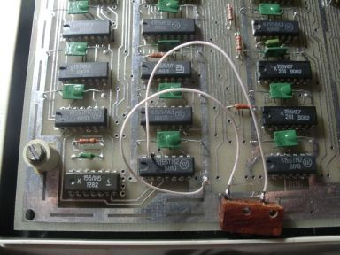

«ROM-DUMPER»

см. также [ROM-REAPER (копировщик загрузчика)](../romreaper)

Далее по тексту используются термины:

ПК - персональный компьютер (IBM-совместимый)

ПЭВМ - «Вектор-06Ц» или «Криста-2»

Программа ROM-DUMPER предназначена для копирования содержимого ПЗУ начального загрузчика без извлечения микросхемы ПЗУ.

Программа может быть использована на ПЭВМ «Вектор-06Ц», «Криста-2».

При копировании используется особеность схем Вектор-06Ц и Криста-2, благодаря которой можно «вернуть» ПЗУ в адресное пространство процессора даже после нажатия клавиш `БЛК`+`СБР`. Для этого к свободному выводу триггера, отвечающего за переключение ПЗУ припаивается микрокнопка, соединяющая этот вывод с «землей». При однократном нажатии на кнопку происходит переключение триггера и ПЗУ становится доступным для чтения. Никаких других модификаций ПЭВМ не требуется.

В ПЭВМ с адреса 8000H загружается программа, которая после нажатия клавиши `РУС` начинает выгрузку области памяти 000H..7FFH в формате ROM через магнитофонный выход.

В методике используется процедура записи файла в формате ROM из [Байт](../byte) №8

и идея b2m с форума zx.pk.ru см. [http://zx.pk.ru/showpost.php?p=195110&postcount=12](http://zx.pk.ru/showpost.php?p=195110&postcount=12)

Методика копирования:

1. Вскрыть корпус ПЭВМ

2. Припаять кнопку между землей и:

   ПЭВМ «Вектор-06Ц» D17.2 вывод 13

   ПЭВМ «Криста-2» D15.1 вывод 13

3. Подключить магнитофонный вход ПЭВМ к линейному выходу звуковой карты ПК

4. Подключить магнитофонный выход ПЭВМ к линейному входу звуковой карты ПК

5. Включить ПЭВМ и загрузить программу:

   ПЭВМ «Вектор-06Ц» romdump_v06c.wav

   ПЭВМ «Криста-2» romdump_kris.wav

6. Нажать кнопку переключения ПЗУ (не страшно если нажмется два и более раз)

7. На ПК включить запись с линейного входа

8. Нажать на ПЭВМ клавишу `РУС`

9. Начнется выгрузка содержимого ПЗУ в формате ROM

10. По окончании записи сохранить полученный файл в формате WAV и выслать по указанному ниже адресу

timsoft@mail.ru

[http://vector06c.narod.ru](http://vector06c.narod.ru)

Тимошенко Александр (Tim0xA)

20 октября 2009 года

