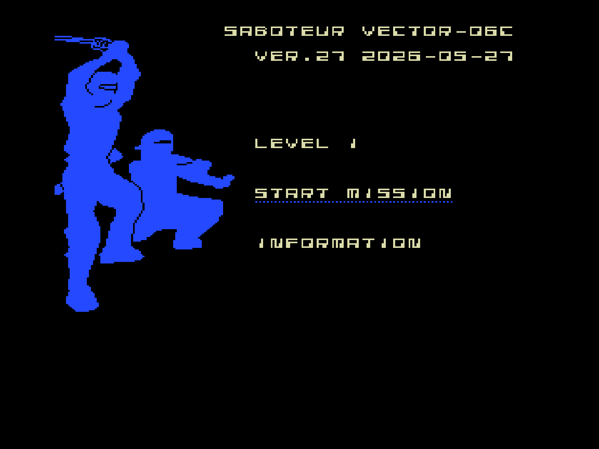
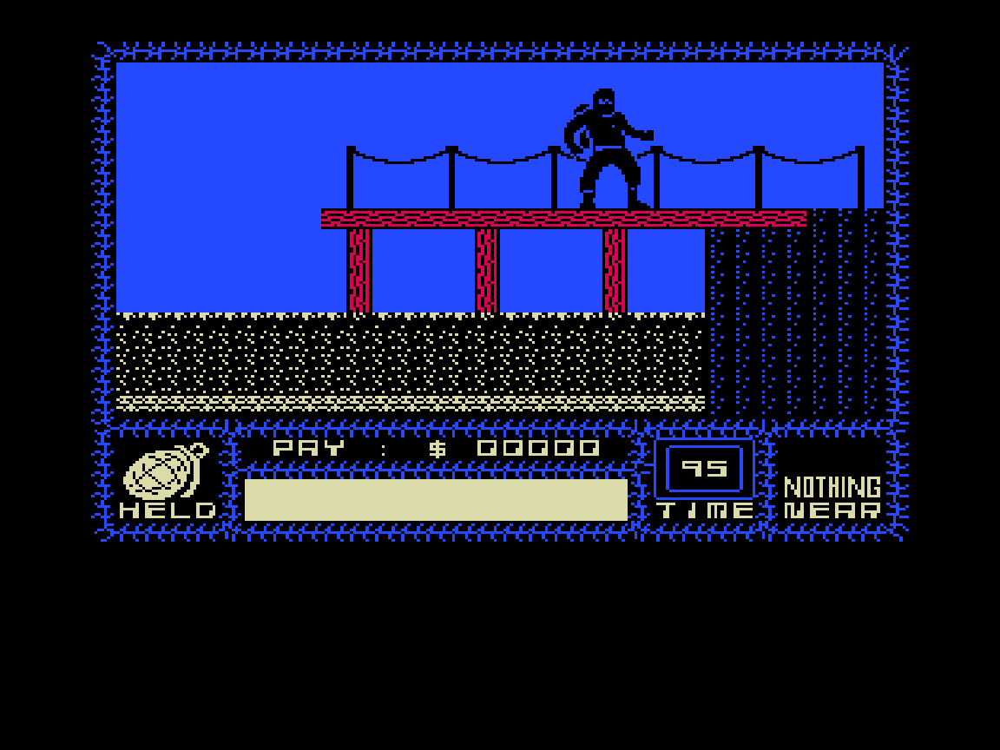
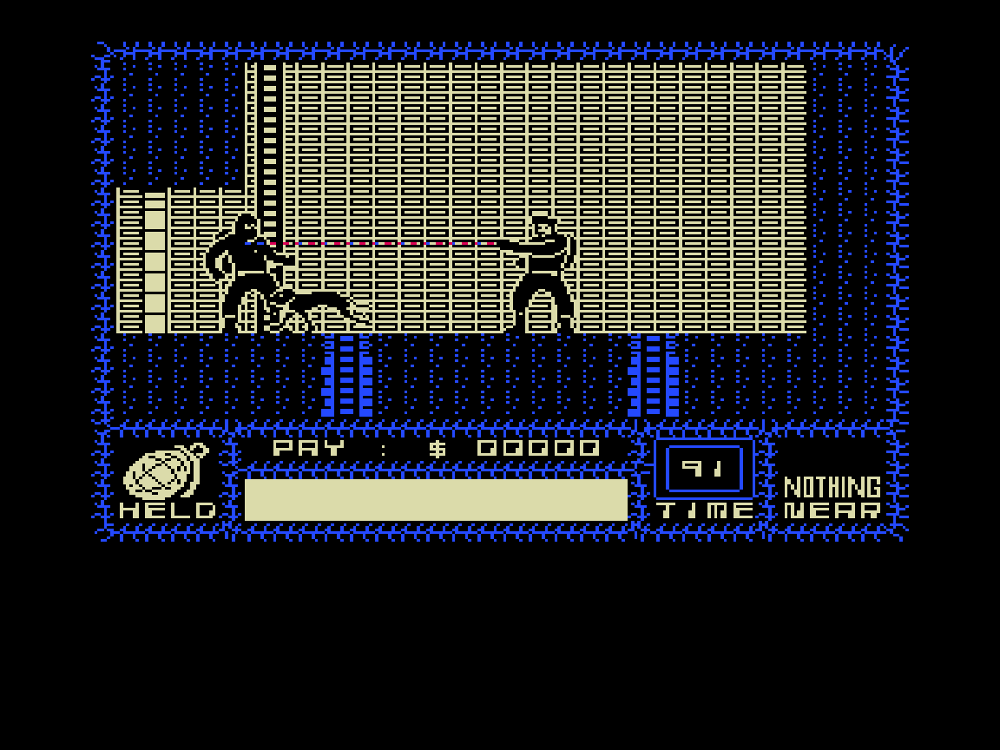

# Saboteur

Порт игры **Saboteur** для компьютера **Вектор-06Ц**. Автор порта — [nzeemin](https://github.com/nzeemin); проект находится в разработке.

## Файлы

- [sabot1.rom](sabot1.rom) — игрa.
- [originalv37.7z](originalv37.7z) — архив с исходными текстами, скриптами сборки и снимками экрана.
- [Репозиторий проекта](https://github.com/nzeemin/vector06c-saboteur1).

## Инструменты

Для разработки использовались кросс-ассемблер [sjasmplus](https://github.com/z00m128/sjasmplus), упаковщик ZX0 [salvador](https://github.com/emmanuel-marty/salvador/releases) и эмуляторы Вектора-06Ц.

## Снимки экрана

## См. также

- [Saboteur](../saboteur/) — другая игра для Вектора-06Ц с тем же названием.
- [Saboteur 2](../saboteur2/) — порт модификации продолжения для Вектора-06Ц.
